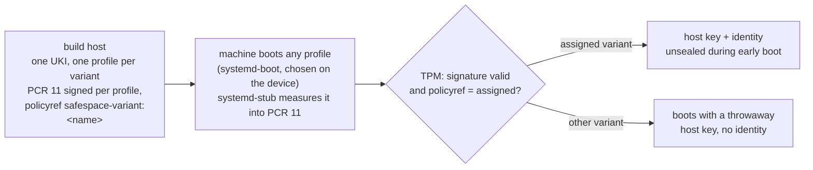

# PLAN: TPM2 binding of a machine to its assigned variant

Status: **proposal**, not started. Builds on the whole-stack build (combinations), the
signed UKI with signed expected PCR 11 values, and `lockdown=integrity` (SECURITY.md).

## Goal

A fresh machine is **sealed** (Secure Boot keys enrolled, as today) and **assigned** to a
variant (e.g. `base`). Afterwards:

- it can still boot **any** variant of the build, chosen on the device;
- only in the **assigned** variant does the TPM release the machine's secrets: its **ssh
  host key** and its **machine identity**. In any other variant the machine boots, but
  without them: other host key, no identity, visibly not "this machine";
- **updates** of the assigned variant (new signed builds) work with no step on the machine
  and no per-machine work on the build host;
- the assignment can only be changed deliberately (see [open questions](#open-questions)).

## Today

- One UKI, one command line with `safespace.root.<name>=<hash>` per combination; the initrd
  (`select`) picks the root from an EFI variable. PCR 11 is the same for every variant: the
  TPM cannot tell them apart.
- ssh host keys are generated in RAM on every boot (new key after each reboot); the
  machine-id is transient. A machine has no stable identity.
- `SignExpectedPcr=yes`: the UKI carries PCR 11 signatures made with the build host's PCR
  key (`/var/lib/safespace/pcr-signing/`), unused so far.

## Design



### 1. Build: one UKI with a profile per variant

`lib/compose.sh` builds a **multi-profile UKI** instead of today's single command line:

- shared sections: `.linux`, `.initrd`, `.ucode`, `.osrel`, `.uname` (from the base build, as
  now);
- per combination a profile: `.profile` (`ID=<name>`, `TITLE=safespace <name>`) and
  `.cmdline` = the common command line + `roothash=<that variant's root hash>` +
  `safespace.variant=<name>`;
- ukify signs the expected PCR 11 values **per profile** with the existing PCR key and the
  policy reference `safespace-variant:<name>` (`--sign-profile`, `--policyref`; to verify in
  step 1). Profile 0 is `base`.

Size: a few KB per profile. The parts layout (roots, verity, layout.sfdisk) stays as it is.

### 2. Boot: the stub measures, the initrd follows

- systemd-stub loads the profile systemd-boot chose and measures its sections into PCR 11,
  before any of our code runs.
- The initrd opens the root from the profile's own `roothash=`, exactly like a single build.
  `select`, `safespace.root.*`, `safespace.select=` and the `SafespaceSelect*` variables go
  away: the booted root is always the measured one.

### 3. Choosing on the device stays

systemd-boot lists the profiles (menu hidden by default, a key shows it).
`safespace-select` wraps it:

| `safespace-select` | does |
|---|---|
| `list` | profiles, booted one, default, the machine's assignment |
| `set NAME` | `bootctl set-default safespace-arch.efi@<n>` |
| `once NAME` | `bootctl set-oneshot safespace-arch.efi@<n>` |

Choosing another variant is always possible; it only never gets the assigned secrets.

### 4. Sealing and assignment

`safespace-seal --assign NAME` (in Setup Mode, as today):

1. enrols PK/KEK/db (unchanged);
2. sets the default boot entry to the assigned profile;
3. creates the machine's secrets **on the machine** and encrypts them to the TPM with the
   signed policy of the assigned variant:
   ```
   systemd-creds encrypt --with-key=tpm2 \
     --tpm2-public-key=/usr/share/safespace/pcr.pem --tpm2-public-key-pcrs=11 \
     --tpm2-public-key-policyref=safespace-variant:NAME   [--tpm2-pcrs=7]
   ```
   - `ssh_host_ed25519_key` (and ecdsa/rsa if kept),
   - `machine-identity`: a key pair (ed25519) and a persistent machine-id;
4. stores the encrypted credentials ([where](#where-the-encrypted-credentials-live));
5. prints the public parts for you: the `known_hosts` line and the identity's public key
   (to register on the build host or wherever machines are inventoried).

The plaintext exists only in RAM on the machine at assignment time. The encrypted
credentials are useless without that machine's TPM *and* a signed UKI of the assigned
variant.

### 5. Using the secrets at boot

- The policy is signed only for the early phases (`enter-initrd` … `sysinit`, chosen in step
  1). systemd-pcrphase extends PCR 11 at each phase, so after `sysinit` nothing can unseal
  any more: not a service compromised later, not a kexec'd kernel (unsigned kexec is
  blocked by `lockdown=integrity` anyway; a signed kernel with a foreign initrd would start
  with PCR 11 already past the signed phases).
- An early unit (before `sysinit.target`) decrypts the credentials into
  `/run/credentials/…` (RAM, per service): `sshd.service` gets its host keys via
  `LoadCredentialEncrypted=`, the machine-id is applied (`system.machine_id` credential or
  written to `/run/machine-id`, to verify in step 1), the identity key is available to the
  services that need it.
- Failure (other variant, no TPM, no assignment): `sshd-hostkeys.service` generates throwaway
  keys in RAM as today, and the machine-id stays transient. The boot itself never depends on
  the TPM.

### 6. Updates

Every build signs every profile with the same PCR key and the same policy references. A
machine assigned to `base` therefore unseals with **every future signed `base` build**:
release, boot, done. Nothing is approved on the machine, nothing is per machine on the build
host.

Re-enrolment is only needed if the PCR key changes (rotation) or, with PCR 7 in the policy,
if the Secure Boot keys in the firmware change.

### Where the encrypted credentials live

The boot medium is never written (invariant), and a network-booted machine has no medium at
all.

| Place | Stick | Network | Note |
|---|---|---|---|
| **EFI variables** (NV, e.g. `SafespaceCred<Name>-<GUID>`), recommended | yes | yes | a few KB each, survives reboots, not on the medium; read by the initrd/early unit |
| a TPM NV index / persistent object | yes | yes | needs tpm2-tools; little NV space |
| per machine on the distribution server | — | yes | public is fine (TPM-bound), but needs a lookup key and the network |
| the ESP (`\loader\credentials\`) | yes | — | breaks "the medium is never written" |

### Network boot

The firmware starts the UKI directly, without systemd-boot, so only profile 0 (`base`) is
measured. Options:

- **(a)** additionally publish single-profile UKIs `boot-<name>.efi` (each ~83 MiB on the
  server, each signed, same policy references); DHCP picks the file per machine. The choice
  for network machines is central, on the DHCP server.
- **(b)** UEFI HTTP boot of a small disk image (systemd-boot + the UKI) that the firmware
  mounts as a RAM disk: systemd-boot and the device-side choice work over the network too.
  Firmware support varies (testable in QEMU; uncertain on the T450s).
- **(c)** base only over the network.

In every case the netroot selection of today is dropped: the initrd always boots the root of
the measured profile.

## Security analysis

| Attack | Result |
|---|---|
| Root (or the firmware setup without a password) boots another variant | it boots; the TPM refuses the assigned credentials (another policyref): other host key, no identity: visible to every ssh client and inventory |
| Copying the encrypted credentials to another machine | useless: they are bound to this machine's TPM |
| An old signed build of the assigned variant | unseals (same key, same policyref); same as today: old signed images stay bootable. Mitigation: PCR key rotation, or a version floor in the policy (later) |
| A modified UKI or kernel | not signed by db → the firmware refuses it on a sealed machine |
| kexec after boot | unsigned: blocked by lockdown; signed with a foreign initrd: PCR 11 is already past the signed phases |
| A service compromised after boot | the policy no longer matches after `sysinit`; it can read only what was handed to it in `/run/credentials` (sshd: its host key) |
| Root in the assigned variant | trusted: can read the host key it runs with. Out of scope |
| Re-assignment by root of another variant (new credentials for that variant) | possible unless prevented ([open question 2](#open-questions)); it creates a *new* identity and host key, never the old one, so clients and the inventory notice |
| TPM cleared in the firmware setup | credentials gone; the machine boots without identity until assigned again |

## Steps

- [ ] 1. **Proof of concept (no repository change yet):** ukify 262 with two profiles, each
      signed with its own policyref; `systemd-creds encrypt/decrypt` with
      `--tpm2-public-key-policyref` in QEMU with swtpm: decrypts in the assigned profile,
      refuses in the other; `bootctl` names of the profiles; which phases to sign;
      `system.machine_id` as a credential.
- [ ] 2. **Build:** `lib/compose.sh` builds the multi-profile UKI and signs per profile;
      `mkosi.postoutput` / `lib/verify.sh` check every profile (signature, roothash, policyref);
      release and stick unchanged otherwise.
- [ ] 3. **Boot:** drop `select`, `safespace.root.*`, the selection variables; `usb-bootdev`
      and `netroot` open the profile's `roothash=`; `safespace-select` wraps `bootctl`.
- [ ] 4. **Assignment:** `safespace-seal --assign NAME`: secrets created on the machine,
      encrypted to the variant's signed policy, stored, public parts printed;
      `safespace-select list` shows the assignment.
- [ ] 5. **Use:** early unit decrypting the credentials; sshd host keys from credentials,
      fallback to throwaway keys; machine-id and identity key.
- [ ] 6. **Network boot:** the chosen option (a/b/c).
- [ ] 7. **Tests:** `tests/run.sh`: profiles in the composed UKI, per-profile signatures and
      policy references, verify refusing a profile with a wrong roothash. `tests/vm.sh` with
      swtpm (new prerequisite): seal + `--assign base`; boot base → known host key, identity
      present; boot docker → throwaway host key, no identity; a **new build** → base still
      gets its host key with no step on the machine.
- [ ] 8. **Docs:** README (sealing and assignment, choosing a variant, network boot),
      NETBOOT.md, SECURITY.md (the binding, the attack table), AGENTS.md (invariant: "the
      booted root is always the measured profile").

## What changes for existing machines

- **Selection:** machines selected with `safespace-select set …` (the current EFI
  variables) fall back to the default profile after the switch; their selection has to be
  made again with the new `safespace-select`.
- **Machines sealed before this:** they boot as before. They get an assignment (and stable
  host keys) only after `safespace-seal --assign`, which today requires Setup Mode; a variant
  of the command for already sealed machines is part of open question 2.

## Open questions

1. **Network boot:** (a) per-variant boot files via DHCP, (b) RAM-disk HTTP boot, or (c) base
   only? Recommendation: (a) for now; (b) once a target machine is known to support it.
2. **What protects the assignment from being changed?** Recommendation: allow
   `--assign` only in Setup Mode (that is, during sealing, behind the firmware password),
   plus the inventory of identity public keys as the anchor. Stronger: store the credentials
   in an authenticated EFI variable signed by a key you hold, or behind a TPM owner
   password.
3. **TPM PIN at boot** (`--tpm2-with-pin`) or unattended? Recommendation: unattended. The
   variant check is the goal, and a PIN would stop unattended updates.
4. **PCR 7 in the policy** (binds also to the enrolled Secure Boot keys)? Recommendation:
   yes; the cost is re-assigning after a Secure Boot key change.
5. **Which host key types** to keep (ed25519 only, or also ecdsa/rsa for old clients)?
