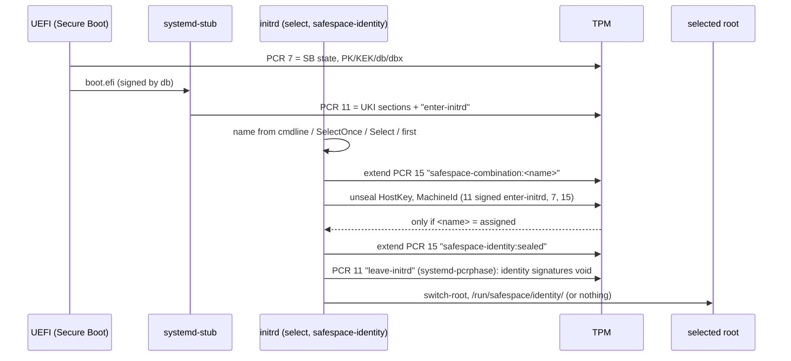
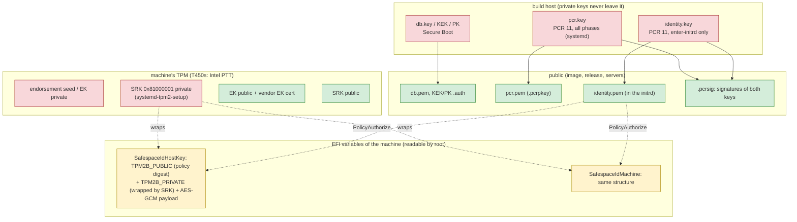
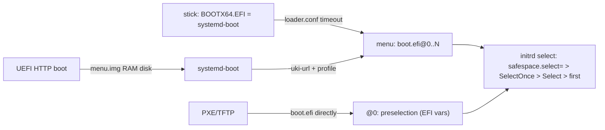
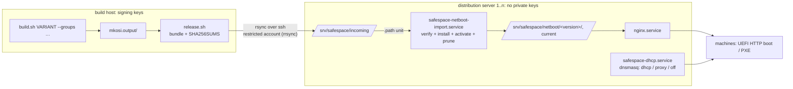
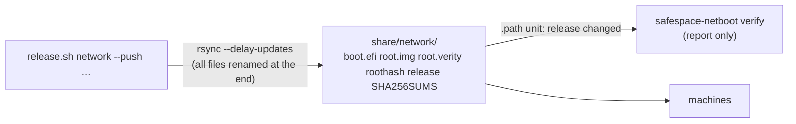
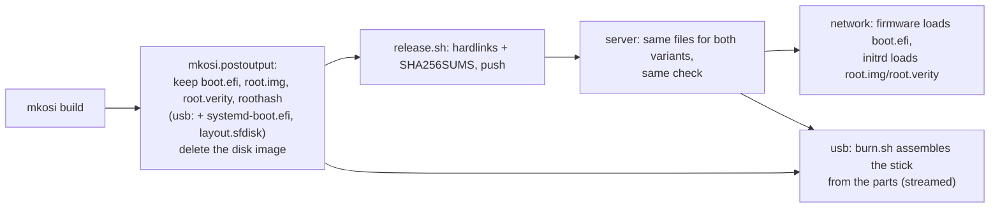

# PLAN

Finished plans are in the git history (`git log -p PLAN.md`): package source
(repos.conf), netboot docs consistency, netstick, network UKI below 80 MiB,
T450s findings with usb/network aligned.

## Still open from earlier plans

- **build.sh has no lock:** a second build started while one runs deletes the first one's
  `.parts-*` directory at its start (seen 2026-10-21: the first build failed). Proposal: `flock`
  on the output root.

- usb variant: boot the current build in QEMU (explicit `KernelInitrdModules=` list).
- `fluidsynth.service` (user unit from vlc-plugin-fluidsynth) fails without a
  SoundFont: mask it in the image? (proposal, not decided)
- netstick: QEMU boot of a netstick image not tested.

---

# PLAN: one command, `safespace`

Status: **confirmed 2026-10-26** (the user's choices: the verb `select`, the old commands
replaced without aliases, implement now). Today a machine has `safespace-seal` (Secure Boot
and the identity) and `safespace-select` (the combination), and `assh` for the rest (a PIN
change, a lockout): confusing.

```
safespace                        overview: build, booted, preselected, Secure Boot, TPM, identity
safespace select                 the combinations, booted, preselected
safespace select NAME            NAME from the next boot on; with an identity it moves along (PIN)
safespace select NAME --once     the next boot only; the identity stays
safespace select --default       the first combination (moves like select NAME)
safespace seal [--replace]       enroll the Secure Boot keys (Setup Mode)
safespace identity               the CA, approvals, @cert-authority line, this boot's host key
safespace identity create|approve|move [NAME]|clear|pin
safespace tpm                    banks, SHA-1 flag, dictionary attack state
safespace tpm sha1 on|off
safespace tpm unlock             end a PIN lockout (lockout authorization)
```

- `--pin-fd N`, `--new-pin-fd N`, `--lockout-auth-fd N`, `--yes` wherever they apply; never a
  secret in argv or the environment. The views work without root where they can.
- One script, `/usr/local/sbin/safespace`, from today's two; what happens stays as it is,
  `identity pin` (`assh ca pin`) and `tpm unlock` (`assh tpm da --reset`) are new.
  `safespace-seal` and `safespace-select` are gone; the initrd's messages, the docs and the
  tests name the new command.

---

# PLAN: moving and clearing the identity

Status: **confirmed 2026-10-26** (the user chose these three; DHCP by MAC not now). Found on
the T450s: a move gives the new combination a new machine-id, and takes two boots; there is
no command to clear an identity (it was done by hand, with a helper for the TPM's NV indices).

## Design

- **`sudo safespace-seal --move NAME`, from the current boot, without booting NAME first.**
  All combinations share one signed UKI, so in NAME's boots PCR 0, 2, 7 and 11 hold what this
  boot's agent recorded, and PCR 15 is known: `safespace-combination:NAME`, then
  `safespace-identity:sealed`, from zero, in the CA's bank. aSSH approves exactly that
  (`ca approve --values STATE --events 15:safespace-combination:NAME --events
  15:safespace-identity:sealed --next-generation`, PIN): every older approval is revoked, the
  next boot of NAME is certified at once. Then the assignment and the selection of NAME. From
  a boot of the same build (PCR 11; slot 1 covers an update). `--move` without NAME keeps
  today's flow (in a boot of NAME: approve this state) - for a changed PCR 7, or a boot that
  is not certified.
- **The machine-id survives a move.** `--move` writes `SafespaceAssign=NAME:<machine-id>` when
  the machine-id is released in the boot it runs in; the initrd of NAME's next boot seals that
  machine-id instead of a new one (32 hex digits, not all zero; anything else: a new one, as
  now). Moved from a boot where it is not released (today's flow, in NAME): a new one, said so.
  Trade-off: root of a booted combination can already write `SafespaceAssign` and so take the
  machine-id from the assigned combination; now it can also choose the value. The machine-id
  is a label, not a credential (SECURITY.md); the host key's certificate needs the PIN.
- **`sudo safespace-seal --identity-clear [--yes]`** (YES asked): aSSH's new `ca remove`
  removes the CA's file (`SAFEasshCA`) and its PIN index and counter - those the file names,
  checked against the TPM, or, with no file, those at assh.conf's handles when they have the
  shape of aSSH's; then `SafespaceIdMachine` and `SafespaceAssign`. The lockout authorization
  and the SHA-1 flag stay. No PIN: root can delete all of it anyway.
- **The move goes with the selection** (decided later the same day): `safespace-select set NAME`
  and `clear` run `safespace-seal --move NAME` (PIN) when the machine has an identity and NAME
  is not the booted combination; only a successful move selects NAME (`safespace-seal` writes
  the selection itself). A failed one selects nothing: retry, or `--identity-clear` first.
  `once` moves nothing. `--move` without NAME in a certified boot moves to the preselection.
- **aSSH:** `ca approve --events PCR:EVENT` (repeatable, in order: that PCR from zero, each
  event hashed in the CA's bank, as TPM2_PCR_Event extends it); `ca remove`.
- **Tests:** aSSH (`--events` against a TPM's own extension; `ca remove` with and without the
  file, a foreign index at the handle untouched); tests/run.sh (the initrd takes a carried
  machine-id, refuses a malformed one); tests/vm.sh: the move branch moves from the certified
  default with `--move containers`, the next boot of containers is certified with the same
  machine-id; a clear branch: `--identity-clear`, `--identity` says none, `--identity-create`,
  the next boot certified by the new CA.

---

# PLAN: the identity on a TPM with the SHA-1 bank only (T450s)

Status: **confirmed 2026-10-26** (decisions below). Found on the T450s: `assh: the TPM has
no sha256 bank for PCR 0` - its firmware activates only the SHA-1 bank, so the agent failed
and the machine-id could not be sealed (the UKI's PCR 11 signature was SHA-256 only).

## Design

- **The flag:** the NV index `0x01802914` (aSSH's `hostkey.SHA1Handle`), defined by the
  owner, one byte, not signed. `sudo safespace-seal --sha1 on|off` sets it (`assh tpm sha1
  --allow|--forbid`), `--identity` shows it. It counts only on a TPM without an active
  SHA-256 bank; there, SHA-1 is used only while it is there - for the machine-id and the
  host key alike, at every boot (`off` stops both at the next boot).
- **Why unsigned:** where SHA-256 is active the flag changes nothing, and which banks are
  active only the firmware decides (TPM2_PCR_Allocate needs the platform hierarchy). On a
  SHA-1-only TPM the choice is SHA-1 or no identity. A downgrade through the BIOS loses the
  old identity (sealed to SHA-256), it does not reveal it; a new CA is another key, which the
  clients' `@cert-authority` line does not name. A signature per EK would add central
  control, not protection.
- **Build:** ukify signs PCR 11 for `sha1,sha256` (both PCR keys, `lib/compose.sh`). On a
  SHA-256 TPM nothing changes: systemd-creds seals to SHA-256 there, and a SHA-1 signature
  satisfies no SHA-256 policy.
- **initrd `identity`:** the active banks from sysfs (`/sys/class/tpm/tpm0/pcr-<alg>/`, which
  the kernel makes for allocated banks only); without SHA-256, it seals and unseals only when
  `tpm2 nvreadpublic 0x01802914` shows the flag (tpm2-tools in the initrd), else no identity
  this boot, and the console says `safespace-seal --sha1 on`.
- **aSSH:** `ASSH_CA_BANK=auto` (assh.conf): SHA-256 where active, else SHA-1 where the flag
  allows it; without it the agent serves a temporary key and records nothing, `ca create`
  refuses; a SHA-1 CA certifies nothing once the flag is gone.
- **Tests:** aSSH (swtpm with SHA-1 only: `TestSHA1`, `TestResolveBank`); tests/run.sh (the
  identity script with a SHA-1-only sysfs, with and without the flag; `--sha1`);
  `test-vm.sh --tpm-banks sha1`; tests/vm.sh: a SHA-1-only TPM, no identity without the flag,
  `--sha1 on`, the machine-id follows, `--identity-create`, the next boot certified.

## Decisions (2026-10-26)

1. For every combination, machine-id included (not the host key alone).
2. The flag is not signed (the reasons above); set with `safespace-seal --sha1 on|off`.
3. tpm2-tools in the initrd to read the flag (not a raw TPM command).

---

# PLAN: the machine identity through aSSH (submodule `assh/`)

Status: **confirmed 2026-10-26, done in QEMU** (decisions below); open: the hand test on the T450s, an update in QEMU (two builds). Goal: the host key of every
safespace machine is aSSH's - made in the TPM at every boot, certified by a CA in the TPM
that signs only in an approved state of the machine's combination - tested end to end in
QEMU (`tests/vm.sh`), and ready to be booted and tested by hand on the T450s. It takes over
the PIN plan below (its decisions 1-4 still apply). Go, as aSSH is Go.

## What aSSH gives (assh `feat/slots`, 1d6c007; tpm2-kira uses the same, tested on VMs)

- **The CA in the TPM**, its file in the EFI variable `SAFEasshCA` (`efi:SAFEasshCA`,
  ~1.3 KB; nothing secret, the TPM checks every approval in it).
- **The authority in the TPM, opened by a PIN**, with a counter: `--next-generation`
  revokes every older approval (a move takes the identity from the old combination).
  DA lockout: 3 tries, then one per 30 minutes.
- **Slots and a window**: slot 0 = PCR 0, 2, 7, 11, 15 (higher confidence), slot 1 =
  PCR 7, 15 (an update or a firmware change still certifies); PCR 15 = the combination
  (select) and the window the agent closes.
- **`assh.conf`**: every setting in one file; `assh agent` needs nothing else.
- **`assh agent`**: a new host key in the TPM every boot, certified through the first
  slot met, else aSSH's temporary key (TPM, no certificate); the PCR state at its start
  recorded (`--state`) for `ca approve --values`; sshd uses it through `HostKeyAgent`.

## Design

```mermaid
flowchart LR
  subgraph initrd
    S["select: PCR 15 += combination"] --> M["identity: unseal SafespaceIdMachine (machine-id)"]
  end
  subgraph root
    A["assh agent (Before=sysinit.target, before systemd's PCR 15 units)"] -->|"slot 0: 0,2,7,11,15 / slot 1: 7,15 approved?"| CA[(CA in TPM, file in SAFEasshCA)]
    CA -->|certifies| HK[(host key of this boot)]
    A -->|no slot met, or no CA yet| TK[(temporary key) + state recorded]
    A -->|"PCR 15 += assh: closed"| X[window closed]
    D["sshd: HostKey/HostCertificate/HostKeyAgent"] --> A
  end
  P["safespace-seal (PIN)"] -.->|"approve the recorded state, slots 0,1"| CA
```

- **Image** (every root): `/usr/bin/assh` (static, built on the build host from the
  submodule), `/etc/assh/assh.conf`:
  `ASSH_CA=efi:SAFEasshCA`, `ASSH_AUTHORITY_TPM=yes`, `ASSH_CA_SLOT_0=0,2,7,11,15`,
  `ASSH_CA_SLOT_1=7,15`, `ASSH_CA_WINDOW=15`, `ASSH_CA_REF="safespace identity"`,
  `ASSH_KEY_ID=safespace`, `ASSH_STATE=/run/assh/agent.pcrs.json`;
  `assh-agent.service` (`assh agent --config /etc/assh/assh.conf`), ordered before
  `systemd-pcrmachine`/`systemd-pcrfs*` (PCR 15 must hold the combination alone when it
  starts); sshd drop-in `HostKey /run/assh/host.pub`, `HostCertificate
  /run/assh/host-cert.pub`, `HostKeyAgent /run/assh/agent.sock` (one configuration, with or
  without a certificate). `sshd-hostkeys.service` and `ssh-keygen` at boot go.
- **aSSH change (assh, with tests):** `agent` without a CA (no `SAFEasshCA` yet) serves the
  temporary key and records the PCRs of `assh.conf`'s slots - so the first creation can
  approve this boot's agent state without a reboot (question 4).
- **`safespace-seal`**:
  - `--identity-create`: the TPM's lockout authorization if it has none (`assh tpm da
    --new-lockout-auth --max-tries 3 --recovery 1800 --lockout-recovery 1800`, asked twice,
    kept by you), the PIN (asked twice), `assh ca create` (from assh.conf), `assh ca approve
    --values /run/assh/agent.pcrs.json` (slots 0 and 1, one PIN); prints the
    `@cert-authority` line. The next boot certifies.
  - `--identity`: the CA's fingerprint, the `@cert-authority` line, which slot this boot
    used, the approvals and the counter.
  - `--approve`: after an update (slot 1 certified, slot 0 not): approve the recorded
    state in slot 0 (PIN).
  - `--move`: in the combination moved to (after `safespace-select set Y` and a reboot,
    temporary key): approve the recorded state in slots 0 and 1 with `--next-generation`
    (PIN): the old combination's approvals are revoked.
- **initrd `identity`**: the machine-id alone (`SafespaceIdMachine`, systemd-creds, signed
  PCR 11 for enter-initrd + PCR 7 + PCR 15, as today: per combination, kept by updates);
  created on the first sealed boot as today, and for the combination moved to by
  `safespace-seal --move` (`SafespaceAssign`, written only after the PIN approved the move).
  No host key slot, no `ssh-keygen`/`openssh` in the initrd; `SafespaceIdHostKey` goes.
- **Build**: `lib/assh.sh` builds `assh/cmd/assh` (`CGO_ENABLED=0 -trimpath
  GOFLAGS=-mod=readonly GOTOOLCHAIN=local`, module cache `mkosi.cache/go`) into a gitignored
  extra tree every root gets; `build.sh` and README name Go as a prerequisite (question 1).

## Steps

- [x] 1. assh: `agent` without a CA records `assh.conf`'s slots (test with swtpm); bump the
      submodule here to it.
- [x] 2. Build: `lib/assh.sh`, the extra tree, `build.sh`; `tests/run.sh` builds and checks it.
- [x] 3. Image: assh.conf, the agent unit and its ordering, the sshd drop-in; `sshd-hostkeys`
      and the host-key slot go; initrd `identity` for the machine-id alone.
- [x] 4. `safespace-seal --identity-create | --identity | --approve | --move`;
      `safespace-select set` names `--move` when an identity exists.
- [x] 5. Tests: `tests/run.sh` (the glue, `go test ./...` in `assh/`, a SKIP names
      go/swtpm); `tests/vm.sh` step `identity` rewritten (swtpm, PIN through a file
      descriptor): first boot temporary key and state recorded; create; reboot: login
      through `@cert-authority`, slot 0; agent restart: no certificate (window closed);
      firmware changed (PCR 0, other OVMF vars): slot 1; another combination: temporary key,
      refused by a strict client; `--move` there: certified, the old combination revoked
      (temporary key there); `--approve` after slot 1; wrong PINs: lockout.
- [x] 6. QEMU: the full `tests/vm.sh` run passes (run-20261026-115825, 36/36; found and fixed on the way: sshd keeps the old host key after an agent restart - `PartOf`; a restart overwrote the recorded state - assh keeps the first; the network boot differs in PCR 0 in QEMU - slot 1 plus `--approve`); then a hand test of the stick image with
      `test-vm.sh --tpm` as on the T450s (creation, login, a reboot).
- [x] 7. Docs: README (clients: `@cert-authority`; creation, move, update; the T450s
      procedure), SECURITY.md ("Machine identity" rewritten: what is in the TPM, the
      variable, the attacker table), AGENTS.md (map: `assh/`, the Go build).

## What changes / breaks

- 201c70c's identity is replaced: machines run `safespace-seal --identity-create` once (a
  new CA, PIN, lockout authorization). Clients trust `@cert-authority` instead of a host key.
- The host key is ECDSA P-256 and new every boot (no ed25519). Without an approved state
  sshd serves aSSH's temporary key, which strict clients refuse.
- PCR 15: the agent closes it; systemd's PCR 15 units run after it.
- Build host: Go >= 1.26; every root grows by ~13 MB (assh's binary).

## Decisions (2026-10-26)

- **One command creates the identity** (question 4 a): `safespace-seal --identity-create`
  creates the CA and approves the state this boot's agent recorded (assh: the agent records
  `assh.conf`'s slots without a CA). sshd serves the temporary key meanwhile; the
  certificate comes with the next boot - a certificate in the same boot would need the
  window (PCR 15) open after the agent, which would let any process of that boot get one.
- **Updates keep the identity, another combination needs the PIN** (question 5): the host
  key through the CA's slots; the machine-id per combination as today, moved only by
  `--move` after the PIN approved it. Root can still write `SafespaceAssign` by hand: that
  gives the other combination a new machine-id (and takes the old one's), never the host
  key - the machine-id is a label, not a credential (SECURITY.md says so).
- **Lockout authorization per device**, typed at `--identity-create`, kept by the owner.
- **Go on the build host.**

## Open questions

1. ~~The authority~~ (PIN in the TPM), 2. ~~revocation~~ (counter), 3. ~~old builds~~,
   7. ~~slots~~, 8. ~~one PIN for several slots~~ (`--slot 0,1`), 9. ~~after an update~~
   (`--approve`; the build host's predicted PCR 11 later): decided.
4. **The first creation**: (a) the agent records `assh.conf`'s slots without a CA (assh
   change) and `--identity-create` approves this boot's state - no reboot (proposed); (b)
   create, reboot (temporary key, state recorded), then `--approve`.
5. **Machine-id**: the same in every combination (sealed without PCR 15, created on the
   first sealed boot; proposed), or per combination as today (then a move needs it too)?
6. **Lockout authorization**: per device, typed at `--identity-create`, kept by you
   (proposed); or one for the fleet?
1b. **The Go build**: on the build host (proposed; Go is there) or in mkosi's sandbox?
10. **The build host's sudo rule** names `/home/pix/safespace/safearch/build.sh`; the repo is
    now `/home/pix/safespace/tpm2-trust/safearch`: `tests/vm.sh` needs the rule for this path.

---

# PLAN: the host key inside the TPM, moved to another combination only with a PIN

Status: **superseded** (2026-10-24) by the aSSH plan above; its decisions 1–4 carry over. It needed an agent
of our own. Decisions below stay valid. Replaces the identity of 201c70c (device-
local, sealed in the initrd). A centrally managed identity was considered and **dropped**
(2026-10-21): no private part leaves the device, no enrolment or issuing scripts.

## Goal

- The ssh host key is **generated inside the device's TPM and never leaves it** (not even
  into the device's RAM): sshd signs through the TPM. ECDSA P-256 (decision 1: TPMs have no
  ed25519).
- The identity (host key, machine-id) is usable **only while the combination it is bound to
  is booted** — also after updates, as today; any other combination boots without it.
- **Moving it to another combination** is possible, but needs a **PIN** (re-authorizing the
  binding); without the PIN no one, root included, can move it.
- The machine-id: a small sealed TPM object in an EFI variable, unsealed in the initrd.

## Design

### 1. TPM objects of a device

| Object | Where | Created | Auth |
|---|---|---|---|
| **Authority key A** (ECC P-256, sign) | wrapped blob in EFI variable `SafespaceIdAuthority` | at creation, inside the TPM | **the PIN** (authValue; TPM dictionary-attack lockout limits guesses) |
| **Move counter** (NV counter, 8 bytes) | TPM NV index `0x01c1a001` (the only NV use) | at creation | the PIN |
| **Host key** (ECC P-256, sign only) | persistent handle `0x81010001` | inside the TPM, `fixedTPM`+`fixedParent` (never duplicable) | policy P (3) |
| **Machine-id** (sealed data) | wrapped blob in EFI variable `SafespaceIdMachine` | inside the TPM (from the TPM RNG) | policy P |
| **Binding approval** | EFI variable `SafespaceIdApproval` (public): A's signature over the approved policy for combination X and counter value n | at creation and each move | — |

### 2. Policies

The two objects carry one fixed `authPolicy`, which names no combination; the combination is
in an *approved* policy that A signs (TPM2_PolicyAuthorize), so it can change without new
objects:

```
host key:   PolicyAuthorize(A, ref "safespace-binding") ; PolicyCommandCode(TPM2_Sign)
machine-id: PolicyAuthorize(A, ref "safespace-binding") ; PolicyCommandCode(TPM2_Unseal)

approved (signed by A, with the PIN) for combination X at move counter n:
  PolicyPCR(7 = Secure Boot state, 15 = SHA256(0³² ‖ SHA256("safespace-combination:X")))
  ; PolicyAuthorize(identity key, PCR 11, every phase)   ← only builds that measure PCR 15
  ; PolicyNV(move counter == n)                          ← revokes every earlier approval
```

- **Booted X:** PCR 15 holds X → the approval for X is satisfied → sign / unseal work.
- **Booted Y (no PIN):** PCR 15 holds Y → no approval matches → no host key, no machine-id
  (throwaway ed25519 key, transient machine-id, as today). Booting X again restores it.
- **Move to Y** (`safespace-seal --move` in a boot of Y, PIN asked): increment the counter
  (PIN) → every old approval, X's included, is void; A signs the approval for Y at n+1 (PIN).
  Same host key, same machine-id, now bound to Y. Without the PIN: refused by the TPM; after
  a few wrong PINs the TPM locks out (dictionary-attack protection).
- **PolicyCommandCode** keeps each object to its one operation (no other use).
- **PCR 11 signed by the identity key** (as today, but for every phase): old db-signed builds,
  whose initrd doesn't measure PCR 15, can't satisfy it.
- **PCR 15 stays at the selection while the root runs** (sshd signs all the time):
  `systemd-pcrmachine`, `systemd-pcrfs-root`, `systemd-pcrfs@` are masked (they measure a
  volatile machine-id and file systems, of no use here); no "close" extend any more. In
  return the initrd **stops the boot** when a TPM is present, the stub measured the UKI, and
  the selection could not be measured (else a root could extend the bound name into an empty
  PCR 15 itself).

### 3. Lifecycle

| Action | Where | PIN |
|---|---|---|
| **Create** (`safespace-seal --identity-create`): A with the PIN, counter = 0, host key, machine-id, approval for the booted combination | root of the combination to bind to, sealed machine (Secure Boot on) | set (twice) |
| **Boot** the bound combination | initrd unseals the machine-id → `/run/machine-id`; the agent serves the host key to sshd | no |
| **Boot** another combination | nothing usable; throwaway key | no |
| **Move**: counter +1, approval for the new combination (its PCR 15 value is computed, so no boot of it is needed first). Asked by `safespace-select set Y` itself when an identity exists and is bound elsewhere (decline: Y boots without it); also `safespace-seal --move Y`. `safespace-select once Y` never moves | root of any combination | yes |
| **Change PIN** (`--pin`): new authValue for A and the counter | any | old PIN |
| **Show** (`--identity`): bound combination, released or not, fingerprint, `known_hosts` line, inventory ID | any | no |
| **Forget** (TPM clear in the firmware, or `--identity-destroy` with the PIN) | — | — |

Creation is explicit (not on the first sealed boot as in 201c70c): only a person can set a PIN.

### 4. sshd and the agent

sshd uses the host key through `HostKeyAgent` + `HostKey <public key file>`: no private key file.
Each signature needs a policy session (PolicyPCR, two PolicyAuthorize with their tickets,
PolicyNV, PolicyCommandCode). `ssh-tpm-agent` (Arch `extra`, 0.9.0) serves TPM host keys but,
as far as known, only with a password/PIN, not with such a policy: **PoC 1b checks it**. If it
can't, a small agent of our own is needed (open question 5 then does apply: language).

### 5. initrd

`select` measures as today, and stops the boot if it can't (2). `identity` (rewritten, tpm2-tools)
only unseals the machine-id; no creation, no sealing, no `ssh-keygen` (openssh leaves the
initrd, tpm2-tools comes in; the `.pcrsig` signature needs a JSON reader: `jq` or a few lines
of sed).

### 6. What is public, what is private

| Item | Class |
|---|---|
| host private key | **inside the TPM only**, never extractable |
| A's private part, machine-id | TPM-wrapped (EFI variables): usable only in this TPM, A only with the PIN |
| the PIN | **only in the person's head**; never stored |
| approval, counter value, public keys, `known_hosts` line, inventory ID | public |
| build host | db/KEK/PK, `pcr.key`, `identity.key` (as today); **nothing per device** |

### 7. What an attacker can do

| Attacker | Result |
|---|---|
| root in another combination | can't sign, can't unseal; can't move without the PIN (TPM lockout after a few tries) |
| root in the bound combination | can *use* the host key (sign) while it runs, can't take it out of the TPM; can't move it without the PIN |
| copy the EFI variables to another machine | useless: bound to this TPM |
| old signed build | no identity-key signature for PCR 11 → nothing |
| deletes the variables / clears the TPM | identity gone (denial of service, visible); a new one needs `--identity-create` |
| knows the PIN | can move the identity to another combination (that is what the PIN is for) |

## PoC results (2026-10-21, swtpm 0.10.2, tpm2-tools 5.8, systemd 262; host only)

Scripts in the session's scratchpad (`pin/poc1a.sh`, `pin/poc1a-pcr11.sh`), simulated boots as
in the earlier PoC (PCR 7 stand-in, PCR 11 replayed as stub + pcrphase measure it).

**1a, design as written (selection in PCR 15):** works as designed — bound combination signs,
also at runtime (after leave-initrd/sysinit/ready) and after an update; refused: debug, debug
+ the bound name extended on top, changed Secure Boot (PCR 7), foreign kernel with signatures
by another key, an approval signed by a forged authority key; TPM2_Duplicate of the host key
refused; move with the PIN (counter 1 → 2, new approval) works, the old approval is revoked;
wrong PIN refused, after 3 failures the TPM is in lockout (even the right PIN refused); the
machine-id unseals only in the bound combination. **But:** the late-extend attack (initrd
measured nothing, the root extends the bound name into PCR 15) **unseals** — PCR 15 can only
be defended by the initrd stopping the boot.

**1a′, the combination as a phase word in PCR 11 (proposed instead):** the initrd extends PCR
11 with `safespace-combination-<name>` right after `enter-initrd`; the build host signs, per
combination, the phase paths `enter-initrd:safespace-combination-<name>[:leave-initrd[:sysinit
[:ready]]]` with the identity key and **policyRef `safespace-combination-<name>`**; the approval
for X is `PolicyAuthorize(I, ref X) ; PolicyPCR(7) ; PolicyNV(counter)`. Result: bound
combination works (also at runtime, after an update); refused: debug, debug's root extending
the bound word, **the late-extend attack** (an unmeasured initrd plus the word extended by the
root gives a PCR 11 value nobody signed), changed PCR 7, foreign kernel. So PCR 15, the masks
of systemd's PCR 15 units and stopping the boot are no longer needed.

**Pitfalls found:**
- **DA lockout blocks every DA-protected object**, the SRK included: after 3 wrong PINs the
  identity was unusable (no load under the SRK). The SRK, host key and machine-id must be
  `noDA` (they have no password); only A and the counter are DA-protected. Retested: signing
  and unsealing work while the PIN is locked out.
- The counter must not be `no_da`, or wrong PINs on it wouldn't count (PIN guessing).
- The counter must be readable without the PIN (`ownerread`, PolicyNV via the owner
  hierarchy), or every signature would need the PIN; only writing needs it.
- `TPM2_PolicyAuthorize` resets the session digest: the PCR 11 authorization comes first in
  the approved policy.
- systemd-measure's `--policyref=STRING` is `SHA256(STRING)` as the TPM policyRef (`ref` in the
  JSON is the plain string); the signature covers `pol ‖ SHA256(ref)`.
- An external public key (`tpm2_loadexternal`) has other attributes, hence another name, than
  the loaded key: tickets and policies must use the same one (the real implementation loads A
  itself; loading needs no PIN).
- Swtpm on a socket has no resource manager (objects must be flushed); `/dev/tpmrm0` does that
  on a machine.

**1b, the agent:** `ssh-tpm-agent` 0.9.0 (inspected, not run) serves TPM host keys with a PIN or
a policy stored in the key file; our policy needs, per signature, the current build's PCR 11
signature and the device's current approval — not supported. **An agent of our own is needed**
(ssh-agent protocol: list identities, sign; the policy session of 2): open question 5.

- [x] 1a. swtpm: PIN, counter, approvals, lockout, duplicate (above).
- [x] 1b. `ssh-tpm-agent`: not usable as is (above).
- [ ] 1c. QEMU: create → X/Y/X → move → update; does the extra PCR 11 word break systemd's own
      PCR 11 users (mkosi's `pcr.key` signatures, NvPCR units)? initrd size with tpm2-tools.

## Steps (after the PoC and the answers)

- [ ] 2. `compose_uki`/`compose_check`: identity key signs every phase (today: enter-initrd).
- [ ] 3. initrd: `select` stops the boot if it can't measure; `identity` unseals the machine-id
      (tpm2-tools); `openssh` out, `tpm2-tools` in; masks for pcrmachine/pcrfs.
- [ ] 4. root: the agent, sshd `HostKeyAgent`/`HostKey`, throwaway ed25519 fallback.
- [ ] 5. `safespace-seal --identity-create | --move | --pin | --identity | --identity-destroy`;
      `--assign` goes.
- [ ] 6. tests/run.sh, tests/vm.sh step `identity` (create, X/Y/X, move with PIN, wrong PIN,
      update); SECURITY.md (everything of 2, 6, 7 and the tested variants), README, AGENTS.md.

## What changes / breaks

- **Replaces 201c70c's identity**: no creation on the first sealed boot any more, the slots
  `SafespaceIdHostKey`/`SafespaceIdMachine`(systemd-creds) and `SafespaceAssign` go; machines
  that have them need `--identity-create` (new host key).
- Host key **ECDSA P-256** when the identity is in use; throwaway keys stay ed25519.
- PCR 15 no longer closed; systemd's PCR 15 measurements masked; one TPM NV index used.
- The boot stops if a TPM is present but the selection can't be measured.
- A PIN to remember per machine (or per fleet, if you use the same one).

## Decisions (2026-10-21)

1. Another combination **withholds** the identity; back when the bound one boots again.
2. Creation is explicit and sets the PIN (the fallback that moving needs). Use is automatic:
   whenever the PCRs match (the bound combination, also after updates), sshd uses the key
   without a PIN.
3. Moving asks for the PIN, automatically when the selection is changed to another combination
   (`safespace-select set`) and an identity exists; `--move` as well.
4. Dictionary-attack lockout: **3 tries, then one try per 30 minutes** (set at creation).

## Open questions (from the PoC)

5. **The agent's language** (needed, see 1b): Go (go-tpm + x/crypto/ssh/agent, one static
   binary, the stack ssh-tpm-agent uses; Go at build time, modules vendored), Python
   (tpm2-pytss; Python in every root, ~60 MB), or C (tpm2-tss ESAPI; no new runtime, the most
   code). Proposed: Go.
6. **The combination in PCR 11** (1a′) instead of PCR 15? Proposed: yes (closes the late-extend
   attack in the TPM; no masks, no boot stop).

---

# PLAN: TPM2 — the machine's identity only in its assigned combination

Status: **confirmed**, in progress. Replaces PLAN-TPM2-BINDING.md: that
one needed a multi-profile UKI and lost the choice on PXE clients (the T450s); this one
measures the selection in the initrd, so stick and network behave the same.

## Goal

- `debug` stays in every build. Selecting it (or any other combination than the assigned
  one) must not give access to anything the assigned combination has: the selection is
  **measured**, and every per-machine secret is sealed to "assigned combination selected".
- First two secrets, each in its own slot: the **ssh host key** and the **machine-id**.
  In the assigned combination they come back on every boot, also after updates; in any
  other they don't (throwaway host key, transient machine-id): the machine is visibly
  "not itself" to every ssh client and inventory.
- Nothing per machine on the build host, nothing on the boot medium, no step on the machine
  after an update.

## Today

- One UKI, one signed command line with `safespace.root.<name>=<hash>` per combination;
  the initrd (`select`) names the root from `SafespaceSelect*` (plain EFI variables, attr
  0x07). PCR 11 is the same for every combination: the TPM can't tell them apart.
- Host keys generated in RAM every boot (`sshd-hostkeys.service`); machine-id transient.
- The UKI carries signed expected PCR 11 values (`.pcrsig`/`.pcrpkey`, PCR key on the build
  host), unused so far. TPM drivers (`tpm_tis`, `tpm_crb`) are built into the Arch kernel.

## Design

### 1. The selection is measured, in the initrd, before anything else can run

`select_root()` (both paths: `usb-bootdev`, `netroot`) extends, right after it decided:

```
systemd-pcrextend --pcr=15 "safespace-combination:<name>"
```

- The initrd is part of the signed UKI (PCR 11), so the code that measures is itself
  measured: a different measurement needs a different initrd, which breaks the PCR 11
  signature (and doesn't boot on a sealed machine).
- PCRs only extend: once the initrd measured `debug`, nothing later in the boot — not the
  debug root, not root in it — can bring PCR 15 to the `containers` value. Only a reboot
  resets it, and then the initrd measures again.
- PCR 15, not 16/23 (resettable from the OS). It is systemd's "system identity" PCR; systemd
  extends it only after switch-root (machine-id, root fs), after our unsealing.
- No TPM, or the extend fails: the boot goes on (it never depends on the TPM), PCR 15 is not
  at the expected value, nothing unseals. Fails closed.

### 2. Two sealed secrets ("slots"), one policy

Each is a systemd-creds TPM2 credential (`--with-key=tpm2-with-public-key`), created **in the
initrd** at assignment (see 5):

| Slot (EFI variable) | Content | Credential name | Size (PoC) | Consumer |
|---|---|---|---|---|
| `SafespaceIdHostKey` | `ssh_host_ed25519_key` | `safespace-ssh-host-key` | ~1.3 KiB | sshd (only this) |
| `SafespaceIdMachine` | machine-id (128 bit, TPM RNG) | `safespace-machine-id` | ~1.4 KiB | PID 1 |

Two slots, not one: sshd never sees the machine-id, either can be renewed alone, a third
secret later (data-disk key, VPN) is another slot. The credential name is embedded and
checked: one slot can't be passed off as the other (PoC: refused).

Policy of both (all must hold, at unseal time):

```
PolicyAuthorize(identity.pem, PCR 11)  a safespace UKI, signed by the build host's identity
                                       PCR key for the phase enter-initrd ONLY
∧ PolicyPCR(7  = value at assignment)  Secure Boot on, with exactly our PK/KEK/db/dbx
∧ PolicyPCR(15 = value at assignment)  = SHA256(0³² ‖ SHA256("safespace-combination:<assigned>")),
                                       i.e. exactly one measurement, of the assigned name
```

- PCR 11 signed (not literal): every future build signed with the same key passes → updates
  need nothing on the machine (PoC: build 2 unseals with its own signature).
- **enter-initrd only**, with a key of its own (`identity.key`, next to mkosi's `pcr.key`, which
  keeps signing all phases for systemd's own use). PoC: with an all-phase signature, a root
  whose initrd measured nothing can extend `safespace-combination:containers` itself after
  switch-root and unseal; with enter-initrd only it can't — after `leave-initrd` no signature
  matches PCR 11 any more. This is the primary guard; PCR 15 is the selection.
- PCR 7: without it, a machine with Secure Boot off could run a foreign stub that measures the
  genuine section hashes into PCR 11 but boots something else.
- PCR 7 and 15 are bound by their **current** values: systemd-creds 262 takes no precomputed
  values (`--tpm2-pcrs=15:sha256=…` refused) and no policyref, so sealing has to happen where
  PCR 15 holds the assigned value: in the initrd of a boot of that combination (see 5).

### 3. Unsealing only in the initrd, then the TPM is closed

`select` writes the decided name to `/run/safespace/combination` and extends PCR 15 (both paths,
exactly once per boot: a second measurement no longer matches, PoC). A new initrd unit
`safespace-identity` (after `usb-bootdev`/`netroot`, before `initrd-switch-root.target`):

1. assignment pending (5)? then seal first;
2. reads the two EFI variables, `systemd-creds decrypt` each into `/run/safespace/identity/`
   (tmpfs, 0700 root; `/run` is carried over the switch-root);
3. extends PCR 15 with `safespace-identity:sealed`: in this boot nothing unseals again, even in
   the initrd (defence in depth, the phase restriction already covers the root);
4. logs to kmsg which slots were released (names only).

In the root: `sshd-hostkeys.service` takes `/run/safespace/identity/ssh_host_ed25519_key` if
present, else generates throwaway keys (as today); the machine-id is applied before PID 1
needs it (mechanism: step 1b).



### 4. TPM2 structure: what is public, what is private



| Item | Where | Class | Note |
|---|---|---|---|
| db/KEK/PK private keys | build host | **private** | as today |
| `pcr.key` | build host `/var/lib/safespace/pcr-signing/` | **private** | as today (mkosi), all phases; not used for the identity |
| `identity.key` (new) | build host `/var/lib/safespace/pcr-signing/` | **private** | its holder can authorize any PCR 11 at enter-initrd — still needs a db-signed UKI to run it on a sealed machine (two keys) |
| `db.pem`, `.auth`, `pcr.pem`, `identity.pem`, `.pcrsig` | image, release, servers | public | |
| EK private, endorsement/storage seeds, SRK private | inside the TPM | **private**, never leaves | |
| EK public + EK certificate | TPM NV | public | optional anchor for an inventory (later) |
| SRK public | TPM, `/run/systemd/tpm2-srk-public-key.*` | public | systemd uses it for salted, encrypted sessions (no plaintext on a TPM bus) |
| sealed credentials (2 slots) | EFI variables | public *ciphertext* | useless without this TPM + the policy; root can delete them (DoS, visible), not read them |
| ssh host private key, machine-id | `/run/safespace/identity/` in RAM, assigned combination only | **private** | machine-id(5): confidential, apps get app-specific IDs |
| ssh host public key, `systemd-id128 machine-id --app-specific=<safespace id>` | printed after assignment | public | `known_hosts` line and inventory ID |
| assigned combination name | implicit in the policy (PCR 15 value) | public | not secret, only bound |

No TPM NV indexes are used (PTT NV space is small, no wear, nothing to clean up); the
only persistent TPM object is systemd's SRK.

### 5. Assignment (one reboot)

1. `safespace-seal --assign NAME` (root, any combination): refuses unless Secure Boot is on with
   our PK and `NAME` is on this build's signed command line; writes `SafespaceAssign=NAME` and
   `SafespaceSelectOnce=NAME`, asks for a reboot.
2. Next boot, initrd: `select` measures `NAME`; `safespace-identity` sees `SafespaceAssign` equal
   to the **measured** name (otherwise: ignore and delete it), generates host key and
   machine-id in RAM, encrypts them with the current PCR 7+15 and the identity key's signed
   PCR 11, writes both slots, deletes `SafespaceAssign`, continues as an unseal (3).
3. `safespace-seal --identity` (in the root) prints the `known_hosts` line, the fingerprint and
   the app-specific machine ID; `safespace-select set NAME` if NAME should stay the default.

The plaintext is only ever created by the measured initrd, never by a process of a root.
Re-assignment creates **new** secrets, never the old ones: clients and inventory notice.

### 6. Why `debug` is then no security issue

| Concern | With this plan (PoC result on swtpm) |
|---|---|
| root selects `debug`, boots it | boots; PCR 15 = debug → no host key, no machine-id (refused) |
| `debug` root extends `containers` on top | PCR 15 = debug+containers ≠ assigned (refused) |
| initrd measured nothing, root extends `containers` | PCR 11 is past `enter-initrd` → no identity signature matches (refused) |
| reads the EFI variables, copies them to another machine | ciphertext bound to this TPM's SRK |
| kernel/UKI not signed, or signed with a foreign PCR key | PCR 11 not covered by an identity signature (refused) |
| Secure Boot keys changed | PCR 7 differs (refused) → `--assign` again |
| `debug` has more privileges | no: `tests/vm.sh` checks it has `root`'s setuid/caps/units (exists) |
| old signed build of the assigned combination | unseals (same identity key) — as today for booting; key rotation as remedy |
| root in the **assigned** combination | trusted, has the keys it runs with; out of scope |

**Rule** (new invariant): every per-machine secret is sealed to the measured selection with
an enter-initrd-only signature and unsealed only in the initrd.

### 7. Network boot

Identical: `netroot` sources `select`, so the measurement and unsealing happen the same way
on PXE (T450s), HTTP boot and stick. Independent of the boot-menu plan (a menu profile would
set `safespace.select=`, which is measured the same way).

## PoC results (2026-10-21, swtpm 0.10.2, systemd 262, host only)

Simulated boots: PCR 7 extended with a "Secure Boot state", PCR 11 replayed exactly as
systemd-stub + pcrphase measure (`.linux\0`, its content, `enter-initrd`; equal to
`systemd-measure calculate`), PCR 15 by `systemd-pcrextend`. Findings:

- `systemd-pcrextend` silently does nothing (exit 0) if the stub didn't measure the UKI into
  PCR 11 (`SYSTEMD_FORCE_MEASURE=1` overrides; on a real boot the stub measures). Fails closed.
- PCR 15 = SHA256(0³² ‖ SHA256(word)), as computed.
- `systemd-creds --with-key=tpm2` **silently drops** `--tpm2-public-key*` ("PK PCR mask: 0x0";
  the credential then unseals with no signature at all). `tpm2-with-public-key` is required.
  tests/run.sh will check the key type in the scripts.
- No precomputed PCR values, no policyref in systemd-creds 262 → sealing in the initrd (5).
- Matrix: assigned/build 1 ✔, assigned/update build 2 ✔; refused: after close, nothing
  measured, debug, debug+containers, measured twice, update + debug, build 2 with build 1's
  signature, Secure Boot keys changed, unsigned kernel, foreign PCR key, no signature, the
  late-extend attack with an enter-initrd-only signature (with an all-phase one it succeeds).

## Steps

- [x] 1a. **PoC on the host with swtpm** (results above; SECURITY.md).
- [x] 1b. **PoC in QEMU + swtpm with a test build** (done, SECURITY.md: tools are all in the initrd but
      `ssh-keygen` → `openssh` added; machine-id handed over by `/run/machine-id`; stick, network,
      update, PCR 7, attacks from a root; T450s by you): `systemd-creds`/`systemd-pcrextend` and
      `tpm2-tss` in mkosi's initrd (size for the network UKI); the stub's real PCR 11; ukify
      with a second `--pcr-private-key … --phases=enter-initrd`; how PID 1 takes the machine-id
      (`/run/machine-id` vs the `system.machine_id` credential); EFI variable writes from the
      initrd. Then on the T450s (you, commands handed over): PTT enabled, `systemd-analyze has-tpm2`.
- [x] 2. Build host: `identity.key`/`identity.pem` created like `pcr.key` (`build.sh`, `lib/keys.sh`),
      never in the image; `compose_uki` signs with it for `enter-initrd` only; `compose_check`
      and `lib/verify.sh` check both signatures are present; `identity.pem` into the initrd.
- [x] 3. initrd: `select` records and measures the name once (both paths); `InitrdPackages=tpm2-tss`.
- [x] 4. initrd: `safespace-identity` (pending assignment → seal; unseal both slots; close
      PCR 15; log). After sealing, before a slot is written: its header type ID must be the
      signed-policy one (`5e2d5c76-0372-4eaf-843c-6fb5f64098f5` in the PoC; plain `tpm2` is
      `d4062dfb-71ad-4c86-804b-40ef1180f1fc`) and a decrypt with an empty signature must fail;
      otherwise the slot is discarded and the assignment aborted.
- [x] 5. root: `sshd-hostkeys.service` uses the unsealed key or generates; machine-id applied.
- [x] 6. `safespace-seal --assign NAME` / `--identity` (`safespace-select list` not yet); `safespace-select list` shows the
      assignment and whether the identity was released this boot.
- [x] 7. `tests/run.sh` (the swtpm matrix as a test: not yet): PCR 15 formula; `select` measures exactly once (stubbed
      `systemd-pcrextend`); `safespace-identity` order measure → (seal) → unseal → close;
      `tpm2-with-public-key` everywhere; `SafespaceAssign` ≠ measured name ignored; fallback
      without slots/TPM; `--assign` input validation; `compose_check` refuses a UKI without
      identity signatures or with an all-phase one; the swtpm matrix above as a test when
      `swtpm` is installed (SKIP otherwise).
      Status 2026-10-21: tests/run.sh 199 passed (combinations.conf: the two combinations are
      meant, test fixed); tests/vm.sh --no-build on combined_20261021-1239 (no TPM: the fallback
      path) all 12 PASS (run-20261021-125139).
- [x] 8. `tests/vm.sh` (new prerequisite: `swtpm`; the PoC driver's stages become its steps).
      Done 2026-10-21: tests/vm.sh all 25 PASS (run-20261021-131418, combined_20261021-1314:
      root, containers, debug).
      Requested 2026-10-21, with a test-only combinations file: `build.sh --combinations FILE`
      (default `combinations.conf`); `tests/vm.combinations.conf` = root, containers, debug
      (debug: the case the identity must hold against, and the debug-surface check). New step
      `identity` (after seal, own TPM and firmware copy, one boot after the other): first sealed
      boot creates it for the default; debug once: not released, no new identity, unseal from
      the running root refused (also after extending PCR 15 with the default's name); default
      again: same host key and machine-id, unseal from the assigned root after boot refused;
      network boot: same; db changed (PCR 7): not released; `--assign containers`: new identity
      in containers; default then: not released. Not in vm.sh (one build per run): the update
      (PoC, SECURITY.md). Original plan: seal + `--assign containers` + reboot;
      boot containers twice → same host key and machine-id; boot `debug` (SelectOnce) → other
      key, no machine-id; next boot containers → original key again; a **new build** released →
      same key, no step; network boot as well.
- [ ] 9. Docs: README (assignment, what the user sees), **SECURITY.md: every security-relevant
      point of this plan** (the measured selection, the policy and why each PCR, the
      enter-initrd-only identity key and the attack it closes, the `tpm2-with-public-key` trap
      and its checks, sealing only in the initrd, the public/private table, the attack table of
      6, the new invariant; remove "selection not measured" from known limits), NETBOOT.md (same on network), AGENTS.md
      (new invariant). Remove PLAN-TPM2-BINDING.md.

## What changes / breaks

- Nothing for unassigned machines: they boot as today (throwaway host keys).
- PCR 15 carries the selection from the initrd on; nothing here used PCR 15 before.
- Secure Boot key or dbx changes in the firmware change PCR 7 → `--assign` again (new keys).
- The initrd grows by `tpm2-tss` (network UKI size, step 1b measures it).
- A new build-host key (`identity.key`); a build without it can't assign (unassigned boots
  stay as they are).
- Assigning takes a reboot (sealing happens in the initrd).

## Decisions (2026-10-21)

Changes from the PoC (OK 2026-10-21): enter-initrd-only identity key; assignment by reboot,
sealed in the initrd. Everything security-relevant goes into SECURITY.md (done: "Machine
identity", with every tested variant and how it was tested).

**Binding (2026-10-21, decision A):** per combination, created **automatically** on the first
boot with Secure Boot on and no slot yet, for the combination that boots; updates keep it.
`--assign NAME` only moves a machine (new identity). Existing slots that don't unseal never
lead to a new identity.

1. Machine-id bound to the assignment, like the host key.
2. PCR 7 in the policy (re-assign after Secure Boot key/dbx changes).
3. Root may assign from any combination; new secrets always mean a new, printed fingerprint,
   which you register as the anchor.
4. ed25519 host key only (for now).
5. No TPM PIN (for now).

---

# PLAN: "safespace <build> <combination>" instead of "Arch Linux"

## Goal

Where the booted system names itself (systemd's "Welcome to …", the console login banner,
`hostnamectl`), show `safespace <version> <combination>`, e.g.
`safespace 20261020-1250 containers`. Every combination is its own root, so each root can
carry its own name at build time; nothing is decided at runtime.

## Steps

- [x] 1. `build.sh`: each combination's mkosi run gets `--environment=SAFESPACE_COMBINATION=<name>`.
- [x] 2. `mkosi.postinst`: `/usr/lib/safespace/combination`; in `/usr/lib/os-release`
      `PRETTY_NAME="safespace $IMAGE_VERSION $SAFESPACE_COMBINATION"`,
      `VARIANT`, `VARIANT_ID=<name>` (`ID=arch`, `NAME` untouched: pacman/tools keep working);
      `/etc/issue` = `\S{PRETTY_NAME} \r (\l)`.
- [x] 3. `lib/compose.sh`: the common UKI's `.osrel` comes from the first combination → would
      say "root" for every combination; rewrite to `PRETTY_NAME="safespace <version>"`
      (no combination: the UKI serves all). The initrd (common) keeps its own name.
- [x] 4. `safespace-select`: `booted` from `/usr/lib/safespace/combination` (the journal
      parse as fallback goes).
- [x] 5. Tests: `tests/run.sh` (compose: `.osrel` without combination); `tests/vm.sh`
      every boot checks `PRETTY_NAME` = `safespace <version> <booted combination>`.
- [x] 6. README (Combinations / on the machine).

Decided: format `safespace 20261020-1250 containers`. `tests/run.sh` 170 passed, 1 skipped
(no real build in `mkosi.output/`); `tests/vm.sh` all 15 PASS (run 20261020-2206).

---

# PLAN: firmware selected by package, not installed and deleted

## Goal

Install only the firmware packages a standard PC needs instead of the `linux-firmware` meta
package (all 12 split packages); what is not installed is not downloaded, not unpacked per
combination and not listed as installed. The mkosi file filter (`KernelModules=`) stays as
the file-level stage: `-intel` bundles iwlwifi with i915/xe and NICs.

Decided (whitelist instead of blacklist): Intel and AMD only, plus what the network boot
needs on common boards.

| Package | Keep | Why |
|---|---|---|
| `linux-firmware-intel` (133 MiB) | yes | i915/xe GPU, ice/e100 NICs, QAT (iwlwifi in it: the filter drops it) |
| `linux-firmware-amdgpu` (27 MiB) | yes | every AMD GPU/APU since ~2012; without it amdgpu fails after taking over the framebuffer: black local console. Note: `-amd` is *not* the GPU one |
| `linux-firmware-realtek` (7 MiB) | yes | `rtl_nic/` for r8169/r8125, the most common onboard Ethernet; the network boot depends on it (rtw/rtl_bt dropped by the filter) |
| `amd-ucode` | yes, new (decided) | AMD CPU microcode, missing today (only `intel-ucode`) |
| `linux-firmware-amd` (1 MiB) | no (decided) | SEV updates for EPYC hosts (confidential VMs), XDNA NPU (Ryzen AI), AMD TEE apps incl. PMF (Ryzen laptop power policy) |
| `linux-firmware-broadcom` (13 MiB) | no (decided) | only bnx2/bnx2x server NICs (and Wi-Fi); desktop tg3 needs none |
| `-nvidia`, `-atheros`, `-mediatek`, `-radeon` (pre-2012 GPUs), `-cirrus`, `-ti`, `-other` | no | |

## Steps

- [x] 1. `mkosi.conf`: `linux-firmware` → the kept packages + `amd-ucode`, with the reasons.
- [x] 2. Guard: the build fails if a manifest lists `linux-firmware` or a dropped split package
      (pulled back as a dependency).
- [x] 3. `FirmwareFiles=-nvidia/` goes; the module exclusions stay.
- [x] 4. Check the UKI's initrd still carries `rtl_nic/` (netroot needs the NIC before the root).
- [x] 5. Tests: `tests/run.sh` (configured packages; the guard refuses a fixture manifest);
      `tests/vm.sh` probe: dropped packages not installed, `amd-ucode` in the UKI; full run.
- [x] 6. README (base group row, smaller roots), SECURITY.md (AMD microcode).

Done: guard in `builds_finalize` (`builds_check_firmware`, allowed list
`BUILDS_FIRMWARE_ALLOWED`), `compose_check` refuses a UKI without Intel or AMD microcode,
`tests/vm.sh` step `initrd-firmware` + probe `slim=` (packages). Found on the way: the
initrd's firmware comes from the root; besides `rtl_nic/` it carried `tigon/` (tg3, from
`-broadcom`), `ene-ub6250/`, `airoha/`, `microchip/` (from `-other`): these go (old tg3 chips,
ENE UB6250 card readers, Airoha/Microsemi PHYs).

# PLAN: boot menu — the combination visible (and choosable) at boot

## Goal

A systemd-boot menu that shows the combinations of a build and which one boots, on the
stick and over the network, without weakening the selection's trust model (signed roots
only; the menu only names a combination, like the EFI variables).

## Approach: one multi-profile UKI (systemd ≥ 257, here 262)

`boot.efi` gets one `.profile` per combination (`ID=<name>`, `TITLE=safespace <version>:
<name> (<groups>)`). The base `.cmdline` stays as now (every `safespace.root.<n>=`,
`lockdown=integrity`, no `roothash=`); each profile's `.cmdline` = base + `safespace.select=<name>`
(a profile `.cmdline` replaces the base one, so the full line is repeated; signed like the
rest). systemd-boot lists each profile as an entry of its own. Each profile is measured
(PCR 11 its sections, PCR 12 its number) → the choice becomes measured, which closes the
open point "selection not measured into a PCR". `ukify --profile/--join-profile/--sign-profile`
builds it; signed expected PCRs per profile.

Profile @0 is what a stub boots without a loader (direct network boot) → **@0 = "preselection"**
(no `safespace.select=`: EFI variables → first combination, as today), @1..@N = the
combinations explicitly.

Network: systemd-boot loaded over HTTP has no file system, so it finds no entries (only
`\loader\…` on a volume, or SMBIOS 11 in VMs). The only way to a menu over the network is
UEFI HTTP boot of a small **FAT image** (firmware RAM disk) holding systemd-boot, `loader.conf`
and Type #1 entries with `uki-url <server>/boot.efi` + `profile <n>` (systemd 258/259). PXE/TFTP
cannot boot a RAM disk → stays direct (no menu, preselection only).



## Steps

- [ ] 1. Spike in QEMU (before anything is wired in): a 2-profile UKI from a test build
      (a) on the stick: menu shows both, entry ids, `LoaderEntryDefault=boot.efi@k` honoured
      for auto-boot (systemd 261: "never auto-boot a non-default profile"), PCRs;
      (b) HTTP boot of a FAT image with `uki-url` + `profile`: OVMF RAM disk, the entry boots
      the right profile, `LoaderDeviceURL`; (c) under enforced Secure Boot.
- [ ] 2. `lib/compose.sh`: `compose_uki` builds the multi-profile UKI; `compose_check` checks
      every profile (signer once; per profile: `lockdown=integrity`, no `roothash=`, all root
      hashes in order, exactly its own `safespace.select=`, @0 none; `.pcrsig` per profile).
- [ ] 3. `lib/verify.sh` (also on the servers): `uki_cmdline` reads the base `.cmdline` of a
      multi-profile UKI (objcopy sees several `.cmdline`); profile checks as in 2.
- [ ] 4. initrd `select`: unchanged precedence; `SafespaceSelectOnce` deleted whenever present
      (also when a profile chose), so a once-selection cannot linger.
- [ ] 5. Stick (`lib/stick.sh`, `mkosi.repart/00-esp.conf`): `\loader\loader.conf` with
      `timeout <n>`, `editor no`, `auto-entries no`, `auto-firmware no`, `random-seed-mode off`;
      read-only as before.
- [ ] 6. `safespace-select set/once/clear`: also write `LoaderEntryDefault`/`LoaderEntryOneShot`
      (`boot.efi@k`) so systemd-boot's highlighted/auto-booted entry follows the preselection.
- [ ] 7. Network menu (if the spike passes and 9 is OK'd): `menu.img` per release, served
      next to `boot.efi`; DHCP option 67 → `menu.img` for HTTP clients; server verify checks it.
- [ ] 8. Visible after boot as well: the booted combination in `/etc/issue` (console login)
      and the ssh banner/motd.
- [ ] 9. Tests: `tests/run.sh` (profiles in the composed UKI, every check of 2/3, loader.conf
      on the stick, menu image entries); `tests/vm.sh` step `select` boots through
      `LoaderEntryOneShot=boot.efi@k` too, `menu` step for HTTP boot of the image.
- [ ] 10. Docs: README (Combinations, stick layout, DHCP option 67), NETBOOT.md, SECURITY.md
      (menu = selection by whoever is at the console; measured profile).

## Open questions

1. **Network menu needs a disk image shipped** (`menu.img`, ~1 MiB FAT: systemd-boot + entries,
   no root, no UKI inside). That touches the invariant "no disk image stored or shipped" →
   your OK? And the entries carry the server URL: built by `release.sh` per target (the build
   host decides, server still alters nothing), or a fixed relative form if the spike shows
   `uki-url` can be relative to `LoaderDeviceURL`.
2. PXE/TFTP clients (T450s) get no menu — acceptable?
3. Menu timeout on the stick: proposed 5 s (`timeout 0` = hidden unless a key is held).
4. Anyone at the console can pick a combination from the menu (as with the firmware setup
   today; still signed roots only). Fine, or a loader.conf without a menu (`timeout
   menu-hidden`) on sealed machines?
5. Keep `SafespaceSelect*` as the source of truth (needed for direct PXE boot), with systemd-boot's
   `LoaderEntryDefault/OneShot` mirrored — or drop ours and use only systemd-boot's (then PXE
   loses the preselection)? Proposed: keep ours, mirror.
6. Breaks: UKI sections change → PCR 11 expected values change (relevant for
   PLAN-TPM2-BINDING), servers need the new `verify.sh` (`server/setup.sh` rerun) before
   the first multi-profile release.

---

# PLAN: tests/vm.sh boots in parallel

## Goal

Shorter integration runs: boot the VMs side by side instead of one after another, with
the same checks. Today (run 20261020-0947): ~1 min per boot, 4 path steps + 2 seal boots +
7 select boots ≈ 15 min after the build (the build itself, ~35 min, is untouched: its erofs
compression already uses every core).

## Steps

- [x] 1. `test-vm.sh`: work directory per VM (`--work DIR`, default `mkosi.test/` as now):
      `vars.fd`, `sealed-vars.fd`, `serial.log`, `qga.sock`, `sig.p7`, `db.pem`, docroot,
      stick copy. Today all of them are fixed paths in `mkosi.test/`, so two VMs overwrite
      each other's firmware variables and logs.
- [x] 2. `tests/vm.sh`: one HTTP server for the share (the port is in the signed URL, so
      there can only be one), net boots with `test-vm.sh --netboot --url`; one ssh port and
      one work directory per VM; `vm_start`/`probe`/`vm_stop` take the VM's slot.
- [x] 3. Schedule (waves, at most `--jobs N` VMs, default from free RAM: a net boot holds
      its root in RAM, up to ~3.5 GiB for remote-workstation; 15 GiB here → 3):
      wave 1 `stick`, `net`, `net-sb`, `seal-setup` (independent: net-sb enrolls its keys
      with virt-fw-vars); wave 2 `seal` (needs seal-setup's variables); then the select
      sequence on that firmware, unchanged and sequential (default → set → once →
      persistent → clear: it tests safespace-select and the once/persistent semantics);
      in parallel to it, one VM per further combination on a copy of the sealed
      variables with `SafespaceSelectOnce=<name>` preset by `virt-fw-vars --set-json`
      (the initrd's selection is what is tested there; safespace-select is covered by
      the sequence).
- [x] 4. Results stay in step order in the output; logs per VM as now.
- [x] 5. Docs (README "Integration test", AGENTS.md, SECURITY.md), `tests/run.sh` 166
      passed, 1 skipped; `tests/vm.sh --no-build` all 15 PASS (run 20261020-1338, 3 VMs at
      a time): boot phase 12.4 → 6.6 min with one boot more (select-cleared).

Expected: ~15 → ~6 min after the build.

Decided: preset offline is fine, as long as safespace-select's changes are verified
elsewhere: the sequence covers set, once, persistent and clear (now with a boot after
`clear`, which was not checked before). `test-vm.sh` also gets `--no-server` (one server
for all VMs; `--url` does not fit, the host cannot fetch from 10.0.2.2).

---

# PLAN: smaller roots (less data to network clients)

## Goal

Less data per network boot (and per stick, and RAM: a network client holds its root in
tmpfs), without touching the security model. Decided: no Wi-Fi/Bluetooth, no NVIDIA,
locales en_US only, no man pages/docs/headers. Baseline (test build 20261020-0855):
root 856 MiB, containers 937, remotedesktop 1869, remote-workstation 1949, debug 860;
firmware 437 MiB and modules 182 MiB (both already zstd) are 2/3 of `containers`.

## Steps

- [x] 1. A1/A2 `mkosi.conf`: `KernelModules=` all, minus Wi-Fi (`drivers/net/wireless`,
      `net/wireless`, `net/mac80211`), Bluetooth (`drivers/bluetooth`, `net/bluetooth`),
      NVIDIA (`nouveau`, `nova`). With a module filter mkosi keeps only the firmware the
      remaining modules declare (plus microcode); `FirmwareFiles=-nvidia/` on top. Runs on
      every build (after the cache), so no stale cache.
- [x] 2. A3 `RemoveFiles=` `/usr/include`, `/usr/share/{doc,man,info,gtk-doc,groff}`
      (also every build; `WithDocs=`/pacman `NoExtract` would be frozen in mkosi's cache,
      whose manifest does not cover them). Locales: `mkosi.postinst` drops every
      `/usr/share/locale/<lang>/` except `en`, `en_US` (`locale.alias` stays;
      `/usr/share/i18n` stays for `locale-gen`).
- [x] 3. Tests: `tests/vm.sh` probe `slim=` (no nvidia/Wi-Fi firmware, no wireless or
      bluetooth modules, no man/doc/include, only en/en_US locales) expected in every boot;
      `tests/run.sh` static check of the settings.
- [x] 4. Docs: README (base group, build configuration table), SECURITY.md (no Wi-Fi /
      Bluetooth stacks: smaller attack surface).
- [x] 6. First vm.sh run: every boot ok, but `slim=modules`: rtl8723bs (staging) and
      batman-adv pulled cfg80211 back in, and mkosi 27 skips depmod after the filter
      (mtime check), leaving modules.dep/alias with the removed drivers. Fixed: both
      excluded; `mkosi.finalize` reruns depmod and fails the build if a radio stack or
      nouveau is left; the probe also checks modules.dep (`modprobe -n iwlwifi`).
- [x] 5. `tests/run.sh` 166 passed, 1 skipped (initrd: no build in mkosi.output/);
      `tests/vm.sh` all 13 PASS (run 20261020-1250, `slim=ok` in every boot). Roots:
      root 856 → 394 MiB, containers 937 → 475, remotedesktop 1869 → 1217,
      remote-workstation 1949 → 1298, debug 860 → 398 (5.4 → 3.7 GiB together);
      firmware 437 → 73 MiB (amdgpu, radeon, i915, xe, rtl_nic, … stay).

## Open questions

- Firmware a module loads without declaring it (rare) would be gone; real hardware
  (`hwtest-image.sh` / a T450s boot) is up to the user.

---

# PLAN: Docker off by default, QEMU guest agent, cleanup

## Goal

1. Docker is not started at boot. It is started by hand once the data disk is mounted.
2. A VM running the image reports to its hypervisor (IP addresses, OS, host name in
   virt-manager / `virsh domifaddr --source agent`) via the QEMU guest agent.
3. Suggest a cleanup of what accumulated historically (repo, docs, build host, server).

## Steps

- [x] 1. `10-safespace.preset`: drop `enable docker.service`. `docker.socket` and
      `containerd.service` stay disabled (Arch's `disable *`). `safespace-docker-images`
      stays `WantedBy=docker.service`, so it still runs whenever Docker is started.
      The `ConditionPathIsMountPoint=/opt/docker` drop-ins stay as a second guard.
- [x] 2. `mkosi.conf`: add `qemu-guest-agent`. There's nothing to enable: its udev rule starts
      the unit only when the virtio port `org.qemu.guest_agent.0` exists, so it does nothing
      on bare metal.
- [x] 3. `mkosi.extra/etc/qemu/qemu-ga.conf`: `allow-rpcs=` limited to read-only reporting
      (ping, info, osinfo, host name, network interfaces, time, timezone, users, fsinfo) and
      `guest-shutdown`. No `guest-exec`, `guest-file-*` or `guest-set-user-password`, so the
      hypervisor's account gets no command channel into the image.
- [x] 4. README:
      - Docker section: Docker is off at boot; start it with `systemctl start docker` once the
        disk is mounted.
      - VM section: the plain QEMU command gets the virtio-serial channel and a socket on the
        VM host. libvirt/virt-install adds the channel itself. Commands to check it:
        `virsh domifaddr --source agent`, `virsh qemu-agent-command … guest-info`.
- [ ] 5. Test: build `network`, then boot via `test-vm.sh --netboot --url` with the agent
      channel. Check that `guest-network-get-interfaces` answers, `guest-exec` is refused,
      and `docker.service` is inactive (not failed). `test-vm.sh` now always attaches the
      agent channel (`mkosi.test/qga.sock`). Waiting for the build (needs root).
- [x] 6. Cleanup (suggestions 1-11):
      - [x] PLAN.md condensed to this file (history: git log)
      - [x] README "Known open points" updated, reset troubleshooting shortened to a
            pointer (`hwtest-image.sh` kept)
      - [x] NETBOOT.md: T450s case reduced to the result, iPXE debugging story dropped
      - [x] netstick kept as the fallback for machines with AMT on; ssh host keys stay an
            open decision
      - [ ] build host / server: root-owned leftovers, commands handed to the user

## Decisions

- Docker stays manual (`systemctl start docker`), no start on mount.
- Guest agent restricted to reporting + shutdown.

---

# PLAN: build/distribution split, package groups

## Goal

1. **Two roles, one repository.** The *build host* (the only machine with the signing keys)
   builds and releases images. One or more *distribution servers* serve them to machines
   (HTTP for UKI and root image, optional DHCP/PXE). A preparation script sets up a
   distribution server. systemd services replace the scripts that run by hand today
   (pxe-proxy.sh in the foreground, netboot-export.sh after each build). The README says
   clearly what runs where.
2. **Package groups**, independent of the variant: `--groups base,remotedesktop,…`
   (comma-separated, case-insensitive). `base` is only the base system and is always in;
   `remotedesktop` is XFCE + TigerVNC + browser/media.

## Design



**What a distribution server trusts:** only the public `db.pem`, pinned at setup. The import
checks the UKI's Secure Boot signature against it (`sbverify --cert`), takes the root hash
from the signed command line, and checks `root.img` with `veritysetup verify`. A tampered
upload or a bundle from another key is rejected. The server needs no private key, and the
build host needs no inbound access (it pushes).

### Repository layout (new or changed)

| Path | Role | What |
|---|---|---|
| `build.sh` | build | + `--groups LIST`; group set written to `<image>.groups` in mkosi.output/ |
| `release.sh` (replaces `netboot-export.sh`) | build | bundle `mkosi.release/<version>/` (boot.efi, root.img.zst, root.verity.zst, roothash, cmdline, groups, SHA256SUMS), own checks as today, `--push TARGET` (repeatable; or `RELEASE_TARGETS=` in gitignored `release.conf`), `--local` = the build host is also a server |
| `server/setup.sh` | server | preparation, idempotent, Arch + Debian/Ubuntu: packages (nginx, dnsmasq, rsync, sbsigntools, cryptsetup, zstd), system user `safespace`, upload account `safespace-upload` (authorized key forced to `rrsync -wo /srv/safespace/incoming`), tree, pinned `db.pem`, `/etc/safespace/server.conf`, nginx site, units enabled |
| `server/server.conf.example` | server | `TREE=`, `KEEP=3`, `AUTO_ACTIVATE=yes`, `DHCP_MODE=off\|proxy\|dhcp`, interface, range, boot URL; site values go to the gitignored copy / `/etc/safespace/` |
| `server/safespace-netboot` | server | CLI: `import`, `list`, `activate VERSION`, `rollback`, `prune` (called by the units, usable by hand) |
| `server/systemd/` | server | `safespace-netboot-import.path` + `.service` (unprivileged, sandboxed), `safespace-dhcp.service` (dnsmasq from `/etc/safespace/dnsmasq.conf`, generated per DHCP_MODE) |
| `server/nginx/safespace.conf` | server | the nginx site (today copied from the README) |
| `pxe-proxy.sh` | — | removed; `DHCP_MODE=proxy` is the service form of it |
| `mkosi.profiles/remotedesktop/` | build | packages, TigerVNC config, `vncserver@:1` preset |
| `mkosi.profiles/docker/` | build | docker, daemon/containerd config, drop-ins, image loader, `opt-docker.mount` (replaces the fstab line) |
| `mkosi.profiles/debug/` | build | unchanged: stays the separate `--debug` flag, not a group |
| `burn.sh`, `diagnose.sh` | server/any | `burn.sh` also takes a usb image from a distribution server (URL or `/srv/safespace/usb/…`); `diagnose.sh --db-cert db.pem` checks a stick without `mkosi.output/` |
| `netstick.sh`, `test-vm.sh` | build | read from `mkosi.release/` instead of `mkosi.netboot/` |

### Groups

| Group | Contents |
|---|---|
| `base` (always) | linux, firmware, ucode, systemd, openssh, sudo, nftables, usbguard, efitools/openssl (safespace-seal), cryptsetup, vim, tmux, qemu-guest-agent; users, ssh, hardening, volatile /var |
| `remotedesktop` | xfce4, xfce4-goodies, tigervnc, firefox, vlc + plugins, gwenview, ffmpegthumbnailer, fonts, pulseaudio; VNC user/password in postinst |
| `docker` | docker, its config, image loader, data disk mount; `docker` user group |

Implementation: every group except `base` is a mkosi profile (`mkosi.profiles/<group>/`,
packages and files of its own, presets as a separate preset file). `build.sh` validates
the names against a fixed list in `lib/groups.sh`; `mkosi.postinst` sees them in `$PROFILES`
(VNC only with remotedesktop, `docker` in USER_GROUPS only with docker). Dropped from the
image: `tinyssh`, `dhclient`, `sbctl`, `systemd-ukify`, `efibootmgr`, `btrfs-progs` (not
used on the system; tell me if you need one of them). The build records the group set in
the output and the release, and `release.sh`/`safespace-netboot list` show it.

### usb images on the distribution servers

`release.sh` also bundles a usb build (`<version>/image.raw.zst`, roothash, groups,
SHA256SUMS). The import checks it like a network release, without root: it unpacks the image
to a temp dir, cuts out the partitions with the offsets from `sfdisk -J`, checks the UKI from
the ESP (`mcopy`) against `db.pem` and the root against the signed root hash. Then it serves
the image under `http://<server>/safespace/usb/<version>/` (and `usb/current`).

## Decisions

- No `--groups`: `base` only (**breaking**: today's image = `--groups base,remotedesktop,docker`).
- Groups: base, remotedesktop, docker. qemu-guest-agent is in base.
- `--debug` stays a separate flag, not a group.
- Transfer: push via rsync/ssh into a restricted upload account.
- Distribution servers serve usb images too.
- The share is `share/` (uploads land where they are served); a channel only ever points
  at a verified release, and the server switches the release's channel automatically.
- Channels per machine class (`--channel`, default `current`).
- Arch Linux only (images, build host, servers): Debian support dropped, it could not be
  tested here.

## Steps

- [x] 1. `lib/groups.sh`, `build.sh --groups`, profiles remotedesktop/docker, move files and
      presets, postinst conditionals, `<image>.groups`.
- [x] 2. `release.sh` (bundle, checks, push, local), `release.conf.example`, .gitignore.
- [x] 3. `server/`: setup.sh (network and usb import), safespace-netboot, units, nginx site, server.conf.example.
- [x] 4. Adapt netstick.sh, test-vm.sh, diagnose.sh; remove netboot-export.sh, pxe-proxy.sh.
- [x] 5. README: roles section first (build host vs distribution server, with the diagram),
      groups section, every command per role; NETBOOT.md server part points to
      `server/setup.sh`.
- [x] 6. Tests:
      - `build.sh … summary` for group combinations and wrong names
      - full builds `network --groups base` and `network --groups base,remotedesktop,docker`
        (yours, root)
      - this host as a distribution server: `server/setup.sh` locally, `release.sh --local`
        and `--push localhost`, import service, nginx, tampered bundle rejected
      - QEMU HTTP boot from it
      - `DHCP_MODE=proxy` against the T450s

Test results (6): summaries for group sets and wrong names OK; release.sh network
(stage + local push) OK; import of network and usb (an image assembled from the signed
parts) OK; rejected: manipulated hash tree, foreign/unsigned UKI, wrong roothash, unlisted
file, missing upload; injected channel falls back to current; rollback/activate errors OK;
dnsmasq --test OK for proxy and dhcp; nginx site OK (hidden files, PUT, listing refused);
units pass systemd-analyze verify, import sandbox exposure 1.0.
Open (needs root / your hardware): full builds with groups, server/setup.sh on a real
server, ssh/rrsync upload, QEMU boot of a new build from the server.

## Open questions

- none

---

# PLAN: simplify releases, keys in the build, fresh-deploy docs, agent handover

## Goal

1. **Releases: only the newest, decided by the build host.** A distribution server holds
   exactly one release per variant at fixed paths. No version directories, channels,
   symlinks, activation, rollback, pruning. Going back = the build host releases an older
   build again. The server can **check** whether what it serves is broken (automatically after
   every upload, and by hand), but never replaces anything itself.
2. **Keys inside the build, dedicated keys possible.** `secureboot-export.sh` goes into
   `lib/keys.sh`. The keys come from an sbctl instance that can be dedicated to safespace
   (its own key directory, `sbctl --config`), not necessarily the host's. Through sbctl, keys
   can also live on a YubiKey (sbctl `--*-keytype yubikey`).
3. **Netstick dropped.**
4. **Groups are the only difference between images** (besides usb/network): one image per
   variant per server, no machine classes.
5. **Separate tools stay** (`release.sh`, `fetch-images.sh`, `burn.sh`, …); merging them is
   decided later.
6. **A fresh clone deploys easily** (README from `git clone`, scripts that say what is
   missing), and **an agent can take over** (`AGENTS.md` project part, `tests/run.sh`).

## Design: one release per server



| | today | after |
|---|---|---|
| server layout | `network/<version>/…`, channel links | `network/{boot.efi,root.img,root.verity,roothash,cmdline,release,manifest.json,SHA256SUMS}`, `usb/{image.raw.zst,roothash,release,SHA256SUMS}` |
| root URL in the UKI | `<base>/<version>/` | `<base>/` exactly as in `netboot.conf` |
| upload | into a version directory + `.pending/` marker | straight onto the served files: `rsync --delay-updates` puts the files into a temp dir and renames them all at the end, so the switch takes milliseconds. nginx keeps serving a download already running from the old file |
| upload account (rrsync) | write-only, no overwrite, no delete | write-only, overwrite allowed (replacing is the point), no delete |
| on the server | import: verify, activate, prune; activate/rollback by hand | `safespace-netboot verify` after every upload (path unit on `release`) and by hand; result in the journal, `safespace-netboot status`, and a failed unit (`systemctl --failed`). It deletes and replaces nothing |
| rollback | on the server | `./release.sh network --version <older> --push …` on the build host |
| DHCP boot file | `…/network/<channel>/boot.efi` | `…/network/boot.efi` |

**Race:** a machine downloads the old `boot.efi`, the release is replaced, then the machine
downloads the new `root.img`. dm-verity refuses it, as it must. `netroot` then fetches the
server's `roothash`; if it differs from its own, it logs "a newer release was published while
booting" and reboots after 10 s (the firmware then gets the new `boot.efi`). A root that is
really broken stays an error, so no reboot loop.

## Design: keys

| | today | after |
|---|---|---|
| where the keys are | the host's sbctl (`/var/lib/sbctl`), layout `keys/db/db.key` required | an sbctl instance: the host's (default) or a dedicated one: `SBCTL_CONFIG=/var/lib/safespace/sbctl/sbctl.conf` in `mkosi.local.conf`'s environment / a build setting, with its own `keydir` (created by `sbctl --config … create-keys`) |
| public keys + enrollment files in the image | `secureboot-export.sh` (cert-to-efi-sig-list, sign-efi-sig-list with the PK/KEK key files) | `lib/keys.sh` asks sbctl: `enroll-keys --export auth` / `esl` (signed by sbctl, so it works for file and YubiKey keys alike) plus the certificates from the keydir; the append variants for `safespace-seal` the same way if sbctl can produce them, else from the files as today (to be checked in step 1) |
| UKI signing | mkosi with `SecureBootKey=` = sbctl's `db.key` file, systemd-sbsign | unchanged for file keys (paths taken from the sbctl config). YubiKey db key: mkosi signs through PKCS#11 (`SecureBootKeySource=provider:pkcs11`, `SecureBootKey=pkcs11:…`); designed and documented, **not testable here without a YubiKey** |
| checks | db.pem fingerprint = SecureBootCertificate, no private key in the image | the same, plus: the exported db certificate = the one the UKI is signed with |

## Steps

- [x] 1. Keys:
      - `lib/keys.sh` takes over `secureboot-export.sh` (then removed). sbctl instance from
        `SBCTL_CONFIG` (default: the host's).
      - Export via sbctl where it can; check with throwaway keys in a scratch sbctl config:
        file keys, and whether `--export auth` covers the append updates `safespace-seal`
        uses.
      - README: "Secure Boot keys": host keys vs. dedicated keys (commands to create
        them), YubiKey (what is needed, what is untested).
- [x] 2. URL without version: `build.sh` signs `NETROOT_URL` as given; `netroot` handles the
      race (compare `roothash`, reboot once).
- [x] 3. `release.sh`: bundle as today, push with `--delay-updates` onto `<target>/<variant>/`.
      Local stage = `mkosi.release/<variant>/` (only the newest).
- [x] 4. Server: `safespace-netboot verify|status|dnsmasq-config` (import, activate, rollback,
      prune, channels, `KEEP`, `DHCP_CHANNEL` removed); units:
      `safespace-netboot-verify.path` (on `network/release`, `usb/release`) + `.service`;
      rrsync without `-no-overwrite`; `setup.sh`, nginx, dnsmasq on the fixed paths.
- [x] 5. Drop the netstick: `netstick.sh`, `burn.sh --netstick`, its part of `diagnose.sh`,
      `lib/uefi.sh` if nothing else needs it, docs. `test-vm.sh --netboot` on the fixed names.
- [x] 6. README for a fresh clone:
      - "Deploy from scratch": numbered commands for the build host, a distribution server
        and the first machine.
      - Reference sections: groups, keys, release, server, DHCP, VM.
      - Channels, version URLs and the netstick cleaned out.
      - NETBOOT.md as the in-depth reference.
- [x] 7. `AGENTS.md` project part:
      - repository map and the two roles
      - security invariants: no private key in an image or a release; a server trusts only
        `db.pem` and never alters a release; root only via dm-verity; nothing writable on
        the medium
      - the test suite
      - script conventions
      - what needs root or hardware and goes back to the user
- [x] 8. `tests/run.sh` (no root, no network):
      - groups
      - `lib/verify.sh` with good and manipulated releases
      - release push + server verify against a temporary share
      - dnsmasq configs, nginx site, `systemd-analyze verify`, `bash -n` of all scripts
      - key export with throwaway sbctl keys
- [ ] 9. Full run (yours, root): build with groups, release to a freshly set up server, QEMU
      HTTP boot, one release while a VM boots (the race).

Results:
- **Keys:** sbctl's `enroll-keys --export auth --append` is signed for replacement (0x27),
  not `APPEND_WRITE` (0x67), so it cannot replace the efitools signing; the export stays on
  efitools, the keys come from any sbctl key set (`SAFESPACE_SBCTL_CONFIG`). YubiKey key
  files are refused with a pointer to the README (the design is documented there).
- **netroot:** reboots only if no server holds this UKI's release any more; a matching
  server that fails otherwise is an error (found by the tests).
- **tests/run.sh:** 74 pass. The rrsync upload test is skipped here (no `/usr/bin/rsync`);
  run once by hand with a patched rrsync: 8 pass.

## Open questions

- none (YubiKey signing is designed but stays untested until a YubiKey is at hand)

---

# PLAN: builds on the build host — organized, listable, traceable

## Goal

Several builds (variants, group sets) can wait side by side on the build host. You can see at
a glance what is there: variant, groups, when it was built, from which package snapshot and
source state, what it contains, and whether and where it was released. Releasing picks the
intended build, not just the newest one.

## Today

- flat `mkosi.output/`, `safespace-arch-<variant>_<YYYYMMDD-HHMM>.*`, root-owned, never
  cleaned
- the group set only in a `.groups` file next to the build; packages in `.manifest`; snapshot,
  mirror, commit, build duration not recorded
- `release.sh` takes the newest build of the variant (by file time), whatever its groups
- nothing records which build was released to which server, and when
- one incremental cache for everything: switching the group set reinstalls all packages

## Design

```
mkosi.output/
├── network/
│   ├── base-remotedesktop-docker_20261019-0930/   one directory per build
│   │   ├── build.json                 what, when, from what (below)
│   │   ├── released.log               "<time> <target>" per push
│   │   └── safespace-arch-network_20261019-0930.{efi,root.raw.zst,root-verity.raw.zst,roothash,manifest,vnc-password}
│   └── base_20261019-1012/ …
└── usb/
    └── base-remotedesktop_20261019-1100/ …
```

`build.json` (written by `build.sh` after a successful build):
variant, version, groups, debug, start/end time, snapshot + mirror (`repos.conf`), git commit
+ "dirty" flag, signing certificate fingerprint, number of packages, sizes (UKI, root),
`NETROOT_URL` (network). The release's `release` file carries the same fields, so
`safespace-netboot status` on a server shows them too.

New verbs of `build.sh` (no root needed; no new script):

| Command | Shows |
|---|---|
| `./build.sh list [network\|usb]` | one line per build: variant, version, groups, built at, snapshot, packages, size, last release (target, time) |
| `./build.sh show VERSION` | `build.json` in readable form, plus the package list (name + version) |
| `./build.sh diff VERSION VERSION` | packages added, removed and upgraded between two builds (from the manifests) |
| `./build.sh prune [--keep N]` | deletes all but the newest N builds per variant **and group set** (default 3); never the build last released to any target |

`release.sh` picks the build:
- `--version V` as today.
- `--groups LIST`: the newest build with exactly that group set.
- Without either, the newest build as today. Before pushing, it prints what it picked
  (version, groups, built at, snapshot). If an unreleased build with another group set is
  newer than the last release, it says so.
- Every push is appended to that build's `released.log`.

Further:
- **Ownership:** after the build, `build.sh` gives the build directory to the user who ran
  sudo, so `list`, `release.sh` and `prune` work without root. The `.vnc-password` stays
  0600. Changing a file there does not help an attacker: `release.sh` and the servers check
  signature and root hash.
- **Two builds in the same minute:** `build.sh` refuses to overwrite an existing build
  directory (the version gets seconds if needed).

## Steps

- [x] 1. `build.sh`: per-build output directory `<groups>_<version>`, `build.json`,
      `purge-cache`, ownership, collision check; `mkosi.postinst`/`mkosi.postoutput` on the new paths.
- [x] 2. `lib/builds.sh`: find, read and select builds (shared by `build.sh` verbs and
      `release.sh`); verbs `list`, `show`, `diff`, `prune`.
- [x] 3. `release.sh`: `--groups`, the printed choice and warning, `released.log`, extended
      `release` file; `safespace-netboot status` shows the new fields.
- [x] 4. `test-vm.sh`, `burn.sh`, `diagnose.sh`, `hwtest-image.sh` find builds in the new
      layout.
- [x] 5. Tests: `list`/`show`/`diff`/`prune` (prune never deletes the last released build),
      selection by `--groups`, `released.log`, the new `release` fields on the server.
- [x] 6. README ("Build host": builds, listing, choosing, cleaning up), AGENTS.md map.
- [ ] 7. (yours, root) The existing flat `mkosi.output/` (old layout, ~15 GB): delete it (I'll give you the
      command, root-owned); not migrated.

## Decisions

1. **Build folder = `<groups>_<version>`**, groups in their fixed order joined by `-`, e.g.
   `mkosi.output/network/base-remotedesktop-docker_20261019-0930/`, so builds of one group
   set sort together. This name (the "build") is what `list`, `release.sh --build`, the
   `release` file and the servers show. The image version inside stays the timestamp.
2. **One cache, as today**, plus `./build.sh purge-cache [--packages]`. Note: mkosi's
   package cache (downloads) serves every group set and version; its incremental image cache
   holds one package list, so a build with another group set reinstalls from the local
   package cache (no downloads) and replaces it.
3. **prune** keeps 3 builds per variant and group set (`--keep N`).

Results: `tests/run.sh` 90 pass (builds: list order, show, diff, choosing by
`--groups`/`--build`/newest, warning, `released.log`, release fields, server status, prune
with the last released build kept and leftovers removed); upload test by hand: 8 pass.
Not testable without root: a real build writing `build.json` and handing the directory to
the sudo user, `purge-cache`.

---

# PLAN: one split format for both variants, nothing shipped twice

## Goal

usb and network builds produce, keep and ship the same kind of artifacts: the signed UKI,
the root image and its hash tree. No whole disk image is stored or shipped anywhere; a usb
stick is assembled from those parts when it is written. Ship as little as possible, but
everything needed.

## Today

| | network build | usb build |
|---|---|---|
| on the build host | UKI, root + verity (split, zstd), **and the whole disk image** (`.raw.zst`, ~1.8 GB, unused), initrd copy | only the whole disk image (`.raw.zst`) + UKI |
| release | boot.efi, root.img, root.verity (unpacked, ~2 GB) | image.raw.zst (~1.9 GB) |
| server check | signature, root hash, `veritysetup verify` | unpack the image to /tmp, cut out partitions, the same checks |
| `burn.sh` | — | writes the image (download to /tmp first) |

## Design

**The same set of files for both variants**, in the build directory and in the release:

| File | network | usb | |
|---|---|---|---|
| `boot.efi` | ✓ | ✓ | the signed UKI (the usb one has USB/SD drivers, the network one the netroot initrd) |
| `root.img`, `root.verity`, `roothash` | ✓ | ✓ | erofs root, its dm-verity hash tree, the root hash (also on the UKI's signed command line) |
| `systemd-boot.efi` | — | ✓ | the signed systemd-boot (becomes `\EFI\BOOT\BOOTX64.EFI` on the stick) |
| `layout.sfdisk` | — | ✓ | the stick's partition table as systemd-repart made it (`sfdisk -d`: types, UUIDs derived from the root hash, sizes, attributes; a few hundred bytes) |
| `release`, `manifest.json`, `SHA256SUMS`, `cmdline` | ✓ | ✓ | as today |

- **Uncompressed, everywhere:** the root is erofs and already compressed (zstd saves ~9%).
  Storing the files as they are shipped means `release.sh` stages them as hardlinks, not
  copies, and nothing is unpacked anywhere.
- **The build (`mkosi.postoutput`):**
  - usb: take `layout.sfdisk` and the signed systemd-boot from the image mkosi built.
  - Then delete what is never used: the whole disk image, the split ESP, mkosi's separate
    initrd copy.
  - Both variants: `CompressOutput=no`, `SplitArtifacts=uki,roothash,partitions`.
  - Rename to the short names above (the build directory already says what it is).
- **Writing a stick (`burn.sh`, new `lib/stick.sh`):**
  1. partition table from `layout.sfdisk`
  2. ESP: `mkfs.vfat -S 512`, then `systemd-boot.efi` as `BOOTX64.EFI` and `boot.efi` in
     `\EFI\Linux\`, the same as repart lays it out today
  3. root and verity written into their partitions

  From a distribution server it streams the files straight onto the stick and checks
  `SHA256SUMS` while writing: no temp file at all. `test-vm.sh` uses the same function to
  build a stick image for QEMU (no root needed).
- **The server check** becomes one code path for both variants: signatures (`boot.efi`, for
  usb also `systemd-boot.efi`), root hash on the signed command line, `veritysetup verify`
  directly on the served files. For usb it also checks that `layout.sfdisk` fits:
  partition UUIDs = root hash halves, types, and that root and verity fit into their
  partitions. No unpacking, no temp space.
- **Sizes per build:** network ~2.1 GB instead of ~3.6 GB (no disk image, no initrd copy,
  root uncompressed +~0.2 GB); usb ~2.2 GB instead of ~1.9 GB (uncompressed root), and the
  server serves the same files for usb as for network.



## Steps

- [x] 1. mkosi config: `CompressOutput=no`, the same `SplitArtifacts` for both variants;
      `mkosi.postoutput`: extract layout + systemd-boot (usb), short names, delete the rest.
- [x] 2. `lib/stick.sh`: assemble a stick (device or image file) from the parts; `burn.sh`
      (local build, share path, URL streamed with checksum check), `test-vm.sh`.
- [x] 3. `lib/verify.sh`: one path for both variants, layout check for usb; `release.sh`
      stages hardlinks; server and nginx unchanged apart from the file names.
- [x] 4. `diagnose.sh`: compare the stick with the build's parts (UUIDs, signatures, root
      block by block as today).
- [x] 5. Tests: fixtures build the parts instead of a whole image; a stick assembled from
      them boots the same layout (sfdisk dump equal to `layout.sfdisk`, ESP content,
      `veritysetup verify` on the written partitions); usb release check; streaming burn
      into an image file.
- [x] 6. README/NETBOOT/AGENTS: what a build holds, what a release ships, how a stick is
      written.
- [ ] 7. Yours (root): a usb build, `burn.sh` onto a stick, boot it (QEMU via `test-vm.sh`
      and one real machine), `diagnose.sh`.

## Decisions

1. Uncompressed: yes.
2. One build for both variants: measured the drivers (compressed): USB host + storage
   ~0.36 MiB, SD/MMC + card readers ~0.74 MiB, ethernet + PHY ~3.1 MiB. Dropping SD would
   save 0.7 MiB of an 82 MiB UKI — not "far less", so SD stays; size is no obstacle to a
   combined initrd either. Not implemented: waits for the user's decision (see the reply).

Results: `tests/run.sh` 103 pass (finalize keeps exactly the parts; usb checks incl.
foreign systemd-boot and wrong/too small partitions; sticks from a build, a share and a URL
equal the build: table, ESP content, signed files, FAT sector size, root block by block; a
manipulated streamed root is refused and nothing stays behind); upload by hand 8 pass.

---

# PLAN: one build for both boot paths

## Goal

One build yields everything: the same UKI boots from a stick/SD card and over the network,
the same root serves both. No `usb`/`network` variant any more; `./build.sh --groups …` once.

## Design

- **One UKI, one command line.** Common: `root=/dev/mapper/root rootfstype=erofs ro`,
  `systemd.verity=no` (+`rd.`), `usbcore.authorized_default=0`, `safespace.netroot=<URL>`
  (optional: without it the build is for sticks only), plus the existing hardening.
- **The initrd picks the path at boot:** `LoaderDevicePartUUID` (set by systemd-boot/stub
  when started from a disk partition; absent when the firmware loaded the UKI over the
  network):
  - set → `usb-bootdev`: authorize the USB path, wait for the root/verity partitions by the
    UUIDs from the root hash, set the stick read-only, then **open the verity root itself**
    (`veritysetup open … --panic-on-corruption`, as netroot does; systemd's generator is
    switched off)
  - absent → `netroot` as today
  - Spoofing the variable only switches to the other path, which then finds no root
    (denial of service); what boots stays verified.
- **initrd:** the union of both: USB/SD drivers + ethernet drivers, curl, cryptsetup,
  iproute2; both scripts and units, each conditioned on the variable. Measured: about
  +1 MiB for the network boot.
- **One image:** `ImageId=safespace-arch`, the ESP in `mkosi.repart/` (systemd-boot and the
  partition table come out of it), `mkosi.profiles/{usb,network}` merged into `mkosi.conf`
  and `mkosi.initrd.conf/`.
- **Builds:** `mkosi.output/<groups>_<version>/`, all parts: boot.efi, root.img,
  root.verity, roothash, systemd-boot.efi, layout.sfdisk, manifest.json, build.json.
- **One release per server, flat:** `share/` holds the parts directly; URLs
  `http://<server>/safespace/boot.efi`, `NETROOT_URL=http://<server>/safespace/`;
  `burn.sh http://<server>/safespace/ /dev/sdX`.
- Commands: `sudo ./build.sh [--groups …]`, `./release.sh [--build|--groups] [--push …]`,
  `burn.sh [SOURCE] DEVICE`, `test-vm.sh [SOURCE]` / `--netboot`.

## Breaking

Every existing build and release, the server layout (rerun `server/setup.sh`, remove
`share/network` and `share/usb`), `NETROOT_URL`, the DHCP/libvirt boot URL. Rebuild.

## Steps

- [x] 1. mkosi config: merge the variants, one command line, ESP in the base repart,
      initrd union, units conditioned on `LoaderDevicePartUUID`, `usb-bootdev` opens the
      verity root.
- [x] 2. `mkosi.postinst`, `mkosi.postoutput` without variants.
- [x] 3. `build.sh`, `lib/builds.sh`: no variant, one build directory per build.
- [x] 4. `release.sh`, `lib/verify.sh`, `server/` on the flat share.
- [x] 5. `burn.sh`, `test-vm.sh`, `diagnose.sh`, `hwtest-image.sh`.
- [x] 6. Tests; the initrd path selection with shims (usb-bootdev and netroot conditions).
- [x] 7. README, NETBOOT.md, AGENTS.md.
- [~] 8. Boot tests. Done in QEMU (OVMF, 2026-10-19, build base_20261019-1216, released to
      this host as distribution server, verified there by the path unit):
      - stick: usb-bootdev took the path (LoaderDevicePartUUID set), only the stick's storage
        interface authorized, sda + partitions read-only, /dev/mapper/root verified; netroot
        did not run; system running, no failed units
      - network, UEFI HTTP from the local nginx: netroot (no LoaderDevicePartUUID), DHCP,
        arch.boot.internal resolved through QEMU/the host's resolver, 851 MiB in 6 s,
        verified; usb-bootdev did not run; running, no failed units
      - Setup Mode -> safespace-seal (append) -> sealed boot: Secure Boot enabled (user),
        stick boots, root verified
      - network with enforced Secure Boot (db = the UKI's signer): boots, verified
      Found and fixed on the way: usb-bootdev used grep, which the initrd lacks (new test
      `tests/run.sh initrd`); `hostname` missing on Arch (now `uname -n`).
      Open: the reboot after a replaced release (needs a second build), the T450s over PXE,
      a real stick.

Results: `tests/run.sh` 105 pass (one build has all parts; release/verify on the flat share,
incl. foreign systemd-boot, wrong partition tables; sticks from a build, a share and a URL;
netroot on the flat URLs; the initrd units carry the LoaderDevicePartUUID conditions);
upload by hand 8 pass. Not testable here: the boot itself on either path (step 8), in
particular usb-bootdev opening the verity root and the path selection by the variable.

---

# PLAN: automatic integration test in QEMU (tests/vm.sh)

## Goal

The boot tests run so far by hand, as one script without an LLM: optionally build the base
image first, release it to a distribution server, boot it in QEMU from a stick and over the
network, seal it, boot with enforced Secure Boot, check each boot over ssh. All
prerequisites are checked before anything starts; a clear PASS/FAIL per step and exit code.

## Design

```
tests/vm.sh [--no-build] [--groups LIST] [--build BUILD] [--keep-logs] [STEP...]
  STEP: stick net seal net-sb   (default: all)
```

1. **Prerequisites, all checked up front** (one list of what is missing, then exit 2):
   - tools: qemu-system-x86_64, OVMF (edk2-ovmf), virt-fw-vars (virt-firmware), socat,
     ssh, curl, rsync, objcopy, sbverify, python3; `/dev/kvm` read/write
   - RAM: root image + 2 GiB free; disk: room for the stick image in `mkosi.test/`
   - ssh: the agent (`SSH_AUTH_SOCK`) holds a key that `users.conf` lists, for the user
     the test logs in as (the first in `users.conf`)
   - build: unless `--no-build`, `sudo` works for `./build.sh` (asked once at the start, or
     NOPASSWD for unattended runs); `users.conf`, keys present
   - release: a target in `release.conf` (or `--push`), reachable over ssh in batch mode;
     `netboot.conf` has a `NETROOT_URL`, its host resolves on this machine, and
     `<NETROOT_URL>` answers over HTTP (the distribution server serves `/safespace/`)
2. **Build** (`sudo ./build.sh --groups base`, or `--groups`), take the new build's name; or
   `--build BUILD` / `--no-build` for an existing one.
3. **Release** with `release.sh --build`, then wait until `<NETROOT_URL>release` names this
   build (the server serves it).
4. **Boots**, each headless (`QEMU_EXTRA='-display none'`), with a free ssh port, a
   timeout, QEMU killed on exit:

   | Step | Boot | Checks over ssh |
   |---|---|---|
   | `stick` | `test-vm.sh BUILD` | `usb-bootdev` opened root, no `netroot`, `LoaderDevicePartUUID` set, stick and partitions read-only, `veritysetup status root` verified, `is-system-running` = running, no failed units |
   | `net` | `test-vm.sh --netboot --url <NETROOT_URL>boot.efi` | `netroot` opened root, no `usb-bootdev`, no `LoaderDevicePartUUID`, verified, running |
   | `seal` | `--setup-mode` → `safespace-seal` (YES piped) → poweroff → `--sealed` | Secure Boot `enabled (user)`, verified, running |
   | `net-sb` | `--netboot --url … --secure-boot` | Secure Boot enabled, verified, running |
5. **Report:** PASS/FAIL per step, logs (`test-vm.sh` output, serial log, the checks'
   output) in `mkosi.test/vm-<time>/`; exit 0 only if all passed.

Not covered: the reboot after a release replaced during a boot (needs two builds and
precise timing), real hardware.

## Steps

- [x] 1. `tests/vm.sh` as above (bash, same conventions as `tests/run.sh`).
- [x] 2. `test-vm.sh`: nothing to change beyond what is needed (it already runs headless via
      `QEMU_EXTRA`, takes builds, `--setup-mode`/`--sealed`/`--secure-boot`/`--url`).
- [x] 3. README ("Check it": the integration test, its prerequisites, the sudo rule for
      unattended runs with the WARNING), AGENTS.md (when to run it).
- [x] 4. Run it here once, end to end, with a fresh base build.

## Changed during the work

Self-contained instead of using the real setup: a throwaway test user and key
(`mkosi.test/vm/`), test builds apart from the real ones (`build.sh --users`,
`--output-root`), a release into the test's own share (`release.sh --builds`, `--stage`),
the server check run on it, the network boot served by `test-vm.sh` at `10.0.2.2:8790`. No
real user, key, build or server is touched; prerequisites shrink to tools, `/dev/kvm`, the
sudo rule for `build.sh`, port, RAM, disk.

Result (2026-10-19, build base_20261019-1248): release, server-verify, stick, net, seal,
net-sb all PASS. A first run found a bug in the script itself (vm_start in a command
substitution lost the VM's PID and port), fixed.


---

# PLAN: build.sh uses the available resources

## Goal

Use all CPUs for the erofs compression without configuration; check disk and RAM before a
build.

## Steps

- [x] 1. `--workers` default: `--workers N`, else `mkosi.local.conf`, else `nproc` (logged
      with its source).
- [x] 2. Before a build: ≥ 8 GiB free where the build lands and in `/var/tmp` (else stop),
      < 2 GiB RAM available warns; one log line with what was found.
- [x] 3. `mkosi.local.conf.example` (the workers line commented out), README.
- [ ] 4. Test: by the user, with the next build (asked not to run a separate test).

---

# PLAN: combinations in one build, preselected by an EFI variable (option A)

## Goal

One build run produces every group **combination** as a complete, verified root (no runtime
layering). One signed UKI serves them all: its command line names each combination with its
root hash. A machine boots `base` by default (seal it there), and `safespace-select` sets an
EFI variable that preselects the combination for the following boots (or once). Over the
network only the chosen combination's root is downloaded.

## Design

- `combinations.conf` (tracked): `name=groups` per line, e.g. `base=base`,
  `docker=base,docker`.
- **Build:** each combination is built as today (mkosi, `base` installed once through the
  cache); then a **compose** step builds the common UKI with ukify from the kernel, initrd
  and microcode of the `base` UKI, a command line with `safespace.root.<name>=<root hash>`
  for every combination instead of `roothash=`, signed with the db key and with signed
  expected PCRs. The combined build holds `boot.efi`, `systemd-boot.efi`, `layout.sfdisk`
  (ESP + one root/verity pair per combination, UUIDs from each root hash), per combination
  `root-<name>.img`, `root-<name>.verity`, `roothash-<name>`, `manifest-<name>.json`, and
  `build.json` (combinations).
- **Selection in the initrd** (shared helper for `usb-bootdev` and `netroot`), first match:
  1. `safespace.select=<name>` on the command line (a boot menu entry / UKI profile)
  2. EFI variable `SafespaceSelectOnce-<GUID>` (deleted by the initrd after reading)
  3. EFI variable `SafespaceSelect-<GUID>` (persistent)
  4. `base`
  An unknown name stops the boot with a message. Only names whose root hash is on the
  signed command line can be chosen: the variable selects, it never supplies a hash.
  (Recording the choice in a PCR is left for later: PCR 11 carries the signed expected
  values, so it must not be extended; a free PCR or a named NvPCR needs its own design.)
  Without
  `safespace.root.*` (a single build) everything works as today (`roothash=`).
- **Stick:** `usb-bootdev` waits for the chosen pair's partitions (UUIDs from its hash).
  **Network:** `netroot` loads `root-<name>.img` / `root-<name>.verity` (and compares
  `roothash-<name>` for the replaced-release reboot).
- **`safespace-select`** (in the image): `list`, `set NAME`, `once NAME`, `clear`; names
  only from the running UKI's signed command line.
- Release, server check, `burn.sh` (all pairs), `test-vm.sh` handle combined builds.

## Steps (proof of concept: base + docker)

- [x] 1. `combinations.conf`; `build.sh --combined` builds every combination and composes
      (`lib/compose.sh`: UKI with ukify, layout, parts).
- [x] 2. initrd: selection helper, `usb-bootdev` and `netroot` use it; one-shot deletion.
- [x] 3. `safespace-select` in the image.
- [x] 4. `lib/verify.sh`, `release.sh`, `lib/stick.sh`/`burn.sh`, `test-vm.sh` for combined
      builds.
- [x] 5. Tests: `tests/run.sh` (compose layout, verify of a combined release, selection
      logic with shims); `tests/vm.sh` step `select`: boot base, seal, `set docker`, reboot
      → docker, `once base` → base once, then docker again (network boot with the variable:
      covered in `tests/run.sh combined`, the VM netboot has no persistent variables).
- [x] 6. Docs (README, NETBOOT.md, AGENTS.md).
- [x] 7. `tests/vm.sh --combined`: all PASS (combined_20261019-1353, 2026-10-19).

## Open questions

- After the proof of concept: make `--combined` the default build, and drop single
  group builds?

---
# PLAN: the combined build is the default

## Goal

`sudo ./build.sh` without group options builds the whole stack: every combination of
`combinations.conf` in one combined build. A single group set stays available explicitly
with `--groups LIST` (also what the combined build runs internally). `--combined` is removed
(it is refused with a hint).

## Steps

- [x] 1. `build.sh`: no `--groups` → combined; `--groups LIST` → single build; `--combined`
      removed. Resource check for combined: 8 GiB + 2 GiB per
      combination where the build lands (the parts of all combinations exist at once).
- [x] 2. `tests/vm.sh`: default combined (step `select` included); `--groups LIST` tests a
      single build.
- [x] 3. Usage texts, README ("Deploy from scratch", "Package groups", "Combinations",
      "Builds", "Integration test"), AGENTS.md (map, test duration), NETBOOT.md wording.
- [ ] 4. `tests/run.sh` (`--combined` refused); then `tests/vm.sh` (default = whole stack).

## Breaks / changes in behaviour

- `sudo ./build.sh` takes about as long as one build per combination (today: 2) and needs
  more disk; the result is `combined_<version>`, so `./release.sh` without options releases
  that.
- Machines booting from a release of a single build keep working with a combined release:
  without a selection they boot `base`.

## Open questions

- (answered: `--combined` goes away.)

---
# PLAN: kernel lockdown (integrity) and SECURITY.md

## Goal

The signed command line enables `lockdown=integrity` (today not active: the Arch kernel
defaults to `LOCK_DOWN_KERNEL_FORCE_NONE`). The build refuses an image without it, the
integration test checks it in every boot. SECURITY.md lists the hardening of the standard
installation, from the repository's actual configuration.

## Steps

- [x] 1. `mkosi.conf`: `lockdown=integrity` in `KernelCommandLine=`.
- [x] 2. `mkosi.postoutput`: refuse a UKI whose signed command line lacks it.
- [x] 3. `tests/vm.sh`: probe `/sys/kernel/security/lockdown`, expect `integrity` in every boot.
- [x] 4. README: lockdown, `--debug` (kexec-tools / lshw affected), known open point resolved.
- [x] 5. SECURITY.md: the applied hardening (each item with where it is configured).
- [x] 6. `tests/run.sh`, then `tests/vm.sh`: all PASS, lockdown=integrity in all 9 boots (combined_20261019-1505).

## Breaks

- Debug builds: `kexec` of arbitrary kernels, `lshw`'s `/dev/mem` fallback.

---
# PLAN: TPM2 binding of a machine to its assigned variant

Superseded by "PLAN: TPM2 — the machine's identity only in its assigned combination" at
the top (selection measured in the initrd instead of a multi-profile UKI).

---
# PLAN: TFTP over safespace-dhcp delivers nothing

## Goal

PXE machines get the proxy-DHCP answer but never the boot file: dnsmasq 2.93 fails every
TFTP reply (`failed to send packet: Network is unreachable`) when `bind-interfaces` and
`tftp-single-port` are combined, which is what `safespace-netboot dnsmasq-config` writes.
Reproduced in a network namespace: either option alone works. Also: a configuration error
(`DHCP_MODE=off`) makes the unit restart five times into the start limit.

## Steps

- [x] 1. `server/safespace-netboot`: drop `tftp-single-port`, keep `bind-interfaces` (coexists
      with other dnsmasq instances, e.g. libvirt's). Data then comes from ephemeral ports;
      a stateful firewall needs only UDP 69 inbound (the client's ACKs are `established`).
- [x] 2. `safespace-dhcp.service`: `RestartPreventExitStatus=1` (no retry on a configuration error).
- [x] 3. `tests/run.sh`: a real TFTP download of `boot.efi` from the generated proxy
      configuration, in an unprivileged network namespace (`unshare -rn`); fails with the old
      configuration.
- [x] 4. NETBOOT.md: dnsmasq example, firewall text, troubleshooting row.
- [x] 5. `tests/run.sh`: 151 passed. On the server: `sudo server/setup.sh` (yours to run).

---
# PLAN: cleanup — the whole stack is the only build; new group/combination matrix

## Goal

`build.sh` always builds every combination of `combinations.conf`; switches and code paths
that only exist for a single group-set build go. New groups and combinations. Security is
never weakened: removed paths are fallbacks, checks only get stricter.

Each combination stays a complete root built on its own; a machine loads only its own root
(network: only that root is downloaded; stick: only that pair is opened). Only the signed UKI
(kernel, initrd) is common.

## Matrix

| combination | groups |
|---|---|
| `root` (default: boots without a selection) | base |
| `containers` | base, docker |
| `remotedesktop` | base, xfce4-headless-vnc |
| `remote-workstation` | base, docker, xfce4-headless-vnc |
| `debug` | base, debug |

- `btrfs-progs` moves from docker to base.
- group `remotedesktop` → `xfce4-headless-vnc`.
- `debug` is a normal group (it only adds packages; verified: `mkosi.profiles/debug/` holds a
  package list and nothing reads it elsewhere) → `--debug` and the `-debug` suffix go.
- The default combination is the **first** line of `combinations.conf` (no hard-coded name in
  initrd, `safespace-select`, compose).

## Steps

- [x] 1. Groups/combinations: `combinations.conf`, `lib/groups.sh` (names with digits and `-`),
      `mkosi.profiles/xfce4-headless-vnc/`, `mkosi.conf` (btrfs-progs), `mkosi.postinst`
      (groups from `$PROFILES`, no fixed list).
- [x] 2. `build.sh`: drop `--groups`, `--version`, `--debug`, mkosi verbs; per-combination mkosi
      run as a function (no recursive call); keys/repos/resources checked once.
- [x] 3. **Security (stricter):** after composing, check the shipped UKI (`mkosi.postoutput` only
      sees the per-combination ones): signed by the exported `db.pem`, `lockdown=integrity`, no
      `roothash=`, `safespace.root.*` = the combinations in order with their `roothash-<name>`,
      `.pcrsig` present, systemd-boot signed, layout consistent. Build fails otherwise.
- [x] 4. initrd `select`: no `roothash=` fallback; default = first `safespace.root.*`.
      `usb-bootdev`/`netroot`: single-root branches go. `safespace-select`: default = first.
- [x] 5. `release.sh` (no `--groups`), `lib/verify.sh`, `lib/stick.sh`, `burn.sh`, `test-vm.sh`,
      `diagnose.sh` (today single-root only: fails on a combined stick): combined only.
- [x] 6. `lib/builds.sh`: `prune` keeps the newest N; no group filter.
- [x] 7. `tests/vm.sh`: no `--groups`; db.pem no longer a prerequisite for a build run (the
      test build exports it); step `select` boots every combination once and checks its groups.
      (The test user and key are already its own: `mkosi.test/vm/users.conf`, `id_ed25519`.)
- [x] 8. `tests/run.sh`: shared fixtures become a composed build; new tests (composed-UKI
      checks, `--groups`/`--debug` refused, select default = first, no fallback).
- [x] 9. Docs: README, NETBOOT.md, SECURITY.md, AGENTS.md; stale texts in scripts.
      Also: `verify_release` (build host and servers) now requires `lockdown=integrity`;
      `diagnose.sh` checks every pair of a stick (needs root and a stick: yours to run).
- [x] 10. `tests/run.sh`: 164 passed (SKIP: initrd comparison, no build in mkosi.output/). `tests/vm.sh`: all 13 PASS (combined_20261020-0855); `--no-build select` with the debug attack-surface check: all PASS.

## Breaks

- `build.sh --groups/--debug`, `release.sh --groups`, `tests/vm.sh --groups`, `./build.sh
  shell|boot|summary|...` are refused.
- Single-root builds/releases are refused by `release.sh`, servers' check, `burn.sh`.
- Combination names change (`base` → `root`, `docker` → `containers`): a machine with
  `SafespaceSelect=docker` stops in the initrd with "not in this build" after the update:
  `safespace-select clear` before, or select it at the firmware (boot entry) afterwards.
- A stick holds all five roots (bigger stick needed).
