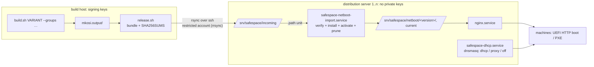

# PLAN

Finished plans are in the git history (`git log -p PLAN.md`): package source
(repos.conf), netboot docs consistency, netstick, network UKI below 80 MiB,
T450s findings with usb/network aligned.

## Still open from earlier plans

- usb variant: boot the current build in QEMU (explicit `KernelInitrdModules=` list).
- `fluidsynth.service` (user unit from vlc-plugin-fluidsynth) fails without a
  SoundFont: mask it in the image? (proposal, not decided)
- netstick: QEMU boot of a netstick image not tested.

---

# PLAN: Docker off by default, QEMU guest agent, cleanup

## Goal

1. Docker is not started at boot. It is started by hand once the data disk is mounted.
2. A VM running the image reports to its hypervisor (IP addresses, OS, host name in
   virt-manager / `virsh domifaddr --source agent`) via the QEMU guest agent.
3. Suggest a cleanup of what accumulated historically (repo, docs, build host, server).

## Steps

- [x] 1. `10-safespace.preset`: drop `enable docker.service`. `docker.socket` and
      `containerd.service` stay disabled (Arch's `disable *`). `safespace-docker-images`
      stays `WantedBy=docker.service`, so it still runs whenever Docker is started.
      The `ConditionPathIsMountPoint=/opt/docker` drop-ins stay as a second guard.
- [x] 2. `mkosi.conf`: add `qemu-guest-agent`. There's nothing to enable: its udev rule starts
      the unit only when the virtio port `org.qemu.guest_agent.0` exists, so it does nothing
      on bare metal.
- [x] 3. `mkosi.extra/etc/qemu/qemu-ga.conf`: `allow-rpcs=` limited to read-only reporting
      (ping, info, osinfo, host name, network interfaces, time, timezone, users, fsinfo) and
      `guest-shutdown`. No `guest-exec`, `guest-file-*` or `guest-set-user-password`, so the
      hypervisor's account gets no command channel into the image.
- [x] 4. README:
      - Docker section: Docker is off at boot; start it with `systemctl start docker` once the
        disk is mounted.
      - VM section: the plain QEMU command gets the virtio-serial channel and a socket on the
        VM host. libvirt/virt-install adds the channel itself. Commands to check it:
        `virsh domifaddr --source agent`, `virsh qemu-agent-command … guest-info`.
- [ ] 5. Test: build `network`, then boot via `test-vm.sh --netboot --url` with the agent
      channel. Check that `guest-network-get-interfaces` answers, `guest-exec` is refused,
      and `docker.service` is inactive (not failed). `test-vm.sh` now always attaches the
      agent channel (`mkosi.test/qga.sock`). Waiting for the build (needs root).
- [x] 6. Cleanup (suggestions 1-11):
      - [x] PLAN.md condensed to this file (history: git log)
      - [x] README "Known open points" updated, reset troubleshooting shortened to a
            pointer (`hwtest-image.sh` kept)
      - [x] NETBOOT.md: T450s case reduced to the result, iPXE debugging story dropped
      - [x] netstick kept as the fallback for machines with AMT on; ssh host keys stay an
            open decision
      - [ ] build host / server: root-owned leftovers, commands handed to the user

## Decisions

- Docker stays manual (`systemctl start docker`), no start on mount.
- Guest agent restricted to reporting + shutdown.

---

# PLAN: build/distribution split, package groups

## Goal

1. **Two roles, one repository.** The *build host* (the only machine with the signing keys)
   builds and releases images. One or more *distribution servers* serve them to machines
   (HTTP for UKI and root image, optional DHCP/PXE). A preparation script sets up a
   distribution server. systemd services replace the scripts that run by hand today
   (pxe-proxy.sh in the foreground, netboot-export.sh after each build). The README says
   clearly what runs where.
2. **Package groups**, independent of the variant: `--groups base,remotedesktop,…`
   (comma-separated, case-insensitive). `base` is only the base system and is always in;
   `remotedesktop` is XFCE + TigerVNC + browser/media.

## Design

**What a distribution server trusts:** only the public `db.pem`, pinned at setup. The import
checks the UKI's Secure Boot signature against it (`sbverify --cert`), takes the root hash
from the signed command line, and checks `root.img` with `veritysetup verify`. A tampered
upload or a bundle from another key is rejected. The server needs no private key, and the
build host needs no inbound access (it pushes).

### Repository layout (new or changed)

| Path | Role | What |
|---|---|---|
| `build.sh` | build | + `--groups LIST`; group set written to `<image>.groups` in mkosi.output/ |
| `release.sh` (replaces `netboot-export.sh`) | build | bundle `mkosi.release/<version>/` (boot.efi, root.img.zst, root.verity.zst, roothash, cmdline, groups, SHA256SUMS), own checks as today, `--push TARGET` (repeatable; or `RELEASE_TARGETS=` in gitignored `release.conf`), `--local` = the build host is also a server |
| `server/setup.sh` | server | preparation, idempotent, Arch + Debian/Ubuntu: packages (nginx, dnsmasq, rsync, sbsigntools, cryptsetup, zstd), system user `safespace`, upload account `safespace-upload` (authorized key forced to `rrsync -wo /srv/safespace/incoming`), tree, pinned `db.pem`, `/etc/safespace/server.conf`, nginx site, units enabled |
| `server/server.conf.example` | server | `TREE=`, `KEEP=3`, `AUTO_ACTIVATE=yes`, `DHCP_MODE=off\|proxy\|dhcp`, interface, range, boot URL; site values go to the gitignored copy / `/etc/safespace/` |
| `server/safespace-netboot` | server | CLI: `import`, `list`, `activate VERSION`, `rollback`, `prune` (called by the units, usable by hand) |
| `server/systemd/` | server | `safespace-netboot-import.path` + `.service` (unprivileged, sandboxed), `safespace-dhcp.service` (dnsmasq from `/etc/safespace/dnsmasq.conf`, generated per DHCP_MODE) |
| `server/nginx/safespace.conf` | server | the nginx site (today copied from the README) |
| `pxe-proxy.sh` | — | removed; `DHCP_MODE=proxy` is the service form of it |
| `mkosi.profiles/remotedesktop/` | build | packages, TigerVNC config, `vncserver@:1` preset |
| `mkosi.profiles/docker/` | build | docker, daemon/containerd config, drop-ins, image loader, `opt-docker.mount` (replaces the fstab line) |
| `mkosi.profiles/debug/` | build | unchanged: stays the separate `--debug` flag, not a group |
| `burn.sh`, `diagnose.sh` | server/any | `burn.sh` also takes a usb image from a distribution server (URL or `/srv/safespace/usb/…`); `diagnose.sh --db-cert db.pem` checks a stick without `mkosi.output/` |
| `netstick.sh`, `test-vm.sh` | build | read from `mkosi.release/` instead of `mkosi.netboot/` |

### Groups

| Group | Contents |
|---|---|
| `base` (always) | linux, firmware, ucode, systemd, openssh, sudo, nftables, usbguard, efitools/openssl (safespace-seal), cryptsetup, vim, tmux, qemu-guest-agent; users, ssh, hardening, volatile /var |
| `remotedesktop` | xfce4, xfce4-goodies, tigervnc, firefox, vlc + plugins, gwenview, ffmpegthumbnailer, fonts, pulseaudio; VNC user/password in postinst |
| `docker` | docker, its config, image loader, data disk mount; `docker` user group |

Implementation: every group except `base` is a mkosi profile (`mkosi.profiles/<group>/`,
packages and files of its own, presets as a separate preset file). `build.sh` validates
the names against a fixed list in `lib/groups.sh`; `mkosi.postinst` sees them in `$PROFILES`
(VNC only with remotedesktop, `docker` in USER_GROUPS only with docker). Dropped from the
image: `tinyssh`, `dhclient`, `sbctl`, `systemd-ukify`, `efibootmgr`, `btrfs-progs` (not
used on the system; tell me if you need one of them). The build records the group set in
the output and the release, and `release.sh`/`safespace-netboot list` show it.

### usb images on the distribution servers

`release.sh` also bundles a usb build (`<version>/image.raw.zst`, roothash, groups,
SHA256SUMS). The import checks it like a network release, without root: it unpacks the image
to a temp dir, cuts out the partitions with the offsets from `sfdisk -J`, checks the UKI from
the ESP (`mcopy`) against `db.pem` and the root against the signed root hash. Then it serves
the image under `http://<server>/safespace/usb/<version>/` (and `usb/current`).

## Decisions

- No `--groups`: `base` only (**breaking**: today's image = `--groups base,remotedesktop,docker`).
- Groups: base, remotedesktop, docker. qemu-guest-agent is in base.
- `--debug` stays a separate flag, not a group.
- Transfer: push via rsync/ssh into a restricted upload account.
- Distribution servers serve usb images too.
- The share is `share/` (uploads land where they are served); a channel only ever points
  at a verified release, and the server switches the release's channel automatically.
- Channels per machine class (`--channel`, default `current`).
- Arch Linux only (images, build host, servers): Debian support dropped, it could not be
  tested here.

## Steps

- [x] 1. `lib/groups.sh`, `build.sh --groups`, profiles remotedesktop/docker, move files and
      presets, postinst conditionals, `<image>.groups`.
- [x] 2. `release.sh` (bundle, checks, push, local), `release.conf.example`, .gitignore.
- [x] 3. `server/`: setup.sh (network and usb import), safespace-netboot, units, nginx site, server.conf.example.
- [x] 4. Adapt netstick.sh, test-vm.sh, diagnose.sh; remove netboot-export.sh, pxe-proxy.sh.
- [x] 5. README: roles section first (build host vs distribution server, with the diagram),
      groups section, every command per role; NETBOOT.md server part points to
      `server/setup.sh`.
- [x] 6. Tests:
      - `build.sh … summary` for group combinations and wrong names
      - full builds `network --groups base` and `network --groups base,remotedesktop,docker`
        (yours, root)
      - this host as a distribution server: `server/setup.sh` locally, `release.sh --local`
        and `--push localhost`, import service, nginx, tampered bundle rejected
      - QEMU HTTP boot from it
      - `DHCP_MODE=proxy` against the T450s

Test results (6): summaries for group sets and wrong names OK; release.sh network
(stage + local push) OK; import of network and usb (an image assembled from the signed
parts) OK; rejected: manipulated hash tree, foreign/unsigned UKI, wrong roothash, unlisted
file, missing upload; injected channel falls back to current; rollback/activate errors OK;
dnsmasq --test OK for proxy and dhcp; nginx site OK (hidden files, PUT, listing refused);
units pass systemd-analyze verify, import sandbox exposure 1.0.
Open (needs root / your hardware): full builds with groups, server/setup.sh on a real
server, ssh/rrsync upload, QEMU boot of a new build from the server.

## Open questions

- none
