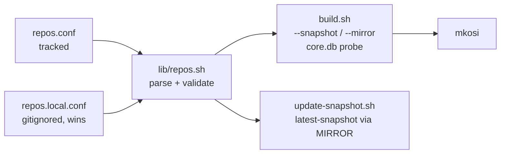
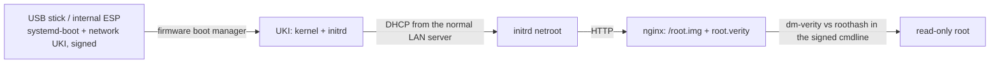

# PLAN

## Goal

1. Rework the package source (snapshot + mirror): set in a config file, with
   four modes: pinned date or `latest`, each with the default or an own mirror.
2. Docs: `cpio` missing from the host prerequisites (mkosi packs the initrd with it).
3. `build.sh --workers N` for the erofs compression threads (`--workers` used to
   end up as an unknown mkosi option).

## Design

| SNAPSHOT | MIRROR | repo URL |
|---|---|---|
| date | empty | `https://archive.archlinux.org/repos/<date>/$repo/os/$arch` |
| date | archive mirror | `MIRROR/repos/<date>/$repo/os/$arch` |
| latest | empty | `https://fastly.mirror.pkgbuild.com/$repo/os/$arch` |
| latest | pacman mirror | `MIRROR/$repo/os/$arch` |

## Steps

- [x] 1. `lib/repos.sh`: parse (not source) `repos.conf` + `repos.local.conf`,
      only `SNAPSHOT`/`MIRROR`; validate; mkosi args; `core.db` probe with a
      layout hint on failure.
- [x] 2. `repos.conf` (SNAPSHOT=2026/10/17, carried over from the local edit of
      the old file), `repos.local.conf.example`, `.gitignore`; removed
      `mkosi.conf.d/20-snapshot.conf`.
- [x] 3. `build.sh`: uses lib/repos.sh, refuses `-m`/`--mirror`/`--snapshot`,
      `--workers N` -> `--environment=SYSTEMD_REPART_MKFS_OPTIONS_EROFS=--workers=N`,
      host tool check (cpio, ...) for `build`.
- [x] 4. `update-snapshot.sh`: edits `repos.conf`, queries `MIRROR` if set.
- [x] 5. README (cpio, section "Package source", tables), mkosi.conf, NETBOOT.md.
- [x] 6. Tested with `summary`: all four modes, invalid SNAPSHOT/MIRROR/keys,
      `--workers 0`, `--workers` overriding mkosi.local.conf, probe against
      archive.archlinux.org / fastly / ftp.fau.de. Not run: a full build.

## Open questions

- none

---

# PLAN: netboot docs consistency (README.md, NETBOOT.md)

## Goal

Fix the inconsistencies found while checking a real `netboot-export.sh` + nginx setup.

## Steps

- [x] 1. nginx (README step 3, NETBOOT §2): create `/etc/nginx/conf.d` before writing
      into it (missing on Arch), so the `include` added by `sed` matches the file.
- [x] 2. Mention the stock `server { listen 80; server_name localhost; }` in Arch's
      `nginx.conf`: harmless next to `default_server`, may be removed.
- [x] 3. "Every build": a bare `./netboot-export.sh` only stages into `mkosi.netboot/`;
      only `--rsync` / `--tree` publishes. Add a check of the served tree.
- [x] 4. Replace the site-specific `172.17.2.155` with the example address `10.0.0.1`
      (as in NETBOOT.md), declared once in the values table.
- [x] 5. Align `server_name` (README and NETBOOT.md both `server_name _;`, the name is
      not needed with `default_server`).
- [x] 6. Untracked-files list: add `repos.local.conf`.

## Open questions

- none

---

# PLAN: netstick — local loader, root over the network (T450s)

## Goal

Machines whose firmware cannot start an EFI image that came over the network
(found on a ThinkPad T450s, BIOS JBET73WW) boot from a small local medium
instead: signed systemd-boot + the signed **network** UKI on an ESP-only USB
stick (or internal disk). The UKI then fetches `root.img`/`root.verity` from
nginx exactly as in a netboot; no PXE, no proxy DHCP, no iPXE involved.
Document the investigation in NETBOOT.md.

## Steps

- [x] 1. `netstick.sh` (new, root: signing needs the db key):
      - input: a **published** network version (default `mkosi.netboot/current`,
        `--version`, `--tree`), i.e. the UKI that netboot-export.sh already
        verified against its root image — the stick can only carry a UKI whose
        root is on the server
      - sign `/usr/lib/systemd/boot/efi/systemd-bootx64.efi` with the key and
        tool from `mkosi --json summary` (respects mkosi.local.conf), verify
        that UKI and systemd-boot carry the same signer
      - image: GPT, one ESP (FAT32, 512-byte sectors as on the usb variant),
        `\EFI\BOOT\BOOTX64.EFI` + `\EFI\Linux\safespace-arch-network_<ver>.efi`,
        no loader.conf
      - output `mkosi.output/safespace-arch-netstick_<ver>.raw.zst`
- [x] 2. `burn.sh`: also writes netstick images (`--netstick` picks the newest one;
      the default stays the newest usb image).
- [x] 3. `diagnose.sh`: recognises an ESP-only stick: partition table, FAT sector
      size, systemd-boot + UKI signatures, netroot URL and root hash on the UKI's
      command line, and whether that URL answers (HEAD on root.img).
- [x] 4. NETBOOT.md:
      - new section "Machines that cannot start a network-loaded image" — the
        T450s findings (table of what was tried, TPL analysis), how to recognise
        the case, the netstick as the fix
      - PXE practicalities learned on the way: proxy-DHCP command incl.
        `--tftp-single-port`, firewall ports (UDP 67/69/4011), "Station IP" means
        PXE not HTTP boot, `error 8 User aborted` is only the tsize probe,
        large TFTP files, iPXE's `autoexec.ipxe` precedence, the `ipxe-arch.efi`
        pitfall, Secure Boot needs signed loaders
- [x] 5. README: netstick in "What's where" / "Everyday use"; burn/diagnose lines.
- [x] 6. Clean up the test leftovers: `/srv/netboot/safespace/hwtest/`,
      `/srv/netboot/safespace/boot.ipxe` (hwtest/ would be taken for a version
      by `netboot-export.sh --prune`); the iPXE binaries in /srv/netboot/ are
      root-owned, removal command for you.
- [~] 7. Test: build a netstick from the current publish, check the image
      (sfdisk, FAT geometry, files, signatures) without hardware; then you boot
      the T450s from it — success = `root.img` in the nginx log.

- [x] 8. Debug tools: profile `mkosi.profiles/debug/`, `./build.sh <variant> --debug`
      (version suffix `-debug`), instead of a host-local mkosi.local.conf.
- [x] 9. `lib/uefi.sh`: signer/section helpers, shared by netboot-export.sh and
      netstick.sh.

Test status (7): netstick image built from the published 20261018-1040 with a
throwaway key: GPT/ESP, FAT 512-byte sectors, UKI byte-identical, systemd-boot
signed; diagnose.sh's server check against nginx OK; netboot-export.sh re-run
with the shared helper OK. Open: QEMU boot (needs edk2-ovmf), real T450s boot.

## Decisions (were open questions)

USB stick only; a new stick per release for now (kexec loader later); iPXE
patches documented in NETBOOT.md only.

## Former open questions

1. Medium: USB stick only, or should netstick.sh also install onto an existing
   internal disk's ESP (writes the machine's disk; I'd keep that manual/documented)?
2. Every release needs a rewritten stick (the UKI pins `<version>/` in its root
   URL). OK for now (option 3 = kexec loader later)?
3. The iPXE patches from the investigation (NII/HII/SNP-provider off): document
   only, or also keep them as a patch file in the repo? Proposal: document only —
   they did not solve the T450s case.

---

# PLAN: network UKI below 80 MiB (PXE on the ThinkPad T450s)

## Goal

With Intel AMT disabled, the T450s firmware starts Linux images over plain
PXE/TFTP up to at least 80 MiB (tested 17/48/80), but not at 112 MiB, the
current network UKI. Shrink the **network** UKI to <= 75 MiB (margin below the
largest tested size) without touching the usb variant, so the T450s boots it
directly over PXE — no iPXE, no stick.

| Part of the UKI (20261018-1439-debug) | now | target |
|---|---|---|
| kernel `.linux` | 16.4 MiB | 16.4 (fixed) |
| microcode `.ucode` (all Intel CPUs) | 16.9 MiB | 16.9 (kept: CPU security fixes) |
| initrd userland (zstd -19 of 169 MiB) | 46.2 MiB | ~33 |
| initrd modules + firmware | 31.8 MiB | ~4 |
| **total** | **112 MiB** | **~70** |

## Steps

- [x] 1. `mkosi.profiles/network/mkosi.conf`: replace the inherited
      `KernelInitrdModules=default` by an explicit list (empty assignment resets it):
      dm-mod, dm-verity, loop, erofs, autofs4, efivarfs, crypto/, fs/nls/,
      i8042/atkbd/hid-generic/usbhid (console keyboard for the emergency shell),
      tpm_tis (systemd's TPM units), virtio_net/virtio_pci (QEMU), and only client
      NIC families: `drivers/net/ethernet/{intel,realtek,broadcom/tg3,marvell/sky2,
      atheros,aquantia,amd}`, `drivers/net/phy/`, `drivers/net/mdio/`.
      Dropped: mellanox, qlogic, chelsio, sfc, netronome, cavium, huawei, wangxun,
      pensando, … (+ cxgb4/bnx2x/phanfw firmware), xfs, btrfs, ext4, nvme, ahci,
      usb-storage, thunderbolt, mmc, wireless (cfg80211), md-raid.
- [x] 2. `mkosi.initrd.conf/mkosi.profiles/network/mkosi.conf` (new, network
      initrd only): `RemoveFiles=` for what netroot never runs:
      btrfs-progs/xfsprogs/e2fsprogs/dosfstools binaries, systemd-nspawn/
      vmspawn/homectl/bootctl/systemd-analyze/systemd-repart, glibc gconv/localedef/
      ldconfig/sln, gcc-libs sanitizers (libasan/libtsan/libhwasan/liblsan/libubsan),
      pcre2test, captree, openssl/certtool/p11tool CLIs (curl keeps its libraries),
      terminfo except linux/vt*, zoneinfo, keymaps except the configured `us`.
      Not removed in this step: `hwdb.bin` (13.5 MiB unpacked; udev uses it) —
      separate test if more is needed.
- [x] 3. `mkosi.postoutput`: stop the build if the network UKI exceeds a size limit
      (changed on request: warn above 80 MiB, stop above 128 MiB;
      `SAFESPACE_UKI_WARN_MIB`/`SAFESPACE_UKI_LIMIT_MIB` per host) and print
      the per-section sizes, so growth is noticed at build time.
- [x] 4. NETBOOT.md: the AMT finding (Intel AMT on = nothing but iPXE starts over
      PXE), the size limit (80 MiB fine, 112 MiB not), what the network initrd
      contains and why; replace the "cannot network-boot" conclusion for the T450s
      (netstick stays as fallback).
- [ ] 5. Test:
      - [x] a. `sudo ./build.sh network --debug` (20261018-1559-debug): UKI 82 MiB
            (initrd 48), warning only
      - [x] b./c. the UKI directly over `pxe-proxy.sh` (AMT off) boots end to end:
            TFTP, root.verity + root.img over HTTP, ssh login (netstick step skipped)
      - [ ] d. usb variant unchanged: `./build.sh usb summary` shows the old module list
      - [ ] e. failed units on the netbooted T450s analysed

Checked without a build: `mkosi summary` shows the new module list only for the
network variant (usb keeps `default`) and the RemoveFiles only in the network
default-initrd; a dry run of mkosi's module matching against the host kernel
(7.2.11) keeps 214 modules (3.7 MiB) + 155 KiB firmware, incl. dm-verity, loop,
erofs, e1000e, r8169, tg3, virtio_net; mkosi.postoutput fails on the old 112 MiB
UKI and prints its section sizes. Result: 82 MiB boots on the T450s; the size
is fine as it is. UEFI HTTP boot stays the intended path (no iPXE); PXE is the
alternative for old firmware without HTTP boot.

## Decisions

Microcode kept; client NICs only; target <= 75 MiB (limit 80 MiB).

## Former open questions

1. Microcode: keep all Intel microcode (16.9 MiB, my proposal), or filter to
   selected CPU families (iucode_tool; smaller, but ties the image to hardware)?
2. NIC families: is the client list in step 1 enough for your machines, or do
   you also netboot servers (Mellanox/Broadcom bnx2x/Chelsio...)? Those could
   go into a separate profile later.
3. Size limit: 80 MiB is the largest *tested* good size; the real limit is
   between 80 and 112 MiB. Test size-96 to know it, or just stay <= 75?

# PLAN: findings from the netbooted T450s; usb and network aligned

## Goal

Fix what the first real netboot (T450s, `20261018-1559-debug`) showed, for both
variants, and keep usb and network identical except where the boot path needs
it. `safespace-seal` must find the public Secure Boot keys in every image;
private key material never goes into an image.

## Findings

- **No Secure Boot keys in the image** (`safespace-seal`: "contains no Secure
  Boot keys"). Not variant-specific: `mkosi.extra/usr/share/safespace/secureboot/`
  does not exist in this checkout (secureboot-export.sh never ran here), and
  `mkosi.postoutput` only prints a note. A usb build from here lacks them too.
- **safespace-var-factory.service fails** (`cp: cannot create directory
  '/var/./lib/systemd': File exists`): race. systemd-random-seed, systemd-tpm2-setup
  and systemd-timesyncd start right after `var.mount`, in parallel with the copy,
  and create `/var/lib/systemd/...` (timesyncd also logs Permission denied on its
  clock file). Both variants (same unit, same `systemd.volatile=state`); the usb
  variant only had better timing.
- **systemd-tpm2-setup-early, systemd-pcrproduct, systemd-pcrlogin@1000 fail**:
  systemd 262 initializes NvPCRs, and that needs the PCR signing public key
  (`tpm2-pcr-public-key.pem`), which our UKI does not carry (no PCR signing).
  Debug: "Failed to load PCR public key for NvPCR: No such file or directory".
  Every machine with a TPM 2.0, both variants. Nothing in safespace uses the TPM.
- Cosmetic: tmpfiles warns that `/home` and `/root` are not directories (they
  are symlinks into /var by design); udev in the trimmed network initrd tries to
  load modules it does not contain (kvm, wmi, mei, snd-hda-codec, ...).
- Expected: docker.service inactive (no `safespace-docker` disk).

## Differences usb ↔ network (mkosi summary, main image and initrd)

Root image: identical (packages, extra trees, units). Differences:
ImageId; command line (network: root=/dev/mapper/root, rootfstype, ro,
systemd.verity=no, safespace.netroot=; usb: verity_root_options);
SplitArtifacts (+partitions); ESP only for usb; initrd: usb-bootdev vs netroot,
network adds curl/cryptsetup/iproute2, explicit module list vs default + USB
storage, network RemoveFiles trimming.

## Steps

- [x] 1. Keys (changed on request): every image is signed, so every build ships
      the public keys. `build.sh` runs `secureboot-export.sh` before each build
      with the sbctl dir of `SecureBootKey=` (lib/keys.sh) and checks that the
      exported db.pem is `SecureBootCertificate=`. `mkosi.postoutput`: missing
      keys are an ERROR; only `*.pem`/`*.auth`/`GUID` allowed, no `PRIVATE KEY`.
- [x] 2. safespace-var-factory: `Before=` random-seed, tpm2-setup, timesyncd,
      pcrproduct, pcrmachine, update-utmp.
- [x] 3. TPM: `SignExpectedPcr=yes` with an own PCR key in
      `/var/lib/safespace/pcr-signing/` (build.sh creates it on the first build;
      `SignInitrdPCRs=auto` is on with ukify 262, needed for NvPCR init).
- [x] 4. Alignment: common initrd module list in `mkosi.conf` (usb: + USB host,
      storage, MMC, card readers; network: + client NICs), all RemoveFiles in
      `mkosi.initrd.conf/mkosi.conf`; the network-only initrd conf is gone.
- [x] 5. tmpfiles `00-safespace-links.conf` (`L /home`, `L /root`). The initrd
      module-load errors: mkosi ships the full module index (6518 entries, 214
      modules); cosmetic, documented.
- [x] 6. Test (20261018-2009-debug): T450s over PXE, sealed with
      safespace-seal, Secure Boot enabled (user); var-factory, tmpfiles and the
      shipped keys fine; only the NvPCR units fail (old Intel PTT, "Device not a
      stream", ignored). QEMU (nested KVM): pure UEFI HTTP boot from nginx via
      `test-vm.sh --netboot --url`, system "running", no failed system units.
      Open: usb build in QEMU; fluidsynth user unit fails (no SoundFont).
- [x] 8. VMs: README "A netbooting VM": plain QEMU (headless) and a persistent
      libvirt machine (own NAT network with bootp URL, virt-install, Setup Mode,
      PXE off via fw_cfg `opt/org.tianocore/IPv4PXESupport=n`/`IPv6PXESupport=n`,
      `--reset-nvram`); DNS through the VM host's resolver (IP or IP fallback in
      NETROOT_URL). Confirmed by the user on their libvirt host. `test-vm.sh`:
      `--url` for a published build, PXE off in HTTP mode. pxe-proxy.sh keeps
      mkosi.test/ owned by the project user.
      Was: rebuild network, netboot the T450s: `systemctl --failed` (docker
      aside), `safespace-seal` finds the keys, `.pcrsig`/`.pcrpkey` in the UKI.
      Old TPMs (T450s: Intel PTT fw 10.0, 2013) are ignored: the NvPCR units
      may fail there. usb build: same checks in QEMU; network: pure UEFI HTTP
      boot in QEMU (nested KVM) against the real nginx.
- [x] 7. README: build, publish, DHCP for HTTP boot (options 60/67) and
      PXE via pxe-proxy.sh, testing one version without moving `current`.

## Decisions

TPM: signed PCRs (own key). usb initrd trimmed like network (alignment over
size). Keys exported on every build, not only when missing.
