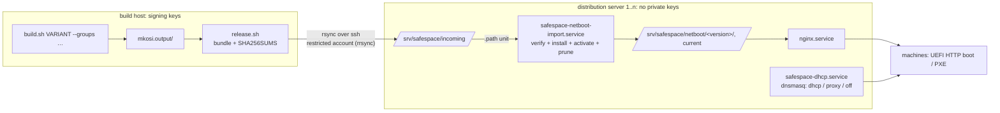
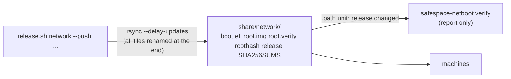
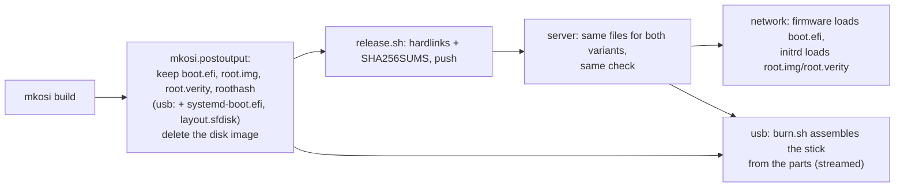

# PLAN

Finished plans are in the git history (`git log -p PLAN.md`): package source
(repos.conf), netboot docs consistency, netstick, network UKI below 80 MiB,
T450s findings with usb/network aligned.

## Still open from earlier plans

- usb variant: boot the current build in QEMU (explicit `KernelInitrdModules=` list).
- `fluidsynth.service` (user unit from vlc-plugin-fluidsynth) fails without a
  SoundFont: mask it in the image? (proposal, not decided)
- netstick: QEMU boot of a netstick image not tested.

---

# PLAN: Docker off by default, QEMU guest agent, cleanup

## Goal

1. Docker is not started at boot. It is started by hand once the data disk is mounted.
2. A VM running the image reports to its hypervisor (IP addresses, OS, host name in
   virt-manager / `virsh domifaddr --source agent`) via the QEMU guest agent.
3. Suggest a cleanup of what accumulated historically (repo, docs, build host, server).

## Steps

- [x] 1. `10-safespace.preset`: drop `enable docker.service`. `docker.socket` and
      `containerd.service` stay disabled (Arch's `disable *`). `safespace-docker-images`
      stays `WantedBy=docker.service`, so it still runs whenever Docker is started.
      The `ConditionPathIsMountPoint=/opt/docker` drop-ins stay as a second guard.
- [x] 2. `mkosi.conf`: add `qemu-guest-agent`. There's nothing to enable: its udev rule starts
      the unit only when the virtio port `org.qemu.guest_agent.0` exists, so it does nothing
      on bare metal.
- [x] 3. `mkosi.extra/etc/qemu/qemu-ga.conf`: `allow-rpcs=` limited to read-only reporting
      (ping, info, osinfo, host name, network interfaces, time, timezone, users, fsinfo) and
      `guest-shutdown`. No `guest-exec`, `guest-file-*` or `guest-set-user-password`, so the
      hypervisor's account gets no command channel into the image.
- [x] 4. README:
      - Docker section: Docker is off at boot; start it with `systemctl start docker` once the
        disk is mounted.
      - VM section: the plain QEMU command gets the virtio-serial channel and a socket on the
        VM host. libvirt/virt-install adds the channel itself. Commands to check it:
        `virsh domifaddr --source agent`, `virsh qemu-agent-command … guest-info`.
- [ ] 5. Test: build `network`, then boot via `test-vm.sh --netboot --url` with the agent
      channel. Check that `guest-network-get-interfaces` answers, `guest-exec` is refused,
      and `docker.service` is inactive (not failed). `test-vm.sh` now always attaches the
      agent channel (`mkosi.test/qga.sock`). Waiting for the build (needs root).
- [x] 6. Cleanup (suggestions 1-11):
      - [x] PLAN.md condensed to this file (history: git log)
      - [x] README "Known open points" updated, reset troubleshooting shortened to a
            pointer (`hwtest-image.sh` kept)
      - [x] NETBOOT.md: T450s case reduced to the result, iPXE debugging story dropped
      - [x] netstick kept as the fallback for machines with AMT on; ssh host keys stay an
            open decision
      - [ ] build host / server: root-owned leftovers, commands handed to the user

## Decisions

- Docker stays manual (`systemctl start docker`), no start on mount.
- Guest agent restricted to reporting + shutdown.

---

# PLAN: build/distribution split, package groups

## Goal

1. **Two roles, one repository.** The *build host* (the only machine with the signing keys)
   builds and releases images. One or more *distribution servers* serve them to machines
   (HTTP for UKI and root image, optional DHCP/PXE). A preparation script sets up a
   distribution server. systemd services replace the scripts that run by hand today
   (pxe-proxy.sh in the foreground, netboot-export.sh after each build). The README says
   clearly what runs where.
2. **Package groups**, independent of the variant: `--groups base,remotedesktop,…`
   (comma-separated, case-insensitive). `base` is only the base system and is always in;
   `remotedesktop` is XFCE + TigerVNC + browser/media.

## Design



**What a distribution server trusts:** only the public `db.pem`, pinned at setup. The import
checks the UKI's Secure Boot signature against it (`sbverify --cert`), takes the root hash
from the signed command line, and checks `root.img` with `veritysetup verify`. A tampered
upload or a bundle from another key is rejected. The server needs no private key, and the
build host needs no inbound access (it pushes).

### Repository layout (new or changed)

| Path | Role | What |
|---|---|---|
| `build.sh` | build | + `--groups LIST`; group set written to `<image>.groups` in mkosi.output/ |
| `release.sh` (replaces `netboot-export.sh`) | build | bundle `mkosi.release/<version>/` (boot.efi, root.img.zst, root.verity.zst, roothash, cmdline, groups, SHA256SUMS), own checks as today, `--push TARGET` (repeatable; or `RELEASE_TARGETS=` in gitignored `release.conf`), `--local` = the build host is also a server |
| `server/setup.sh` | server | preparation, idempotent, Arch + Debian/Ubuntu: packages (nginx, dnsmasq, rsync, sbsigntools, cryptsetup, zstd), system user `safespace`, upload account `safespace-upload` (authorized key forced to `rrsync -wo /srv/safespace/incoming`), tree, pinned `db.pem`, `/etc/safespace/server.conf`, nginx site, units enabled |
| `server/server.conf.example` | server | `TREE=`, `KEEP=3`, `AUTO_ACTIVATE=yes`, `DHCP_MODE=off\|proxy\|dhcp`, interface, range, boot URL; site values go to the gitignored copy / `/etc/safespace/` |
| `server/safespace-netboot` | server | CLI: `import`, `list`, `activate VERSION`, `rollback`, `prune` (called by the units, usable by hand) |
| `server/systemd/` | server | `safespace-netboot-import.path` + `.service` (unprivileged, sandboxed), `safespace-dhcp.service` (dnsmasq from `/etc/safespace/dnsmasq.conf`, generated per DHCP_MODE) |
| `server/nginx/safespace.conf` | server | the nginx site (today copied from the README) |
| `pxe-proxy.sh` | — | removed; `DHCP_MODE=proxy` is the service form of it |
| `mkosi.profiles/remotedesktop/` | build | packages, TigerVNC config, `vncserver@:1` preset |
| `mkosi.profiles/docker/` | build | docker, daemon/containerd config, drop-ins, image loader, `opt-docker.mount` (replaces the fstab line) |
| `mkosi.profiles/debug/` | build | unchanged: stays the separate `--debug` flag, not a group |
| `burn.sh`, `diagnose.sh` | server/any | `burn.sh` also takes a usb image from a distribution server (URL or `/srv/safespace/usb/…`); `diagnose.sh --db-cert db.pem` checks a stick without `mkosi.output/` |
| `netstick.sh`, `test-vm.sh` | build | read from `mkosi.release/` instead of `mkosi.netboot/` |

### Groups

| Group | Contents |
|---|---|
| `base` (always) | linux, firmware, ucode, systemd, openssh, sudo, nftables, usbguard, efitools/openssl (safespace-seal), cryptsetup, vim, tmux, qemu-guest-agent; users, ssh, hardening, volatile /var |
| `remotedesktop` | xfce4, xfce4-goodies, tigervnc, firefox, vlc + plugins, gwenview, ffmpegthumbnailer, fonts, pulseaudio; VNC user/password in postinst |
| `docker` | docker, its config, image loader, data disk mount; `docker` user group |

Implementation: every group except `base` is a mkosi profile (`mkosi.profiles/<group>/`,
packages and files of its own, presets as a separate preset file). `build.sh` validates
the names against a fixed list in `lib/groups.sh`; `mkosi.postinst` sees them in `$PROFILES`
(VNC only with remotedesktop, `docker` in USER_GROUPS only with docker). Dropped from the
image: `tinyssh`, `dhclient`, `sbctl`, `systemd-ukify`, `efibootmgr`, `btrfs-progs` (not
used on the system; tell me if you need one of them). The build records the group set in
the output and the release, and `release.sh`/`safespace-netboot list` show it.

### usb images on the distribution servers

`release.sh` also bundles a usb build (`<version>/image.raw.zst`, roothash, groups,
SHA256SUMS). The import checks it like a network release, without root: it unpacks the image
to a temp dir, cuts out the partitions with the offsets from `sfdisk -J`, checks the UKI from
the ESP (`mcopy`) against `db.pem` and the root against the signed root hash. Then it serves
the image under `http://<server>/safespace/usb/<version>/` (and `usb/current`).

## Decisions

- No `--groups`: `base` only (**breaking**: today's image = `--groups base,remotedesktop,docker`).
- Groups: base, remotedesktop, docker. qemu-guest-agent is in base.
- `--debug` stays a separate flag, not a group.
- Transfer: push via rsync/ssh into a restricted upload account.
- Distribution servers serve usb images too.
- The share is `share/` (uploads land where they are served); a channel only ever points
  at a verified release, and the server switches the release's channel automatically.
- Channels per machine class (`--channel`, default `current`).
- Arch Linux only (images, build host, servers): Debian support dropped, it could not be
  tested here.

## Steps

- [x] 1. `lib/groups.sh`, `build.sh --groups`, profiles remotedesktop/docker, move files and
      presets, postinst conditionals, `<image>.groups`.
- [x] 2. `release.sh` (bundle, checks, push, local), `release.conf.example`, .gitignore.
- [x] 3. `server/`: setup.sh (network and usb import), safespace-netboot, units, nginx site, server.conf.example.
- [x] 4. Adapt netstick.sh, test-vm.sh, diagnose.sh; remove netboot-export.sh, pxe-proxy.sh.
- [x] 5. README: roles section first (build host vs distribution server, with the diagram),
      groups section, every command per role; NETBOOT.md server part points to
      `server/setup.sh`.
- [x] 6. Tests:
      - `build.sh … summary` for group combinations and wrong names
      - full builds `network --groups base` and `network --groups base,remotedesktop,docker`
        (yours, root)
      - this host as a distribution server: `server/setup.sh` locally, `release.sh --local`
        and `--push localhost`, import service, nginx, tampered bundle rejected
      - QEMU HTTP boot from it
      - `DHCP_MODE=proxy` against the T450s

Test results (6): summaries for group sets and wrong names OK; release.sh network
(stage + local push) OK; import of network and usb (an image assembled from the signed
parts) OK; rejected: manipulated hash tree, foreign/unsigned UKI, wrong roothash, unlisted
file, missing upload; injected channel falls back to current; rollback/activate errors OK;
dnsmasq --test OK for proxy and dhcp; nginx site OK (hidden files, PUT, listing refused);
units pass systemd-analyze verify, import sandbox exposure 1.0.
Open (needs root / your hardware): full builds with groups, server/setup.sh on a real
server, ssh/rrsync upload, QEMU boot of a new build from the server.

## Open questions

- none

---

# PLAN: simplify releases, keys in the build, fresh-deploy docs, agent handover

## Goal

1. **Releases: only the newest, decided by the build host.** A distribution server holds
   exactly one release per variant at fixed paths. No version directories, channels,
   symlinks, activation, rollback, pruning. Going back = the build host releases an older
   build again. The server can **check** whether what it serves is broken (automatically after
   every upload, and by hand), but never replaces anything itself.
2. **Keys inside the build, dedicated keys possible.** `secureboot-export.sh` goes into
   `lib/keys.sh`. The keys come from an sbctl instance that can be dedicated to safespace
   (its own key directory, `sbctl --config`), not necessarily the host's. Through sbctl, keys
   can also live on a YubiKey (sbctl `--*-keytype yubikey`).
3. **Netstick dropped.**
4. **Groups are the only difference between images** (besides usb/network): one image per
   variant per server, no machine classes.
5. **Separate tools stay** (`release.sh`, `fetch-images.sh`, `burn.sh`, …); merging them is
   decided later.
6. **A fresh clone deploys easily** (README from `git clone`, scripts that say what is
   missing), and **an agent can take over** (`AGENTS.md` project part, `tests/run.sh`).

## Design: one release per server



| | today | after |
|---|---|---|
| server layout | `network/<version>/…`, channel links | `network/{boot.efi,root.img,root.verity,roothash,cmdline,release,manifest.json,SHA256SUMS}`, `usb/{image.raw.zst,roothash,release,SHA256SUMS}` |
| root URL in the UKI | `<base>/<version>/` | `<base>/` exactly as in `netboot.conf` |
| upload | into a version directory + `.pending/` marker | straight onto the served files: `rsync --delay-updates` puts the files into a temp dir and renames them all at the end, so the switch takes milliseconds. nginx keeps serving a download already running from the old file |
| upload account (rrsync) | write-only, no overwrite, no delete | write-only, overwrite allowed (replacing is the point), no delete |
| on the server | import: verify, activate, prune; activate/rollback by hand | `safespace-netboot verify` after every upload (path unit on `release`) and by hand; result in the journal, `safespace-netboot status`, and a failed unit (`systemctl --failed`). It deletes and replaces nothing |
| rollback | on the server | `./release.sh network --version <older> --push …` on the build host |
| DHCP boot file | `…/network/<channel>/boot.efi` | `…/network/boot.efi` |

**Race:** a machine downloads the old `boot.efi`, the release is replaced, then the machine
downloads the new `root.img`. dm-verity refuses it, as it must. `netroot` then fetches the
server's `roothash`; if it differs from its own, it logs "a newer release was published while
booting" and reboots after 10 s (the firmware then gets the new `boot.efi`). A root that is
really broken stays an error, so no reboot loop.

## Design: keys

| | today | after |
|---|---|---|
| where the keys are | the host's sbctl (`/var/lib/sbctl`), layout `keys/db/db.key` required | an sbctl instance: the host's (default) or a dedicated one: `SBCTL_CONFIG=/var/lib/safespace/sbctl/sbctl.conf` in `mkosi.local.conf`'s environment / a build setting, with its own `keydir` (created by `sbctl --config … create-keys`) |
| public keys + enrollment files in the image | `secureboot-export.sh` (cert-to-efi-sig-list, sign-efi-sig-list with the PK/KEK key files) | `lib/keys.sh` asks sbctl: `enroll-keys --export auth` / `esl` (signed by sbctl, so it works for file and YubiKey keys alike) plus the certificates from the keydir; the append variants for `safespace-seal` the same way if sbctl can produce them, else from the files as today (to be checked in step 1) |
| UKI signing | mkosi with `SecureBootKey=` = sbctl's `db.key` file, systemd-sbsign | unchanged for file keys (paths taken from the sbctl config). YubiKey db key: mkosi signs through PKCS#11 (`SecureBootKeySource=provider:pkcs11`, `SecureBootKey=pkcs11:…`); designed and documented, **not testable here without a YubiKey** |
| checks | db.pem fingerprint = SecureBootCertificate, no private key in the image | the same, plus: the exported db certificate = the one the UKI is signed with |

## Steps

- [x] 1. Keys:
      - `lib/keys.sh` takes over `secureboot-export.sh` (then removed). sbctl instance from
        `SBCTL_CONFIG` (default: the host's).
      - Export via sbctl where it can; check with throwaway keys in a scratch sbctl config:
        file keys, and whether `--export auth` covers the append updates `safespace-seal`
        uses.
      - README: "Secure Boot keys": host keys vs. dedicated keys (commands to create
        them), YubiKey (what is needed, what is untested).
- [x] 2. URL without version: `build.sh` signs `NETROOT_URL` as given; `netroot` handles the
      race (compare `roothash`, reboot once).
- [x] 3. `release.sh`: bundle as today, push with `--delay-updates` onto `<target>/<variant>/`.
      Local stage = `mkosi.release/<variant>/` (only the newest).
- [x] 4. Server: `safespace-netboot verify|status|dnsmasq-config` (import, activate, rollback,
      prune, channels, `KEEP`, `DHCP_CHANNEL` removed); units:
      `safespace-netboot-verify.path` (on `network/release`, `usb/release`) + `.service`;
      rrsync without `-no-overwrite`; `setup.sh`, nginx, dnsmasq on the fixed paths.
- [x] 5. Drop the netstick: `netstick.sh`, `burn.sh --netstick`, its part of `diagnose.sh`,
      `lib/uefi.sh` if nothing else needs it, docs. `test-vm.sh --netboot` on the fixed names.
- [x] 6. README for a fresh clone:
      - "Deploy from scratch": numbered commands for the build host, a distribution server
        and the first machine.
      - Reference sections: groups, keys, release, server, DHCP, VM.
      - Channels, version URLs and the netstick cleaned out.
      - NETBOOT.md as the in-depth reference.
- [x] 7. `AGENTS.md` project part:
      - repository map and the two roles
      - security invariants: no private key in an image or a release; a server trusts only
        `db.pem` and never alters a release; root only via dm-verity; nothing writable on
        the medium
      - the test suite
      - script conventions
      - what needs root or hardware and goes back to the user
- [x] 8. `tests/run.sh` (no root, no network):
      - groups
      - `lib/verify.sh` with good and manipulated releases
      - release push + server verify against a temporary share
      - dnsmasq configs, nginx site, `systemd-analyze verify`, `bash -n` of all scripts
      - key export with throwaway sbctl keys
- [ ] 9. Full run (yours, root): build with groups, release to a freshly set up server, QEMU
      HTTP boot, one release while a VM boots (the race).

Results:
- **Keys:** sbctl's `enroll-keys --export auth --append` is signed for replacement (0x27),
  not `APPEND_WRITE` (0x67), so it cannot replace the efitools signing; the export stays on
  efitools, the keys come from any sbctl key set (`SAFESPACE_SBCTL_CONFIG`). YubiKey key
  files are refused with a pointer to the README (the design is documented there).
- **netroot:** reboots only if no server holds this UKI's release any more; a matching
  server that fails otherwise is an error (found by the tests).
- **tests/run.sh:** 74 pass. The rrsync upload test is skipped here (no `/usr/bin/rsync`);
  run once by hand with a patched rrsync: 8 pass.

## Open questions

- none (YubiKey signing is designed but stays untested until a YubiKey is at hand)

---

# PLAN: builds on the build host — organized, listable, traceable

## Goal

Several builds (variants, group sets) can wait side by side on the build host. You can see at
a glance what is there: variant, groups, when it was built, from which package snapshot and
source state, what it contains, and whether and where it was released. Releasing picks the
intended build, not just the newest one.

## Today

- flat `mkosi.output/`, `safespace-arch-<variant>_<YYYYMMDD-HHMM>.*`, root-owned, never
  cleaned
- the group set only in a `.groups` file next to the build; packages in `.manifest`; snapshot,
  mirror, commit, build duration not recorded
- `release.sh` takes the newest build of the variant (by file time), whatever its groups
- nothing records which build was released to which server, and when
- one incremental cache for everything: switching the group set reinstalls all packages

## Design

```
mkosi.output/
├── network/
│   ├── base-remotedesktop-docker_20261019-0930/   one directory per build
│   │   ├── build.json                 what, when, from what (below)
│   │   ├── released.log               "<time> <target>" per push
│   │   └── safespace-arch-network_20261019-0930.{efi,root.raw.zst,root-verity.raw.zst,roothash,manifest,vnc-password}
│   └── base_20261019-1012/ …
└── usb/
    └── base-remotedesktop_20261019-1100/ …
```

`build.json` (written by `build.sh` after a successful build):
variant, version, groups, debug, start/end time, snapshot + mirror (`repos.conf`), git commit
+ "dirty" flag, signing certificate fingerprint, number of packages, sizes (UKI, root),
`NETROOT_URL` (network). The release's `release` file carries the same fields, so
`safespace-netboot status` on a server shows them too.

New verbs of `build.sh` (no root needed; no new script):

| Command | Shows |
|---|---|
| `./build.sh list [network\|usb]` | one line per build: variant, version, groups, built at, snapshot, packages, size, last release (target, time) |
| `./build.sh show VERSION` | `build.json` in readable form, plus the package list (name + version) |
| `./build.sh diff VERSION VERSION` | packages added, removed and upgraded between two builds (from the manifests) |
| `./build.sh prune [--keep N]` | deletes all but the newest N builds per variant **and group set** (default 3); never the build last released to any target |

`release.sh` picks the build:
- `--version V` as today.
- `--groups LIST`: the newest build with exactly that group set.
- Without either, the newest build as today. Before pushing, it prints what it picked
  (version, groups, built at, snapshot). If an unreleased build with another group set is
  newer than the last release, it says so.
- Every push is appended to that build's `released.log`.

Further:
- **Ownership:** after the build, `build.sh` gives the build directory to the user who ran
  sudo, so `list`, `release.sh` and `prune` work without root. The `.vnc-password` stays
  0600. Changing a file there does not help an attacker: `release.sh` and the servers check
  signature and root hash.
- **Two builds in the same minute:** `build.sh` refuses to overwrite an existing build
  directory (the version gets seconds if needed).

## Steps

- [x] 1. `build.sh`: per-build output directory `<groups>_<version>`, `build.json`,
      `purge-cache`, ownership, collision check; `mkosi.postinst`/`mkosi.postoutput` on the new paths.
- [x] 2. `lib/builds.sh`: find, read and select builds (shared by `build.sh` verbs and
      `release.sh`); verbs `list`, `show`, `diff`, `prune`.
- [x] 3. `release.sh`: `--groups`, the printed choice and warning, `released.log`, extended
      `release` file; `safespace-netboot status` shows the new fields.
- [x] 4. `test-vm.sh`, `burn.sh`, `diagnose.sh`, `hwtest-image.sh` find builds in the new
      layout.
- [x] 5. Tests: `list`/`show`/`diff`/`prune` (prune never deletes the last released build),
      selection by `--groups`, `released.log`, the new `release` fields on the server.
- [x] 6. README ("Build host": builds, listing, choosing, cleaning up), AGENTS.md map.
- [ ] 7. (yours, root) The existing flat `mkosi.output/` (old layout, ~15 GB): delete it (I'll give you the
      command, root-owned); not migrated.

## Decisions

1. **Build folder = `<groups>_<version>`**, groups in their fixed order joined by `-`, e.g.
   `mkosi.output/network/base-remotedesktop-docker_20261019-0930/`, so builds of one group
   set sort together. This name (the "build") is what `list`, `release.sh --build`, the
   `release` file and the servers show. The image version inside stays the timestamp.
2. **One cache, as today**, plus `./build.sh purge-cache [--packages]`. Note: mkosi's
   package cache (downloads) serves every group set and version; its incremental image cache
   holds one package list, so a build with another group set reinstalls from the local
   package cache (no downloads) and replaces it.
3. **prune** keeps 3 builds per variant and group set (`--keep N`).

Results: `tests/run.sh` 90 pass (builds: list order, show, diff, choosing by
`--groups`/`--build`/newest, warning, `released.log`, release fields, server status, prune
with the last released build kept and leftovers removed); upload test by hand: 8 pass.
Not testable without root: a real build writing `build.json` and handing the directory to
the sudo user, `purge-cache`.

---

# PLAN: one split format for both variants, nothing shipped twice

## Goal

usb and network builds produce, keep and ship the same kind of artifacts: the signed UKI,
the root image and its hash tree. No whole disk image is stored or shipped anywhere; a usb
stick is assembled from those parts when it is written. Ship as little as possible, but
everything needed.

## Today

| | network build | usb build |
|---|---|---|
| on the build host | UKI, root + verity (split, zstd), **and the whole disk image** (`.raw.zst`, ~1.8 GB, unused), initrd copy | only the whole disk image (`.raw.zst`) + UKI |
| release | boot.efi, root.img, root.verity (unpacked, ~2 GB) | image.raw.zst (~1.9 GB) |
| server check | signature, root hash, `veritysetup verify` | unpack the image to /tmp, cut out partitions, the same checks |
| `burn.sh` | — | writes the image (download to /tmp first) |

## Design

**The same set of files for both variants**, in the build directory and in the release:

| File | network | usb | |
|---|---|---|---|
| `boot.efi` | ✓ | ✓ | the signed UKI (the usb one has USB/SD drivers, the network one the netroot initrd) |
| `root.img`, `root.verity`, `roothash` | ✓ | ✓ | erofs root, its dm-verity hash tree, the root hash (also on the UKI's signed command line) |
| `systemd-boot.efi` | — | ✓ | the signed systemd-boot (becomes `\EFI\BOOT\BOOTX64.EFI` on the stick) |
| `layout.sfdisk` | — | ✓ | the stick's partition table as systemd-repart made it (`sfdisk -d`: types, UUIDs derived from the root hash, sizes, attributes; a few hundred bytes) |
| `release`, `manifest.json`, `SHA256SUMS`, `cmdline` | ✓ | ✓ | as today |

- **Uncompressed, everywhere:** the root is erofs and already compressed (zstd saves ~9%).
  Storing the files as they are shipped means `release.sh` stages them as hardlinks, not
  copies, and nothing is unpacked anywhere.
- **The build (`mkosi.postoutput`):**
  - usb: take `layout.sfdisk` and the signed systemd-boot from the image mkosi built.
  - Then delete what is never used: the whole disk image, the split ESP, mkosi's separate
    initrd copy.
  - Both variants: `CompressOutput=no`, `SplitArtifacts=uki,roothash,partitions`.
  - Rename to the short names above (the build directory already says what it is).
- **Writing a stick (`burn.sh`, new `lib/stick.sh`):**
  1. partition table from `layout.sfdisk`
  2. ESP: `mkfs.vfat -S 512`, then `systemd-boot.efi` as `BOOTX64.EFI` and `boot.efi` in
     `\EFI\Linux\`, the same as repart lays it out today
  3. root and verity written into their partitions

  From a distribution server it streams the files straight onto the stick and checks
  `SHA256SUMS` while writing: no temp file at all. `test-vm.sh` uses the same function to
  build a stick image for QEMU (no root needed).
- **The server check** becomes one code path for both variants: signatures (`boot.efi`, for
  usb also `systemd-boot.efi`), root hash on the signed command line, `veritysetup verify`
  directly on the served files. For usb it also checks that `layout.sfdisk` fits:
  partition UUIDs = root hash halves, types, and that root and verity fit into their
  partitions. No unpacking, no temp space.
- **Sizes per build:** network ~2.1 GB instead of ~3.6 GB (no disk image, no initrd copy,
  root uncompressed +~0.2 GB); usb ~2.2 GB instead of ~1.9 GB (uncompressed root), and the
  server serves the same files for usb as for network.



## Steps

- [x] 1. mkosi config: `CompressOutput=no`, the same `SplitArtifacts` for both variants;
      `mkosi.postoutput`: extract layout + systemd-boot (usb), short names, delete the rest.
- [x] 2. `lib/stick.sh`: assemble a stick (device or image file) from the parts; `burn.sh`
      (local build, share path, URL streamed with checksum check), `test-vm.sh`.
- [x] 3. `lib/verify.sh`: one path for both variants, layout check for usb; `release.sh`
      stages hardlinks; server and nginx unchanged apart from the file names.
- [x] 4. `diagnose.sh`: compare the stick with the build's parts (UUIDs, signatures, root
      block by block as today).
- [x] 5. Tests: fixtures build the parts instead of a whole image; a stick assembled from
      them boots the same layout (sfdisk dump equal to `layout.sfdisk`, ESP content,
      `veritysetup verify` on the written partitions); usb release check; streaming burn
      into an image file.
- [x] 6. README/NETBOOT/AGENTS: what a build holds, what a release ships, how a stick is
      written.
- [ ] 7. Yours (root): a usb build, `burn.sh` onto a stick, boot it (QEMU via `test-vm.sh`
      and one real machine), `diagnose.sh`.

## Decisions

1. Uncompressed: yes.
2. One build for both variants: measured the drivers (compressed): USB host + storage
   ~0.36 MiB, SD/MMC + card readers ~0.74 MiB, ethernet + PHY ~3.1 MiB. Dropping SD would
   save 0.7 MiB of an 82 MiB UKI — not "far less", so SD stays; size is no obstacle to a
   combined initrd either. Not implemented: waits for the user's decision (see the reply).

Results: `tests/run.sh` 103 pass (finalize keeps exactly the parts; usb checks incl.
foreign systemd-boot and wrong/too small partitions; sticks from a build, a share and a URL
equal the build: table, ESP content, signed files, FAT sector size, root block by block; a
manipulated streamed root is refused and nothing stays behind); upload by hand 8 pass.

---

# PLAN: one build for both boot paths

## Goal

One build yields everything: the same UKI boots from a stick/SD card and over the network,
the same root serves both. No `usb`/`network` variant any more; `./build.sh --groups …` once.

## Design

- **One UKI, one command line.** Common: `root=/dev/mapper/root rootfstype=erofs ro`,
  `systemd.verity=no` (+`rd.`), `usbcore.authorized_default=0`, `safespace.netroot=<URL>`
  (optional: without it the build is for sticks only), plus the existing hardening.
- **The initrd picks the path at boot:** `LoaderDevicePartUUID` (set by systemd-boot/stub
  when started from a disk partition; absent when the firmware loaded the UKI over the
  network):
  - set → `usb-bootdev`: authorize the USB path, wait for the root/verity partitions by the
    UUIDs from the root hash, set the stick read-only, then **open the verity root itself**
    (`veritysetup open … --panic-on-corruption`, as netroot does; systemd's generator is
    switched off)
  - absent → `netroot` as today
  - Spoofing the variable only switches to the other path, which then finds no root
    (denial of service); what boots stays verified.
- **initrd:** the union of both: USB/SD drivers + ethernet drivers, curl, cryptsetup,
  iproute2; both scripts and units, each conditioned on the variable. Measured: about
  +1 MiB for the network boot.
- **One image:** `ImageId=safespace-arch`, the ESP in `mkosi.repart/` (systemd-boot and the
  partition table come out of it), `mkosi.profiles/{usb,network}` merged into `mkosi.conf`
  and `mkosi.initrd.conf/`.
- **Builds:** `mkosi.output/<groups>_<version>/`, all parts: boot.efi, root.img,
  root.verity, roothash, systemd-boot.efi, layout.sfdisk, manifest.json, build.json.
- **One release per server, flat:** `share/` holds the parts directly; URLs
  `http://<server>/safespace/boot.efi`, `NETROOT_URL=http://<server>/safespace/`;
  `burn.sh http://<server>/safespace/ /dev/sdX`.
- Commands: `sudo ./build.sh [--groups …]`, `./release.sh [--build|--groups] [--push …]`,
  `burn.sh [SOURCE] DEVICE`, `test-vm.sh [SOURCE]` / `--netboot`.

## Breaking

Every existing build and release, the server layout (rerun `server/setup.sh`, remove
`share/network` and `share/usb`), `NETROOT_URL`, the DHCP/libvirt boot URL. Rebuild.

## Steps

- [x] 1. mkosi config: merge the variants, one command line, ESP in the base repart,
      initrd union, units conditioned on `LoaderDevicePartUUID`, `usb-bootdev` opens the
      verity root.
- [x] 2. `mkosi.postinst`, `mkosi.postoutput` without variants.
- [x] 3. `build.sh`, `lib/builds.sh`: no variant, one build directory per build.
- [x] 4. `release.sh`, `lib/verify.sh`, `server/` on the flat share.
- [x] 5. `burn.sh`, `test-vm.sh`, `diagnose.sh`, `hwtest-image.sh`.
- [x] 6. Tests; the initrd path selection with shims (usb-bootdev and netroot conditions).
- [x] 7. README, NETBOOT.md, AGENTS.md.
- [~] 8. Boot tests. Done in QEMU (OVMF, 2026-10-19, build base_20261019-1216, released to
      this host as distribution server, verified there by the path unit):
      - stick: usb-bootdev took the path (LoaderDevicePartUUID set), only the stick's storage
        interface authorized, sda + partitions read-only, /dev/mapper/root verified; netroot
        did not run; system running, no failed units
      - network, UEFI HTTP from the local nginx: netroot (no LoaderDevicePartUUID), DHCP,
        arch.boot.internal resolved through QEMU/the host's resolver, 851 MiB in 6 s,
        verified; usb-bootdev did not run; running, no failed units
      - Setup Mode -> safespace-seal (append) -> sealed boot: Secure Boot enabled (user),
        stick boots, root verified
      - network with enforced Secure Boot (db = the UKI's signer): boots, verified
      Found and fixed on the way: usb-bootdev used grep, which the initrd lacks (new test
      `tests/run.sh initrd`); `hostname` missing on Arch (now `uname -n`).
      Open: the reboot after a replaced release (needs a second build), the T450s over PXE,
      a real stick.

Results: `tests/run.sh` 105 pass (one build has all parts; release/verify on the flat share,
incl. foreign systemd-boot, wrong partition tables; sticks from a build, a share and a URL;
netroot on the flat URLs; the initrd units carry the LoaderDevicePartUUID conditions);
upload by hand 8 pass. Not testable here: the boot itself on either path (step 8), in
particular usb-bootdev opening the verity root and the path selection by the variable.

---

# PLAN: automatic integration test in QEMU (tests/vm.sh)

## Goal

The boot tests run so far by hand, as one script without an LLM: optionally build the base
image first, release it to a distribution server, boot it in QEMU from a stick and over the
network, seal it, boot with enforced Secure Boot, check each boot over ssh. All
prerequisites are checked before anything starts; a clear PASS/FAIL per step and exit code.

## Design

```
tests/vm.sh [--no-build] [--groups LIST] [--build BUILD] [--keep-logs] [STEP...]
  STEP: stick net seal net-sb   (default: all)
```

1. **Prerequisites, all checked up front** (one list of what is missing, then exit 2):
   - tools: qemu-system-x86_64, OVMF (edk2-ovmf), virt-fw-vars (virt-firmware), socat,
     ssh, curl, rsync, objcopy, sbverify, python3; `/dev/kvm` read/write
   - RAM: root image + 2 GiB free; disk: room for the stick image in `mkosi.test/`
   - ssh: the agent (`SSH_AUTH_SOCK`) holds a key that `users.conf` lists, for the user
     the test logs in as (the first in `users.conf`)
   - build: unless `--no-build`, `sudo` works for `./build.sh` (asked once at the start, or
     NOPASSWD for unattended runs); `users.conf`, keys present
   - release: a target in `release.conf` (or `--push`), reachable over ssh in batch mode;
     `netboot.conf` has a `NETROOT_URL`, its host resolves on this machine, and
     `<NETROOT_URL>` answers over HTTP (the distribution server serves `/safespace/`)
2. **Build** (`sudo ./build.sh --groups base`, or `--groups`), take the new build's name; or
   `--build BUILD` / `--no-build` for an existing one.
3. **Release** with `release.sh --build`, then wait until `<NETROOT_URL>release` names this
   build (the server serves it).
4. **Boots**, each headless (`QEMU_EXTRA='-display none'`), with a free ssh port, a
   timeout, QEMU killed on exit:

   | Step | Boot | Checks over ssh |
   |---|---|---|
   | `stick` | `test-vm.sh BUILD` | `usb-bootdev` opened root, no `netroot`, `LoaderDevicePartUUID` set, stick and partitions read-only, `veritysetup status root` verified, `is-system-running` = running, no failed units |
   | `net` | `test-vm.sh --netboot --url <NETROOT_URL>boot.efi` | `netroot` opened root, no `usb-bootdev`, no `LoaderDevicePartUUID`, verified, running |
   | `seal` | `--setup-mode` → `safespace-seal` (YES piped) → poweroff → `--sealed` | Secure Boot `enabled (user)`, verified, running |
   | `net-sb` | `--netboot --url … --secure-boot` | Secure Boot enabled, verified, running |
5. **Report:** PASS/FAIL per step, logs (`test-vm.sh` output, serial log, the checks'
   output) in `mkosi.test/vm-<time>/`; exit 0 only if all passed.

Not covered: the reboot after a release replaced during a boot (needs two builds and
precise timing), real hardware.

## Steps

- [x] 1. `tests/vm.sh` as above (bash, same conventions as `tests/run.sh`).
- [x] 2. `test-vm.sh`: nothing to change beyond what is needed (it already runs headless via
      `QEMU_EXTRA`, takes builds, `--setup-mode`/`--sealed`/`--secure-boot`/`--url`).
- [x] 3. README ("Check it": the integration test, its prerequisites, the sudo rule for
      unattended runs with the WARNING), AGENTS.md (when to run it).
- [x] 4. Run it here once, end to end, with a fresh base build.

## Changed during the work

Self-contained instead of using the real setup: a throwaway test user and key
(`mkosi.test/vm/`), test builds apart from the real ones (`build.sh --users`,
`--output-root`), a release into the test's own share (`release.sh --builds`, `--stage`),
the server check run on it, the network boot served by `test-vm.sh` at `10.0.2.2:8790`. No
real user, key, build or server is touched; prerequisites shrink to tools, `/dev/kvm`, the
sudo rule for `build.sh`, port, RAM, disk.

Result (2026-10-19, build base_20261019-1248): release, server-verify, stick, net, seal,
net-sb all PASS. A first run found a bug in the script itself (vm_start in a command
substitution lost the VM's PID and port), fixed.


---

# PLAN: build.sh uses the available resources

## Goal

Use all CPUs for the erofs compression without configuration; check disk and RAM before a
build.

## Steps

- [x] 1. `--workers` default: `--workers N`, else `mkosi.local.conf`, else `nproc` (logged
      with its source).
- [x] 2. Before a build: ≥ 8 GiB free where the build lands and in `/var/tmp` (else stop),
      < 2 GiB RAM available warns; one log line with what was found.
- [x] 3. `mkosi.local.conf.example` (the workers line commented out), README.
- [ ] 4. Test: by the user, with the next build (asked not to run a separate test).

---

# PLAN: combinations in one build, preselected by an EFI variable (option A)

## Goal

One build run produces every group **combination** as a complete, verified root (no runtime
layering). One signed UKI serves them all: its command line names each combination with its
root hash. A machine boots `base` by default (seal it there), and `safespace-select` sets an
EFI variable that preselects the combination for the following boots (or once). Over the
network only the chosen combination's root is downloaded.

## Design

- `combinations.conf` (tracked): `name=groups` per line, e.g. `base=base`,
  `docker=base,docker`.
- **Build:** each combination is built as today (mkosi, `base` installed once through the
  cache); then a **compose** step builds the common UKI with ukify from the kernel, initrd
  and microcode of the `base` UKI, a command line with `safespace.root.<name>=<root hash>`
  for every combination instead of `roothash=`, signed with the db key and with signed
  expected PCRs. The combined build holds `boot.efi`, `systemd-boot.efi`, `layout.sfdisk`
  (ESP + one root/verity pair per combination, UUIDs from each root hash), per combination
  `root-<name>.img`, `root-<name>.verity`, `roothash-<name>`, `manifest-<name>.json`, and
  `build.json` (combinations).
- **Selection in the initrd** (shared helper for `usb-bootdev` and `netroot`), first match:
  1. `safespace.select=<name>` on the command line (a boot menu entry / UKI profile)
  2. EFI variable `SafespaceSelectOnce-<GUID>` (deleted by the initrd after reading)
  3. EFI variable `SafespaceSelect-<GUID>` (persistent)
  4. `base`
  An unknown name stops the boot with a message. Only names whose root hash is on the
  signed command line can be chosen: the variable selects, it never supplies a hash.
  (Recording the choice in a PCR is left for later: PCR 11 carries the signed expected
  values, so it must not be extended; a free PCR or a named NvPCR needs its own design.)
  Without
  `safespace.root.*` (a single build) everything works as today (`roothash=`).
- **Stick:** `usb-bootdev` waits for the chosen pair's partitions (UUIDs from its hash).
  **Network:** `netroot` loads `root-<name>.img` / `root-<name>.verity` (and compares
  `roothash-<name>` for the replaced-release reboot).
- **`safespace-select`** (in the image): `list`, `set NAME`, `once NAME`, `clear`; names
  only from the running UKI's signed command line.
- Release, server check, `burn.sh` (all pairs), `test-vm.sh` handle combined builds.

## Steps (proof of concept: base + docker)

- [x] 1. `combinations.conf`; `build.sh --combined` builds every combination and composes
      (`lib/compose.sh`: UKI with ukify, layout, parts).
- [x] 2. initrd: selection helper, `usb-bootdev` and `netroot` use it; one-shot deletion.
- [x] 3. `safespace-select` in the image.
- [x] 4. `lib/verify.sh`, `release.sh`, `lib/stick.sh`/`burn.sh`, `test-vm.sh` for combined
      builds.
- [x] 5. Tests: `tests/run.sh` (compose layout, verify of a combined release, selection
      logic with shims); `tests/vm.sh` step `select`: boot base, seal, `set docker`, reboot
      → docker, `once base` → base once, then docker again (network boot with the variable:
      covered in `tests/run.sh combined`, the VM netboot has no persistent variables).
- [x] 6. Docs (README, NETBOOT.md, AGENTS.md).
- [x] 7. `tests/vm.sh --combined`: all PASS (combined_20261019-1353, 2026-10-19).

## Open questions

- After the proof of concept: make `--combined` the default build, and drop single
  group builds?

---
# PLAN: the combined build is the default

## Goal

`sudo ./build.sh` without group options builds the whole stack: every combination of
`combinations.conf` in one combined build. A single group set stays available explicitly
with `--groups LIST` (also what the combined build runs internally). `--combined` is removed
(it is refused with a hint).

## Steps

- [x] 1. `build.sh`: no `--groups` → combined; `--groups LIST` → single build; `--combined`
      removed. Resource check for combined: 8 GiB + 2 GiB per
      combination where the build lands (the parts of all combinations exist at once).
- [x] 2. `tests/vm.sh`: default combined (step `select` included); `--groups LIST` tests a
      single build.
- [x] 3. Usage texts, README ("Deploy from scratch", "Package groups", "Combinations",
      "Builds", "Integration test"), AGENTS.md (map, test duration), NETBOOT.md wording.
- [ ] 4. `tests/run.sh` (`--combined` refused); then `tests/vm.sh` (default = whole stack).

## Breaks / changes in behaviour

- `sudo ./build.sh` takes about as long as one build per combination (today: 2) and needs
  more disk; the result is `combined_<version>`, so `./release.sh` without options releases
  that.
- Machines booting from a release of a single build keep working with a combined release:
  without a selection they boot `base`.

## Open questions

- (answered: `--combined` goes away.)

---
# PLAN: kernel lockdown (integrity) and SECURITY.md

## Goal

The signed command line enables `lockdown=integrity` (today not active: the Arch kernel
defaults to `LOCK_DOWN_KERNEL_FORCE_NONE`). The build refuses an image without it, the
integration test checks it in every boot. SECURITY.md lists the hardening of the standard
installation, from the repository's actual configuration.

## Steps

- [x] 1. `mkosi.conf`: `lockdown=integrity` in `KernelCommandLine=`.
- [x] 2. `mkosi.postoutput`: refuse a UKI whose signed command line lacks it.
- [x] 3. `tests/vm.sh`: probe `/sys/kernel/security/lockdown`, expect `integrity` in every boot.
- [x] 4. README: lockdown, `--debug` (kexec-tools / lshw affected), known open point resolved.
- [x] 5. SECURITY.md: the applied hardening (each item with where it is configured).
- [x] 6. `tests/run.sh`, then `tests/vm.sh`: all PASS, lockdown=integrity in all 9 boots (combined_20261019-1505).

## Breaks

- Debug builds: `kexec` of arbitrary kernels, `lshw`'s `/dev/mem` fallback.

---
# PLAN: TPM2 binding of a machine to its assigned variant

Proposal written up in [PLAN-TPM2-BINDING.md](PLAN-TPM2-BINDING.md) (design, security
analysis, steps, open questions). Not started; waits for the open questions there.
