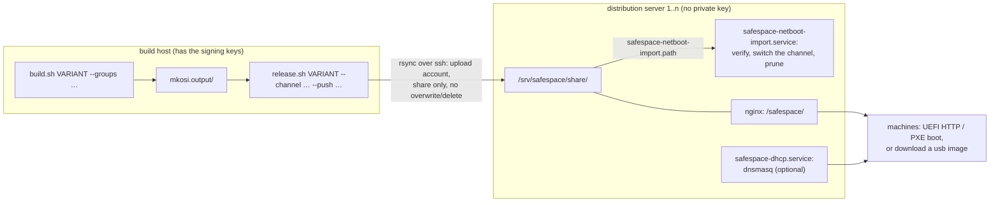

# safespace-arch with mkosi

A Secure-Boot-signed Arch Linux system for USB sticks, SD cards and network boot on x86-64
UEFI machines (no legacy BIOS), built with
[mkosi](https://github.com/systemd/mkosi) (written for mkosi 27). The system is
**read-only**: nothing is written to the boot medium at runtime. The root is protected by
dm-verity, `/var` lives in RAM, and only disks mounted at runtime are writable. What goes
into an image on top of the base system is chosen with **package groups**: an XFCE desktop
over VNC (`remotedesktop`), Docker with its storage on a data disk (`docker`).

Arch Linux only: the images, the build host and the distribution servers.

Two variants are built from the same configuration, selected with `./build.sh`:

| | `usb` | `network` |
|---|---|---|
| Build | `sudo ./build.sh usb` | `sudo ./build.sh network` |
| Boots from | a USB stick or SD card (ESP + root + verity on the medium) | UEFI HTTP (or PXE) boot: the firmware itself downloads the signed UKI, nothing is on the machine |
| Root comes from | the medium, read-only and set read-only at block level | HTTP, into a tmpfs, opened through dm-verity with the signed root hash |
| Distributed with | `sudo ./burn.sh /dev/sdX` (here, or from a distribution server) | `./release.sh network` to the distribution servers |
| USB devices | the initrd authorizes only the path to the boot medium | nothing on USB is authorized at all (the NIC must be PCI/PCIe) |
| Docs | this file | this file plus **[NETBOOT.md](NETBOOT.md)** |

Everything else is identical: same package groups, users, hardening, dm-verity root,
volatile `/var`, Secure Boot signature and `safespace-seal`.

> **Status:** usb variant tested in QEMU (OVMF, stick on emulated USB): boots with and
> without enforced Secure Boot; dm-verity verified, stick read-only at block level; sealing
> with `safespace-seal` (append and `--replace`) and booting the sealed VM. Boots on one real
> machine (Secure Boot in Setup Mode). Network variant tested end to end in QEMU and libvirt
> (OVMF, no disk attached): DHCP → UEFI HTTP boot of the signed UKI → root image and hash
> tree over HTTP → dm-verity against the signed root hash → login. On real hardware: a
> ThinkPad T450s (no HTTP boot, Intel AMT disabled) boots the same signed UKI over PXE/TFTP
> end to end; UEFI HTTP boot on real hardware is not tested yet.

## Two roles: build host and distribution servers



| | Build host | Distribution server |
|---|---|---|
| What it is | the one machine with the Secure Boot keys (`/var/lib/sbctl`) and the PCR signing key | any number of machines next to the clients; they can also be the build host itself |
| Holds | sources, keys, `mkosi.output/`, `mkosi.release/` (staged releases) | the share (`/srv/safespace/share/`): released versions, channels; the **public** `db.pem` |
| Runs | `build.sh` (root), `release.sh` (user) | `server/setup.sh` once, then only services: `nginx`, `safespace-netboot-import.path`, optionally `safespace-dhcp` |
| Network | pushes out over ssh; needs no inbound access | serves HTTP (and DHCP/TFTP); accepts uploads only through the restricted upload account |
| Part of the repo | everything except `server/` | `server/` (+ `lib/verify.sh`); a checkout is only needed to run `server/setup.sh` |

**What a distribution server trusts:** nothing but the public `db.pem`, pinned once at setup.
Before a release is served, the import checks the UKI's Secure Boot signature against it
(`sbverify`), takes the root hash from the signed command line and verifies the root image
block by block against it (`veritysetup verify`); for usb releases it does the same with the
partitions cut out of the image. A release that fails is deleted. So a stolen upload key lets
someone fill the disk or delete nothing (the upload account can neither overwrite nor
delete), but not publish anything the machines would boot. The clients check the same things
again themselves (firmware: signature; initrd: dm-verity).

**Channels:** a release goes to a channel (`--channel`, default `current`). Each channel is a
symlink in the share that points at a version, per variant: `network/current`,
`network/desktop`, `usb/current`, … A server switches the channel to a release **as soon as it
has verified it**. Machines boot a channel through their DHCP boot file
(`…/network/<channel>/boot.efi`), so different kinds of machines can follow different
channels, e.g. kiosks on `current` with `--groups base` and workstations on `desktop` with
`--groups base,remotedesktop`.

## Package groups

`--groups LIST` on `build.sh`: comma-separated, case-insensitive, the same for both variants.
Without it, an image has `base` only.

| Group | What it adds | Where it is defined |
|---|---|---|
| `base` (always) | kernel, firmware, microcode, systemd, openssh, sudo, nftables, usbguard, cryptsetup, efitools + openssl (`safespace-seal`), vim, tmux, qemu-guest-agent; users, ssh, hardening, volatile `/var` | `mkosi.conf`, `mkosi.extra/` |
| `remotedesktop` | XFCE, TigerVNC on `localhost:5901` (through an ssh tunnel), firefox, vlc, gwenview, fonts, pulseaudio; VNC user and password (`safespace.env`) | `mkosi.profiles/remotedesktop/` |
| `docker` | Docker and containerd with their storage on a data disk at `/opt/docker`, the shipped images (`fetch-images.sh`) and their loader; users get the `docker` group. Docker is not started at boot (see [Docker](#docker)) | `mkosi.profiles/docker/` |

```sh
sudo ./build.sh network                                    # base only
sudo ./build.sh network --groups base,RemoteDesktop        # + desktop
sudo ./build.sh usb --groups base,remotedesktop,docker     # everything
```

Each group except `base` is a mkosi profile of its own name, with its packages, files
(`mkosi.extra/`) and service presets; `lib/groups.sh` knows the names and refuses unknown
ones. The build records the set: `mkosi.output/<image>_<version>.groups`,
`/usr/lib/safespace/groups` in the image, `GROUPS=` in the release, and
`safespace-netboot list` on the servers. A new group is a new directory
`mkosi.profiles/<name>/` plus its name in `GROUPS_KNOWN` in `lib/groups.sh`.

`--debug` is **not** a group and stays separate: it adds diagnostic tools (ethtool,
dmidecode, pciutils, usbutils, lshw, iperf3, tcpdump, kexec-tools) and marks the version
`-debug`; no security setting is changed. ⚠️ `kexec-tools` lets root boot an unsigned kernel
past Secure Boot, because the kernel does not enforce lockdown (see "Known open points"):
do not hand out debug builds as production images.

## Quick start

```sh
# build host, once
sudo pacman -S --needed mkosi systemd-ukify sbctl efitools sbsigntools dosfstools mtools erofs-utils zstd cpio rsync skopeo
sudo sbctl create-keys                       # if you have no Secure Boot keys yet (/var/lib/sbctl)
cp users.conf.example users.conf             # your users and ssh keys
cp netboot.conf.example netboot.conf         # network variant: NETROOT_URL=http://<server>/safespace/network/

# distribution server, once (a checkout of this repo on it; db.pem copied from the build host)
sudo server/setup.sh --db-cert db.pem --upload-key releaser.pub

# build host, every release
sudo ./build.sh network --groups base,remotedesktop
./release.sh network --push safespace@<server>
sudo ./build.sh usb --groups base,remotedesktop
./release.sh usb --push safespace@<server>          # or burn it here: sudo ./burn.sh /dev/sdX

# on a machine with the docker group, once per data disk (any disk except the boot medium):
sudo mkfs.ext4 -L safespace-docker /dev/<datadisk>
```

`build.sh` needs root because the signing key in `/var/lib/sbctl/keys/db/` is readable by
root only. Build with `build.sh` only: before mkosi runs it exports the public Secure Boot
keys into the image and creates the PCR signing key on the first build; a plain
`mkosi build` stops at the key check (and without a profile even earlier).

Not tracked by git, created per user or host: `users.conf`, `netboot.conf`, `release.conf`,
`mkosi.local.conf`, `repos.local.conf`, `server/server.conf`, the exported keys
(`mkosi.extra/usr/share/safespace/secureboot/`), shipped images
(`mkosi.profiles/docker/mkosi.extra/usr/share/safespace/docker-images/`), caches, outputs and
the staged releases (`mkosi.release/`).

## Build host

### Once

```sh
sudo pacman -S --needed mkosi systemd-ukify sbctl efitools sbsigntools dosfstools mtools erofs-utils zstd cpio rsync skopeo
sudo sbctl create-keys                  # if there are no Secure Boot keys yet
cp users.conf.example users.conf        # your users and ssh keys
cp netboot.conf.example netboot.conf    # NETROOT_URL=http://arch.boot.internal/safespace/network/
cp release.conf.example release.conf    # RELEASE_TARGETS="safespace@dist1 safespace@dist2" (optional)
ssh-keygen -t ed25519 -f ~/.ssh/safespace-release -C "safespace release $(hostname)"   # the upload key
```

- **`netboot.conf`** (network variant): the URL the machines load their root image from,
  `<SERVER_URL>/network/` of the distribution servers. `build.sh` appends the build version
  and signs the result into the UKI, which is why **changing the server address means
  rebuilding** — a name (`arch.boot.internal`, see [DNS](#dns-you-have-to-do-this)) keeps
  that from happening when the server moves. Several URLs are tried in order: a name with an
  address as fallback, or one URL per distribution server.
- **The upload key** goes to every distribution server (`--upload-key
  ~/.ssh/safespace-release.pub` on `server/setup.sh`); add it to `~/.ssh/config` for those
  hosts (`IdentityFile ~/.ssh/safespace-release`). It reaches nothing but the share.
- **`db.pem` for the servers:** `mkosi.extra/usr/share/safespace/secureboot/db.pem`, written
  by the first build. Public; copy it to the servers any way you like.

### Every release

```sh
sudo ./build.sh network --groups base,remotedesktop       # -f to rebuild unchanged packages
./release.sh network --push safespace@dist1 --push safespace@dist2
./release.sh network --channel desktop                    # release to another channel (targets from release.conf)
./release.sh usb                                          # usb image: same, the stick image as the release
```

`release.sh` bundles the newest build of the variant (`--version` for another one) into
`mkosi.release/<variant>/<version>/`, checks it exactly as the servers will (signature
against `db.pem`, root image against the signed root hash), and pushes it: the release
directory first, then a marker in `.pending/`, which starts the server's import. On the
server the channel switches as soon as the release is verified; the release's files cannot be
replaced afterwards (a new build gets a new version anyway). Machines take the new version on
their next boot; a running machine is unaffected, it has everything in RAM.

| Release | Files |
|---|---|
| network | `boot.efi` (signed UKI), `root.img`, `root.verity`, `roothash`, `cmdline` |
| usb | `image.raw.zst` (the whole stick), `roothash` |
| both | `release` (VARIANT, VERSION, GROUPS, CHANNEL), `manifest.json` (packages), `SHA256SUMS` |

Without a target (`--push` or `RELEASE_TARGETS=`) it only stages. `mkosi.release/<variant>/`
also keeps a local channel link, which `test-vm.sh --netboot` and `netstick.sh` use;
`--prune N` keeps N releases there.

**Try a build on one machine first:** release it to a channel of its own and point only that
machine at it (a `dhcp-host` entry, see [Channels in DHCP](#channels-in-dhcp)):

```sh
sudo ./build.sh network --debug         # --debug: ethtool, tcpdump, ... and "-debug" in the version
./release.sh network --channel test
```

## Distribution server

### Once: set it up

On an Arch Linux machine next to the clients (or the build host itself), from a checkout of
this repository, with `db.pem` and the upload key's `.pub` from the build host:

```sh
cp server/server.conf.example server/server.conf    # optional: prepare the settings first (gitignored)
sudo server/setup.sh --db-cert db.pem --upload-key safespace-release.pub
```

`server/setup.sh` can be run again at any time: it applies changed settings, adds upload
keys and keeps everything else. It does:

| What | Where |
|---|---|
| packages | nginx, dnsmasq, rsync, python (rrsync), openssh, sbsigntools, cryptsetup, zstd, mtools, util-linux, binutils, openssl |
| settings | `/etc/safespace/server.conf` (installed once from `server/server.conf` or the example; then edit it there and rerun) |
| pinned certificate | `/etc/safespace/db.pem`; replacing it needs `--replace-db-cert` |
| user `safespace` | owns the share and runs the import; its ssh login is the upload account: `command="rrsync -wo -no-del -no-overwrite -munge <share>",restrict` — no shell, no reading, no deleting, no overwriting. `authorized_keys` belongs to root |
| share | `/srv/safespace/share/` (`SHARE=`) with `network/`, `usb/`, `.pending/` |
| tool | `/usr/local/bin/safespace-netboot` (+ `/usr/local/lib/safespace-server/verify.sh`) |
| units | `safespace-netboot-import.path` + `.service`, `safespace-dhcp.service` (enabled when `DHCP_MODE` is not `off`) |
| nginx | `/etc/nginx/conf.d/safespace.conf`: the share read-only under `http://<server>/safespace/`, hidden files never |

Settings in `/etc/safespace/server.conf`:

| Setting | Meaning |
|---|---|
| `SHARE=/srv/safespace/share` | where releases are uploaded to and served from |
| `KEEP=3` | releases kept per variant; the ones a channel points at are always kept |
| `SERVER_URL=http://10.0.0.1/safespace` | how machines reach the share; the boot file is `$SERVER_URL/network/<channel>/boot.efi`, the build host's `NETROOT_URL` is `$SERVER_URL/network/` |
| `DHCP_MODE=off\|proxy\|dhcp`, `DHCP_INTERFACE`, `DHCP_CHANNEL` | network boot answers, see [Tell the machines what to boot](#once-tell-the-machines-what-to-boot-dhcp) |
| `DHCP_PROXY_SUBNET` (proxy), `DHCP_RANGE`, `DHCP_ROUTER`, `DHCP_DNS` (dhcp) | per mode |

Firewall, if one is active: TCP 22 (uploads) and 80 (HTTP); with `DHCP_MODE` also UDP 67, 69
and 4011.

### Services

| Unit | What it does |
|---|---|
| `nginx.service` | serves `/srv/safespace/share/` as `http://<server>/safespace/`: GET/HEAD only, no directory listing, no hidden files |
| `safespace-netboot-import.path` | watches `.pending/`; starts the import when an upload is complete (and at boot if one is waiting) |
| `safespace-netboot-import.service` | runs `safespace-netboot import` as user `safespace`, sandboxed and without network: verify, record it in `/var/lib/safespace/state/`, switch the release's channel, prune to `KEEP` |
| `safespace-dhcp.service` | dnsmasq for `DHCP_MODE=proxy` or `dhcp` (configuration generated from `server.conf` on every start); TFTP serves the share |

### Every day

```sh
safespace-netboot list                                     # releases, groups, channels, pending uploads
journalctl -u safespace-netboot-import -f                  # an upload being verified
sudo safespace-netboot activate 20261019-0800 --channel desktop   # point a channel at a verified release
sudo safespace-netboot rollback                            # network/current back to the release before it
sudo safespace-netboot rollback --usb --channel current
journalctl -u safespace-dhcp -f                            # a machine asking where to boot from
curl -I http://10.0.0.1/safespace/network/current/boot.efi # 200 + Content-Length
```

Only verified releases can be activated. A release that failed the import is deleted from the
share (the journal says why), so the build host can upload it again. An old version stays
bootable for as long as it is in the share — that is what makes a rollback work, and why
`KEEP` should stay small.

### usb images from a distribution server

Released usb images are served under `http://<server>/safespace/usb/<channel>/`. Writing one to
a stick needs `burn.sh` and `diagnose.sh` from a checkout, but no keys and no build:

```sh
sudo ./burn.sh http://10.0.0.1/safespace/usb/current/ /dev/sdX      # download, check SHA256SUMS, write
sudo ./burn.sh /srv/safespace/share/usb/current/image.raw.zst /dev/sdX   # on the server itself
sudo ./diagnose.sh --db-cert /etc/safespace/db.pem /dev/sdX         # signatures against db.pem, root block by block
```

### DNS (you have to do this)

If `NETROOT_URL` uses a name, it is not optional: it is signed into the UKI, and the machines
have no other way to find the root image. Create an **A record** `arch.boot.internal` → the
distribution server's IP (`10.0.0.1` in the examples), in the DNS server that your DHCP hands
out to the clients:

| DNS server | What to add |
|---|---|
| dnsmasq | `host-record=arch.boot.internal,10.0.0.1` (or `address=/arch.boot.internal/10.0.0.1`) |
| BIND, zone `boot.internal` | `arch    IN  A   10.0.0.1`, then `rndc reload` |
| Unbound (OPNsense/pfSense: *Overrides*) | `local-data: "arch.boot.internal. A 10.0.0.1"` |
| Pi-hole | *Local DNS → DNS Records*: `arch.boot.internal` → `10.0.0.1` |
| Windows DNS | `dnscmd . /recordadd boot.internal arch A 10.0.0.1` |

Verify from a machine on the same network as the clients (not from the server itself):

```sh
getent hosts arch.boot.internal          # or: nslookup arch.boot.internal
curl -I http://arch.boot.internal/safespace/network/current/boot.efi
```

If the name cannot be resolved, `netroot` says `Could not resolve host` on the client's
console. You can ride that out by listing a second URL with a plain IP address in
`netboot.conf` (tried in order) and rebuilding.

### Once: tell the machines what to boot (DHCP)

The machines learn what to boot from **DHCP**; that is the only thing that changes in your
network. Both ways are pure UEFI firmware booting the signed UKI directly — no iPXE, no boot
loader in between:

| | UEFI HTTP boot (the intended path) | UEFI PXE/TFTP (old firmware without HTTP boot) |
|---|---|---|
| firmware boot entry | "UEFI HTTPv4 …" / "HTTP Boot" | "UEFI PXEv4 …" / "Start PXE over IPv4" |
| client asks with | option 60 `HTTPClient:Arch:00016`, option 93 = 16 | option 60 `PXEClient:Arch:00007`, option 93 = 7 or 9 |
| answer: option 60 | `HTTPClient` | `PXEClient` |
| answer: option 67 | `http://10.0.0.1/safespace/network/current/boot.efi` (full URL) | `network/current/boot.efi` (path under the TFTP root) |
| answer: next server | — | `10.0.0.1`, the distribution server (TFTP) |
| who can answer | the network's DHCP server | the DHCP server, **or** proxy DHCP next to it |
| `DHCP_MODE` on the distribution server | `off` (your DHCP server sends it) or `dhcp` (it *is* the DHCP server) | `proxy` (or `dhcp`) |
| speed for the ~82 MiB UKI | seconds | ~1 min |

**Pure UEFI HTTP boot is options 60 and 67**, and both have to come from the DHCP server that
hands out the address: dnsmasq in proxy mode only answers clients that announce `PXEClient`.
Use the server's IP in option 67 rather than the name: the firmware's own resolver is one more
thing that can fail, and this value can be changed any time without rebuilding the image (the
name matters for the URL *inside* the UKI).

**`DHCP_MODE=off`** (default) — your DHCP server sends the options. With dnsmasq there, this
is the whole change ([NETBOOT.md §3](NETBOOT.md#3-dhcp-and-the-boot-file) has ISC dhcpd, Kea,
OPNsense/pfSense and Windows Server):

```ini
# /etc/dnsmasq.d/netboot.conf on your DHCP server
dhcp-vendorclass=set:httpclient,HTTPClient:Arch:00016
dhcp-match=set:httpclient,option:client-arch,16
dhcp-option-force=tag:httpclient,60,HTTPClient
dhcp-boot=tag:httpclient,http://10.0.0.1/safespace/network/current/boot.efi
```

Only for clients whose option 60 starts with `HTTPClient` — a PXE client that gets an HTTP URL
fails with `PXE-E23`.

**`DHCP_MODE=proxy`** — for machines whose firmware only offers PXE (e.g. ThinkPad T450s with
Intel AMT **disabled**, see [NETBOOT.md](NETBOOT.md#case-found-thinkpad-t450s-bios-jbet73ww)),
or when the router cannot send boot options at all. The distribution server answers only the
boot question of UEFI PXE clients; the router keeps handing out addresses. The UKI comes over
TFTP, the root image over HTTP. Proxy DHCP only reaches machines on the same L2 segment.

**`DHCP_MODE=dhcp`** — the distribution server is the DHCP server of a boot network of its own
(VLAN): addresses from `DHCP_RANGE`, HTTP boot for clients that ask for it, PXE for the rest.

```sh
sudo vim /etc/safespace/server.conf          # DHCP_MODE=proxy, DHCP_INTERFACE=..., DHCP_PROXY_SUBNET=...
sudo server/setup.sh                         # enables and (re)starts safespace-dhcp
journalctl -u safespace-dhcp -f
```

#### Channels in DHCP

`DHCP_CHANNEL` is what every machine boots. Exceptions go into
`/etc/safespace/dnsmasq.d/*.conf` (read by `safespace-dhcp`, kept across reruns), e.g. one
test machine on channel `test`:

```ini
dhcp-host=52:54:00:12:34:56,set:test
dhcp-boot=tag:test,tag:httpclient,http://10.0.0.1/safespace/network/test/boot.efi
dhcp-boot=tag:test,tag:efi64,network/test/boot.efi
```

With `DHCP_MODE=off` the same goes into your own DHCP server's per-host settings.

### Once: Secure Boot on the machines

Enroll your `db` certificate, or boot a machine once in Setup Mode and run
`sudo safespace-seal` on it — see
[NETBOOT.md](NETBOOT.md#secure-boot-on-the-clients). Until then, boot with Secure Boot off;
the dm-verity protection of the root image works either way, but the command line (and with
it the root hash) is only trustworthy with Secure Boot on.

## Check it

```sh
curl -I http://arch.boot.internal/safespace/network/current/boot.efi    # 200 + Content-Length
./test-vm.sh --netboot --url http://10.0.0.1/safespace/network/current/boot.efi --ssh 2222   # optional: QEMU
```

`test-vm.sh --netboot --url` boots the published build in QEMU by pure UEFI HTTP boot from
the real server (through QEMU's NAT, names resolved by the host), as a machine on the LAN
would.

Without `--url` the rehearsal serves a local tree and needs an image built for the VM's view
of the host (`sudo ./build.sh network --url http://10.0.2.2:8000/`) — see
[NETBOOT.md](NETBOOT.md#optional-rehearse-it-in-qemu-first). On a booted machine:
`journalctl -b -g netroot`, `findmnt /`, `veritysetup status root`, `df -h /run/netroot`.

## A netbooting VM (QEMU, libvirt / virt-manager)

A VM that boots the published build exactly like a machine on the LAN: pure UEFI HTTP boot of
the signed UKI from the server, no disk, no iPXE. Two forms, both tested: a plain
`qemu-system-x86_64` command, or a persistent libvirt machine that shows up in virt-manager.

Common to both:

- **Firmware:** OVMF with Secure Boot and **no** enrolled keys, so the VM starts in Setup
  Mode; `sudo safespace-seal` inside seals it, and from the next start on it boots the UKI only
  with enforced Secure Boot. Its NVRAM (a file of its own) keeps that state. With enrolled
  keys, libvirt's Secure Boot firmware would trust only Microsoft's and refuse the UKI.
- **PXE off in the firmware:** OVMF creates PXEv4, PXEv6, HTTPv4 and HTTPv6 boot entries for
  the NIC, PXE first. The PXE entry gets the URL, cannot use it and fails, and only then does
  HTTPv4 load the UKI. Two fw_cfg settings of OVMF remove the PXE entries, so the firmware
  goes straight to `Start HTTP Boot over IPv4`: `opt/org.tianocore/IPv4PXESupport=n` and
  `opt/org.tianocore/IPv6PXESupport=n`. They apply to the boot entries the firmware creates;
  an NVRAM that already has PXE entries is reset once (below).
- **DHCP and DNS** come from the virtual network (QEMU's user network or a libvirt NAT
  network), which uses the **resolver of the VM host**. A host name in the root URL (the
  `NETROOT_URL` signed into the UKI) only resolves if that host's DNS knows it. If not, use
  the server's IP in `netboot.conf`, or the name plus the IP as fallback
  (`NETROOT_URL="http://arch.boot.internal/safespace/network/ http://10.0.0.1/safespace/network/"`, tried in
  order), and rebuild. Check on the VM host: `getent hosts arch.boot.internal`.
- **RAM:** at least root.img + 2 GiB (4 GiB).
- **Guest agent:** the image has `qemu-guest-agent`. It starts by itself when the VM has the
  agent channel (virtio port `org.qemu.guest_agent.0`) and reports IP addresses, OS, host
  name, users and filesystems to the VM host. It only answers those queries and
  `guest-shutdown` (`/etc/qemu/qemu-ga.conf`, `allow-rpcs=`): no `guest-exec`, no file
  access, no password setting, so the VM host gets no command channel into the system.

### Plain QEMU, headless

On any host with QEMU and OVMF (`qemu-desktop edk2-ovmf`), no checkout needed. Runs in the foreground,
also as root over ssh without a desktop; Ctrl-C stops it.

```sh
cp /usr/share/edk2/x64/OVMF_VARS.4m.fd safespace-vm-vars.fd      # once: the VM's NVRAM
qemu-system-x86_64 -machine q35,smm=on,accel=kvm -cpu host -smp 2 -m 4096 -global driver=cfi.pflash01,property=secure,value=on -drive if=pflash,format=raw,readonly=on,file=/usr/share/edk2/x64/OVMF_CODE.secboot.4m.fd -drive if=pflash,format=raw,file=safespace-vm-vars.fd -fw_cfg name=opt/org.tianocore/IPv4PXESupport,string=n -fw_cfg name=opt/org.tianocore/IPv6PXESupport,string=n -nic user,model=virtio-net-pci,bootfile=http://10.0.0.1/safespace/network/current/boot.efi,hostfwd=tcp:127.0.0.1:2222-:22 -device virtio-serial -chardev socket,id=qga,path=safespace-vm-qga.sock,server=on,wait=off -device virtserialport,chardev=qga,name=org.qemu.guest_agent.0 -boot order=n -display none -serial file:safespace-vm-serial.log
ssh -p 2222 <user>@127.0.0.1                                      # after ~1 min; a user from users.conf
echo '{"execute":"guest-network-get-interfaces"}' | socat - UNIX-CONNECT:safespace-vm-qga.sock   # the guest agent
```

| Part | Why |
|---|---|
| `OVMF_CODE.secboot.4m.fd` (read-only pflash) | the UEFI firmware, shared by all VMs; the build with Secure Boot |
| `safespace-vm-vars.fd` (writable pflash) | this VM's NVRAM: boot entries and the Secure Boot keys `safespace-seal` writes. A fresh copy = Setup Mode again |
| `smm=on`, `cfi.pflash01,property=secure` | only the firmware (in SMM) may write the keys, not the guest |
| `-fw_cfg name=opt/org.tianocore/IPv4PXESupport,string=n` (and IPv6) | no PXE boot entries: HTTP boot right away |
| `-nic user,…,bootfile=` | QEMU's user network is the DHCP server, `bootfile=` is its option 67 (the server's IP, so the firmware needs no DNS) |
| `hostfwd=tcp:127.0.0.1:2222-:22` | ssh into the VM from this host only (`tcp::2222-:22` opens it to the network) |
| `-device virtio-serial`, `-chardev socket,…`, `virtserialport,…name=org.qemu.guest_agent.0` | the guest agent's channel; on the VM host it is the socket `safespace-vm-qga.sock` |
| `-display none`, `-serial file:…` | no window; `safespace-vm-serial.log` shows the firmware's netboot (`Start HTTP Boot over IPv4`, `Downloading...100%`). The kernel console is not on the serial port (no `console=ttyS0` in the UKI), so the system is reached over ssh |

Without Secure Boot in the VM: `OVMF_CODE.4m.fd`, and drop `smm=on` and the `-global` option.

### Persistent machine in libvirt (virt-manager)

libvirt's user network has no `bootfile=`, so the boot URL comes from the DHCP server of a
small libvirt NAT network of its own; other networks and VMs stay untouched. As root on the
VM host (change `192.168.150.0/24` if it is in use there).

1. The network; its DHCP sends the boot URL (option 67):

   ```sh
   virsh net-define /dev/stdin <<'EOF'
   <network>
     <name>safespace-netboot</name>
     <forward mode='nat'/>
     <bridge name='virbr-ssnb'/>
     <ip address='192.168.150.1' netmask='255.255.255.0'>
       <dhcp>
         <range start='192.168.150.100' end='192.168.150.199'/>
         <bootp file='http://10.0.0.1/safespace/network/current/boot.efi'/>
       </dhcp>
     </ip>
   </network>
   EOF
   virsh net-autostart safespace-netboot && virsh net-start safespace-netboot
   ```

2. The machine: UEFI with Secure Boot and no keys (Setup Mode), no disk, the NIC as the only
   boot device:

   ```sh
   virt-install --name safespace-netboot --memory 4096 --vcpus 2 --cpu host-passthrough --machine q35 --boot uefi,network,firmware.feature0.name=secure-boot,firmware.feature0.enabled=yes,firmware.feature1.name=enrolled-keys,firmware.feature1.enabled=no --network network=safespace-netboot,model=virtio --disk none --pxe --osinfo linux2022 --graphics vnc --noautoconsole
   ```

3. PXE off: `virsh edit safespace-netboot` and add, directly inside `<domain>`
   (libvirt ≥ 6.5):

   ```xml
   <sysinfo type='fwcfg'>
     <entry name='opt/org.tianocore/IPv4PXESupport'>n</entry>
     <entry name='opt/org.tianocore/IPv6PXESupport'>n</entry>
   </sysinfo>
   ```

   Then start it once with a fresh NVRAM, so the PXE entries of the first start go away. This
   also clears its Secure Boot keys: seal the VM after this start, not before.

   ```sh
   virsh destroy safespace-netboot; virsh start safespace-netboot --reset-nvram
   ```

The VM appears in virt-manager as `safespace-netboot`, with its console there. `virt-install`
adds the guest agent channel by itself, so virt-manager shows the VM's IP addresses
(Details → NIC). Its address, for ssh from the VM host:

```sh
virsh domifaddr safespace-netboot --source agent     # or: virsh net-dhcp-leases safespace-netboot
ssh <user>@192.168.150.1xx
virsh qemu-agent-command safespace-netboot '{"execute":"guest-get-osinfo"}'   # answers
virsh qemu-agent-command safespace-netboot '{"execute":"guest-exec","arguments":{"path":"/bin/true"}}'   # refused: command disabled
```

It boots what `current` points to; to pin a version, put it into `<bootp file=…>`
(`virsh net-edit safespace-netboot`, then `virsh net-destroy` and `virsh net-start`). Remove
it all again:

```sh
virsh destroy safespace-netboot; virsh undefine --nvram safespace-netboot; virsh net-destroy safespace-netboot; virsh net-undefine safespace-netboot
```

## The boot medium is never written to

| Layer | How |
|---|---|
| Partitions | only ESP, root and root-verity (network variant: no partitions at all on the machine) |
| Root (`/usr` and `/etc`) | erofs (read-only filesystem) on dm-verity. The root hash is part of the signed kernel command line, so any changed block fails to read |
| `/var` | tmpfs (`systemd.volatile=state`), filled on every boot from the verified copy in `/usr/share/factory/var` (`safespace-var-factory.service`). Everything written there is gone after reboot |
| ESP | never mounted (`efi`/`boot` mounts masked); no `loader/random-seed` on it, so systemd-boot writes nothing; `systemd-boot-update`, `systemd-boot-random-seed` and systemd-repart are masked |
| Block level | usb: after finding root, the initrd step `usb-bootdev` runs `blockdev --setro` on the medium and all its partitions, so the kernel refuses writes to it, even from root. network: the root image is a read-only loop device over a tmpfs file |

Writable storage exists only on disks mounted at runtime, such as the Docker data disk.

Partitions of the `usb` image (what `burn.sh` writes):

| # | Partition | Content |
|---|---|---|
| 1 | ESP, 512 MiB, FAT | signed systemd-boot `\EFI\BOOT\BOOTX64.EFI`, signed UKI `\EFI\Linux\*.efi` |
| 2 | root, erofs (zstd) | `/usr`, `/etc`, factory `/var`, shipped Docker images |
| 3 | root-verity | dm-verity hash tree for partition 2 |

The `network` image has partitions 2 and 3 only; they are published as separate files
(`root.img`, `root.verity`) and the UKI is served on its own. See
[NETBOOT.md](NETBOOT.md).

## How the integrity protection works

dm-verity itself uses **no keys**. It's a sha256 hash tree over root, and its only anchor of
trust is the **root hash**. That hash sits in the kernel command line inside the UKI, and
the UKI is signed with your sbctl **`db` key**. So everything rests on the Secure Boot
signature:

1. Firmware checks the signatures of systemd-boot and, through it, of the UKI against the
   `db` certificate enrolled in it (PK and KEK only control changes to `db`; the build only
   uses `db.key`).
2. The command line is part of the signed file. Under Secure Boot, systemd-stub ignores any
   command line passed from outside.
3. The initrd (also signed) reads `roothash=`. usb: it finds the root and hash partitions by
   the UUIDs derived from it. network: it downloads `root.img` and `root.verity` from the URL
   on the signed command line and opens them with that hash. Either way the result is
   `/dev/mapper/root`, and a wrong or manipulated root is rejected before it is mounted.
4. The kernel checks every block read from root against the tree. A mismatch stops the system
   (`panic-on-corruption`).

The ESP itself isn't covered by dm-verity, and systemd-stub reads more than the UKI from it.
Those paths are closed on the signed command line:

| ESP content | Protection |
|---|---|
| add-ons (`*.addon.efi`) | only loaded if signed by a key in `db` |
| credentials (`*.cred`) | `systemd.credentials_boot_policy=strict`: no null-key credentials (the default would accept them on machines without TPM2) |
| extension images (`*.sysext.raw`, `*.confext.raw`) | `systemd.sysext=0`, `systemd.confext=0` and `rd.` variants; the units are also masked in the initrd and on the system |

`diagnose.sh` checks all of this on a burned stick, including that the ESP holds nothing but
systemd-boot and the UKI (`--db-cert`: signatures against the db certificate). For released
images, `release.sh` and every distribution server's import do the equivalent before serving
(signature against `db.pem`, root hash from the signed command line, `veritysetup verify` over
the whole root image; `lib/verify.sh`).

**Preconditions:** Secure Boot on and a firmware password on every machine. Without Secure Boot,
any command line (and with it any `roothash=`) can be passed in. The `db` key decides
everything: whoever has it can sign a UKI for a manipulated root.

## Sealing a machine to these keys

The stick can enroll its own Secure Boot keys on a machine, so that the machine afterwards
only boots binaries signed with them (the "seal").

**On the build host: nothing extra.** Every image is signed, so every image carries the
public half of the keys it is signed with: `build.sh` runs `secureboot-export.sh` before each
build (usb and network alike), with the sbctl directory of `SecureBootKey=`. It puts into
`mkosi.extra/usr/share/safespace/secureboot/` (gitignored) the PK, KEK and db certificates
and the signed updates (`*.auth`) the firmware needs to enroll them. The private keys are
only used to sign those updates (PK signs PK and KEK, KEK signs db) and stay in
`/var/lib/sbctl`. `mkosi.postoutput` fails the build if the keys are missing (mkosi run
without `build.sh`), if anything but certificates, `*.auth` and `GUID` is in that directory,
or if any file there contains a private key, and if the UKI is signed by a different key
than the shipped `db.pem` (a machine sealed with it would refuse that UKI). After rotating
keys in sbctl, the next build ships the new ones.

**On the machine:**

1. Firmware setup: "Reset to Setup Mode" or "Clear Secure Boot keys". Boot the stick (Secure
   Boot can't be enforced without keys, so it boots).
2. `sudo safespace-seal`: shows what's enrolled now and what will be enrolled, asks for YES,
   writes db, KEK and finally PK (writing PK ends Setup Mode).
3. Reboot, check that Secure Boot is enabled in the firmware setup, and set a firmware
   password.

By default our KEK and db are **added** to whatever the firmware still has, so Microsoft or
vendor certificates stay if present. Option ROMs of GPUs, NICs or RAID controllers are usually
signed by Microsoft, and without that certificate in db they don't load: no picture in the
firmware setup, or a machine that doesn't boot. `safespace-seal --replace` enrolls **only**
our keys. Use it only on machines without such devices, e.g. integrated graphics only.

Try it in a VM: `./test-vm.sh --setup-mode --ssh 2222`, log in, `sudo safespace-seal`, power
off, then `./test-vm.sh --sealed`.

A netbooted machine can seal itself the same way: boot it in Setup Mode (no keys, so the
unverified UKI loads), run `sudo safespace-seal`, reboot — from then on the firmware
verifies the downloaded UKI against your `db`. See
[NETBOOT.md](NETBOOT.md#secure-boot-on-the-clients).

## Docker

**Why a data disk is needed:** Docker can't run from read-only storage. Its storage
(`data-root`) is constantly written: layer metadata, image references, container layers,
volumes, networks. RAM (`/var`) would fill up quickly. So:

- `/etc/docker/daemon.json`: `data-root` is `/opt/docker/engine`, storage driver `overlay2`.
  Docker 29's default containerd image store is switched off on purpose, so all images live
  in `data-root` and image IDs can be checked against the shipped archives.
- `/etc/containerd/config.toml`: containerd's data goes to `/opt/docker/containerd`.
Only in images with the **`docker` group** (`--groups base,docker`); its files are in
`mkosi.profiles/docker/`.

- **Docker is not started at boot** (not enabled in the preset). Start it by hand once the
  data disk is mounted: `sudo systemctl start docker`. As a second guard, `docker.service`,
  `docker.socket` and `containerd.service` only start when `/opt/docker` is a mount point
  (`ConditionPathIsMountPoint`), so Docker never runs on the read-only root or in RAM.
- `/etc/fstab` (the entry is added by `mkosi.postinst` with the docker group) mounts a disk labelled **`safespace-docker`** at `/opt/docker` if present at boot
  (`nofail`, 10 s timeout). The filesystem must support overlay2: ext4, xfs with ftype=1, or
  btrfs.
- Start Docker: `sudo systemctl start docker` (disk present at boot), or for a disk attached
  later `sudo mount /dev/<datadisk> /opt/docker && sudo systemctl start docker`.

**Images on the stick:**

1. List them in `docker-images.txt` as `<local name:tag> <source>`, with the source pinned by
   digest (`docker.io/library/nginx@sha256:…`).
2. `./fetch-images.sh` downloads them with skopeo as archives into
   `mkosi.profiles/docker/mkosi.extra/usr/share/safespace/docker-images/`, plus `images.list`
   with each image ID.
3. The build puts them into the dm-verity protected root, so they're verified like everything
   else.
4. When Docker starts, `safespace-docker-images.service` loads any image whose expected ID
   isn't present on the data disk, and fails if a loaded image has a different ID.

Container data, volumes and anything pulled at runtime stay on the data disk.

**USB data disks:** usbguard blocks every USB device plugged in after boot. A Docker disk on
USB needs `sudo usbguard allow-device <id>` after plugging it in (temporary; `-p` can't be
written to the read-only `/etc`). Or add a permanent rule to
`mkosi.extra/etc/usbguard/rules.conf` and rebuild (`usbguard generate-policy` shows the
rule syntax). Disks on SATA or NVMe aren't affected.

## What differs from a plain mkosi build

Everything below is on top of what `mkosi build` with `Distribution=arch` and stock Arch
packages would give you. Stock Arch defaults (e.g. the nftables ruleset in
`/etc/nftables.conf`: input policy drop, ssh allowed) are not listed.

### Build configuration (`mkosi.conf`, `mkosi.profiles/`, `repos.conf`)

`mkosi.conf` holds everything both variants share; the differences are in
`mkosi.profiles/usb/` and `mkosi.profiles/network/`, which mkosi merges in when that
profile is active (`./build.sh <variant>` = `mkosi --profile=<variant>`). `mkosi.postinst`
stops the build if no variant is selected.

| Setting | Why |
|---|---|
| `Profiles=` (`--profile`) | `usb` or `network`; also inherited by the initrd, so `mkosi.initrd.conf/mkosi.profiles/<variant>/` ends up in the initrd |
| `ImageId=safespace-arch-usb` / `-network` | per variant, so both can live in `mkosi.output/` and `burn.sh`/`test-vm.sh` never pick the wrong one |
| `Format=disk`, `Bootable=yes` | bootable GPT image |
| `Bootloader=systemd-boot` | mkosi's default for this setup would be a bare UKI as `\EFI\BOOT\BOOTX64.EFI`. Some firmware resets when its boot manager starts a 90 MiB UKI directly, but loads it fine for systemd-boot (see "Troubleshooting") |
| `ElTorito=no` | mkosi 27 adds an ISO9660/El Torito header for CD boot by default; a stick boots via GPT |
| `SecureBoot=yes`, `SecureBootKey`/`Certificate` from `/var/lib/sbctl`, `SecureBootSignTool=systemd-sbsign`, `SecureBootAutoEnroll=no` | systemd-boot and the UKI are signed with the sbctl `db` key; no systemd-boot auto-enrollment files on the ESP (`safespace-seal` does enrollment) |
| `SignExpectedPcr=yes`, `SignExpectedPcrKey`/`Certificate` in `/var/lib/safespace/pcr-signing/` | the UKI carries signed expected PCR 11 values and the PCR public key (`.pcrsig`, `.pcrpkey`): systemd's NvPCRs can be set up, and TPM secrets can be bound to "a UKI signed by this host". Own key, created by `build.sh` on the first build (root-only, never in the image) |
| `Verity=hash` | dm-verity root; the root hash is on the signed kernel command line, no signature partition needed |
| `SplitArtifacts=uki,roothash` (+`partitions` for network), `ManifestFormat=json` | UKI, root hash and package list next to the image; the network variant also writes the root and verity partitions as separate files to publish |
| `CompressOutput=zstd`, `CompressLevel=10` | image as `.raw.zst`, only as large as its content |
| `OutputDirectory=mkosi.output` | outputs out of the project root |
| `--snapshot=`/`--mirror=` from `repos.conf` | set by `build.sh`, not in `mkosi.conf`: pinned Arch Linux Archive day or `latest`, default or own mirror (see ["Package source"](#package-source-snapshot-and-mirror)) |
| `Incremental=yes`, `CacheDirectory=`, `PackageCacheDirectory=` | two cache levels: downloaded packages and the installed system |
| `Environment=SYSTEMD_REPART_MKFS_OPTIONS_VFAT=-S512` | FAT with 512-byte sectors (many firmwares don't read 4K-sector FAT on USB), while erofs and verity keep 4K blocks |
| `Ssh=never` | no sshd-over-vsock units for `mkosi vm` |
| `Hostname=`, `Locale=`, `Keymap=`, `Timezone=` | safespace, en_US.UTF-8, us, UTC |
| `mkosi.version` | `ImageVersion` is the build timestamp, so every build gets its own files. `build.sh` runs it once and passes `--image-version`, so the same value can go into the netboot URL |
| `KernelCommandLine=` of the network variant | `root=/dev/mapper/root`, `rootfstype=erofs`, `ro`, `systemd.verity=no` (the initrd opens the verity device itself) and `safespace.netroot=<url>/<version>/` (where to fetch root from, signed in) |
| `mkosi.local.conf.example` | per-host settings, e.g. more erofs compression threads |

### Disk layout (`mkosi.repart/`, `mkosi.profiles/usb/mkosi.repart/`)

| File | Partition |
|---|---|
| `mkosi.profiles/usb/mkosi.repart/00-esp.conf` | usb variant only: 512 MiB FAT32 with systemd-boot and the UKI only. Excluded: `intel-ucode.img` (the UKI has its microcode), `loader/` (no loader.conf, no type 1 entries, no random seed), `\EFI\systemd\` (only needed for NVRAM boot entries), `BOOTIA32.EFI` |
| `10-root.conf` | erofs, zstd level 12, `Minimize=best`; without `/var`, `/efi`, `/boot` |
| `11-root-verity.conf` | dm-verity hash tree for root |

### Kernel command line (`KernelCommandLine=`, signed into the UKI)

| Option | Effect |
|---|---|
| `systemd.volatile=state` | `/var` is a tmpfs |
| `usbcore.authorized_default=0` | the kernel authorizes no USB device by itself |
| `systemd.credentials_boot_policy=strict` | no null-key credentials from the ESP |
| `systemd.sysext=0`, `systemd.confext=0`, `rd.systemd.sysext=0`, `rd.systemd.confext=0` | no extension images over `/usr` and `/etc` |
| `systemd.verity_root_options=panic-on-corruption` (usb) | a modified root block stops the system; the network variant passes `--panic-on-corruption` to `veritysetup` instead |
| `systemd.firstboot=off` | no first-boot questions |
| `root=/dev/mapper/root`, `rootfstype=erofs`, `ro`, `systemd.verity=no` (network) | the initrd opens the downloaded verity device under that name, so systemd must not look for partitions |
| `safespace.netroot=<url>/<version>/` (network) | where `netroot` fetches `root.img` and `root.verity`; signed, so it cannot be redirected |

### Initrd (`mkosi.initrd.conf/`, `InitrdPackages=`, `KernelInitrdModules=`)

- Both variants: `coreutils`, `sed`, `kmod` for the scripts below; sysext/confext units
  masked in the initrd as well; `CompressLevel=19`. Drivers: one explicit list instead of
  mkosi's default set (dm-verity, loop, erofs, crypto, virtio for QEMU, in `mkosi.conf`),
  plus the boot path per variant. Removed, to keep the UKI small (NETBOOT.md, "Size of the
  network UKI"): filesystem tools, systemd tools without a job in the initrd, glibc's
  charset converters, sanitizer runtimes, certificate CLIs, sqlite tools, `magic.mgc`,
  terminal/timezone/keymap data beyond the console defaults
  (`mkosi.initrd.conf/mkosi.conf`).
- usb (`mkosi.profiles/usb/`, `mkosi.initrd.conf/mkosi.profiles/usb/`): drivers for USB
  host controllers, USB storage, MMC and card readers; `usb-bootdev.service` and
  `/usr/local/lib/safespace/usb-bootdev`, see "USB lockdown".
- network (`mkosi.profiles/network/`, `mkosi.initrd.conf/mkosi.profiles/network/`): client
  ethernet drivers (and their firmware), `curl`, `cryptsetup`, `iproute2`; `20-netboot.network` (DHCP on physical
  ethernet) and `netroot.service` + `/usr/local/lib/safespace/netroot`, which waits for
  DHCP, downloads `root.verity` and `root.img` into a tmpfs under `/run/netroot` (checking
  `MemAvailable` first), and opens them with the signed root hash as `/dev/mapper/root`.
  The tmpfs stays after switch-root: that file *is* the root filesystem. Several
  `safespace.netroot=` URLs are tried in order.

### Build scripts

| Script | What it does |
|---|---|
| `mkosi.postinst` | users from `users.conf` without password (`*`) and with groups from `safespace.env`; their ssh keys into the read-only `/etc/ssh/authorized_keys/<user>`; root locked; `/home` → `/var/home`, `/root` → `/var/roothome`; sudoers check; usbguard daemon settings (block new devices, keep present ones, IPC for `wheel`); VNC password (random per build, saved next to the image); mount points `/efi`, `/var`, `/opt/docker` |
| `mkosi.finalize` | `resolv.conf` → systemd-resolved stub; moves the built `/var` to `/usr/share/factory/var` (caches and logs dropped) |
| `mkosi.postoutput` | fails the build if the UKI is larger than 100 MiB (network: 128 MiB, it carries the ethernet drivers), if it is signed by another key than the exported `db.pem`, or if a network build has no `safespace.netroot=` URL |

### Files in the system (`mkosi.extra/`)

| Area | Files |
|---|---|
| Read-only system | `etc/fstab` (ESP never mounted, Docker data disk); `safespace-var-factory.service` fills `/var` from the factory copy on every boot; masked: `boot.mount`, `boot.automount`, `efi.mount`, `efi.automount`, `systemd-repart`, `systemd-boot-random-seed`, `systemd-boot-update`, all sysext/confext units |
| ssh | `sshd_config.d/10-safespace.conf` (keys only, no root, group `wheel`, keys from `/etc/ssh/authorized_keys/%u`, host keys in `/var`); `sshd-hostkeys.service` + `sshd.service.d/10-hostkeys.conf` replace the masked `sshdgenkeys.service` |
| Network | `20-wired.network`: DHCP on physical ethernet only (`Kind=!*` skips Docker's veth pairs). The network variant configures the same thing once more in the initrd |
| sudo | `sudoers.d/10-wheel`: `wheel` without password |
| USB | `usbguard.service.d/10-early.conf`: usbguard starts before `sysinit.target` |
| Desktop (group `remotedesktop`, `mkosi.profiles/remotedesktop/mkosi.extra/`) | `tigervnc/vncserver-config-defaults` (XFCE, 1920x1080), `vncserver-config-mandatory` (`localhost` only), `20-remotedesktop.preset` (`vncserver@:1`) |
| Docker (group `docker`, `mkosi.profiles/docker/mkosi.extra/`) | `docker/daemon.json` (`data-root=/opt/docker/engine`, overlay2, no containerd image store); `containerd/config.toml` (root in `/opt/docker/containerd`); drop-ins for docker, docker.socket and containerd (`RequiresMountsFor=`/`ConditionPathIsMountPoint=/opt/docker`); `safespace-docker-images.service` + `load-docker-images`, `20-docker.preset` (image loader; Docker itself is not enabled) |
| Services | `system-preset/10-safespace.preset`: networkd, resolved, timesyncd, sshd, nftables, usbguard, var-factory; the groups add their own preset files |
| Groups | `/usr/lib/safespace/groups`: the package groups of this image (written by `mkosi.postinst`) |
| VM guest agent | `qemu/qemu-ga.conf`: `allow-rpcs=` reporting queries and `guest-shutdown` only; the agent starts via udev only in a VM with the agent channel |
| Sealing | `safespace-seal`, plus the keys exported by `secureboot-export.sh` |
| Locale | `etc/locale.gen` (en_US.UTF-8) |

### Tools around the build (not in the image)

`build.sh`, `release.sh`, `secureboot-export.sh`, `burn.sh`, `diagnose.sh`, `netstick.sh`,
`test-vm.sh`, `hwtest-image.sh`, `update-snapshot.sh`, `fetch-images.sh`: see
"What's where".

## Living with a read-only, volatile system

| Topic | Behaviour |
|---|---|
| Configuration (`/etc`) | baked into the image; change `mkosi.extra/` or `mkosi.postinst` and rebuild |
| Users, ssh keys | created at build from `users.conf`; keys in the verified `/etc/ssh/authorized_keys/<user>` |
| Home directories | `/home` → `/var/home` in RAM, reset to the image's state on every boot (including XFCE settings) |
| **ssh host keys** | **new on every boot** (`/var` is RAM), so clients warn "host key changed" after each reboot. See "Open decisions" |
| Logs | journal in RAM only, gone after reboot |
| machine-id | new on every boot |
| Packages | no `pacman` on the running system; add to `Packages=` and rebuild |
| usbguard | only temporary `allow-device`; permanent rules go into the image |
| System extensions | `systemd-sysext`/`confext` stay disabled |
| RAM | `/var` (homes, logs, factory content) uses RAM; the factory part is small (users' homes, package database). The network variant also keeps the whole root image (~2 GiB) in RAM |

## What's where

| File | Purpose |
|---|---|
| `build.sh` | the build entry point (build host): picks the variant (`usb` / `network`) and the package groups, fixes the version, puts the netboot URL on the signed command line, then runs mkosi |
| `release.sh`, `release.conf.example` | build host: bundles a build as a release, checks it as the servers do, pushes it to the distribution servers (`RELEASE_TARGETS=` in `release.conf`) |
| `server/` | distribution server: `setup.sh` (preparation), `safespace-netboot` (import, list, activate, rollback, dnsmasq config), `server.conf.example`, `systemd/` (import path + service, `safespace-dhcp`), `nginx/safespace.conf` |
| `mkosi.profiles/remotedesktop/`, `mkosi.profiles/docker/` | the package groups: packages, files and presets of each |
| `mkosi.conf` | what both variants share: the base packages, kernel command line, UKI, Secure Boot key, verity, compression, caches |
| `repos.conf`, `repos.local.conf.example` | package source: `SNAPSHOT=` (date or `latest`) and `MIRROR=`; per-host override in `repos.local.conf` (gitignored); parsed by `lib/repos.sh` |
| `mkosi.profiles/usb/` | usb variant: `ImageId`, split artifacts, USB lockdown on the command line, USB/SD drivers, and `mkosi.repart/00-esp.conf` (the ESP) |
| `mkosi.profiles/network/` | network variant: `ImageId`, `SplitArtifacts=…,partitions`, `root=`/`systemd.verity=no`, ethernet drivers, initrd packages |
| `mkosi.repart/` | erofs root (verity data) and root-verity, for both variants |
| `mkosi.extra/` | files of the base system: sshd, sudo, networkd, usbguard drop-in, fstab, guest agent restrictions, service presets, unit masks, volatile `/var` |
| `mkosi.initrd.conf/` | initrd configuration: unit masks for both, `mkosi.profiles/usb/` with `usb-bootdev`, `mkosi.profiles/network/` with `netroot` and the initrd network config |
| `mkosi.postinst` | `/home` and `/root` into `/var`, users and ssh keys, usbguard, sudoers check, mount points; per group: VNC (remotedesktop), the docker group and data disk mount (docker); records the groups |
| `mkosi.finalize` | resolv.conf, moves the built `/var` to `/usr/share/factory/var` |
| `mkosi.postoutput` | UKI size and signature checks, netroot URL check (see above) |
| `docker-images.txt`, `fetch-images.sh` | images to ship and their downloader |
| `users.conf.example`, `safespace.env` | users and ssh keys (copy to `users.conf`); groups and VNC settings |
| `netboot.conf.example` | the network variant's root URL on the distribution servers (`<SERVER_URL>/network/`); copy to `netboot.conf` |
| `mkosi.local.conf.example` | per-host settings (erofs threads, key paths); copy to `mkosi.local.conf` |
| `burn.sh`, `diagnose.sh` | write a usb image (from `mkosi.output/`, a share path or a distribution server's URL; or `--netstick` a netstick image) to a medium; read-only check incl. signatures against `db.pem` (`--db-cert`), `veritysetup verify` and which build is on it, for a netstick whether the server serves its root |
| `netstick.sh` | a loader-only USB stick (signed systemd-boot + the published network UKI) for machines whose firmware cannot network-boot the UKI, e.g. the ThinkPad T450s ([NETBOOT.md](NETBOOT.md#machines-that-cannot-network-boot-the-uki-the-netstick)) |
| `lib/` | shared shell helpers: `repos.sh` (package source), `groups.sh` (package groups), `keys.sh` (Secure Boot export and PCR signing key for a build), `verify.sh` (release checks, used by `release.sh` and the servers), `uefi.sh` (signer of EFI binaries, `netstick.sh`) |
| `mkosi.profiles/debug/` | `./build.sh <variant> --debug`: ethtool, dmidecode, pciutils, kexec-tools, tcpdump, … on top of a variant; the version gets a `-debug` suffix |
| `NETBOOT.md` | the network variant in depth: trust model, what the clients need, DHCP for other servers, Secure Boot enrollment, QEMU test, old firmware, troubleshooting |
| `test-vm.sh` | optional rehearsal in QEMU: boot an image as a USB stick, or `--netboot` a released network build (DHCP + HTTP boot, no disk), optionally with enforced Secure Boot, in Setup Mode or sealed |
| `hwtest-image.sh` | diagnostic stick for machines that reset/hang on the real stick: systemd-boot menu that starts the UKI layer by layer (see the script header) |
| `secureboot-export.sh` | public Secure Boot keys and signed enrollment updates for `safespace-seal`; run by `build.sh` before every build |
| `update-snapshot.sh` | moves the pinned package snapshot to the newest day |

## Everyday use

| Task | Command |
|---|---|
| Build | `sudo ./build.sh usb\|network --groups base,…` (`-f` to rebuild unchanged, `--workers N` erofs threads for this run) |
| Release | `./release.sh network\|usb [--channel NAME] [--push safespace@<server>]` |
| On a distribution server | `safespace-netboot list`, `sudo safespace-netboot activate VERSION [--channel NAME]`, `sudo safespace-netboot rollback`, `journalctl -u safespace-netboot-import` |
| Other mirror / newest packages | `SNAPSHOT=`/`MIRROR=` in `repos.local.conf` (["Package source"](#package-source-snapshot-and-mirror)) |
| Update packages | `./update-snapshot.sh && sudo ./build.sh <variant> -f` |
| Update shipped images | edit `docker-images.txt`, `./fetch-images.sh`, `sudo ./build.sh <variant> -f` |
| Force reinstalling all packages | `sudo ./build.sh <variant> -ff` |
| Show the resolved configuration | `./build.sh <variant> summary` |
| Look inside the image | `sudo mkosi --profile=<variant> shell` |
| Test in a VM (no root) | `./test-vm.sh` / `./test-vm.sh --secure-boot`, or `./test-vm.sh --netboot` (DHCP + HTTP boot, no disk; needs `qemu-desktop edk2-ovmf`, for Secure Boot `virt-firmware`) |
| Machine does not boot the stick | `./hwtest-image.sh`, write `mkosi.test/hwtest.img` with `dd`, try the menu entries in order |
| Burn / check (usb) | `sudo ./burn.sh [IMAGE\|URL] /dev/sdX`, `sudo ./diagnose.sh [--db-cert db.pem] /dev/sdX` |
| Debug build with diagnostic tools | `sudo ./build.sh <variant> --debug` |
| Netstick for a machine that cannot network-boot | `sudo ./netstick.sh` (from `mkosi.release/network/current`; `--tree /srv/safespace/share/network` on a server), then `dd` (the script prints the command) or `sudo ./burn.sh --netstick /dev/sdX` |
| Delete outputs / also caches | `sudo mkosi clean` / `sudo mkosi -ff clean` |

**Build host with many cores:** `cp mkosi.local.conf.example mkosi.local.conf` and set
`--workers=` to `nproc`, or pass `sudo ./build.sh <variant> --workers N` for one run
(`--workers` is a `build.sh` option, mkosi itself has none). Most of the build time goes into compressing the erofs root, which
uses 4 threads by default (`--workers=0` means single-threaded, not "all"). zstd for the
image and the initrd already uses all cores. The host needs the same tools as listed under
Quick start, plus the sbctl `db` key and certificate at the paths in `mkosi.conf` (or point
`SecureBootKey=`/`SecureBootCertificate=` elsewhere in `mkosi.local.conf`).

Caches: `mkosi.pkgcache/` (packages) and `mkosi.cache/` (installed system,
`Incremental=yes`). The cache skips package installation, not the erofs compression, which
runs on every build. After editing `Packages=`, build with `-ff` to be safe.

## Package source: snapshot and mirror

`build.sh` reads `repos.conf` (tracked, the project default) and then `repos.local.conf`
(gitignored, per host, `cp repos.local.conf.example repos.local.conf`); keys in the local file
win. Only `SNAPSHOT=` and `MIRROR=` are accepted, the files are parsed, not sourced. mkosi's
own `--mirror`/`--snapshot` are refused on the `build.sh` command line, so the files are the
only source. Before a build, `build.sh` fetches `core.db` from the resulting URL and stops
with the expected layout if it is not there.

`MIRROR=` is a base URL **without** `$repo/os/$arch`; mkosi appends the repository path:

| `SNAPSHOT=` | `MIRROR=` | URL mkosi uses per repository |
|---|---|---|
| `2026/10/17` | empty | `https://archive.archlinux.org/repos/2026/10/17/$repo/os/$arch` |
| `2026/10/17` | archive mirror `URL` | `URL/repos/2026/10/17/$repo/os/$arch` |
| `latest` | empty | `https://fastly.mirror.pkgbuild.com/$repo/os/$arch` |
| `latest` | pacman mirror `URL` | `URL/$repo/os/$arch` |

- A normal pacman mirror only works with `SNAPSHOT=latest`. Take its line from
  `/etc/pacman.d/mirrorlist` and drop `/$repo/os/$arch`:
  `Server = https://ftp.fau.de/archlinux/$repo/os/$arch` → `MIRROR=https://ftp.fau.de/archlinux`.
  `https://ftp.fau.de` alone misses the `/archlinux` directory; with `$repo/os/$arch` in it
  the path is doubled. With a date, a normal mirror fails because it has no `/repos/<date>/`.
- With a date, `MIRROR` has to be an Arch Linux Archive mirror (serves `/repos/YYYY/MM/DD/`
  and `/repos/last/lastsync`).
- `latest` pins nothing: mkosi reuses the incremental cache while the configuration is
  unchanged, so build with `-f` to get the current packages. Changing `SNAPSHOT` or `MIRROR`
  invalidates the incremental cache (both are part of mkosi's cache manifest);
  `mkosi.pkgcache/` is kept.
- `./update-snapshot.sh` sets `SNAPSHOT=` in `repos.conf` to the newest archive day (asked from
  `MIRROR`, else archive.archlinux.org); `latest` becomes a date again.
- Running `mkosi build` directly bypasses `build.sh` and installs from the current
  repositories (no snapshot); build with `build.sh`.

## Troubleshooting: the machine resets instead of booting

**Case found** (usb variant, one machine): the firmware reset without output when its boot
manager started the 90 MiB UKI directly as `\EFI\BOOT\BOOTX64.EFI`, but loaded the same
file when systemd-boot asked for it. Hence `Bootloader=systemd-boot` (a small signed
`BOOTX64.EFI`, the UKI in `\EFI\Linux\`, no `loader.conf`). Older builds also had 4K FAT
sectors and a CD boot header; both are fixed (`-S512`, `ElTorito=no`).

**If another machine doesn't boot:**

1. `sudo ./diagnose.sh /dev/sdX`: right build, 512-byte FAT, no ISO9660 header,
   systemd-boot as `BOOTX64.EFI`.
2. Note when it fails (immediately, after kernel messages, after 30-90 s), the Secure Boot
   state, and whether other live sticks boot.
3. `./hwtest-image.sh`: a stick with a menu that starts the UKI layer by layer; the script
   header says which result points to which layer. The test files are unsigned: Secure Boot
   off or in Setup Mode.

## USB lockdown

- `usbcore.authorized_default=0`: the kernel authorizes no USB device. Both variants.
- usb variant: in the initrd, `usb-bootdev` authorizes hubs and mass-storage interfaces, waits
  up to 30 s for the root partition (UUID derived from `roothash=`), revokes every USB device
  not on the path to it, and marks the medium read-only. A second stick posing as root is
  rejected by dm-verity.
- network variant: nothing authorizes anything, because nothing is needed from USB — every USB
  device stays unauthorized until usbguard is told otherwise (`sudo usbguard allow-device …`),
  and a USB NIC cannot be used for booting.
- After boot, usbguard blocks every new device. Log: `journalctl -b -g usb-bootdev` (usb) or
  `journalctl -b -g netroot` (network).

## Open decisions

- **ssh host keys.** With nothing writable on the stick, they're generated on every boot.
  Options:
  1. leave it like that, and connect with `StrictHostKeyChecking`/known_hosts relaxed for this
     host;
  2. bake fixed host keys into the image (every stick and every boot has the same key, but the
     private key is readable from the unencrypted stick);
  3. keep them on the data disk when present (stable per data disk, unverified storage);
  4. ssh host certificates from your own CA (`TrustedUserCAKeys`/`@cert-authority`), so clients
     trust any host key the CA signed. That needs the CA key at build time (option 2 plus a
     certificate) or a signing service.

## Known open points

- **Real hardware so far:** the usb variant on one machine; the network variant on a ThinkPad
  T450s over PXE (Intel AMT off). UEFI HTTP boot is tested in QEMU/libvirt only. Firmware
  differs (FAT handling, UKI size for network boot, option ROMs when sealing with
  `--replace`); `hwtest-image.sh` helps to find out why a machine doesn't boot.
- **Network variant limits:** the root image (~2 GiB) is downloaded into RAM on every boot;
  the server address is part of the signed command line (moving it means rebuilding); no
  boot while the server is down. See [NETBOOT.md](NETBOOT.md), "Known limits".
- **TPM:** old TPMs (e.g. the T450s' Intel PTT) fail the NvPCR units of systemd 262
  (`systemd-pcrnvdone` and friends); ignored, the system boots normally.
- `fetch-images.sh` is untested.
- **Distribution server:** `release.sh`, the import (all checks, including the rejection
  of manipulated, unsigned and foreign-signed releases and of usb images), channels,
  rollback, the nginx site and the generated dnsmasq configuration are tested without root
  against a local share. Not yet run as root on a real server: `server/setup.sh` itself, the
  units with their sandbox, the ssh upload through rrsync, and which `dhcp-boot` line
  dnsmasq picks for a per-machine channel.
- Builds from before package groups (`20261018-*`) have `GROUPS=unknown` in their release,
  and their `NETROOT_URL` lacks `/network/`: they cannot be served from a distribution
  server. Rebuild.
- **Still open from the security review:**
  - the UKI is signed with the build host's sbctl `db` key (a separate key for the sticks would
    be cleaner);
  - the build runs as root from a folder a normal user can write to;
  - old signed images stay bootable (network: for as long as their directory is on the
    server, which is also what makes a rollback work);
  - no kernel lockdown parameters.
- The data disk is unverified. Shipped images are reloaded when their ID doesn't match, but
  Docker doesn't re-check layer contents that are already on the disk.
- USB keyboards are blocked even at boot, and SD readers on USB with a vendor-specific interface
  (e.g. Realtek `rtsx_usb`) aren't authorized.
