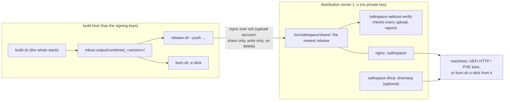

# safespace-arch with mkosi

A Secure-Boot-signed Arch Linux system for USB sticks, SD cards and network boot on x86-64
UEFI machines (no legacy BIOS), built with
[mkosi](https://github.com/systemd/mkosi) (written for mkosi 27). The system is
**read-only**: nothing is written to the boot medium at runtime. The root is protected by
dm-verity, `/var` lives in RAM, and only disks mounted at runtime are writable. A build holds
several **combinations** of **package groups** on top of the base system (Docker with its
storage on a data disk, an XFCE desktop over VNC, diagnostic tools): every group a
dm-verity protected layer, built and shipped once, a combination a chain of layers stacked
read-only; a machine boots one of them and loads only its layers.

Arch Linux only: the images, the build host and the distribution servers.

**One build serves both boot paths.** The same signed UKI and the same root boot from a stick
and over the network; the initrd tells them apart at boot:

| | From a USB stick / SD card | Over the network |
|---|---|---|
| How the firmware starts the UKI | systemd-boot on the stick (`\EFI\BOOT\BOOTX64.EFI`) starts it from the ESP | the firmware downloads it itself (UEFI HTTP boot, or PXE/TFTP) |
| How the initrd knows | `LoaderDevicePartUUID` is set (started from a partition) | it is not |
| Where the root comes from | `usb-bootdev`: the layers of the selected combination, each a data and a hash partition on the stick, found by the UUIDs derived from its signed root hash; the stick is set read-only at block level | `netroot`: the selected combination's layers, `root-<layer>.img` and `root-<layer>.verity`, over HTTP from `safespace.netroot=` into a tmpfs |
| Opened as | every layer through dm-verity with its signed root hash, `--panic-on-corruption`, stacked read-only at `/sysroot` (one layer: its erofs; more: overlayfs without an upper layer) | the same |
| USB devices | only the path to the stick is authorized | nothing on USB is authorized (the NIC must be PCI/PCIe) |
| Gets to the machines | `sudo ./burn.sh /dev/sdX` (on the build host, or anywhere from a distribution server) | `./release.sh` to the distribution servers |

Everything else is identical: combinations, users, hardening, volatile `/var`, Secure Boot
signature and `safespace seal`. **[NETBOOT.md](NETBOOT.md)** is the in-depth reference for
network boot (trust model, other DHCP servers, firmware, troubleshooting);
**[AGENTS.md](AGENTS.md)** is the guide for working on this repository.

> **Status:** stick boot tested in QEMU (OVMF, stick on emulated USB): boots with and without
> enforced Secure Boot; dm-verity verified, stick read-only at block level; sealing with
> `safespace seal` (append and `--replace`) and booting the sealed VM. Boots on one real
> machine (Secure Boot in Setup Mode). Network boot tested end to end in QEMU and libvirt
> (OVMF, no disk attached) and on a ThinkPad T450s over PXE/TFTP (Intel AMT disabled); UEFI
> HTTP boot on real hardware is not tested yet. The single build that serves both paths is
> booted in QEMU both ways (stick, UEFI HTTP from a distribution server), sealed with
> `safespace seal` and with enforced Secure Boot; not yet on real hardware (see "Known open
> points"). Everything that runs without root is covered by `tests/run.sh`.

## Two roles: build host and distribution servers



| | Build host | Distribution server |
|---|---|---|
| What it is | the one machine with the Secure Boot keys and the PCR signing key | any number of machines next to the clients; the build host can be one too |
| Holds | the checkout, keys, `mkosi.output/` (all builds), `mkosi.release/` (the last release, staged) | the share `/srv/safespace/share/`: exactly one release; the **public** `db.pem` |
| Runs | `build.sh` (root), `release.sh` (user) | `server/setup.sh` once, then only services: nginx, `safespace-netboot-verify.path`, optionally `safespace-dhcp` |
| Decides | what is released, and when; going back = releasing an older build again | nothing: it serves what it got and reports whether it is broken |
| Network | pushes out over ssh; needs no inbound access | serves HTTP (and DHCP/TFTP); accepts uploads only through the restricted upload account |

**One release per server.** A distribution server serves the newest release under fixed
names: `boot.efi` (the signed UKI), `systemd-boot.efi`, `layout.sfdisk` (the partition table
for sticks), per layer `root-<layer>.img`, `root-<layer>.verity`, `roothash-<layer>`, per
combination `manifest-<name>.json`, plus `cmdline`, `release`, `SHA256SUMS`. No disk image is stored or shipped anywhere: `burn.sh` assembles a
stick from the parts. `release.sh` replaces a release with `rsync --delay-updates`: the new
files are collected in a temp directory and renamed in one go at the end, and a download
already running finishes on the old file. There are no versions, channels or links to
maintain on the server; all machines of a server boot the same build, and **package groups
are the only difference between its combinations**.

**What a distribution server checks:** after every upload, `safespace-netboot verify` checks
the release against the public `db.pem`, which was pinned when the server was set up: the
Secure Boot signatures of `boot.efi` and `systemd-boot.efi` (`sbverify`), the root hash taken
from the UKI's signed command line, the root image block by block against it
(`veritysetup verify`), and that the partition table names root and verity by the root hash.
All of it on the served files as they are, no unpacking, no temp space. It reports (journal,
`safespace-netboot status`, a failed unit) and never changes anything. The machines check
the same things again themselves (firmware: signature; initrd: dm-verity), so a stolen upload
key can keep machines from booting, but cannot make them boot anything else.

## Deploy from scratch

### 1. Build host

An Arch Linux machine (not a container: the build needs loop devices and root).

```sh
git clone <this repository> safearch && cd safearch
sudo pacman -S --needed mkosi systemd-ukify sbctl efitools sbsigntools dosfstools mtools erofs-utils zstd cpio rsync skopeo go
cp users.conf.example users.conf             # your users and their ssh public keys
cat >safespace.local.conf <<'END'            # this host's choices; every key: safespace.conf
NETROOT_URL=http://<distribution server>/safespace/
RELEASE_TARGETS="safespace@<distribution server>"
END
```

Everything a build can be told is in **one file**, [`safespace.conf`](safespace.conf): the
combinations, the users file, the package source, the netroot URLs, the release targets,
the Secure Boot keys and the machine identity's policy (PCRs, key types). This host's
choices go into `safespace.local.conf` (gitignored); see
[The configuration](#the-configuration-safespaceconf).

Secure Boot keys, once — the host's sbctl, or a key set of its own for safespace
(see [Secure Boot keys](#secure-boot-keys)):

```sh
sudo sbctl create-keys                       # the host's sbctl: /var/lib/sbctl
```

The upload key for the distribution servers, once:

```sh
ssh-keygen -t ed25519 -f ~/.ssh/safespace-release -C "safespace release $(uname -n)"
printf 'Host <distribution server>\n    IdentityFile ~/.ssh/safespace-release\n' >>~/.ssh/config
```

Check the checkout (no root needed, a few seconds):

```sh
tests/run.sh
```

### 2. First build

```sh
sudo ./build.sh                                # the whole stack -> mkosi.output/combined_<time>/
./build.sh list
```

The first build also exports the public Secure Boot keys into the checkout:
`mkosi.extra/usr/share/safespace/secureboot/db.pem` is what the distribution servers need.
A stick right away: `sudo ./burn.sh /dev/sdX`.

### 3. Distribution server

An Arch Linux machine next to the clients (or the build host itself). Copy `db.pem` and
`~/.ssh/safespace-release.pub` from the build host to it, then:

```sh
git clone <this repository> safearch && cd safearch
cp server/server.conf.example server/server.conf       # set SERVER_URL=, DHCP_MODE= (see below)
sudo server/setup.sh --db-cert db.pem --upload-key safespace-release.pub
```

Back on the build host:

```sh
./release.sh                                            # the newest build, to RELEASE_TARGETS
```

On the distribution server:

```sh
safespace-netboot status                                # <build>, ..., ok, checked ...
curl -I http://localhost/safespace/boot.efi             # 200 + Content-Length
```

### 4. Tell the machines where to boot from, once

- **DNS** for the name in `NETROOT_URL`, if it is a name: [DNS](#dns).
- **DHCP** options 60/67 for UEFI HTTP boot, or `DHCP_MODE=proxy` on the server for PXE:
  [DHCP](#dhcp-tell-the-machines-what-to-boot).

### 5. The first machine

Firmware setup: UEFI only, network stack and HTTP boot on, Secure Boot in Setup Mode
("Reset to Setup Mode"). Boot it from the network (boot menu → "UEFI HTTPv4") or from a stick,
log in with an ssh key from `users.conf`, then:

```sh
sudo safespace seal          # enrolls the keys the image is signed with; then reboot
```

From then on it boots only images signed with your keys. Details:
[Sealing a machine](#sealing-a-machine-to-these-keys),
[NETBOOT.md, "Boot a real machine"](NETBOOT.md#boot-a-real-machine).

A stick from anywhere with a checkout: `sudo ./burn.sh http://<server>/safespace/ /dev/sdX`.

## Package groups

A group is what goes into a root on top of the base system:

| Group | What it adds | Where it is defined |
|---|---|---|
| `base` (always) | kernel (no Wi-Fi, Bluetooth or NVIDIA drivers), firmware for Intel, AMD GPUs and Realtek NICs (see below), Intel and AMD microcode, systemd, openssh, sudo, nftables, usbguard, cryptsetup, btrfs-progs, efitools + openssl (`safespace seal`), vim, tmux, qemu-guest-agent; users, ssh, hardening, volatile `/var` | `mkosi.conf`, `mkosi.extra/` |
| `docker` | Docker and containerd with their storage on a data disk at `/opt/docker`, the shipped images (`fetch-images.sh`) and their loader; users get the `docker` group. Docker is not started at boot (see [Docker](#docker)) | `mkosi.profiles/docker/` |
| `xfce4-headless-vnc` | XFCE, TigerVNC on `localhost:5901` (through an ssh tunnel), firefox, vlc, gwenview, fonts, pulseaudio; VNC user and password (`safespace.env`) | `mkosi.profiles/xfce4-headless-vnc/` |
| `debug` | diagnostic tools: ethtool, dmidecode, pciutils, usbutils, lshw, iperf3, tcpdump, kexec-tools | `mkosi.profiles/debug/` |

Each group except `base` is a mkosi profile of its own name, with its packages, files
(`mkosi.extra/`) and service presets; `lib/groups.sh` knows the names and refuses unknown
ones. The image records its groups in `/usr/lib/safespace/groups`. A new group is a new
directory `mkosi.profiles/<name>/` plus its name in `GROUPS_KNOWN` in `lib/groups.sh`.

**Firmware** is chosen by package, not with the `linux-firmware` meta package (all its split
packages): `linux-firmware-intel` (i915/xe GPUs, Intel NICs), `linux-firmware-amdgpu` (AMD
GPUs/APUs since ~2012), `linux-firmware-realtek` (`rtl_nic/` for the usual onboard Realtek
Ethernet; the initrd carries it for the network boot). Not installed, so not downloaded
either: NVIDIA, Broadcom (bnx2/bnx2x server NICs; desktop tg3 needs none), Atheros and
MediaTek (Wi-Fi/Bluetooth), pre-2012 Radeon, AMD NPU/SEV/TEE (`linux-firmware-amd`), Cirrus, TI
and `linux-firmware-other` (among others ENE UB6250 card readers, Airoha and Microsemi PHYs). Of
the installed packages the module filter keeps only what the remaining drivers declare
(iwlwifi, rtw88/89 and rtl_bt go). The build fails if another firmware package comes back as
a dependency (`builds_check_firmware` in `lib/builds.sh`). A machine that needs one of the
others: its package in `mkosi.conf`, its name in `BUILDS_FIRMWARE_ALLOWED`. Microcode for
both vendors (`intel-ucode`, `amd-ucode`) is in the UKI; `compose_check` refuses a UKI
without either.

`debug` is a group like the others because it only adds packages: no setting of the image
depends on it (`tests/run.sh groups` checks that its profile is a package list and nothing
else refers to it). Under the kernel lockdown (`lockdown=integrity`,
[SECURITY.md](SECURITY.md)) `kexec-tools` can only start signed kernels and `lshw` loses its
`/dev/mem` fallback (less detail); `dmidecode` reads `/sys/firmware/dmi` and is unaffected.

## Combinations: the whole stack in one build

`COMBINATIONS=` in `safespace.conf` lists what a build holds, `<name>=<groups>`, space
separated. The default holds three; others are a line in `safespace.local.conf` away:

| Combination | Groups | In the default |
|---|---|---|
| `root` (the default: booted without a selection) | base | yes |
| `containers` | base, docker | yes |
| `debug` | base, debug | yes |
| `remotedesktop` | base, xfce4-headless-vnc | no |
| `remote-workstation` | base, docker, xfce4-headless-vnc | no |

**Each group is a layer, built once** (`lib/layers.sh`). A combination is a chain of layers,
the base first, then its groups in the order `COMBINATIONS` names them; a group lies on the
same layer in every combination (otherwise `build.sh` refuses), so `root=base`,
`containers=base,docker` and `debug=base,debug` are three layers: base, docker on base, debug
on base. `sudo ./build.sh`:

1. builds the base as a tree (pacman's database kept), then the base's image on a copy of
   that tree: the UKI, the initrd and systemd-boot (every combination's), and the base's own
   erofs root with its dm-verity tree;
2. builds every further layer as a tree on a copy of the one below it (mkosi `BaseTrees=`,
   the chain's groups as profiles), and takes as the layer exactly what is new or differs
   from the tree below (type, mode, owner, content, xattrs; `lib/layertree.py`) - the base
   as the machine gets it: its image, unpacked;
3. refuses a layer that changes a package below it, deletes a path of it, or touches the
   kernel; **proves** that the layers stacked as the initrd stacks them are the combination
   built in full, file for file; and makes each layer an erofs image with its dm-verity tree;
4. composes the build, `mkosi.output/combined_<version>/`:
   - one signed UKI (`boot.efi`): kernel, initrd and microcode of the base, built with ukify
     from the image's own systemd-stub, signed with the db key and with signed expected PCRs.
     Its command line names every layer with its root hash, `safespace.layer.<layer>=<hash>`,
     and every combination as its chain, `safespace.root.<name>=<layer>,<layer>...` (no
     `roothash=`, no `root=`); its os-release is named `safespace <version>`, without a
     combination (systemd-boot shows that name);
   - per layer `root-<layer>.img`, `root-<layer>.verity`, `roothash-<layer>`; per combination
     `manifest-<name>.json`; one `layout.sfdisk` with the ESP and a data/verity pair per layer
     (partitions `root-<layer>`, `root-<layer>-verity`, UUIDs from each root hash).

The roots are not shipped whole: the base once, each group's layer once. All combinations run
the same kernel and initrd (the base's). Before the build counts as built, `build.sh` checks
the composed UKI again: signed by exactly the exported `db.pem`, `lockdown=integrity` on its
command line, no `roothash=` or `root=`, every layer with its own hash and every combination
with its chain, in order, signed expected PCRs, and a partition table that names every pair
by its hash. `release.sh` releases it (`COMBINATIONS=` and `LAYERS=` in `release`), the
server checks every layer against its signed hash, `burn.sh` writes all pairs onto the stick.
Over the network a machine downloads only the layers it boots; from a stick only those pairs
are opened.

**Which root boots** is decided in the initrd (`mkosi.initrd.conf/.../select`), first match:

1. `safespace.select=<name>` on the command line
2. EFI variable `SafespaceSelectOnce-8a3e6c1d-4b2f-4e9a-b7d5-1c0f9e2a6b34`: this boot only,
   the initrd deletes it before opening the root
3. EFI variable `SafespaceSelect-8a3e6c1d-…`: the persistent preselection
4. the first combination (`root`)

Without any `safespace.root.<name>=` on the command line the initrd opens nothing.

On the machine, one command, `safespace` (`safespace --help`):

```sh
safespace                              # the overview: combinations, Secure Boot, TPM, identity
safespace select                       # combinations of this build, the booted one, the preselection
sudo safespace select containers       # boot containers from the next boot on
sudo safespace select root --once      # next boot only
sudo safespace select --default        # back to the first combination
```

The machine's identity stays with its combination: another one boots with aSSH's temporary
host key (`debug` for a look around, say); a new identity for it is `safespace identity
clear` and a boot ([Machine identity](#machine-identity)).

**Which root is booted** is visible on the machine: every root names itself at build time
(`mkosi.postinst`), so the name is that of the verified root, not of the selection.
`PRETTY_NAME` in `/usr/lib/os-release` is `safespace <version> <combination>`, e.g.
`safespace 20261020-1250 containers` (`VARIANT_ID=<combination>`; `ID=arch` and `NAME` stay
Arch's), shown by systemd's "Welcome to …", the console login banner (`/etc/issue`, with
the whole `safespace` overview below it: `safespace-issue.service`) and `hostnamectl`; `/usr/lib/safespace/combination` holds the name alone. The initrd is common to
all combinations and keeps Arch's name.

So a machine is sealed once on the default (`safespace seal`), then preselected. The variable
only **names** a combination; its root hash always comes from the signed command line, so
whoever can write the variable (root on the machine, or the firmware setup without a
password) can choose between the signed roots, never boot an unsigned one. An unknown name
stops the boot with a message instead of falling back silently: renaming a combination in
`COMBINATIONS` stops machines preselected to the old name (`safespace select --default`
before the update). The choice is measured into the TPM (PCR 15): only the combination a
sealed machine belongs to gets its identity ([Machine identity](#machine-identity)).

Tested by `tests/run.sh` (sections `compose`: the composed UKI and every check of
`compose_check`, the selection order; `netroot`: only the selected root downloaded; `stick`,
`server`: all pairs) and `tests/vm.sh` (step `select` on the sealed firmware: every
combination booted once, its name and groups checked).

## Secure Boot keys

Every image is signed. `build.sh` finds the keys through **sbctl**, as a key set of PK, KEK
and db (`<keydir>/<K>/<K>.{key,pem}`) plus its GUID file:

| | Setting | Create it |
|---|---|---|
| the host's sbctl (default) | `SecureBootKey=/var/lib/sbctl/keys/db/db.key` in `mkosi.conf` | `sudo sbctl create-keys` |
| a dedicated key set for safespace | `SBCTL_CONFIG=/var/lib/safespace/sbctl/sbctl.conf` in `safespace.local.conf` | see below |

A dedicated set keeps the safespace keys apart from the ones that sign the build host's own
boot chain, and can be rotated on its own:

```sh
sudo install -d -m 0700 /var/lib/safespace/sbctl
printf 'keydir: /var/lib/safespace/sbctl/keys\nguid: /var/lib/safespace/sbctl/GUID\n' | sudo tee /var/lib/safespace/sbctl/sbctl.conf
sudo sbctl --config /var/lib/safespace/sbctl/sbctl.conf create-keys
echo 'SBCTL_CONFIG=/var/lib/safespace/sbctl/sbctl.conf' >>safespace.local.conf
```

`build.sh` then signs the UKI and systemd-boot with that set's db key, and **exports the
public part into every image** (`mkosi.extra/usr/share/safespace/secureboot/`, gitignored):
the PK, KEK and db certificates, the GUID, and the signed updates `safespace seal` writes into
the firmware — `PK.auth`, `KEK.auth`, `db.auth` (replace) and `KEK-append.auth`,
`db-append.auth` (append; signed with `APPEND_WRITE`). The private keys are only used to sign
those (PK signs PK and KEK, KEK signs db) and never leave the key directory.
`mkosi.postoutput` fails the build if anything else is in the export, if a file contains a
private key, or if the UKI is signed by another key than the exported `db.pem`. After
rotating keys, the next build ships the new ones; the servers need the new `db.pem`
(`server/setup.sh --db-cert … --replace-db-cert`).

**YubiKey:** sbctl can keep keys on a YubiKey (`sbctl create-keys --db-keytype yubikey`, also
`--kek-keytype`, `--pk-keytype`). `build.sh` refuses such a key set for now, because nothing
here has been tested with one. The way to add it: mkosi signs the UKI through PKCS#11
(`SecureBootKeySource=provider:pkcs11`, `SecureBootKey=pkcs11:…`), and efitools signs the
`.auth` updates through an OpenSSL engine (`sign-efi-sig-list -e pkcs11 -k 'pkcs11:…'`).
sbctl's own `enroll-keys --export auth` is no substitute: its `--append` export is signed for
replacement, not for `APPEND_WRITE` (`tests/run.sh keys` has the checker).

## Build host

### Builds

Every build gets a directory of its own, named by its build time. Builds wait there until
they are released (or pruned), any number of them:

```
mkosi.output/
├── combined_20261019-0930/
│   ├── boot.efi                     the signed UKI (sticks and network), all combinations
│   ├── systemd-boot.efi             the signed systemd-boot, \EFI\BOOT\BOOTX64.EFI on a stick
│   ├── layout.sfdisk                a stick's partition table (UUIDs derived from the root hashes)
│   ├── root-<layer>.img, .verity    per layer: its erofs image and its dm-verity hash tree
│   ├── roothash-<layer>             its root hash (also on the UKI's signed command line)
│   ├── manifest-<name>.json         per combination: its packages
│   ├── vnc-password-<name>          (xfce4-headless-vnc) the generated VNC password, 0600
│   ├── build.json                   combinations, layers, start/end, snapshot + mirror, commit
│   │                                (+ uncommitted changes?), signing certificate, packages, sizes
│   └── released.log                 one line per push: time, target
└── combined_20261019-1012/ …
```

The directory name is **the build**: `list`, `release.sh --build`, the release and the
servers' `status` show it. The image version inside stays the timestamp; a second build in the
same minute gets the seconds too. After the build the directory belongs to the user who ran
`sudo`, so everything below works without root.

**The parts:** in `mkosi.output/.parts-<version>/` - every mkosi run with its log there, every
step's time in `build.sh`'s output. For the base mkosi builds a disk image as usual (ESP,
root, verity); right after its run `build.sh` keeps only the parts (`builds_finalize` in
`lib/builds.sh`): it takes the signed systemd-boot and the partition table (`sfdisk -d`) out
of the image, then deletes the image and mkosi's separate initrd copy. The layers' trees and
images are made next to it (`lib/layers.sh`). `lib/compose.sh` then makes the build from them
and the parts directory goes. A build is the base (~400 MiB) plus its layers (docker ~100 MiB,
debug a few MiB).

```sh
./build.sh list                              # all builds: built at, snapshot, packages, size, last release
./build.sh show combined_20261019-1012       # build.json readable, the package lists, where it was released
./build.sh diff combined_20261019-0930 combined_20261019-1012   # per combination: + added, - removed, ~ upgraded
./build.sh prune                             # keep the newest 3 (--keep N, --yes)
sudo ./build.sh purge-cache                  # drop mkosi's image cache (--packages: also the downloads)
```

`build.sh` only builds; a combination's resolved configuration is mkosi's own:
`mkosi --profile=docker --profile=xfce4-headless-vnc summary`.

`prune` never deletes the build last released to a target, and removes the leftovers of
failed builds (directories without `build.json`). **Caches:** the downloaded packages
(`mkosi.pkgcache/`) serve every combination; mkosi's image cache (`mkosi.cache/`) holds the
installed system of one package list, so each combination installs again from the local
packages (no downloads). `purge-cache` starts both over when they are suspect or too big.

### Every release

```sh
sudo ./build.sh                                   # the whole stack; -f to rebuild unchanged packages
./release.sh --build combined_20261019-1012       # exactly this build
./release.sh                                      # the newest build
```

Targets: `RELEASE_TARGETS=` in `safespace.local.conf`, or `--push safespace@dist1 --push …`
(a build from another directory, `--builds`, as the test's, goes only where `--push` says). Before
pushing, `release.sh` prints the build it picked (combinations, built at, snapshot, commit,
packages) and warns if a newer build was never released. Every push is
appended to the build's `released.log`.

`release.sh` stages the build's parts in `mkosi.release/` as hardlinks (nothing copied or
unpacked) with `cmdline` (the UKI's signed command line, readable), `release` (VERSION, BUILD,
COMBINATIONS, BUILT, SNAPSHOT, COMMIT, PACKAGES) and `SHA256SUMS`, checks it exactly as the
servers will (signatures against `db.pem`, `lockdown=integrity` on the signed command line,
every root image against its signed root hash, the partition table; `lib/verify.sh`), and pushes it into the share of every target, the file `release`
last. Machines take the new release on their next boot; a running machine is unaffected, it
has everything in RAM.

**Going back** is releasing an older build again: `./release.sh --build <build>`
(`./build.sh list` shows them, with their last release).

**A machine that downloads during a release:** it may get the old `boot.efi` and then the new
`root-<layer>.img`. dm-verity refuses that, as it must; the initrd sees that the server now has
another release (a `roothash-<layer>` that is not the signed one) and reboots after 10 s, and the firmware loads the new
`boot.efi`. If no server answers with this UKI's release and the image is refused anyway, it
stops with an error instead (no reboot loop).

**Try a build first:** release it to a test server of its own (a second distribution server
or the build host, `--push`), with a test machine that boots from it, or write a stick.

## Distribution server

### Setup

`server/setup.sh` (Arch Linux, root) can be run again at any time: it applies changed
settings, adds upload keys and keeps everything else.

```sh
sudo server/setup.sh --db-cert db.pem --upload-key safespace-release.pub   # first run
sudo server/setup.sh                                                        # after editing /etc/safespace/server.conf
sudo server/setup.sh --upload-key another-build-host.pub                    # one more key
```

| What | Where |
|---|---|
| packages | nginx, dnsmasq, rsync, python (rrsync), openssh, sbsigntools, cryptsetup, zstd, mtools, util-linux, binutils, openssl |
| settings | `/etc/safespace/server.conf`, installed once from `server/server.conf` (if you prepared one) or the example; then edit it there and rerun |
| pinned certificate | `/etc/safespace/db.pem`; replacing it needs `--replace-db-cert` |
| user `safespace` | owns the share and runs the checks; its ssh login is the upload account: `command="rrsync -wo -no-del -munge <share>",restrict` — no shell, no reading, no deleting, nothing outside the share. `authorized_keys` belongs to root |
| share | `/srv/safespace/share/` (`SHARE=`): the release |
| tool | `/usr/local/bin/safespace-netboot` (+ `/usr/local/lib/safespace-server/verify.sh`) |
| units | `safespace-netboot-verify.path` + `.service`, `safespace-dhcp.service` (enabled when `DHCP_MODE` is not `off`) |
| nginx | `/etc/nginx/conf.d/safespace.conf`: the share read-only under `http://<server>/safespace/`, hidden files never |

| Setting (`/etc/safespace/server.conf`) | Meaning |
|---|---|
| `SHARE=/srv/safespace/share` | where the release is uploaded to and served from |
| `SERVER_URL=http://10.0.0.1/safespace` | how machines reach the share; the boot file is `$SERVER_URL/boot.efi`, the build host's `NETROOT_URL` is `$SERVER_URL/` |
| `DHCP_MODE=off\|proxy\|dhcp`, `DHCP_INTERFACE` | network boot answers, see [DHCP](#dhcp-tell-the-machines-what-to-boot) |
| `DHCP_PROXY_SUBNET` (proxy), `DHCP_RANGE`, `DHCP_ROUTER`, `DHCP_DNS` (dhcp) | per mode |

Firewall, if one is active: TCP 22 (uploads) and 80 (HTTP); with `DHCP_MODE` also UDP 67, 69
and 4011.

### Services

| Unit | What it does |
|---|---|
| `nginx.service` | serves the share as `http://<server>/safespace/`: GET/HEAD only, no directory listing, no hidden files (rsync's temp directory during an upload) |
| `safespace-netboot-verify.path` | starts the check when `release` changes (`release.sh` writes it last) |
| `safespace-netboot-verify.service` | `safespace-netboot verify --changed` as user `safespace`, sandboxed, read-only on the share, without network; records the result in `/var/lib/safespace/state/`; a broken release leaves the unit failed |
| `safespace-dhcp.service` | dnsmasq for `DHCP_MODE=proxy` or `dhcp`, configuration generated from `server.conf` on every start; TFTP serves the share |

### Every day

```sh
safespace-netboot status                     # what is served, its combinations, the last check
sudo safespace-netboot verify                # check again now
journalctl -u safespace-netboot-verify       # the checks, with the reason if one failed
systemctl --failed                           # a broken release shows up here
journalctl -u safespace-dhcp -f              # a machine asking where to boot from
```

A broken release is reported, not repaired: the machines refuse it on their own, and the fix
is a new release from the build host.

### Sticks from a distribution server

The release is everything a stick needs too. Writing one needs `burn.sh` and `diagnose.sh`
from a checkout, no keys and no build:

```sh
sudo ./burn.sh http://10.0.0.1/safespace/ /dev/sdX          # root streamed onto the stick, checked against SHA256SUMS
sudo ./burn.sh /srv/safespace/share /dev/sdX                 # on the server itself
sudo ./diagnose.sh --db-cert /etc/safespace/db.pem /dev/sdX  # signatures against db.pem, root block by block
./burn.sh http://10.0.0.1/safespace/ --image stick.raw       # a stick image file instead (no root)
```

`burn.sh` writes the partition table from `layout.sfdisk`, creates the ESP (FAT32, 512-byte
sectors) with `systemd-boot.efi` as `\EFI\BOOT\BOOTX64.EFI` and `boot.efi` in `\EFI\Linux\`,
then the hash tree and the root partition (`lib/stick.sh`). From a URL, the root partition
goes from the server onto the stick in one stream; if its checksum does not match, the stick
is wiped again.

### DNS

If `NETROOT_URL` uses a name, it is not optional: it is signed into the UKI, and the machines
have no other way to find the root image. Create an **A record** `arch.boot.internal` → the
distribution server's IP (`10.0.0.1` in the examples), in the DNS server that your DHCP hands
out to the clients:

| DNS server | What to add |
|---|---|
| dnsmasq | `host-record=arch.boot.internal,10.0.0.1` (or `address=/arch.boot.internal/10.0.0.1`) |
| BIND, zone `boot.internal` | `arch    IN  A   10.0.0.1`, then `rndc reload` |
| Unbound (OPNsense/pfSense: *Overrides*) | `local-data: "arch.boot.internal. A 10.0.0.1"` |
| Pi-hole | *Local DNS → DNS Records*: `arch.boot.internal` → `10.0.0.1` |
| Windows DNS | `dnscmd . /recordadd boot.internal arch A 10.0.0.1` |

Verify from a machine on the same network as the clients (not from the server itself):

```sh
getent hosts arch.boot.internal          # or: nslookup arch.boot.internal
curl -I http://arch.boot.internal/safespace/boot.efi
```

If the name cannot be resolved, `netroot` says `Could not resolve host` on the client's
console. Several URLs in `NETROOT_URL` are tried in order: a name with an IP as fallback, or
one URL per distribution server.

### DHCP: tell the machines what to boot

The machines learn what to boot from **DHCP**; that is the only thing that changes in your
network. Both ways are pure UEFI firmware booting the signed UKI directly — no iPXE, no boot
loader in between:

| | UEFI HTTP boot (the intended path) | UEFI PXE/TFTP (old firmware without HTTP boot) |
|---|---|---|
| firmware boot entry | "UEFI HTTPv4 …" / "HTTP Boot" | "UEFI PXEv4 …" / "Start PXE over IPv4" |
| client asks with | option 60 `HTTPClient:Arch:00016`, option 93 = 16 | option 60 `PXEClient:Arch:00007`, option 93 = 7 or 9 |
| answer: option 60 | `HTTPClient` | `PXEClient` |
| answer: option 67 | `http://10.0.0.1/safespace/boot.efi` (full URL) | `boot.efi` (path under the TFTP root = the share) |
| answer: next server | — | `10.0.0.1`, the distribution server (TFTP) |
| who can answer | the network's DHCP server | the DHCP server, **or** proxy DHCP next to it |
| `DHCP_MODE` on the distribution server | `off` (your DHCP server sends it) or `dhcp` (it *is* the DHCP server) | `proxy` (or `dhcp`) |
| speed for the ~83 MiB UKI | seconds | ~1 min |

**Pure UEFI HTTP boot is options 60 and 67**, and both have to come from the DHCP server that
hands out the address: dnsmasq in proxy mode only answers clients that announce `PXEClient`.
Use the server's IP in option 67 rather than the name: the firmware's own resolver is one more
thing that can fail, and this value can be changed any time without rebuilding the image (the
name matters for the URL *inside* the UKI).

**`DHCP_MODE=off`** (default) — your DHCP server sends the options. With dnsmasq there, this
is the whole change ([NETBOOT.md §3](NETBOOT.md#3-dhcp-and-the-boot-file) has ISC dhcpd, Kea,
OPNsense/pfSense and Windows Server):

```ini
# /etc/dnsmasq.d/netboot.conf on your DHCP server
dhcp-vendorclass=set:httpclient,HTTPClient:Arch:00016
dhcp-match=set:httpclient,option:client-arch,16
dhcp-option-force=tag:httpclient,60,HTTPClient
dhcp-boot=tag:httpclient,http://10.0.0.1/safespace/boot.efi
```

Only for clients whose option 60 starts with `HTTPClient` — a PXE client that gets an HTTP URL
fails with `PXE-E23`.

**`DHCP_MODE=proxy`** — for machines whose firmware only offers PXE (e.g. ThinkPad T450s with
Intel AMT **disabled**, see [NETBOOT.md](NETBOOT.md#case-found-thinkpad-t450s-bios-jbet73ww)),
or when the router cannot send boot options at all. The distribution server answers only the
boot question of UEFI PXE clients; the router keeps handing out addresses. The UKI comes over
TFTP, the root image over HTTP. Proxy DHCP only reaches machines on the same L2 segment.

**`DHCP_MODE=dhcp`** — the distribution server is the DHCP server of a boot network of its own
(VLAN): addresses from `DHCP_RANGE`, HTTP boot for clients that ask for it, PXE for the rest.

```sh
sudo vim /etc/safespace/server.conf          # DHCP_MODE=proxy, DHCP_INTERFACE=..., DHCP_PROXY_SUBNET=...
sudo server/setup.sh                         # enables and (re)starts safespace-dhcp
journalctl -u safespace-dhcp -f
```

Site additions (extra options, per-host settings) go into `/etc/safespace/dnsmasq.d/*.conf`,
which `safespace-dhcp` reads after its own configuration.

## Check it

```sh
curl -I http://arch.boot.internal/safespace/boot.efi    # 200 + Content-Length
./test-vm.sh --netboot --url http://10.0.0.1/safespace/boot.efi --ssh 2222   # optional: QEMU over the network
./test-vm.sh --ssh 2222                                  # optional: QEMU from a stick (the newest build)
```

`test-vm.sh --netboot --url` boots the released build in QEMU by pure UEFI HTTP boot from the
real server (through QEMU's NAT, names resolved by the host), as a machine on the LAN would.
Without `--netboot`, it assembles a stick image from a build (as `burn.sh` writes a stick)
and boots it on emulated USB.

Without `--url` the network rehearsal serves `mkosi.release/` and needs an image built for the
VM's view of the host (`sudo ./build.sh --url http://10.0.2.2:8000/`) — see
[NETBOOT.md](NETBOOT.md#optional-rehearse-it-in-qemu-first). On a booted machine:
`journalctl -b -g 'netroot|usb-bootdev'`, `findmnt /`, `veritysetup status root`.

## Integration test

`tests/vm.sh` runs the whole chain unattended, without a window, and **self-contained**: it
builds a test image with a throwaway user, releases it into a share of its own, checks it as
a distribution server does, boots it in QEMU from a stick and over the network, seals it,
boots with enforced Secure Boot, and checks each boot over ssh (in every boot also: kernel
lockdown, and none of what the roots leave out: Wi-Fi/Bluetooth/NVIDIA drivers and firmware,
firmware packages but the selected ones (both microcode packages present), headers, docs, man
pages, locales but en_US), and the machine identity on a software TPM. It touches no real
user, key, build or server. Exit 0 only if every step passed. The test build has combinations
of its own, `tests/vm.safespace.conf` (`build.sh --config`, on top of `safespace.conf`):
`root` (base) and `containers` (base, docker), few to keep it fast and independent of what
is built for real; the step `identity-policy` builds once more with `tests/vm.policy.conf` on
top (another identity policy).

```sh
tests/vm.sh                          # build the whole stack, release, all steps
tests/vm.sh --no-build stick net     # the last test build, two steps only
tests/vm.sh --no-build --jobs 2      # at most two VMs at a time
```

| Step | What | Checked |
|---|---|---|
| `release`, `server-verify`, `initrd-firmware` (always) | `release.sh` into the test's share, then `server/safespace-netboot verify` on it; the UKI's initrd | the checks a distribution server makes; the initrd carries the Realtek NIC firmware (`rtl_nic/`) |
| `stick` | a stick assembled from the release (`lib/stick.sh`, as `burn.sh` writes it) | the first combination by its name, `usb-bootdev` opened the root, `netroot` did not run, `LoaderDevicePartUUID` set, the stick read-only, root `verified`, `running`, no failed units |
| `net` | UEFI HTTP boot of the share | `netroot` opened the root, no `usb-bootdev`, no `LoaderDevicePartUUID`, `verified`, `running` |
| `seal` | Setup Mode → `safespace seal` → the sealed firmware | Secure Boot `enabled (user)`, `verified`, `running` |
| `net-sb` | network boot with enforced Secure Boot | Secure Boot enabled, `verified`, `running` |
| `select` | on the sealed firmware, one VM, one boot after the other: no selection, `safespace select <second>`, `once <first>`, the second again (persistent), `clear`, the first again. Side by side, every further combination in a VM of its own: `SafespaceSelectOnce=<name>` written into a copy of the sealed variables (`virt-fw-vars`) | the booted combination's name (the initrd's choice, `/usr/lib/safespace/combination`, `PRETTY_NAME`, the login banner) and groups (`/usr/lib/safespace/groups`; the docker command exactly with the docker group); a preset `SafespaceSelectOnce` deleted by the initrd; `debug` has exactly the default's setuid/setgid files, file capabilities and enabled units; each Secure Boot enabled and `verified` |
| `identity` | on a TPM of its own (swtpm, `test-vm.sh --tpm`) and a copy of the sealed firmware, the first two boots first, then each further case side by side on a copy of their TPM and variables, with a client that trusts only the CA (`@cert-authority`, `StrictHostKeyChecking yes`): the first sealed boot, the default again, `containers` once, over the network, an option ROM more (PCR 2), another db certificate (PCR 7), the stick of a second build (B, built while A boots), `safespace identity clear`, the agent failing; beside them a new TPM with the SHA-1 bank only (`--tpm-banks sha1`); last `safespace update` on a network boot (B into the share) | first boot: the initrd makes the machine-id and the CA at once, certified through slot 0 in the same boot; the default again: slot 0, the same machine-id, an agent restart gets no certificate (window closed; sshd restarts with it, the first state is kept), its root can't unseal the machine-id (also not after extending PCR 15); `containers`: temporary key, nothing released; network, PCR 2: slot 1; PCR 7: temporary; build B: slot 0 with no step, the same CA and machine-id; identity clear: the next boot a new CA (the old line refused) and machine-id; the agent failing: the throwaway key, the reason on the console; SHA-1 only: without `safespace tpm sha1 on` nothing made, with it the identity on SHA-1, after `tpm sha1 off` neither; `safespace update`: up to date, then B checked and booted, slot 0, the same CA and machine-id; build C (`tests/vm.policy.conf`: one slot `0,7,15+11`, `KEY_TYPES=p256`) on a new TPM: the identity made under that policy - certified through that slot, an ECDSA CA and host key, `safespace identity` names the policy ([Machine identity](#machine-identity)) |

**Kept apart from everything real**, in `mkosi.test/vm/` (gitignored): the test user
`tester` and its key (created on the first run, used for nothing else), the test builds
(`build.sh --config tests/vm.safespace.conf --output-root mkosi.test/vm/builds`; the newest is
kept; `./build.sh list` and `./release.sh` never see them, and `release.sh --builds` never
pushes to `RELEASE_TARGETS`, so a build with the test key cannot reach a real server by
accident), and one directory per run with the share and the
logs. The test build loads its root from `http://10.0.2.2:8790/` (QEMU's view of the build
host), where one HTTP server serves the share to every network boot.

**Boots side by side:** `stick`, `net`, `net-sb` and `seal` start together, `select` once
`seal` has sealed the firmware; at most `--jobs N` VMs at a time (default: as many as the
available RAM allows for a network boot of the largest root, i.e. root + 2.5 GiB each, at
most 4). Each step's VMs have their own files (`test-vm.sh --work`: firmware variables,
serial log, guest-agent socket) in `run-<time>/w/<step>/`; the report lists the results in
step order.

**Prerequisites**, all checked before anything starts (the script lists what is missing and
exits with 2):

- `qemu-desktop`, `edk2-ovmf`, `virt-firmware`, `openssh`, `curl`, `rsync`, `binutils`,
  `sbsigntools`, `cryptsetup`, `dosfstools`, `mtools`, `util-linux`, `python`; read/write
  access to `/dev/kvm`; `swtpm` (step `identity`); `go` for a build (aSSH, `lib/assh.sh`)
- with `--no-build` / `--build`: the public keys the test build was signed with (every
  build exports them)
- `sudo` for `build.sh` (not with `--no-build`): asked once at the start, or for unattended
  runs (cron, CI) a rule without password:
  ```
  <user> ALL=(root) NOPASSWD: /path/to/safearch/build.sh
  ```
  ⚠️ That is root for whoever can write the checkout: `build.sh` runs the repository's
  scripts as root. Only on a build host where that is acceptable.
- TCP port 8790 free on `127.0.0.1`, 4 GiB RAM available (enough for one VM at a time),
  6 GiB + 4 GiB per combination free in `mkosi.test/`

Logs: `mkosi.test/vm/run-<time>/` (the build and release logs, the server check, each boot's
`test-vm.sh` output and serial log, what the checks saw). Not covered: real hardware, the
real distribution server (its setup and services), and the reboot when a release is replaced
while a machine boots.

## A netbooting VM (QEMU, libvirt / virt-manager)

A VM that boots the published build exactly like a machine on the LAN: pure UEFI HTTP boot of
the signed UKI from the server, no disk, no iPXE. Two forms, both tested: a plain
`qemu-system-x86_64` command, or a persistent libvirt machine that shows up in virt-manager.

Common to both:

- **Firmware:** OVMF with Secure Boot and **no** enrolled keys, so the VM starts in Setup
  Mode; `sudo safespace seal` inside seals it, and from the next start on it boots the UKI only
  with enforced Secure Boot. Its NVRAM (a file of its own) keeps that state. With enrolled
  keys, libvirt's Secure Boot firmware would trust only Microsoft's and refuse the UKI.
- **PXE off in the firmware:** OVMF creates PXEv4, PXEv6, HTTPv4 and HTTPv6 boot entries for
  the NIC, PXE first. The PXE entry gets the URL, cannot use it and fails, and only then does
  HTTPv4 load the UKI. Two fw_cfg settings of OVMF remove the PXE entries, so the firmware
  goes straight to `Start HTTP Boot over IPv4`: `opt/org.tianocore/IPv4PXESupport=n` and
  `opt/org.tianocore/IPv6PXESupport=n`. They apply to the boot entries the firmware creates;
  an NVRAM that already has PXE entries is reset once (below).
- **DHCP and DNS** come from the virtual network (QEMU's user network or a libvirt NAT
  network), which uses the **resolver of the VM host**. A host name in the root URL (the
  `NETROOT_URL` signed into the UKI) only resolves if that host's DNS knows it. If not, use
  the server's IP in `NETROOT_URL` (`safespace.local.conf`), or the name plus the IP as fallback
  (`NETROOT_URL="http://arch.boot.internal/safespace/ http://10.0.0.1/safespace/"`, tried in
  order), and rebuild. Check on the VM host: `getent hosts arch.boot.internal`.
- **RAM:** at least the booted root image + 2 GiB (4 GiB).
- **Guest agent:** the image has `qemu-guest-agent`. It starts by itself when the VM has the
  agent channel (virtio port `org.qemu.guest_agent.0`) and reports IP addresses, OS, host
  name, users and filesystems to the VM host. It only answers those queries and
  `guest-shutdown` (`/etc/qemu/qemu-ga.conf`, `allow-rpcs=`): no `guest-exec`, no file
  access, no password setting, so the VM host gets no command channel into the system.

### Plain QEMU, headless

On any host with QEMU and OVMF (`qemu-desktop edk2-ovmf`), no checkout needed. Runs in the foreground,
also as root over ssh without a desktop; Ctrl-C stops it.

```sh
cp /usr/share/edk2/x64/OVMF_VARS.4m.fd safespace-vm-vars.fd      # once: the VM's NVRAM
qemu-system-x86_64 -machine q35,smm=on,accel=kvm -cpu host -smp 2 -m 4096 -global driver=cfi.pflash01,property=secure,value=on -drive if=pflash,format=raw,readonly=on,file=/usr/share/edk2/x64/OVMF_CODE.secboot.4m.fd -drive if=pflash,format=raw,file=safespace-vm-vars.fd -fw_cfg name=opt/org.tianocore/IPv4PXESupport,string=n -fw_cfg name=opt/org.tianocore/IPv6PXESupport,string=n -nic user,model=virtio-net-pci,bootfile=http://10.0.0.1/safespace/boot.efi,hostfwd=tcp:127.0.0.1:2222-:22 -device virtio-serial -chardev socket,id=qga,path=safespace-vm-qga.sock,server=on,wait=off -device virtserialport,chardev=qga,name=org.qemu.guest_agent.0 -boot order=n -display none -serial file:safespace-vm-serial.log
ssh -p 2222 <user>@127.0.0.1                                      # after ~1 min; a user from users.conf
echo '{"execute":"guest-network-get-interfaces"}' | socat - UNIX-CONNECT:safespace-vm-qga.sock   # the guest agent
```

| Part | Why |
|---|---|
| `OVMF_CODE.secboot.4m.fd` (read-only pflash) | the UEFI firmware, shared by all VMs; the build with Secure Boot |
| `safespace-vm-vars.fd` (writable pflash) | this VM's NVRAM: boot entries and the Secure Boot keys `safespace seal` writes. A fresh copy = Setup Mode again |
| `smm=on`, `cfi.pflash01,property=secure` | only the firmware (in SMM) may write the keys, not the guest |
| `-fw_cfg name=opt/org.tianocore/IPv4PXESupport,string=n` (and IPv6) | no PXE boot entries: HTTP boot right away |
| `-nic user,…,bootfile=` | QEMU's user network is the DHCP server, `bootfile=` is its option 67 (the server's IP, so the firmware needs no DNS) |
| `hostfwd=tcp:127.0.0.1:2222-:22` | ssh into the VM from this host only (`tcp::2222-:22` opens it to the network) |
| `-device virtio-serial`, `-chardev socket,…`, `virtserialport,…name=org.qemu.guest_agent.0` | the guest agent's channel; on the VM host it is the socket `safespace-vm-qga.sock` |
| `-display none`, `-serial file:…` | no window; `safespace-vm-serial.log` shows the firmware's netboot (`Start HTTP Boot over IPv4`, `Downloading...100%`). The kernel console is not on the serial port (no `console=ttyS0` in the UKI), so the system is reached over ssh |

Without Secure Boot in the VM: `OVMF_CODE.4m.fd`, and drop `smm=on` and the `-global` option.

### Persistent machine in libvirt (virt-manager)

libvirt's user network has no `bootfile=`, so the boot URL comes from the DHCP server of a
small libvirt NAT network of its own; other networks and VMs stay untouched. As root on the
VM host (change `192.168.150.0/24` if it is in use there).

1. The network; its DHCP sends the boot URL (option 67):

   ```sh
   virsh net-define /dev/stdin <<'EOF'
   <network>
     <name>safespace-netboot</name>
     <forward mode='nat'/>
     <bridge name='virbr-ssnb'/>
     <ip address='192.168.150.1' netmask='255.255.255.0'>
       <dhcp>
         <range start='192.168.150.100' end='192.168.150.199'/>
         <bootp file='http://10.0.0.1/safespace/boot.efi'/>
       </dhcp>
     </ip>
   </network>
   EOF
   virsh net-autostart safespace-netboot && virsh net-start safespace-netboot
   ```

2. The machine: UEFI with Secure Boot and no keys (Setup Mode), no disk, the NIC as the only
   boot device:

   ```sh
   virt-install --name safespace-netboot --memory 4096 --vcpus 2 --cpu host-passthrough --machine q35 --boot uefi,network,firmware.feature0.name=secure-boot,firmware.feature0.enabled=yes,firmware.feature1.name=enrolled-keys,firmware.feature1.enabled=no --network network=safespace-netboot,model=virtio --disk none --pxe --osinfo linux2022 --graphics vnc --noautoconsole
   ```

3. PXE off: `virsh edit safespace-netboot` and add, directly inside `<domain>`
   (libvirt ≥ 6.5):

   ```xml
   <sysinfo type='fwcfg'>
     <entry name='opt/org.tianocore/IPv4PXESupport'>n</entry>
     <entry name='opt/org.tianocore/IPv6PXESupport'>n</entry>
   </sysinfo>
   ```

   Then start it once with a fresh NVRAM, so the PXE entries of the first start go away. This
   also clears its Secure Boot keys: seal the VM after this start, not before.

   ```sh
   virsh destroy safespace-netboot; virsh start safespace-netboot --reset-nvram
   ```

The VM appears in virt-manager as `safespace-netboot`, with its console there. `virt-install`
adds the guest agent channel by itself, so virt-manager shows the VM's IP addresses
(Details → NIC). Its address, for ssh from the VM host:

```sh
virsh domifaddr safespace-netboot --source agent     # or: virsh net-dhcp-leases safespace-netboot
ssh <user>@192.168.150.1xx
virsh qemu-agent-command safespace-netboot '{"execute":"guest-get-osinfo"}'   # answers
virsh qemu-agent-command safespace-netboot '{"execute":"guest-exec","arguments":{"path":"/bin/true"}}'   # refused: command disabled
```

It boots what `current` points to; to pin a version, put it into `<bootp file=…>`
(`virsh net-edit safespace-netboot`, then `virsh net-destroy` and `virsh net-start`). Remove
it all again:

```sh
virsh destroy safespace-netboot; virsh undefine --nvram safespace-netboot; virsh net-destroy safespace-netboot; virsh net-undefine safespace-netboot
```

## The boot medium is never written to

| Layer | How |
|---|---|
| Partitions | only ESP, root and root-verity on a stick; over the network no partitions at all on the machine |
| Root (`/usr` and `/etc`) | erofs (read-only filesystem) on dm-verity. The root hash is part of the signed kernel command line, so any changed block fails to read |
| `/var` | tmpfs (`systemd.volatile=state`), filled on every boot from the verified copy in `/usr/share/factory/var` (`safespace-var-factory.service`). Everything written there is gone after reboot |
| ESP | never mounted (`efi`/`boot` mounts masked); no `loader/random-seed` on it, so systemd-boot writes nothing; `systemd-boot-update`, `systemd-boot-random-seed` and systemd-repart are masked |
| Block level | from a stick: after finding root, the initrd step `usb-bootdev` runs `blockdev --setro` on the medium and all its partitions, so the kernel refuses writes to it, even from root. Over the network: the root image is a read-only loop device over a tmpfs file |

Writable storage exists only on disks mounted at runtime, such as the Docker data disk.

Partitions of the `usb` image (what `burn.sh` writes):

| # | Partition | Content |
|---|---|---|
| 1 | ESP, 512 MiB, FAT | signed systemd-boot `\EFI\BOOT\BOOTX64.EFI`, signed UKI `\EFI\Linux\*.efi` |
| 2, 4, … | `root-<layer>`, erofs (zstd), one per layer | the base: `/usr`, `/etc`, factory `/var`; a further layer: what its group adds or changes (e.g. docker, shipped Docker images) |
| 3, 5, … | `root-<layer>-verity` | dm-verity hash tree of the partition before it |

The base's mkosi run lays out ESP, root, verity (`mkosi.repart/`); `lib/compose.sh` writes the
stick's table with one pair per layer. Over the network the same pairs are published as
separate files (`root-<layer>.img`, `root-<layer>.verity`) and the UKI is served on its own. See
[NETBOOT.md](NETBOOT.md).

## How the integrity protection works

dm-verity itself uses **no keys**. It's a sha256 hash tree over a layer, and its only anchor
of trust is the **root hash**. That hash (one per layer, `safespace.layer.<layer>=`) sits in
the kernel command line inside the UKI, with every combination's chain of layers
(`safespace.root.<name>=`), and
the UKI is signed with your sbctl **`db` key**. So everything rests on the Secure Boot
signature:

1. Firmware checks the signatures of systemd-boot and, through it, of the UKI against the
   `db` certificate enrolled in it (PK and KEK only control changes to `db`; the build only
   uses `db.key`).
2. The command line is part of the signed file. Under Secure Boot, systemd-stub ignores any
   command line passed from outside.
3. The initrd (also signed) picks the combination and reads its layers and their hashes from
   the command line (an EFI variable can only name a combination, never supply a hash or a
   layer). usb: it finds each layer's data and hash partitions by the UUIDs derived from its
   hash. network: it downloads `root-<layer>.img` and `root-<layer>.verity` from the URL on
   the signed command line and opens them with that hash. Either way each layer is a dm-verity
   device, and a wrong or manipulated layer is rejected before anything is mounted.
4. The layers are stacked read-only at `/sysroot`: one layer is its erofs, more are overlayfs
   without an upper layer (`ro,metacopy=off,redirect_dir=off,index=off`) - every file comes
   from a verified layer, nothing is writable, the build proved the stack equal to the
   combination built in full.
5. The kernel checks every block read from a layer against its tree. A mismatch stops the
   system (`panic-on-corruption`).

The ESP itself isn't covered by dm-verity, and systemd-stub reads more than the UKI from it.
Those paths are closed on the signed command line:

| ESP content | Protection |
|---|---|
| add-ons (`*.addon.efi`) | only loaded if signed by a key in `db` |
| credentials (`*.cred`) | `systemd.credentials_boot_policy=strict`: no null-key credentials (the default would accept them on machines without TPM2) |
| extension images (`*.sysext.raw`, `*.confext.raw`) | `systemd.sysext=0`, `systemd.confext=0` and `rd.` variants; the units are also masked in the initrd and on the system |

`diagnose.sh` checks all of this on a burned stick, including that the ESP holds nothing but
systemd-boot and the UKI (`--db-cert`: signatures against the db certificate). For released
images, `release.sh` and every distribution server's check do the equivalent
(signature against `db.pem`, root hashes from the signed command line, `veritysetup verify`
over every root image; `lib/verify.sh`).

**Preconditions:** Secure Boot on and a firmware password on every machine. Without Secure Boot,
any command line (and with it any root hash) can be passed in. The `db` key decides
everything: whoever has it can sign a UKI for a manipulated root.

## Sealing a machine to these keys

The stick can enroll its own Secure Boot keys on a machine, so that the machine afterwards
only boots binaries signed with them (the "seal").

**On the build host: nothing extra.** Every image is signed, so every image carries the
public half of the keys it is signed with; `build.sh` exports them on every build (usb and
network alike), see [Secure Boot keys](#secure-boot-keys).

**On the machine:**

1. Firmware setup: "Reset to Setup Mode" or "Clear Secure Boot keys". Boot the stick (Secure
   Boot can't be enforced without keys, so it boots).
2. `sudo safespace seal`: shows what's enrolled now and what will be enrolled, asks for YES,
   writes db, KEK and finally PK (writing PK ends Setup Mode).
3. Reboot, check that Secure Boot is enabled in the firmware setup, and set a firmware
   password.

By default our KEK and db are **added** to whatever the firmware still has, so Microsoft or
vendor certificates stay if present. Option ROMs of GPUs, NICs or RAID controllers are usually
signed by Microsoft, and without that certificate in db they don't load: no picture in the
firmware setup, or a machine that doesn't boot. `safespace seal --replace` enrolls **only**
our keys. Use it only on machines without such devices, e.g. integrated graphics only.

Try it in a VM: `./test-vm.sh --setup-mode --ssh 2222`, log in, `sudo safespace seal`, power
off, then `./test-vm.sh --sealed`.

A netbooted machine can seal itself the same way: boot it in Setup Mode (no keys, so the
unverified UKI loads), run `sudo safespace seal`, reboot — from then on the firmware
verifies the downloaded UKI against your `db`. See
[NETBOOT.md](NETBOOT.md#secure-boot-on-the-clients).

### Machine identity

A sealed machine with a TPM 2.0 gets an identity of its own: its **ssh host key** is made in
the TPM at every boot and certified by the machine's **CA**, a key in the TPM - and its
machine-id stays the same across reboots and updates. Both are made by the initrd at the
first boot with Secure Boot on, at once, without a step and without a PIN, for the
combination that boots. The host key is [aSSH](assh/README.md)'s (the submodule `assh/`):
`assh-agent.service`, configured by `/etc/assh/assh.conf`, lends it to sshd. Clients trust the
CA, once (`safespace` shows the line):

```
@cert-authority host.example,192.0.2.10 ssh-rsa AAAA...   # in ~/.ssh/known_hosts
```

- **Updates** keep the identity with nothing to do: the CA certifies (slot 0) while the
  firmware, Secure Boot and the combination are as at the creation and the UKI is one the
  build host signed - a new build carries its own signature. `sudo safespace update` on a
  network-booted machine checks the server's newer release (signed by the db key) and
  reboots into it.
- **A firmware update or a new option ROM** leaves slot 0: the CA still certifies through
  slot 1 (Secure Boot and the combination), shown purple.
- **Another combination** boots normally, with aSSH's temporary host key (made in the TPM,
  not certified, its fingerprint in the journal) and a throwaway machine-id: clients that
  trust only the CA refuse it.
- **Nothing approves another state**: the CA's authority existed for the creation alone. A
  new identity - for another combination, after a firmware update, after a cleared TPM - is
  `sudo safespace identity clear` and a boot; the clients need the new line. `sudo safespace
  select NAME` asks on a terminal whether to clear it too (default no).

| Command (on the machine) | Does |
|---|---|
| `safespace` | the overview: the combinations, Secure Boot, the TPM's bank, the identity with its `@cert-authority` line, this boot's host key (also on the console before the login) |
| `safespace identity` | the machine-id, the CA with its slots and the `@cert-authority` line, this boot's host key: certified through which slot, or temporary, and in full (`host key: ssh-rsa AAAA…`, what ssh shows whoever connects without the CA's line) |
| `sudo safespace select NAME` | NAME from the next boot on; another combination than the booted one, with an identity, asks whether to clear it (`--clear-identity`, `--keep-identity` answer it; without a terminal it stays) |
| `sudo safespace identity clear` | removes the identity (YES): the CA, the machine-id; the next boot with Secure Boot on makes a new one, with a new `@cert-authority` line. SHA-1 stays |
| `sudo safespace tpm sha1 on\|off` | allows SHA-1 on a TPM whose firmware activates no SHA-256 PCR bank (T450s), or forbids it again: the identity uses it from the next boot, only while it is on. Elsewhere it changes nothing ([SECURITY.md](SECURITY.md#the-sha-1-bank)) |
| `sudo safespace update` | a network-booted machine: the server's `release` checked against the image's `db.pem`, a newer version with the booted combination required, then reboot |

**What a boot's identity is**, shown, never decided by: after a login, a line in the
identity's colour, and the prompt `pix@safespace[containers]:~$` with the hostname in it -
green certified through slot 0, purple through slot 1 (the firmware or an option ROM
changed, or the UKI is not the build's: check), yellow sealed but no identity yet (the next
boot makes it), red not sealed, or a temporary or throwaway key
(`/etc/profile.d/safespace-status.sh`, from aSSH's `/run/assh/status`; the state is decided
in `/usr/local/lib/safespace/state.sh`, for `safespace` alike). The console shows the
overview before the login, the host key in full with it. The overview is in the same
colours, on a terminal and on the console: this boot and its host key in the identity's,
each other line green where it holds, yellow where it waits or is weaker (no identity yet,
SHA-1, a throwaway machine-id), red where it is missing (`NO_COLOR` switches them off). A client sees the
slot in the certificate's key ID (`ssh -v`: `ID "safespace slot=0 pcrs=0,2,7,15
signed=11"`). Whatever must rely on the state checks it itself (an unlock the TPM binds).

The CA's file is the EFI variable `SAFEasshCA`, the machine-id's `SAFEmachineID` (nothing
secret in either: the CA's key never leaves the TPM, the TPM checks every approval, the
machine-id is sealed to the TPM). Machines without a TPM 2.0, and any boot where aSSH can't
start, get a throwaway ed25519 host key (new on every boot): ssh stays reachable, and the
console says `ssh host key: THROWAWAY (...)` with the reason (`journalctl -b -u assh-agent`).
Details, measures and tests: [SECURITY.md](SECURITY.md#machine-identity).

#### Trying it by hand (QEMU, or a T450s)

In QEMU, with a stick image of a build (`tests/vm.sh` makes one; `./burn.sh` for a real stick):

```bash
./test-vm.sh --setup-mode --tpm --ssh 2222   # sudo safespace seal, power off
./test-vm.sh --sealed --tpm --ssh 2222       # the first sealed boot makes the identity
ssh -p 2222 you@127.0.0.1 safespace          # the @cert-authority line
#   put it into ~/.ssh/known_hosts as "@cert-authority [127.0.0.1]:2222 ssh-rsa AAAA..."
#   ssh -o StrictHostKeyChecking=yes -p 2222 you@127.0.0.1   (this boot is certified already)
```

A TPM like the T450s's, with the SHA-1 bank only: `--tpm-banks sha1` instead of `--tpm` (on
a new work directory); `sudo safespace tpm sha1 on` and a reboot, which makes the identity.

On a T450s: the security chip must be a TPM 2.0 (booted, `ls /dev/tpmrm0`; if not, look at
the firmware setup's security chip settings), seal with the stick (`sudo safespace seal` in
Setup Mode, then Secure Boot on), boot it sealed. Its firmware activates the TPM's SHA-1 bank
only (`safespace`: "PCR bank: none ..."): `sudo safespace tpm sha1 on` and a reboot, which makes
the identity. Check: `safespace` says "certified by the CA through slot 0", the login is green,
and a client with only the `@cert-authority` line logs in. Then: another combination
(`safespace select NAME --once`) is refused by that client; an update keeps the login.

## Docker

**Why a data disk is needed:** Docker can't run from read-only storage. Its storage
(`data-root`) is constantly written: layer metadata, image references, container layers,
volumes, networks. RAM (`/var`) would fill up quickly. So:

- `/etc/docker/daemon.json`: `data-root` is `/opt/docker/engine`, storage driver `overlay2`.
  Docker 29's default containerd image store is switched off on purpose, so all images live
  in `data-root` and image IDs can be checked against the shipped archives.
- `/etc/containerd/config.toml`: containerd's data goes to `/opt/docker/containerd`.
Only in combinations with the **`docker` group** (`containers`, `remote-workstation`), with
Docker Compose (`docker compose`, `docker-compose`); its files are in `mkosi.profiles/docker/`.

- **Docker is not started at boot** (not enabled in the preset). Start it by hand once the
  data disk is mounted: `sudo systemctl start docker`. As a second guard, `docker.service`,
  `docker.socket` and `containerd.service` only start when `/opt/docker` is a mount point
  (`ConditionPathIsMountPoint`), so Docker never runs on the read-only root or in RAM.
- `/etc/fstab` (the entry is added by `mkosi.postinst` with the docker group) mounts a disk labelled **`safespace-docker`** at `/opt/docker` if present at boot
  (`nofail`, 10 s timeout). The filesystem must support overlay2: ext4, xfs with ftype=1, or
  btrfs.
- Start Docker: `sudo systemctl start docker` (disk present at boot), or for a disk attached
  later `sudo mount /dev/<datadisk> /opt/docker && sudo systemctl start docker`.

**Images on the stick:**

1. List them in `docker-images.txt` as `<local name:tag> <source>`, with the source pinned by
   digest (`docker.io/library/nginx@sha256:…`).
2. `./fetch-images.sh` downloads them with skopeo as archives into
   `mkosi.profiles/docker/mkosi.extra/usr/share/safespace/docker-images/`, plus `images.list`
   with each image ID.
3. The build puts them into the dm-verity protected root, so they're verified like everything
   else.
4. When Docker starts, `safespace-docker-images.service` loads any image whose expected ID
   isn't present on the data disk, and fails if a loaded image has a different ID.

Container data, volumes and anything pulled at runtime stay on the data disk.

**USB data disks:** usbguard blocks every USB device plugged in after boot. A Docker disk on
USB needs `sudo usbguard allow-device <id>` after plugging it in (temporary; `-p` can't be
written to the read-only `/etc`). Or add a permanent rule to
`mkosi.extra/etc/usbguard/rules.conf` and rebuild (`usbguard generate-policy` shows the
rule syntax). Disks on SATA or NVMe aren't affected.

## What differs from a plain mkosi build

Everything below is on top of what `mkosi build` with `Distribution=arch` and stock Arch
packages would give you. Stock Arch defaults (e.g. the nftables ruleset in
`/etc/nftables.conf`: input policy drop, ssh allowed) are not listed.

### Build configuration (`mkosi.conf`, `mkosi.profiles/`, `safespace.conf`)

`mkosi.conf` holds the whole image, for both boot paths; `mkosi.profiles/<group>/` add the
package groups, which mkosi merges in when the profile is active (`build.sh` passes a
combination's groups as `--profile=<group>`).

| Setting | Why |
|---|---|
| `ImageId=safespace-arch` | in the file names mkosi writes; `build.sh` renames the parts to short names in the build's directory |
| `Format=disk`, `Bootable=yes` | bootable GPT image |
| `Bootloader=systemd-boot` | mkosi's default for this setup would be a bare UKI as `\EFI\BOOT\BOOTX64.EFI`. Some firmware resets when its boot manager starts a 90 MiB UKI directly, but loads it fine for systemd-boot (see "Troubleshooting") |
| `ElTorito=no` | mkosi 27 adds an ISO9660/El Torito header for CD boot by default; a stick boots via GPT |
| `SecureBoot=yes`, `SecureBootKey`/`Certificate` from `/var/lib/sbctl`, `SecureBootSignTool=systemd-sbsign`, `SecureBootAutoEnroll=no` | systemd-boot and the UKI are signed with the sbctl `db` key; no systemd-boot auto-enrollment files on the ESP (`safespace seal` does enrollment) |
| `SignExpectedPcr=yes`, `SignExpectedPcrKey`/`Certificate` in `/var/lib/safespace/pcr-signing/` | the UKI carries signed expected PCR 11 values and the PCR public key (`.pcrsig`, `.pcrpkey`): systemd's NvPCRs can be set up, and TPM secrets can be bound to "a UKI signed by this host". Own key, created by `build.sh` on the first build (root-only, never in the image) |
| `Verity=hash` | dm-verity root; the root hash is on the signed kernel command line, no signature partition needed |
| `SplitArtifacts=uki,roothash,partitions`, `ManifestFormat=json` | the UKI, the root hash, the root and verity partitions as separate files, and the package list; `build.sh` keeps only these (plus systemd-boot and the partition table) and deletes the disk image |
| `CompressOutput=no` | the parts are kept and shipped as they are (the root is erofs, compressed already) |
| `OutputDirectory=mkosi.output` | outputs out of the project root |
| `--snapshot=`/`--mirror=` from `safespace.conf` | set by `build.sh`, not in `mkosi.conf`: pinned Arch Linux Archive day or `latest`, default or own mirror (see ["Package source"](#package-source-snapshot-and-mirror)) |
| `Incremental=yes`, `CacheDirectory=`, `PackageCacheDirectory=` | two cache levels: downloaded packages and the installed system |
| `Environment=SYSTEMD_REPART_MKFS_OPTIONS_VFAT=-S512` | FAT with 512-byte sectors (many firmwares don't read 4K-sector FAT on USB), while erofs and verity keep 4K blocks |
| `Ssh=never` | no sshd-over-vsock units for `mkosi vm` |
| `Hostname=`, `Locale=`, `Keymap=`, `Timezone=` | safespace, en_US.UTF-8, us, UTC |
| `KernelModules=` (all but Wi-Fi, Bluetooth, nouveau/nova), `FirmwareFiles=-nvidia/` | every network client downloads its whole root (and holds it in RAM); modules and firmware are zstd already, so erofs cannot shrink them, and they were 2/3 of the base root. With a module filter mkosi keeps only the firmware the remaining modules declare, plus microcode. The image has no Wi-Fi tools; a headless machine needs no nouveau. Applied on every build, after mkosi's cache |
| `RemoveFiles=` `/usr/include`, docs, man/info pages; `mkosi.postinst`: locales other than `en`/`en_US` | nothing on a read-only machine without compilers reads them. Not `WithDocs=no`/pacman `NoExtract`: mkosi's cache manifest does not cover them, so a cached tree would keep the files |
| `mkosi.version` | `ImageVersion` is the build timestamp, so every build gets its own directory. `build.sh` runs it once and passes `--image-version` |
| `mkosi.local.conf.example` | raw mkosi settings of this host (everything safespace decides is in `safespace.conf`) |

### Disk layout (`mkosi.repart/`)

| File | Partition |
|---|---|
| `00-esp.conf` | 512 MiB FAT32 with systemd-boot and the UKI only (not split out: the build keeps systemd-boot and the UKI themselves, `burn.sh` creates the ESP). Excluded: `intel-ucode.img` (the UKI has its microcode), `loader/` (no loader.conf, no type 1 entries, no random seed), `\EFI\systemd\` (only needed for NVRAM boot entries), `BOOTIA32.EFI` |
| `10-root.conf` | erofs, zstd level 12, `Minimize=best`; without `/var`, `/efi`, `/boot` |
| `11-root-verity.conf` | dm-verity hash tree for root |

The partition table of this image is what the build keeps as `layout.sfdisk` and what
`burn.sh` writes onto a stick.

### Kernel command line (`KernelCommandLine=`, signed into the UKI)

| Option | Effect |
|---|---|
| `systemd.volatile=state` | `/var` is a tmpfs |
| `usbcore.authorized_default=0` | the kernel authorizes no USB device by itself |
| `systemd.credentials_boot_policy=strict` | no null-key credentials from the ESP |
| `systemd.sysext=0`, `systemd.confext=0`, `rd.systemd.sysext=0`, `rd.systemd.confext=0` | no extension images over `/usr` and `/etc` |
| `systemd.firstboot=off` | no first-boot questions |
| `lockdown=integrity` | kernel lockdown: no unsigned kexec or modules, no `/dev/mem`, MSR writes, `iopl`, hibernation; the Arch kernel does not enable it under Secure Boot by itself. `mkosi.postoutput` refuses a UKI without it ([SECURITY.md](SECURITY.md)) |
| `ro`, `systemd.verity=no`, `rd.systemd.verity=no`, `systemd.gpt_auto=0`, `rd.systemd.gpt_auto=0`; no `root=` | the initrd opens the layers itself and mounts their stack at `/sysroot`, on either path (`usb-bootdev` or `netroot`, both with `--panic-on-corruption`), so systemd's verity and partition generators stay out of it |
| `safespace.netroot=<url>/` | where `netroot` fetches `roothash-<layer>`, `root-<layer>.verity` and `root-<layer>.img` (from `NETROOT_URL`); signed, so it cannot be redirected. Without it the build boots from sticks only |
| `safespace.layer.<layer>=<hash>` | one per layer, set by `lib/compose.sh` instead of mkosi's `roothash=`; the initrd opens only a layer named here, with this hash |
| `safespace.root.<name>=<layer>,<layer>...` | one per combination: its chain of layers, bottom first; the initrd stacks exactly these |

### Initrd (`mkosi.initrd.conf/`, `InitrdPackages=`, `KernelInitrdModules=`)

- One initrd for both paths: `coreutils`, `sed`, `kmod`, `curl`, `cryptsetup`, `iproute2`,
  `openssh` (`ssh-keygen`, for the machine identity) for the scripts below; sysext/confext units masked in the initrd as well;
  `CompressLevel=19`. Drivers: one explicit list instead of mkosi's default set (dm-verity,
  loop, erofs, overlay, crypto, virtio for QEMU, USB host controllers, USB storage, MMC and card
  readers, client ethernet and PHY, in `mkosi.conf`). Removed, to keep the UKI small
  (NETBOOT.md, "Size of the network UKI"): filesystem tools, systemd tools without a job in
  the initrd, glibc's charset converters, sanitizer runtimes, certificate CLIs, sqlite
  tools, `magic.mgc`, terminal/timezone/keymap data beyond the console defaults
  (`mkosi.initrd.conf/mkosi.conf`).
- **The path is chosen at boot** by `LoaderDevicePartUUID` (`mkosi.initrd.conf/mkosi.extra/`):
  - set (systemd-boot started the UKI from a partition): `usb-bootdev.service` +
    `/usr/local/lib/safespace/usb-bootdev`: authorizes the USB path to the stick (see "USB
    lockdown"), waits for the data and hash partitions of the chosen combination's layers by
    the UUIDs derived from their root hashes, sets the stick read-only, opens each layer with
    its signed root hash (`--panic-on-corruption`) and stacks them at `/sysroot` (`stack`).
  - not set (the firmware loaded the UKI over the network): `20-netboot.network` (DHCP on
    physical ethernet) and `netroot.service` + `/usr/local/lib/safespace/netroot`, which
    waits for DHCP, checks the server's `roothash-<layer>` of each layer, downloads
    `root-<layer>.verity` and `root-<layer>.img` of the chosen combination's layers into a
    tmpfs under `/run/netroot` (checking `MemAvailable` first), and opens and stacks them the
    same way. The tmpfs stays after switch-root: those files *are* the root filesystem. Several
    `safespace.netroot=` URLs are tried in order.
  - Setting the variable from outside only switches to the other path, which then finds no
    root: the machine does not boot, but cannot boot anything unverified either.
- **The combination is chosen and measured first**, before either path:
  `safespace-select.service` + `/usr/local/lib/safespace/choose` (`select`: PCR 15
  `safespace-combination:<name>`, once); both paths require it and open the chosen one. Then,
  before the network (`network-pre.target`), `safespace-identity.service` +
  `/usr/local/lib/safespace/identity` creates (first sealed boot) or releases the machine
  identity and closes PCR 15. The released machine-id is the initrd's own from then on
  (written in place into `/run/machine-id`, which PID 1 bind-mounts as `/etc/machine-id`), so
  over the network the initrd asks DHCP as the running system does: the same address
  already for the download. The identity key's public part is appended to the
  initrd by `lib/compose.sh` (`usr/local/lib/safespace/identity.pem`). See
  [Machine identity](#machine-identity).

### Build scripts

| Script | What it does |
|---|---|
| `mkosi.postinst` | users from `users.conf` without password (`*`) and with groups from `safespace.env`; their ssh keys into the read-only `/etc/ssh/authorized_keys/<user>`; root locked; `/home` → `/var/home`, `/root` → `/var/roothome`; sudoers check; usbguard daemon settings (block new devices, keep present ones, IPC for `wheel`); mount points `/efi`, `/var`; per group: VNC password (random per build, saved next to the image; xfce4-headless-vnc), the `docker` user group, `/opt/docker` and its fstab entry (docker); records the groups |
| `mkosi.finalize` | `resolv.conf` → systemd-resolved stub; moves the built `/var` to `/usr/share/factory/var` (caches and logs dropped); reruns `depmod` after the module filter (mkosi 27 skips it, so `modules.dep`/`modules.alias` would still name the removed drivers) and fails the build if a Wi-Fi/Bluetooth stack or nouveau is left |
| `mkosi.postoutput` | per mkosi run: prints the UKI's size and parts, warns above 85 MiB (network boot on old firmware), fails above 128 MiB, fails if it is signed by another key than the exported `db.pem` or lacks `lockdown=integrity`, and says when there is no `safespace.netroot=` URL (sticks only). The composed UKI is checked again by `compose_check` in `lib/compose.sh` |

### Files in the system (`mkosi.extra/`)

| Area | Files |
|---|---|
| Read-only system | `etc/fstab` (ESP never mounted, Docker data disk); `safespace-var-factory.service` fills `/var` from the factory copy on every boot; masked: `boot.mount`, `boot.automount`, `efi.mount`, `efi.automount`, `systemd-repart`, `systemd-boot-random-seed`, `systemd-boot-update`, all sysext/confext units |
| ssh | `sshd_config.d/10-safespace.conf` (keys only, no root, group `wheel`, keys from `/etc/ssh/authorized_keys/%u`, one ed25519 host key in `/var`); `sshd-hostkeys.service` (the machine's own if the initrd released it, else a throwaway one) + `sshd.service.d/10-hostkeys.conf` replace the masked `sshdgenkeys.service` |
| Network | `20-wired.network`: DHCP on physical ethernet only (`Kind=!*` skips Docker's veth pairs). Network boot configures the same thing once more in the initrd |
| sudo | `sudoers.d/10-wheel`: `wheel` without password |
| USB | `usbguard.service.d/10-early.conf`: usbguard starts before `sysinit.target` |
| Desktop (group `xfce4-headless-vnc`, `mkosi.profiles/xfce4-headless-vnc/mkosi.extra/`) | `tigervnc/vncserver-config-defaults` (XFCE, 1920x1080), `vncserver-config-mandatory` (`localhost` only), `20-xfce4-headless-vnc.preset` (`vncserver@:1`) |
| Docker (group `docker`, `mkosi.profiles/docker/mkosi.extra/`) | `docker/daemon.json` (`data-root=/opt/docker/engine`, overlay2, no containerd image store); `containerd/config.toml` (root in `/opt/docker/containerd`); drop-ins for docker, docker.socket and containerd (`RequiresMountsFor=`/`ConditionPathIsMountPoint=/opt/docker`); `safespace-docker-images.service` + `load-docker-images`, `20-docker.preset` (image loader; Docker itself is not enabled) |
| Services | `system-preset/10-safespace.preset`: networkd, resolved, timesyncd, sshd, nftables, usbguard, var-factory; the groups add their own preset files |
| Groups | `/usr/lib/safespace/groups`: the package groups of this image (written by `mkosi.postinst`) |
| VM guest agent | `qemu/qemu-ga.conf`: `allow-rpcs=` reporting queries and `guest-shutdown` only; the agent starts via udev only in a VM with the agent channel |
| Sealing | `safespace seal`, plus the keys `build.sh` exports (`usr/share/safespace/secureboot/`) |
| Locale | `etc/locale.gen` (en_US.UTF-8) |

### Tools around the build (not in the image)

`build.sh`, `release.sh`, `burn.sh`, `diagnose.sh`, `test-vm.sh`, `hwtest-image.sh`,
`update-snapshot.sh`, `fetch-images.sh`, `tests/run.sh`: see "What's where".

## Living with a read-only, volatile system

| Topic | Behaviour |
|---|---|
| Configuration (`/etc`) | baked into the image; change `mkosi.extra/` or `mkosi.postinst` and rebuild |
| Users, ssh keys | created at build from `users.conf`; keys in the verified `/etc/ssh/authorized_keys/<user>` |
| Home directories | `/home` → `/var/home` in RAM, reset to the image's state on every boot (including XFCE settings) |
| **ssh host key** | ed25519 only. Sealed machine with TPM, in its combination: **the machine's own**, released by the TPM ([Machine identity](#machine-identity)); otherwise **new on every boot** (`/var` is RAM), so clients warn "host key changed" after each reboot |
| Logs | journal in RAM only, gone after reboot |
| machine-id | like the host key: the machine's own in its combination, otherwise new on every boot |
| Packages | no `pacman` on the running system; add to `Packages=` and rebuild |
| usbguard | only temporary `allow-device`; permanent rules go into the image |
| System extensions | `systemd-sysext`/`confext` stay disabled |
| RAM | `/var` (homes, logs, factory content) uses RAM; the factory part is small (users' homes, package database). A network-booted machine also keeps the whole root image (~2 GiB) in RAM |

## What's where

| File | Purpose |
|---|---|
| `build.sh` | the build entry point (build host): fixes the version, puts the netboot URL on the signed command line, builds the base and every further layer once (`lib/layers.sh`, `lib/layertree.py`: the difference, the checks, the proof), keeps the parts, composes and checks the build |
| `safespace.conf`, `lib/conf.sh` | the build host's configuration, every key with its default; this host's in `safespace.local.conf` (gitignored); parsed, not sourced |
| `lib/settings.sh`, `lib/assh.conf.in` | the identity's policy checked and written into the image (`/etc/assh/assh.conf`, `/usr/local/lib/safespace/settings`: the scripts' shared constants), root and initrd |
| `lib/compose.sh` | the combinations a build holds (the first is the default); composing them into one UKI and build, and checking it |
| `release.sh` | build host: bundles a build as a release, checks it as the servers do, pushes it to the distribution servers (`RELEASE_TARGETS=`) |
| `server/` | distribution server: `setup.sh` (preparation), `safespace-netboot` (verify, status, dnsmasq config), `server.conf.example`, `systemd/` (verify path + service, `safespace-dhcp`), `nginx/safespace.conf` |
| `mkosi.profiles/docker/`, `mkosi.profiles/xfce4-headless-vnc/`, `mkosi.profiles/debug/` | the package groups: packages, files and presets of each |
| `mkosi.conf` | the image: the base packages, kernel command line, UKI, Secure Boot key, verity, compression, caches |
| `mkosi.repart/` | ESP, erofs root (verity data) and root-verity |
| `mkosi.extra/` | files of the base system: sshd, sudo, networkd, usbguard drop-in, fstab, guest agent restrictions, service presets, unit masks, volatile `/var` |
| `mkosi.initrd.conf/` | initrd configuration: unit masks, both boot paths (`usb-bootdev`, `netroot` and the initrd network config), each run only on its path |
| `mkosi.postinst` | `/home` and `/root` into `/var`, users and ssh keys, usbguard, sudoers check, mount points; per group: VNC (xfce4-headless-vnc), the docker group and data disk mount (docker); records the groups |
| `mkosi.finalize` | resolv.conf, moves the built `/var` to `/usr/share/factory/var`, `depmod` + check after the module filter |
| `mkosi.postoutput` | UKI size and signature checks, netroot URL check (see above) |
| `docker-images.txt`, `fetch-images.sh` | images to ship and their downloader |
| `users.conf.example`, `safespace.env` | users and ssh keys (copy to `users.conf`); groups and VNC settings |
| `mkosi.local.conf.example` | raw mkosi settings of this host; copy to `mkosi.local.conf` |
| `burn.sh`, `diagnose.sh` | write a stick from a build (the newest in `mkosi.output/`), a release directory, a share or a distribution server's URL; read-only check incl. signatures against `db.pem` (`--db-cert`), `veritysetup verify` of every root and which build is on it |
| `lib/` | shared shell helpers: `conf.sh` (safespace.conf), `settings.sh` (what the image is told), `repos.sh` (package source), `groups.sh` (package groups), `keys.sh` (Secure Boot keys: which set, export into the image, PCR signing key), `builds.sh` (the builds in `mkosi.output/`: their parts, list, show, diff, prune), `stick.sh` (a usb stick assembled from the parts: `burn.sh`, `test-vm.sh`), `verify.sh` (release checks, used by `release.sh` and the servers) |
| `SECURITY.md` | the hardening of the standard installation, each measure with where it is configured |
| `NETBOOT.md` | network boot in depth: trust model, what the clients need, DHCP for other servers, Secure Boot enrollment, QEMU test, old firmware, troubleshooting |
| `test-vm.sh` | optional rehearsal in QEMU: boot an image as a USB stick, or `--netboot` a released network build (DHCP + HTTP boot, no disk), optionally with enforced Secure Boot, in Setup Mode or sealed; `--work DIR` keeps a VM's files apart (several at once, `tests/vm.sh`) |
| `hwtest-image.sh` | diagnostic stick for machines that reset/hang on the real stick: systemd-boot menu that starts the UKI layer by layer (see the script header) |
| `tests/` | `run.sh`: the test suite without root (fixtures with throwaway keys in `tests/lib/`), run it after every change; `vm.sh`: the integration test (build, release, boots in QEMU, checks over ssh) |
| `AGENTS.md` | how to work on this repository: map, invariants, conventions, what needs root or hardware |
| `update-snapshot.sh` | moves the pinned package snapshot to the newest day |

## Everyday use

| Task | Command |
|---|---|
| Build | `sudo ./build.sh` (every combination of `COMBINATIONS`; `-f` to rebuild unchanged; erofs threads: all CPUs, `EROFS_WORKERS=`, `--workers N` for this run) |
| Change what is built or how | `safespace.local.conf` (the keys: `safespace.conf`), then `sudo ./build.sh` |
| Release | `./release.sh [--build BUILD] [--push safespace@<server>]` (an older `--build` = going back) |
| Builds on this host | `./build.sh list`, `./build.sh show BUILD`, `./build.sh diff A B`, `./build.sh prune` |
| On a distribution server | `safespace-netboot status`, `sudo safespace-netboot verify`, `journalctl -u safespace-netboot-verify` |
| Other mirror / newest packages | `SNAPSHOT=`/`MIRROR=` in `safespace.local.conf` (["Package source"](#package-source-snapshot-and-mirror)) |
| Update packages | `./update-snapshot.sh && sudo ./build.sh -f` |
| Update shipped images | edit `docker-images.txt`, `./fetch-images.sh`, `sudo ./build.sh -f` |
| Force reinstalling all packages | `sudo ./build.sh -ff` |
| Show the resolved configuration | `mkosi --profile=<group>… summary` (a combination's groups) |
| Look inside the image | `sudo mkosi shell` (with `--profile=<group>` per group) |
| Test in a VM (no root) | `./test-vm.sh` / `./test-vm.sh --secure-boot`, or `./test-vm.sh --netboot` (DHCP + HTTP boot, no disk; needs `qemu-desktop edk2-ovmf`, for Secure Boot `virt-firmware`) |
| Machine does not boot the stick | `./hwtest-image.sh`, write `mkosi.test/hwtest.img` with `dd`, try the menu entries in order |
| Burn / check (usb) | `sudo ./burn.sh [IMAGE\|URL] /dev/sdX`, `sudo ./diagnose.sh [--db-cert db.pem] /dev/sdX` |
| Diagnostic tools on a machine | `sudo safespace select debug --once`, reboot (the combination `debug`) |
| Run the tests | `tests/run.sh` (no root; `tests/run.sh keys server` for single parts); `tests/vm.sh` (build, release, boots in QEMU) |
| Delete old builds / the caches | `./build.sh prune` / `sudo ./build.sh purge-cache [--packages]` |

**CPUs, disk, RAM:** most of the build time goes into compressing the erofs root.
`build.sh` gives `mkfs.erofs` all available CPUs (`nproc`, which respects CPU affinity and
limits), unless `--workers N` (this run) or `EROFS_WORKERS=N` in `safespace.local.conf`
(this host) says otherwise, e.g. to leave cores free on a shared host
(`--workers=0` would mean single-threaded, not "all"). zstd for the initrd already uses all
cores. Before a build it checks the free disk space where the build lands (8 GiB + 3 GiB per
combination: each disk image next to the parts of the combinations before it) and in `/var/tmp` (mkosi's work tree, ~8 GiB), and stops if there is
too little; with less than 2 GiB RAM available it warns. The log shows what it found
(`resources: … CPUs, … GiB RAM …`). The host needs the same tools as listed under "Deploy
from scratch", plus the Secure Boot keys (see [Secure Boot keys](#secure-boot-keys)).

Caches: `mkosi.pkgcache/` (packages) and `mkosi.cache/` (installed system,
`Incremental=yes`). The cache skips package installation, not the erofs compression, which
runs on every build. After editing `Packages=`, build with `-ff` to be safe.

## The configuration: `safespace.conf`

One file holds everything a build can be told, each key with its default and its meaning:
[`safespace.conf`](safespace.conf) (tracked). This host's choices go into
`safespace.local.conf` (gitignored), whose keys win; `build.sh --config FILE` adds one more
layer on top (the integration test). The files are parsed, not sourced: `KEY=VALUE`, `#`
comments, only the keys below - an unknown key is an error, nothing in them runs. Read by
`build.sh`, `release.sh` and `update-snapshot.sh` (`lib/conf.sh`); a leftover file of before
(`netboot.conf`, `release.conf`, `repos.local.conf`, ...) stops them, so that none of its
keys is dropped without a word.

| Key | Default | What |
|---|---|---|
| `COMBINATIONS` | `root=base containers=base,docker debug=base,debug` | the combinations, the first is the default ([Combinations](#combinations-the-whole-stack-in-one-build)) |
| `USERS` | `users.conf` | the users and their ssh keys, a file inside the checkout |
| `SNAPSHOT`, `MIRROR` | `latest`, `https://ftp.fau.de/archlinux` | the package source ([below](#package-source-snapshot-and-mirror)) |
| `NETROOT_URL` | empty: sticks only | the distribution servers' share, signed into the UKI (`--url` wins) |
| `RELEASE_TARGETS` | empty: stage only | where `release.sh` pushes without `--push` |
| `EROFS_WORKERS` | all CPUs | threads for the erofs compression (`--workers` wins) |
| `SBCTL_CONFIG` | the host's sbctl | a dedicated Secure Boot key set ([Secure Boot keys](#secure-boot-keys)) |
| `IDENTITY_SLOTS` | `0,2,7,15+11 7,15` | aSSH's slots, in order: the PCRs as at the creation, `+11` PCR 11 signed by the build |
| `MACHINE_ID_PCRS` | `7,15+11` | the machine-id's seal |
| `KEY_TYPES` | `rsa2048,p256` | the CA's and the host key's types, the first the TPM takes |
| `PCR_BANK` | `auto` | SHA-256, or SHA-1 where only that is active and allowed |

**The identity's policy is decided on the build host** and written into the image, never
configured on a machine (the image is signed and read-only): `build.sh` writes
`/etc/assh/assh.conf` (from `lib/assh.conf.in`) and `/usr/local/lib/safespace/settings`
(the constants the image's scripts share, and the machine-id's PCRs) into the root and the
initrd alike, and aSSH checks its file before the build goes on. `build.sh` refuses a policy
that weakens the identity: every slot and the machine-id need PCR 7 (Secure Boot) and PCR 15
(the combination, aSSH's window); only PCR 11 can be signed, and the machine-id needs it
(it unseals only in the build's initrd); PCRs 0 to 22, not 16. `safespace identity` shows the
policy an image was built with. **A changed policy applies to identities made after it**:
the machine-id's seal is in its credential and the CA's slots were approved at its creation,
so an existing identity keeps its own (a slot it never approved certifies nothing: a
temporary host key); `safespace identity clear` and a reboot make one under the new policy.
`build.sh` notes when the policy differs from the last build's (`build.json`).

## Package source: snapshot and mirror

`build.sh` takes `SNAPSHOT=` and `MIRROR=` from `safespace.conf` (and `safespace.local.conf`,
which wins). mkosi's own `--mirror`/`--snapshot` are refused on the `build.sh` command line,
so the configuration is the only source. Before a build, `build.sh` fetches `core.db` from the resulting URL and stops
with the expected layout if it is not there.

`MIRROR=` is a base URL **without** `$repo/os/$arch`; mkosi appends the repository path:

| `SNAPSHOT=` | `MIRROR=` | URL mkosi uses per repository |
|---|---|---|
| `2026/10/17` | empty | `https://archive.archlinux.org/repos/2026/10/17/$repo/os/$arch` |
| `2026/10/17` | archive mirror `URL` | `URL/repos/2026/10/17/$repo/os/$arch` |
| `latest` | empty | `https://fastly.mirror.pkgbuild.com/$repo/os/$arch` |
| `latest` | pacman mirror `URL` | `URL/$repo/os/$arch` |

- A normal pacman mirror only works with `SNAPSHOT=latest`. Take its line from
  `/etc/pacman.d/mirrorlist` and drop `/$repo/os/$arch`:
  `Server = https://ftp.fau.de/archlinux/$repo/os/$arch` → `MIRROR=https://ftp.fau.de/archlinux`.
  `https://ftp.fau.de` alone misses the `/archlinux` directory; with `$repo/os/$arch` in it
  the path is doubled. With a date, a normal mirror fails because it has no `/repos/<date>/`.
- With a date, `MIRROR` has to be an Arch Linux Archive mirror (serves `/repos/YYYY/MM/DD/`
  and `/repos/last/lastsync`).
- `latest` pins nothing: mkosi reuses the incremental cache while the configuration is
  unchanged, so build with `-f` to get the current packages. Changing `SNAPSHOT` or `MIRROR`
  invalidates the incremental cache (both are part of mkosi's cache manifest);
  `mkosi.pkgcache/` is kept.
- `./update-snapshot.sh` sets `SNAPSHOT=` in `safespace.conf` to the newest archive day (asked from
  `MIRROR`, else archive.archlinux.org); `latest` becomes a date again.
- Running `mkosi build` directly bypasses `build.sh` and installs from the current
  repositories (no snapshot); build with `build.sh`.

## Troubleshooting: the machine resets instead of booting

**Case found** (from a stick, one machine): the firmware reset without output when its boot
manager started the 90 MiB UKI directly as `\EFI\BOOT\BOOTX64.EFI`, but loaded the same
file when systemd-boot asked for it. Hence `Bootloader=systemd-boot` (a small signed
`BOOTX64.EFI`, the UKI in `\EFI\Linux\`, no `loader.conf`). Older builds also had 4K FAT
sectors and a CD boot header; both are fixed (`-S512`, `ElTorito=no`).

**If another machine doesn't boot:**

1. `sudo ./diagnose.sh /dev/sdX`: right build, 512-byte FAT, no ISO9660 header,
   systemd-boot as `BOOTX64.EFI`.
2. Note when it fails (immediately, after kernel messages, after 30-90 s), the Secure Boot
   state, and whether other live sticks boot.
3. `./hwtest-image.sh`: a stick with a menu that starts the UKI layer by layer; the script
   header says which result points to which layer. The test files are unsigned: Secure Boot
   off or in Setup Mode.

## USB lockdown

- `usbcore.authorized_default=0`: the kernel authorizes no USB device, on both boot paths.
- From a stick: in the initrd, `usb-bootdev` authorizes hubs and mass-storage interfaces,
  waits up to 30 s for the root partition (UUID derived from the selected root hash), revokes every USB
  device not on the path to it, and marks the medium read-only. A second stick posing as
  root is rejected by dm-verity.
- Over the network: nothing authorizes anything, because nothing is needed from USB — every
  USB device stays unauthorized until usbguard is told otherwise
  (`sudo usbguard allow-device …`), and a USB NIC cannot be used for booting.
- After boot, usbguard blocks every new device. Log: `journalctl -b -g 'usb-bootdev|netroot'`.

## Open decisions

- **ssh host keys of machines without an identity** (not sealed, no TPM, another
  combination; [Machine identity](#machine-identity)): generated on every boot. Options:
  1. leave it like that, and connect with `StrictHostKeyChecking`/known_hosts relaxed for this
     host;
  2. bake fixed host keys into the image (every stick and every boot has the same key, but the
     private key is readable from the unencrypted stick);
  3. keep them on the data disk when present (stable per data disk, unverified storage);
  4. ssh host certificates from your own CA (`TrustedUserCAKeys`/`@cert-authority`), so clients
     trust any host key the CA signed. That needs the CA key at build time (option 2 plus a
     certificate) or a signing service.

## Known open points

- Combinations: the selected combination is not measured into a PCR. PCR 11
  holds the UKI's signed expected values and must not be extended; a free PCR or an NvPCR
  needs its own design.

- **The single build on real hardware:** booted in QEMU from a stick and over UEFI HTTP
  (also sealed and with enforced Secure Boot), not yet on real hardware: the T450s over PXE
  (the UKI grew to ~83 MiB with the USB/SD drivers; 82 MiB was tested there) and a real
  stick. Also untested: the reboot after a release replaced while a machine boots.
- **Real hardware so far:** sticks on one machine; network boot on a ThinkPad T450s over PXE
  (Intel AMT off). UEFI HTTP boot is tested in QEMU/libvirt only. Firmware
  differs (FAT handling, UKI size for network boot, option ROMs when sealing with
  `--replace`); `hwtest-image.sh` helps to find out why a machine doesn't boot.
- **Network boot limits:** the root image (~2 GiB) is downloaded into RAM on every boot;
  the server address is part of the signed command line (moving it means rebuilding); no
  boot while the server is down. See [NETBOOT.md](NETBOOT.md), "Known limits".
- **TPM:** old TPMs (e.g. the T450s' Intel PTT) fail the NvPCR units of systemd 262
  (`systemd-pcrnvdone` and friends); ignored, the system boots normally.
- `fetch-images.sh` is untested.
- **Distribution server:** `release.sh`, the server's checks (including manipulated,
  unsigned and foreign-signed releases, wrong partition tables), sticks assembled from a
  build, a share and a URL, the upload through rrsync, the nginx
  site, the generated dnsmasq configuration and the initrd's reaction to a replaced release
  are tested without root (`tests/run.sh`). Not yet run as root on a real server:
  `server/setup.sh` itself and the units with their sandbox under systemd.
- **YubiKey-held Secure Boot keys:** refused for now (see [Secure Boot keys](#secure-boot-keys)).
- Builds from before this layout (`20261018-*`) carry a versioned root URL in their signed
  command line and cannot be served by a distribution server. Rebuild.
- **Still open from the security review:**
  - by default the UKI is signed with the build host's sbctl `db` key; a dedicated key set
    (`SBCTL_CONFIG`) is the cleaner choice;
  - the build runs as root from a folder a normal user can write to;
  - old signed images stay bootable wherever someone has a copy (a server only serves the
    newest, but an old usb stick or a copied UKI still boots on a sealed machine; builds
    from before `lockdown=integrity` boot without the lockdown).
- The data disk is unverified. Shipped images are reloaded when their ID doesn't match, but
  Docker doesn't re-check layer contents that are already on the disk.
- USB keyboards are blocked even at boot, and SD readers on USB with a vendor-specific interface
  (e.g. Realtek `rtsx_usb`) aren't authorized.
