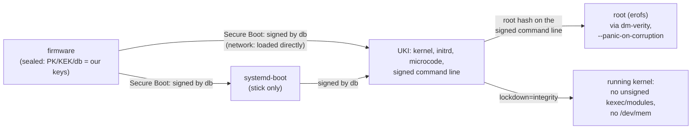

# Security of the standard installation

What a standard safespace-arch build (`sudo ./build.sh`, every combination of
`combinations.conf`) does to be trustworthy, and where each measure lives. Usage is in [README.md](README.md), network
boot in [NETBOOT.md](NETBOOT.md). What is still open is listed at the end.

## Chain of trust



Every link is checked by the one before it: the firmware checks the signatures, the signed
command line carries the root hash and every security parameter, and dm-verity checks every
block of the root as it is read.

## Boot and integrity

| Measure | What it prevents | Where |
|---|---|---|
| **Signed UKI and systemd-boot** (db key), checked by the build against the shipped `db.pem`: each combination's UKI by `mkosi.postoutput`, the composed UKI that ships again by `compose_check` (signer, `lockdown=integrity`, no `roothash=`, every root hash in order, signed expected PCRs, partition table) | booting anything not built here, once the machine is sealed; a composed UKI that lost a property of its parts | `mkosi.conf` `[Validation]`, `mkosi.postoutput`, `lib/compose.sh` |
| **Sealing** (`safespace-seal`): enrols our PK, KEK, db from Setup Mode (signed `.auth` updates); `--replace` keeps only our keys | other operating systems / boot loaders on a sealed machine | `mkosi.extra/usr/local/sbin/safespace-seal`, `lib/keys.sh` |
| **dm-verity root** with the root hash on the signed command line, opened with `--panic-on-corruption` | any change to the system files; a modified block stops the machine instead of being used | `mkosi.repart/`, `usb-bootdev`, `netroot` |
| **Read-only root (erofs)**, **`/var` in RAM** (`systemd.volatile=state`, factory copy from the verified `/usr`) | persistence of changes across a reboot; every boot starts from the verified state | `mkosi.conf`, `mkosi.finalize`, `safespace-var-factory.service` |
| **The boot medium is never written**: the stick is set read-only after it is found (`blockdev --setro`), the ESP is not mounted, systemd-boot writes no random seed, no NVRAM entries | tampering through the medium while running, wear | `usb-bootdev`, `mkosi.extra/etc/systemd/system/` (masked `boot`/`efi` mounts, `systemd-boot-random-seed`, `systemd-boot-update`) |
| **No extension images** (`systemd.sysext=0`, `systemd.confext=0`, `rd.` variants; units masked in the system and the initrd) | sysext/confext images on the unverified ESP overlaying `/usr` or `/etc` | `mkosi.conf`, `mkosi.extra/`, `mkosi.initrd.conf/mkosi.extra/` |
| **Strict credentials** (`systemd.credentials_boot_policy=strict`) | credentials "encrypted" with the null key from the ESP (e.g. a planted `systemd.extra-unit.*` = root code) | `mkosi.conf` |
| **Signed expected PCR 11 values** (own PCR key, not the db key) | lets the TPM bind secrets to "a signed safespace UKI booted"; rotating one key doesn't touch the other | `mkosi.conf` `SignExpectedPcr=` |
| **Combinations:** the EFI variables / `safespace.select=` only *name* a root; its hash comes from the signed command line; an unknown name stops the boot; without `safespace.root.<name>=` on the command line nothing is opened (no `roothash=` fallback) | choosing an unsigned root through the selection | `mkosi.initrd.conf/.../select` |

## Running kernel

| Measure | What it prevents | Where |
|---|---|---|
| **`lockdown=integrity`** on the signed command line; the build (per combination and for the composed UKI), `release.sh` and every distribution server refuse a UKI without it. The Arch kernel does not lock down under Secure Boot by itself (`LOCK_DOWN_KERNEL_FORCE_NONE`) | root leaving the signed chain at runtime: unsigned kexec or kernel modules, writes to `/dev/mem`/`/dev/port`, MSR writes, `iopl`/`ioperm`, hibernation images, runtime ACPI overrides, unsafe module parameters | `mkosi.conf`, `mkosi.postoutput`, `lib/compose.sh`, `lib/verify.sh`; checked in every boot by `tests/vm.sh` |
| **Signed modules only** (follows from the lockdown; every Arch module is signed) | loading a modified or foreign driver | kernel |
| **CPU microcode of both vendors** in the signed UKI (`intel-ucode`, `amd-ucode`), loaded before the kernel | CPU vulnerabilities fixed by microcode the machine's firmware does not have yet (AMD machines had none before) | `mkosi.conf`; `compose_check` refuses a UKI without either |
| **No Wi-Fi, Bluetooth or NVIDIA (nouveau/nova) drivers** in any root, and no firmware for them (removed to keep the roots small) | radio stacks (cfg80211/mac80211, Bluetooth) and their firmware parsers as a remote attack surface; a USB radio dongle being of any use even if usbguard let it through | `mkosi.conf` (`KernelModules=`; firmware by package: Intel, AMD GPU, Realtek only, `builds_check_firmware` fails the build on any other); `mkosi.finalize` fails the build if one is left (a new kernel can add a module that pulls a stack back in); checked in every boot by `tests/vm.sh` |

`integrity`, not `confidentiality`: the latter would also block perf, kprobes and BPF reads
of kernel memory, i.e. any tracing.

## Access

| Measure | Where |
|---|---|
| ssh: public key only, no passwords, no keyboard-interactive, no root login, only group `wheel` | `mkosi.extra/etc/ssh/sshd_config.d/10-safespace.conf` |
| The authorized keys are part of the verified image (`/etc/ssh/authorized_keys/<user>`, root-owned); nobody can add a key without a new signed build | `mkosi.postinst` (from `users.conf`) |
| No passwords at all: users have `*`, root is locked | `mkosi.postinst` |
| ssh host keys are generated in RAM on every boot, never stored on the medium | `sshd-hostkeys.service` |
| Firewall: Arch's default nftables ruleset: inbound dropped except established traffic, loopback, ICMP and ssh; no forwarding (Docker adds its own rules when it runs) | `nftables` package, enabled in `10-safespace.preset` |
| Only the services named in the preset are enabled; everything else stays off | `mkosi.extra/usr/lib/systemd/system-preset/10-safespace.preset` |
| DHCP only on physical ethernet ports (not on virtual links such as Docker's veths) | `mkosi.extra/etc/systemd/network/20-wired.network` |

## USB

| Measure | Where |
|---|---|
| The kernel authorizes no USB device (`usbcore.authorized_default=0`) | `mkosi.conf` |
| The initrd authorizes exactly the path to the boot stick (on the network path: nothing) | `usb-bootdev` |
| usbguard starts before `sysinit.target`, so there is no window without a policy; new devices are blocked (`ImplicitPolicyTarget=block`, empty rules), devices present at boot keep the initrd's decision | `mkosi.postinst`, `usbguard.service.d/10-early.conf` |
| USB-attached NICs cannot boot the network path: the NIC must be PCI/PCIe | `mkosi.conf` (initrd modules) |

## As a virtual machine

| Measure | Where |
|---|---|
| The QEMU guest agent runs only if the VM has its virtio port (started by udev; never on hardware) | `qemu-guest-agent` |
| Its RPCs are restricted to reporting (`guest-info`, network interfaces, OS info, host name, time, users, file systems) and `guest-shutdown`. Not allowed: `guest-exec`, `guest-file-*`, `guest-set-user-password`, `guest-ssh-*`, fsfreeze, …: the hypervisor gets no command or file channel into the system | `mkosi.extra/etc/qemu/qemu-ga.conf` |

## Network boot

| Measure | Where |
|---|---|
| The root URL is on the signed command line: it cannot be redirected | `build.sh` (`safespace.netroot=`) |
| What is downloaded is only used after dm-verity accepted it against the signed root hash; plain HTTP is therefore enough for integrity (HTTPS would add confidentiality) | `netroot` |
| A replaced release on the server leads to one reboot into the new UKI, never a reboot loop; a refused image stops the boot | `netroot` |

## Package groups

| Group | Measure | Where |
|---|---|---|
| xfce4-headless-vnc | TigerVNC listens on `localhost` only (reach it through an ssh tunnel), with a password generated per build (shown only in the build directory, mode 0600) | `mkosi.profiles/xfce4-headless-vnc/`, `mkosi.postinst` |
| docker | Docker and containerd are not started at boot (manual start), and only run when the data disk is mounted at `/opt/docker`; all their state is on that disk, nothing on the verified root | `mkosi.profiles/docker/` |
| debug | packages only (diagnostic tools); no setting of the image depends on the group, so the combination `debug` has the same hardening as every other (`tests/run.sh groups` checks the profile is a bare package list and nothing refers to it). `tests/vm.sh` checks on the booted image that `debug` has exactly `root`'s setuid/setgid files, file capabilities and enabled units (system and user); under the lockdown `kexec` only loads signed kernels. It is in every build, so root on a sealed machine can select it — root can run any tool anyway, and the selection is measured: `debug` never gets the identity of a machine assigned to another combination ([Machine identity](#machine-identity)) | `mkosi.profiles/debug/` |

## Machine identity

A sealed machine has an identity of its own, an ssh host key and a machine-id, bound to
**one combination**: the one it booted the first time with Secure Boot on (created then,
automatically), or the one it was moved to (`safespace-seal --assign NAME`). The TPM
releases it **whenever that combination boots, also after updates** (any build signed by the
same keys). Every other combination (`debug` included) boots normally, but with a throwaway
host key and machine-id: to every ssh client and inventory it is visibly not this machine,
and nothing it runs can reach the identity. This is what makes it safe to ship `debug` in
every build. Machines without Secure Boot on (not sealed) get no identity (throwaway host
key and machine-id on every boot, as before).

```mermaid
sequenceDiagram
  participant FW as UEFI (Secure Boot)
  participant ST as systemd-stub
  participant IR as initrd (select, identity)
  participant T as TPM
  participant R as selected root
  FW->>T: PCR 7 = Secure Boot state, PK/KEK/db/dbx
  FW->>ST: boot.efi (signed by db)
  ST->>T: PCR 11 = UKI sections, then "enter-initrd"
  IR->>IR: name from safespace.select= / SelectOnce / Select / first
  IR->>T: extend PCR 15 "safespace-combination:<name>"
  IR->>T: unseal both slots (policy below)
  T-->>IR: only if <name> is the assigned one
  IR->>T: extend PCR 15 "safespace-identity:sealed"
  IR->>T: PCR 11 "leave-initrd" (systemd-pcrphase): the identity signature no longer matches
  IR->>R: switch-root; /run/safespace/identity/ (or nothing)
```

| Measure | Against | Where |
|---|---|---|
| **The selection is measured** into PCR 15 (`safespace-combination:<name>`) by the initrd, right after it decided and before the name is used; exactly once per boot (a second measurement is refused, it would no longer match); recorded in `/run/safespace/combination`. The measuring code is part of the signed UKI (PCR 11). A PCR only extends: nothing later in the boot can turn another selection into the assigned one | booting another combination and still getting the identity | `mkosi.initrd.conf/.../select` |
| **Two slots**, each a systemd-creds TPM credential in an EFI variable of its own: `SafespaceIdHostKey` (ed25519 host key, credential name `safespace-ssh-host-key`), `SafespaceIdMachine` (machine-id, `safespace-machine-id`). The embedded credential name is checked: one slot can't be passed off as the other. sshd only ever gets its key | one secret leaking through the consumer of the other; renewing one without the other | `mkosi.initrd.conf/.../identity` |
| **Policy of both slots:** PCR 11 signed by the build host's **identity key for the phase `enter-initrd` only** ∧ PCR 7 as at the assignment ∧ PCR 15 as at the assignment (= exactly one measurement, of the assigned name) | see the next rows | `identity`, `lib/compose.sh` |
| — PCR 11, signed (`PolicyAuthorize`), not literal | a kernel/initrd/command line not built here; and every new signed build passes without a step on the machine | |
| — the **identity key** signs `enter-initrd` only; mkosi's PCR key keeps signing every phase for systemd's own use. `compose_check` computes the `enter-initrd` policy from the UKI's sections (`systemd-measure policy-digest`) and refuses a UKI whose `.pcrsig` does not hold exactly that one identity signature | a root unsealing after the initrd: with an all-phase signature, a root whose initrd measured nothing could extend PCR 15 itself and unseal (shown, see below) | `lib/keys.sh`, `lib/compose.sh` |
| — PCR 7 | a machine with Secure Boot off running a foreign stub that measures the genuine section hashes into PCR 11 but boots something else; changed Secure Boot keys | |
| — PCR 15 | another combination | |
| **Sealing happens in the initrd**, never in a root, after measuring: it generates host key and machine-id (`ssh-keygen`, `systemd-id128`), seals them with the *current* PCR 7 and 15 and writes the slots. When: automatically on a boot with Secure Boot on (SecureBoot=1, SetupMode=0) and *no slot at all*; or when `SafespaceAssign` (set by `--assign`, together with `SafespaceSelectOnce`) names the measured combination. A `SafespaceAssign` for another name is deleted and ignored. Slots that exist but don't unseal (another combination) **never** lead to a new identity | the plaintext existing in any process of a root; an identity for a combination that did not boot; another combination replacing the identity by booting | `identity`, `safespace-seal` |
| Deleting the slots (root, any combination) makes the next sealed boot create a **new** identity for the combination that boots then: never the old one, and a new host key every ssh client notices | | `identity` |
| **Every new slot is checked before it is written:** its header type must be the signed-policy one (`5e2d5c76-0372-4eaf-843c-6fb5f64098f5`), and it must *not* unseal with an empty signature; otherwise the assignment is aborted | the `systemd-creds` pitfall below (a slot without PCR 11 binding) | `identity` |
| **The TPM is closed** after unsealing: PCR 15 is extended with `safespace-identity:sealed`, always (also on errors, `trap`) | a second unseal in the same boot, even in the initrd | `identity` |
| **Released secrets live in RAM only**: `/run/safespace/identity/` (0700 root), the machine-id also as `/run/machine-id` (PID 1 takes it over); the host key is *moved* to `/var/lib/sshd/etc/ssh/` (one plaintext copy) | secrets on any medium | `identity`, `sshd-hostkeys.service` |
| **`--assign` (moving a machine) requires** Secure Boot on (SetupMode=0, SecureBoot=1), the firmware's PK being this stick's, and a name on the signed command line; it always creates *new* secrets | binding to a firmware state the next builds won't see; re-using an old identity | `safespace-seal` |
| **The boot never depends on the TPM**: no TPM, no slots, no signature, any error → no identity, the boot goes on | a TPM fault making the machine unusable | `identity`, `safespace-identity.service` |
| **ed25519 host key only** (was ed25519 + ECDSA + RSA) | | `sshd_config.d/10-safespace.conf`, `sshd-hostkeys.service` |

### What is public, what is private

| Item | Where | Class |
|---|---|---|
| db/KEK/PK private keys | build host | **private** |
| `pcr.key` (mkosi, all phases) and `identity.key` (enter-initrd) | build host, `/var/lib/safespace/pcr-signing/`, root-only | **private**. A holder of `identity.key` can authorize any PCR 11 at `enter-initrd`, but still needs a db-signed UKI to run it on a sealed machine (two keys) |
| `db.pem`, `.auth`, `pcr.pem` (`.pcrpkey`), `identity.pem` (appended to the initrd), `.pcrsig` | image, release, servers | public |
| Endorsement/storage seeds, EK private, SRK private | inside the TPM | **private**, never leave it |
| EK public + certificate, SRK public | TPM, `/run/systemd/tpm2-srk-public-key.*` | public |
| The two slots | EFI variables | public **ciphertext**: bound to this TPM's SRK and the policy; root can delete them (the machine then boots without identity, which shows), not read them |
| ssh host private key, machine-id | RAM, assigned combination only | **private** (machine-id(5): confidential) |
| ssh host public key, inventory ID (`systemd-id128 machine-id --app-specific=eda1fc8c35e94e2087addff88d0b4e91`) | `safespace-seal --identity` | public |

No TPM NV index is used; the only persistent TPM object is systemd's SRK.

### Pitfalls found (and how they are guarded)

- **`systemd-creds --with-key=tpm2` silently drops `--tpm2-public-key*`.** The options are
  accepted, the exit code is 0, only the debug log shows `PK PCR mask: 0x0`. The credential is
  then bound to the literal PCRs only, and unseals with *no* signature at all (shown below).
  `--with-key=tpm2-with-public-key` is required (not listed in `--help`). Guarded by the
  header type and empty-signature checks before a slot is written, and by `tests/run.sh`.
- **`systemd-pcrextend` silently skips** (exit 0) when the stub did not measure the UKI into
  PCR 11 (e.g. firmware without TPM). Fails closed: PCR 15 then never has the assigned value.
- **systemd-creds 262 cannot seal to precomputed PCR values** (`--tpm2-pcrs=15:sha256=…` is
  refused) and has no policyref: hence sealing in the initrd of a boot of the assigned
  combination (one reboot to assign).
- **mkosi signs PCR 11 for every boot phase**: that signature must not be used for secrets
  a root must not reach (hence the identity key).
- **`systemd-measure sign --current` reads PCRs from sysfs**, not from `--tpm2-device`:
  irrelevant on a machine, but tests against swtpm have to replay the stub's measurements.

### Tested variants and their outcomes

**Host, swtpm (2026-10-21; swtpm 0.10.2, systemd 262).** A software TPM on the build host;
each "boot" is a fresh swtpm start (`--flags startup-clear`), then PCR 7 extended with a
stand-in for the Secure Boot state, PCR 11 replayed exactly as systemd-stub + pcrphase
measure it (`.linux\0`, the section's content, `enter-initrd`; checked equal to
`systemd-measure calculate`), PCR 15 by `systemd-pcrextend`. Signatures by
`systemd-measure sign --phase=…` with throwaway RSA keys; credentials by `systemd-creds`
(as root in a user namespace).

| Variant | Outcome |
|---|---|
| PCR 15 after `safespace-combination:containers` = SHA256(0³² ‖ SHA256(word)) | as computed |
| Sealed with `--with-key=tpm2` + `--tpm2-public-key-pcrs=11`: unsigned kernel, foreign PCR key, **empty signature** | **unsealed** (the pitfall above) |
| Sealed with `tpm2-with-public-key`, enter-initrd signature: assigned combination | unsealed |
| … after `safespace-identity:sealed` | refused |
| … nothing measured into PCR 15 | refused |
| … `debug` measured | refused |
| … `debug`, then `containers` extended on top | refused |
| … `containers` measured twice | refused |
| … update: other kernel, its own signature by the same key | unsealed |
| … update booting `debug` | refused |
| … update with the old build's signature | refused |
| … Secure Boot state (PCR 7) changed | refused |
| … unsigned kernel / kernel signed by a foreign PCR key / no signature | refused |
| … one slot decrypted under the other slot's credential name | refused |
| Late extend: initrd measured nothing, after `leave-initrd` the root extends `containers` — with an **all-phase** signature | **unsealed** (why the identity key exists) |
| … with an **enter-initrd-only** signature (also after `sysinit`, `ready`) | refused |

**QEMU (2026-10-21).** A real test build (`sudo ./build.sh --users mkosi.test/vm/users.conf
--output-root mkosi.test/vm/builds`, combinations `root` and `containers`), booted with
`test-vm.sh --tpm` (swtpm as a TPM 2.0 with CRB interface, like Intel PTT; its state and the
firmware variables kept across boots), from the stick and over the network, sealed
(`safespace-seal` in Setup Mode, then enforced Secure Boot). Checked over ssh in every boot:
the combination, `/etc/machine-id`, the host key fingerprint, the initrd's kernel messages.

| Variant | Outcome |
|---|---|
| Sealed, nothing assigned (`root`), *build before the automatic creation* | no slots, throwaway host key and machine-id, no failed unit |
| `--assign containers`, reboot | the initrd booted `containers` (SelectOnce), generated, sealed and wrote both slots, released them in the same boot; sshd uses the machine's key; `/etc/machine-id` = the released one |
| `containers` again (persistent selection) | same host key, same machine-id |
| `root` once (`safespace-select once root`) | both slots refused; throwaway host key and machine-id |
| `containers` after that | same host key and machine-id again |
| In a running `root`: decrypt the machine-id slot with the UKI's signatures | refused |
| … after `systemd-pcrextend --pcr=15 safespace-combination:containers` | refused |
| In a running `containers` (the assigned one): decrypt after boot | refused (PCR 11 past `enter-initrd`) |
| Network boot (`netroot`), same firmware and TPM | same host key and machine-id |
| **Update:** a newer build (`combined_20261021-1204`: new UKI, new root hashes, same keys), `containers` | same host key and machine-id, no step on the machine |
| Another certificate added to db (`virt-fw-vars --add-db`: PCR 7 changes), `containers` | both slots refused; throwaway host key and machine-id |
| The original db again | released again |
| Re-assignment (`--assign containers` on the newer build) | new host key and machine-id (never the old ones) |
| `SafespaceAssign=root` written, but the boot measures `containers` | ignored ("this boot measured containers"), variable deleted, identity unchanged |
| **Automatic identity** (build `combined_20261021-1239`, freshly sealed): the Setup Mode boot | no identity created (Secure Boot not on yet) |
| … the first sealed boot (`root`, the default) | identity created for `root` and released in the same boot |
| … `containers` once | not released, **no new identity** (the slots stay as they are), throwaway host key and machine-id |
| … `root` again | the same host key and machine-id |
| PID 1 and `/run/machine-id` from the initrd | taken over (`/etc/machine-id` = the released ID) |
| `compose_check` on the real build: identity signature for `enter-initrd` only, computed with `systemd-measure policy-digest` | passed; `tests/run.sh` refuses a UKI without it, with an all-phase one, with one for `leave-initrd` |

Driver: a PoC script around `test-vm.sh --tpm`; its stages are now the `tests/vm.sh` step
`identity` (all but the update, which needs two builds).

**Unit tests (`tests/run.sh`, no TPM):** the initrd's `identity` with `systemd-creds` replaced
by a stub (signed or plain credential type; unseals only with a "good" signature): first
sealed boot creates and releases both slots and closes PCR 15; nothing with Secure Boot off,
in Setup Mode or without a measured combination (PCR 15 closed all the same); another
combination: not released, no new identity; the same combination again: the same machine-id;
`SafespaceAssign` for another name ignored and deleted, for the measured one a new identity;
a slot with the plain type, or one that unseals without a signature, is not written; one slot
passed off as the other is not released; every sealing in the scripts uses
`tpm2-with-public-key`. `select`: measured into PCR 15 before use, once per boot, a failing
measurement does not stop the boot, an unknown name is not measured. `compose_check`: refuses
a UKI without the identity signature, with one for every phase, with one for `leave-initrd`.

**Not tested yet:** Secure Boot switched off in QEMU (shown on swtpm only), a cleared TPM,
the T450s (Intel PTT) itself.

## Keys and the build host

| Measure | Where |
|---|---|
| No private key in an image, a release or the repository; only certificates, signed `.auth` updates and the GUID are shipped; the build refuses anything else in the shipped key directory | `lib/keys.sh`, `mkosi.postoutput` |
| The `.auth` updates are signed with efitools with the right attributes (replace 0x27, append 0x67; sbctl's own append export is wrong and not used) | `lib/keys.sh`, `tests/lib/authcheck.py` |
| A dedicated Secure Boot key set is possible (`SAFESPACE_SBCTL_CONFIG`); YubiKey-held keys are refused until supported | `lib/keys.sh` |
| The PCR signing keys (mkosi's, all phases; the identity key, `enter-initrd` only) are separate from the db key, root-only, never in the image | `mkosi.conf`, `build.sh`, `lib/keys.sh` |
| Per-host and private settings live in gitignored files with `*.example` templates | `.gitignore` |
| Test builds carry a throwaway test key and user and are kept apart (`mkosi.test/vm/`), invisible to `build.sh list` and `release.sh` | `tests/vm.sh` |

## Distribution server

| Measure | Where |
|---|---|
| Trusts only the pinned public `db.pem`; checks every release (signatures, `lockdown=integrity`, every root against its signed hash, partition table) and only reports; it never alters what it serves | `server/safespace-netboot`, `lib/verify.sh` |
| Upload account confined by rrsync: write-only, no delete, the share only | `server/setup.sh` |
| The check runs sandboxed: own user, no network, read-only share, no capabilities, `ProtectSystem=strict`, system call filter, … | `server/systemd/safespace-netboot-verify.service` |
| nginx serves the share read-only: GET/HEAD only, no directory listing, no hidden files (rsync's temporary files), no version banner | `server/nginx/safespace.conf` |
| The build host checks a release exactly as a server will before pushing it | `release.sh` |

## Checked by the tests

`tests/run.sh` (no root): manipulated, unsigned and foreign-signed releases, wrong partition
tables, combinations with a changed root or a forged `COMBINATIONS=`, releases with a
db-signed UKI that lacks the lockdown or is single-root, every refusal of `compose_check`,
the selection order and its missing fallback, the selection measured exactly once, the
composed UKI's identity signature (only `enter-initrd`), the rrsync confinement, the units' sandbox syntax, the initrd only calling programs it
contains. `tests/vm.sh` (QEMU): in every boot the root is `verified`, lockdown is
`integrity`, no unit failed; stick read-only, sealing, booting with enforced Secure Boot, every
combination booted through the selection on the sealed firmware (`safespace-select` set,
once, persistent, clear on one firmware; a `SafespaceSelectOnce` written offline is consumed
by the initrd). Step `identity` (software TPM): the first sealed boot creates the identity for
the default; `debug` gets none, creates none and its root cannot unseal it (also not after
extending PCR 15 with the default's name); the default again and over the network: the same
host key and machine-id, and its root cannot unseal after the boot; a changed db (PCR 7)
releases nothing; `--assign containers` creates a new identity there, the default then has
none.

## Accepted trade-offs

- **sudo without a password** for `wheel`: users have no passwords (ssh keys only), so sudo
  could not ask for one. Whoever has a user's key is root on the machine.
- **New ssh host keys on every boot** on machines without an assignment: clients see a
  changed key after each reboot (README, "Open decisions"). Assigned machines keep theirs
  ([Machine identity](#machine-identity)).
- **The combination selection can be changed** by root (or the firmware setup without a
  password) between the signed roots. It is measured: only the assigned combination gets the
  machine's identity ([Machine identity](#machine-identity)).
- **An old signed build of the assigned combination still releases the identity** (same
  identity key); rotating the identity key ends that, and requires `--assign` again.
- **Root in the assigned combination** has the keys it runs with; the identity protects
  against other combinations, not against that root.

## Still open

See README, "Known open points": among them old signed images stay bootable wherever a
copy exists (builds from before `lockdown=integrity` boot without the lockdown), the build
runs as root from a folder a normal user can write to, the Docker data disk is not verified.
