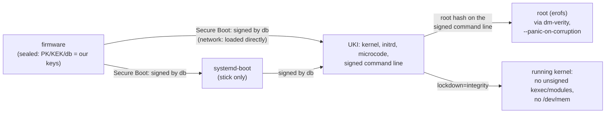

# Security of the standard installation

What a standard safespace-arch build (`sudo ./build.sh`, every combination of
`combinations.conf`) does to be trustworthy, and where each measure lives. Usage is in [README.md](README.md), network
boot in [NETBOOT.md](NETBOOT.md). What is still open is listed at the end.

## Chain of trust

Every link is checked by the one before it: the firmware checks the signatures, the signed
command line carries the root hash and every security parameter, and dm-verity checks every
block of the root as it is read.

## Boot and integrity

| Measure | What it prevents | Where |
|---|---|---|
| **Signed UKI and systemd-boot** (db key), checked by the build against the shipped `db.pem`: each combination's UKI by `mkosi.postoutput`, the composed UKI that ships again by `compose_check` (signer, `lockdown=integrity`, no `roothash=`, every root hash in order, signed expected PCRs, partition table) | booting anything not built here, once the machine is sealed; a composed UKI that lost a property of its parts | `mkosi.conf` `[Validation]`, `mkosi.postoutput`, `lib/compose.sh` |
| **Sealing** (`safespace-seal`): enrols our PK, KEK, db from Setup Mode (signed `.auth` updates); `--replace` keeps only our keys | other operating systems / boot loaders on a sealed machine | `mkosi.extra/usr/local/sbin/safespace-seal`, `lib/keys.sh` |
| **dm-verity root** with the root hash on the signed command line, opened with `--panic-on-corruption` | any change to the system files; a modified block stops the machine instead of being used | `mkosi.repart/`, `usb-bootdev`, `netroot` |
| **Read-only root (erofs)**, **`/var` in RAM** (`systemd.volatile=state`, factory copy from the verified `/usr`) | persistence of changes across a reboot; every boot starts from the verified state | `mkosi.conf`, `mkosi.finalize`, `safespace-var-factory.service` |
| **The boot medium is never written**: the stick is set read-only after it is found (`blockdev --setro`), the ESP is not mounted, systemd-boot writes no random seed, no NVRAM entries | tampering through the medium while running, wear | `usb-bootdev`, `mkosi.extra/etc/systemd/system/` (masked `boot`/`efi` mounts, `systemd-boot-random-seed`, `systemd-boot-update`) |
| **No extension images** (`systemd.sysext=0`, `systemd.confext=0`, `rd.` variants; units masked in the system and the initrd) | sysext/confext images on the unverified ESP overlaying `/usr` or `/etc` | `mkosi.conf`, `mkosi.extra/`, `mkosi.initrd.conf/mkosi.extra/` |
| **Strict credentials** (`systemd.credentials_boot_policy=strict`) | credentials "encrypted" with the null key from the ESP (e.g. a planted `systemd.extra-unit.*` = root code) | `mkosi.conf` |
| **Signed expected PCR 11 values** (own PCR key, not the db key) | lets the TPM bind secrets to "a signed safespace UKI booted"; rotating one key doesn't touch the other | `mkosi.conf` `SignExpectedPcr=` |
| **Combinations:** the EFI variables / `safespace.select=` only *name* a root; its hash comes from the signed command line; an unknown name stops the boot; without `safespace.root.<name>=` on the command line nothing is opened (no `roothash=` fallback) | choosing an unsigned root through the selection | `mkosi.initrd.conf/.../select` |

## Running kernel

| Measure | What it prevents | Where |
|---|---|---|
| **`lockdown=integrity`** on the signed command line; the build (per combination and for the composed UKI), `release.sh` and every distribution server refuse a UKI without it. The Arch kernel does not lock down under Secure Boot by itself (`LOCK_DOWN_KERNEL_FORCE_NONE`) | root leaving the signed chain at runtime: unsigned kexec or kernel modules, writes to `/dev/mem`/`/dev/port`, MSR writes, `iopl`/`ioperm`, hibernation images, runtime ACPI overrides, unsafe module parameters | `mkosi.conf`, `mkosi.postoutput`, `lib/compose.sh`, `lib/verify.sh`; checked in every boot by `tests/vm.sh` |
| **Signed modules only** (follows from the lockdown; every Arch module is signed) | loading a modified or foreign driver | kernel |
| **No Wi-Fi, Bluetooth or NVIDIA (nouveau/nova) drivers** in any root, and no firmware for them (removed to keep the roots small) | radio stacks (cfg80211/mac80211, Bluetooth) and their firmware parsers as a remote attack surface; a USB radio dongle being of any use even if usbguard let it through | `mkosi.conf` (`KernelModules=`, `FirmwareFiles=`); `mkosi.finalize` fails the build if one is left (a new kernel can add a module that pulls a stack back in); checked in every boot by `tests/vm.sh` |

`integrity`, not `confidentiality`: the latter would also block perf, kprobes and BPF reads
of kernel memory, i.e. any tracing.

## Access

| Measure | Where |
|---|---|
| ssh: public key only, no passwords, no keyboard-interactive, no root login, only group `wheel` | `mkosi.extra/etc/ssh/sshd_config.d/10-safespace.conf` |
| The authorized keys are part of the verified image (`/etc/ssh/authorized_keys/<user>`, root-owned); nobody can add a key without a new signed build | `mkosi.postinst` (from `users.conf`) |
| No passwords at all: users have `*`, root is locked | `mkosi.postinst` |
| ssh host keys are generated in RAM on every boot, never stored on the medium | `sshd-hostkeys.service` |
| Firewall: Arch's default nftables ruleset: inbound dropped except established traffic, loopback, ICMP and ssh; no forwarding (Docker adds its own rules when it runs) | `nftables` package, enabled in `10-safespace.preset` |
| Only the services named in the preset are enabled; everything else stays off | `mkosi.extra/usr/lib/systemd/system-preset/10-safespace.preset` |
| DHCP only on physical ethernet ports (not on virtual links such as Docker's veths) | `mkosi.extra/etc/systemd/network/20-wired.network` |

## USB

| Measure | Where |
|---|---|
| The kernel authorizes no USB device (`usbcore.authorized_default=0`) | `mkosi.conf` |
| The initrd authorizes exactly the path to the boot stick (on the network path: nothing) | `usb-bootdev` |
| usbguard starts before `sysinit.target`, so there is no window without a policy; new devices are blocked (`ImplicitPolicyTarget=block`, empty rules), devices present at boot keep the initrd's decision | `mkosi.postinst`, `usbguard.service.d/10-early.conf` |
| USB-attached NICs cannot boot the network path: the NIC must be PCI/PCIe | `mkosi.conf` (initrd modules) |

## As a virtual machine

| Measure | Where |
|---|---|
| The QEMU guest agent runs only if the VM has its virtio port (started by udev; never on hardware) | `qemu-guest-agent` |
| Its RPCs are restricted to reporting (`guest-info`, network interfaces, OS info, host name, time, users, file systems) and `guest-shutdown`. Not allowed: `guest-exec`, `guest-file-*`, `guest-set-user-password`, `guest-ssh-*`, fsfreeze, …: the hypervisor gets no command or file channel into the system | `mkosi.extra/etc/qemu/qemu-ga.conf` |

## Network boot

| Measure | Where |
|---|---|
| The root URL is on the signed command line: it cannot be redirected | `build.sh` (`safespace.netroot=`) |
| What is downloaded is only used after dm-verity accepted it against the signed root hash; plain HTTP is therefore enough for integrity (HTTPS would add confidentiality) | `netroot` |
| A replaced release on the server leads to one reboot into the new UKI, never a reboot loop; a refused image stops the boot | `netroot` |

## Package groups

| Group | Measure | Where |
|---|---|---|
| xfce4-headless-vnc | TigerVNC listens on `localhost` only (reach it through an ssh tunnel), with a password generated per build (shown only in the build directory, mode 0600) | `mkosi.profiles/xfce4-headless-vnc/`, `mkosi.postinst` |
| docker | Docker and containerd are not started at boot (manual start), and only run when the data disk is mounted at `/opt/docker`; all their state is on that disk, nothing on the verified root | `mkosi.profiles/docker/` |
| debug | packages only (diagnostic tools); no setting of the image depends on the group, so the combination `debug` has the same hardening as every other (`tests/run.sh groups` checks the profile is a bare package list and nothing refers to it). `tests/vm.sh` checks on the booted image that `debug` has exactly `root`'s setuid/setgid files, file capabilities and enabled units (system and user); under the lockdown `kexec` only loads signed kernels. It is in every build, so root on a sealed machine can select it — root can run any tool anyway | `mkosi.profiles/debug/` |

## Keys and the build host

| Measure | Where |
|---|---|
| No private key in an image, a release or the repository; only certificates, signed `.auth` updates and the GUID are shipped; the build refuses anything else in the shipped key directory | `lib/keys.sh`, `mkosi.postoutput` |
| The `.auth` updates are signed with efitools with the right attributes (replace 0x27, append 0x67; sbctl's own append export is wrong and not used) | `lib/keys.sh`, `tests/lib/authcheck.py` |
| A dedicated Secure Boot key set is possible (`SAFESPACE_SBCTL_CONFIG`); YubiKey-held keys are refused until supported | `lib/keys.sh` |
| The PCR signing key is separate from the db key, root-only, never in the image | `mkosi.conf`, `build.sh` |
| Per-host and private settings live in gitignored files with `*.example` templates | `.gitignore` |
| Test builds carry a throwaway test key and user and are kept apart (`mkosi.test/vm/`), invisible to `build.sh list` and `release.sh` | `tests/vm.sh` |

## Distribution server

| Measure | Where |
|---|---|
| Trusts only the pinned public `db.pem`; checks every release (signatures, `lockdown=integrity`, every root against its signed hash, partition table) and only reports; it never alters what it serves | `server/safespace-netboot`, `lib/verify.sh` |
| Upload account confined by rrsync: write-only, no delete, the share only | `server/setup.sh` |
| The check runs sandboxed: own user, no network, read-only share, no capabilities, `ProtectSystem=strict`, system call filter, … | `server/systemd/safespace-netboot-verify.service` |
| nginx serves the share read-only: GET/HEAD only, no directory listing, no hidden files (rsync's temporary files), no version banner | `server/nginx/safespace.conf` |
| The build host checks a release exactly as a server will before pushing it | `release.sh` |

## Checked by the tests

`tests/run.sh` (no root): manipulated, unsigned and foreign-signed releases, wrong partition
tables, combinations with a changed root or a forged `COMBINATIONS=`, releases with a
db-signed UKI that lacks the lockdown or is single-root, every refusal of `compose_check`,
the selection order and its missing fallback, the rrsync confinement, the units' sandbox syntax, the initrd only calling programs it
contains. `tests/vm.sh` (QEMU): in every boot the root is `verified`, lockdown is
`integrity`, no unit failed; stick read-only, sealing, booting with enforced Secure Boot, every
combination booted through the selection on the sealed firmware (`safespace-select` set,
once, persistent, clear on one firmware; a `SafespaceSelectOnce` written offline is consumed
by the initrd).

## Accepted trade-offs

- **sudo without a password** for `wheel`: users have no passwords (ssh keys only), so sudo
  could not ask for one. Whoever has a user's key is root on the machine.
- **New ssh host keys on every boot**: clients see a changed key after each reboot (README,
  "Open decisions").
- **The combination selection is not measured** into a TPM PCR yet, and root (or the
  firmware setup without a password) can change it between the signed roots.

## Still open

See README, "Known open points": among them old signed images stay bootable wherever a
copy exists (builds from before `lockdown=integrity` boot without the lockdown), the build
runs as root from a folder a normal user can write to, the Docker data disk is not verified.
