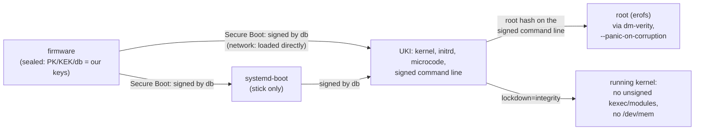

# Security of the standard installation

What a standard safespace-arch build (`sudo ./build.sh`, every combination of
`safespace.conf`, its defaults) does to be trustworthy, and where each measure lives. Usage is in [README.md](README.md), network
boot in [NETBOOT.md](NETBOOT.md). What is still open is listed at the end.

## Chain of trust



Every link is checked by the one before it: the firmware checks the signatures, the signed
command line carries the root hash and every security parameter, and dm-verity checks every
block of the root as it is read.

## Boot and integrity

| Measure | What it prevents | Where |
|---|---|---|
| **Signed UKI and systemd-boot** (db key), checked by the build against the shipped `db.pem`: each combination's UKI by `mkosi.postoutput`, the composed UKI that ships again by `compose_check` (signer, `lockdown=integrity`, no `roothash=`, every root hash in order, signed expected PCRs, partition table) | booting anything not built here, once the machine is sealed; a composed UKI that lost a property of its parts | `mkosi.conf` `[Validation]`, `mkosi.postoutput`, `lib/compose.sh` |
| **Sealing** (`safespace seal`): enrols our PK, KEK, db from Setup Mode (signed `.auth` updates); `--replace` keeps only our keys | other operating systems / boot loaders on a sealed machine | `mkosi.extra/usr/local/sbin/safespace seal`, `lib/keys.sh` |
| **dm-verity root** with the root hash on the signed command line, opened with `--panic-on-corruption` | any change to the system files; a modified block stops the machine instead of being used | `mkosi.repart/`, `usb-bootdev`, `netroot` |
| **Read-only root (erofs)**, **`/var` in RAM** (`systemd.volatile=state`, factory copy from the verified `/usr`) | persistence of changes across a reboot; every boot starts from the verified state | `mkosi.conf`, `mkosi.finalize`, `safespace-var-factory.service` |
| **The boot medium is never written**: the stick is set read-only after it is found (`blockdev --setro`), the ESP is not mounted, systemd-boot writes no random seed, no NVRAM entries | tampering through the medium while running, wear | `usb-bootdev`, `mkosi.extra/etc/systemd/system/` (masked `boot`/`efi` mounts, `systemd-boot-random-seed`, `systemd-boot-update`) |
| **No extension images** (`systemd.sysext=0`, `systemd.confext=0`, `rd.` variants; units masked in the system and the initrd) | sysext/confext images on the unverified ESP overlaying `/usr` or `/etc` | `mkosi.conf`, `mkosi.extra/`, `mkosi.initrd.conf/mkosi.extra/` |
| **Strict credentials** (`systemd.credentials_boot_policy=strict`) | credentials "encrypted" with the null key from the ESP (e.g. a planted `systemd.extra-unit.*` = root code) | `mkosi.conf` |
| **Signed expected PCR 11 values** (own PCR key, not the db key) | lets the TPM bind secrets to "a signed safespace UKI booted"; rotating one key doesn't touch the other | `mkosi.conf` `SignExpectedPcr=` |
| **Combinations:** the EFI variables / `safespace.select=` only *name* a root; its hash comes from the signed command line; an unknown name stops the boot; without `safespace.root.<name>=` on the command line nothing is opened (no `roothash=` fallback) | choosing an unsigned root through the selection | `mkosi.initrd.conf/.../select` |

## Running kernel

| Measure | What it prevents | Where |
|---|---|---|
| **`lockdown=integrity`** on the signed command line; the build (per combination and for the composed UKI), `release.sh` and every distribution server refuse a UKI without it. The Arch kernel does not lock down under Secure Boot by itself (`LOCK_DOWN_KERNEL_FORCE_NONE`) | root leaving the signed chain at runtime: unsigned kexec or kernel modules, writes to `/dev/mem`/`/dev/port`, MSR writes, `iopl`/`ioperm`, hibernation images, runtime ACPI overrides, unsafe module parameters | `mkosi.conf`, `mkosi.postoutput`, `lib/compose.sh`, `lib/verify.sh`; checked in every boot by `tests/vm.sh` |
| **Signed modules only** (follows from the lockdown; every Arch module is signed) | loading a modified or foreign driver | kernel |
| **CPU microcode of both vendors** in the signed UKI (`intel-ucode`, `amd-ucode`), loaded before the kernel | CPU vulnerabilities fixed by microcode the machine's firmware does not have yet (AMD machines had none before) | `mkosi.conf`; `compose_check` refuses a UKI without either |
| **No Wi-Fi, Bluetooth or NVIDIA (nouveau/nova) drivers** in any root, and no firmware for them (removed to keep the roots small) | radio stacks (cfg80211/mac80211, Bluetooth) and their firmware parsers as a remote attack surface; a USB radio dongle being of any use even if usbguard let it through | `mkosi.conf` (`KernelModules=`; firmware by package: Intel, AMD GPU, Realtek only, `builds_check_firmware` fails the build on any other); `mkosi.finalize` fails the build if one is left (a new kernel can add a module that pulls a stack back in); checked in every boot by `tests/vm.sh` |

`integrity`, not `confidentiality`: the latter would also block perf, kprobes and BPF reads
of kernel memory, i.e. any tracing.

## Access

| Measure | Where |
|---|---|
| ssh: public key only, no passwords, no keyboard-interactive, no root login, only group `wheel` | `mkosi.extra/etc/ssh/sshd_config.d/10-safespace.conf` |
| The authorized keys are part of the verified image (`/etc/ssh/authorized_keys/<user>`, root-owned); nobody can add a key without a new signed build | `mkosi.postinst` (from `users.conf`) |
| No passwords at all: users have `*`, root is locked | `mkosi.postinst` |
| ssh host keys are generated in RAM on every boot, never stored on the medium | `sshd-hostkeys.service` |
| Firewall: Arch's default nftables ruleset: inbound dropped except established traffic, loopback, ICMP and ssh; no forwarding (Docker adds its own rules when it runs) | `nftables` package, enabled in `10-safespace.preset` |
| Only the services named in the preset are enabled; everything else stays off | `mkosi.extra/usr/lib/systemd/system-preset/10-safespace.preset` |
| DHCP only on physical ethernet ports (not on virtual links such as Docker's veths) | `mkosi.extra/etc/systemd/network/20-wired.network` |

## USB

| Measure | Where |
|---|---|
| The kernel authorizes no USB device (`usbcore.authorized_default=0`) | `mkosi.conf` |
| The initrd authorizes exactly the path to the boot stick (on the network path: nothing) | `usb-bootdev` |
| usbguard starts before `sysinit.target`, so there is no window without a policy; new devices are blocked (`ImplicitPolicyTarget=block`, empty rules), devices present at boot keep the initrd's decision | `mkosi.postinst`, `usbguard.service.d/10-early.conf` |
| USB-attached NICs cannot boot the network path: the NIC must be PCI/PCIe | `mkosi.conf` (initrd modules) |

## As a virtual machine

| Measure | Where |
|---|---|
| The QEMU guest agent runs only if the VM has its virtio port (started by udev; never on hardware) | `qemu-guest-agent` |
| Its RPCs are restricted to reporting (`guest-info`, network interfaces, OS info, host name, time, users, file systems) and `guest-shutdown`. Not allowed: `guest-exec`, `guest-file-*`, `guest-set-user-password`, `guest-ssh-*`, fsfreeze, …: the hypervisor gets no command or file channel into the system | `mkosi.extra/etc/qemu/qemu-ga.conf` |

## Network boot

| Measure | Where |
|---|---|
| The root URL is on the signed command line: it cannot be redirected | `build.sh` (`safespace.netroot=`) |
| What is downloaded is only used after dm-verity accepted it against the signed root hash; plain HTTP is therefore enough for integrity (HTTPS would add confidentiality) | `netroot` |
| A replaced release on the server leads to one reboot into the new UKI, never a reboot loop; a refused image stops the boot | `netroot` |

## Package groups

| Group | Measure | Where |
|---|---|---|
| xfce4-headless-vnc | TigerVNC listens on `localhost` only (reach it through an ssh tunnel), with a password generated per build (shown only in the build directory, mode 0600) | `mkosi.profiles/xfce4-headless-vnc/`, `mkosi.postinst` |
| docker | Docker and containerd are not started at boot (manual start), and only run when the data disk is mounted at `/opt/docker`; all their state is on that disk, nothing on the verified root | `mkosi.profiles/docker/` |
| debug | packages only (diagnostic tools); no setting of the image depends on the group, so the combination `debug` has the same hardening as every other (`tests/run.sh groups` checks the profile is a bare package list and nothing refers to it). `tests/vm.sh` checks on the booted image that `debug` has exactly `root`'s setuid/setgid files, file capabilities and enabled units (system and user); under the lockdown `kexec` only loads signed kernels. It is in every build, so root on a sealed machine can select it — root can run any tool anyway, and the selection is measured: `debug` never gets the identity of a machine assigned to another combination ([Machine identity](#machine-identity)) | `mkosi.profiles/debug/` |

## Machine identity

A sealed machine with a TPM 2.0 has an identity of its own, bound to **one combination**:
its **ssh host key**, made in the TPM at every boot and certified by the machine's **CA** (a
key in the TPM, [aSSH](assh/README.md)), and its **machine-id**. The initrd makes both at the
first boot with Secure Boot on, at once and without a step; nothing can approve anything
after. Updates keep it: every build the build host signed is certified (slot 0). Every other
combination (`debug` included) boots normally, but with aSSH's temporary host key (made in the
TPM, never certified) and a throwaway machine-id: to every ssh client that trusts the CA, and
to every inventory, it is visibly not this machine, and nothing it runs can have the CA
certify. This is what makes it safe to ship `debug` in every build. Another combination, or a
firmware update, gets the identity only as a new one: `safespace identity clear` and a boot -
a new CA, a new line for the clients. Machines without Secure Boot on (not sealed) get none;
machines without a TPM 2.0 a throwaway ed25519 host key on every boot.

```mermaid
sequenceDiagram
  participant FW as UEFI (Secure Boot)
  participant ST as systemd-stub
  participant IR as initrd (select, identity)
  participant T as TPM
  participant A as assh agent (root, before sysinit)
  participant S as sshd
  FW->>T: PCR 0, 2 (firmware, option ROMs), PCR 7 (Secure Boot state, PK/KEK/db/dbx)
  FW->>ST: boot.efi (signed by db)
  ST->>T: PCR 11 = UKI sections, then "enter-initrd"
  IR->>IR: name from safespace.select= / SelectOnce / Select / first
  IR->>T: extend PCR 15 "safespace-combination:<name>"
  IR->>T: first sealed boot only: make the machine-id and the CA, approve the root's state ahead
  IR->>T: unseal the machine-id (only in its combination)
  IR->>T: extend PCR 15 "safespace-identity:sealed"; PCR 11 "leave-initrd"
  A->>T: new host key (NULL hierarchy); the CA certifies it if PCR 0,2,7,15 hold the approved state and PCR 11 a value the build signed (slot 0), or PCR 7,15 (slot 1)
  A->>T: extend PCR 15 "assh: closed" (the window): the CA signs nothing more this boot
  S->>A: every signature (HostKeyAgent), with the certificate if there is one
```

| Measure | Against | Where |
|---|---|---|
| **The selection is measured** into PCR 15 (`safespace-combination:<name>`) by the initrd, right after it decided and before the name is used; exactly once per boot (a second measurement is refused, it would no longer match); recorded in `/run/safespace/combination`. The measuring code is part of the signed UKI (PCR 11). A PCR only extends: nothing later in the boot can turn another selection into the assigned one | booting another combination and still getting the identity | `mkosi.initrd.conf/.../select` |
| **One event makes the identity, all or nothing**: the initrd, at the first boot with Secure Boot on (SecureBoot=1, SetupMode=0) and neither `SAFEmachineID` nor `SAFEasshCA`: the machine-id, then the CA (`assh ca create --authority-once`); if the CA fails, the machine-id goes too. One without the other: nothing is made (`safespace identity clear`) | two decision paths; half an identity | `identity` |
| **The CA is a key in the TPM** (RSA-2048, else ECDSA P-256; `fixedTPM`), never exported: its file - the TPM's wrapped copy, the public parts, the approvals - is the EFI variable `SAFEasshCA`: nothing in it is secret, the TPM checks every approval in it each time the CA signs | the CA's key on any medium; a forged approval | `assh`, `/etc/assh/assh.conf` |
| **Its authority exists for the creation alone**: a key made in the TPM under the NULL hierarchy approves the slots and is flushed (the NULL seed is new at the next boot anyway). No PIN, no counter, no lockout authorization: **nothing can approve another state after** - not root of any combination, not after a firmware change | another combination or firmware approved later; a PIN guessed or phished | `assh` |
| **The approvals are made ahead, for the root's state**: PCR 15 calculated as the root sees it (`safespace-combination:<name>`, `safespace-identity:sealed`, from zero), PCR 0, 2, 7 as the TPM holds them at the creation. **Slot 0 = PCR 0, 2, 7, 15 + PCR 11 signed by the build's PCR key** (the UKI's own `.pcrsig`, phase `enter-initrd:leave-initrd`: `PolicyAuthorize` by that key inside the approved policy) - an update certifies with no step; **slot 1 = PCR 7, 15** - a firmware update or an option ROM (purple at the login). PCR 15 is in both: **another combination never certifies** (the default policy of `safespace.conf`) | another combination, another firmware or Secure Boot state using the identity | `safespace.conf` (`IDENTITY_SLOTS`), the generated `assh.conf` |
| **The policy is decided on the build host and checked before a build**: `IDENTITY_SLOTS`, `MACHINE_ID_PCRS`, `KEY_TYPES`, `PCR_BANK` of `safespace.conf`, written into the signed image (`/etc/assh/assh.conf`, `/usr/local/lib/safespace/settings`), never configured on a machine. Refused: a slot or the machine-id's seal without PCR 7 (it would hold with Secure Boot off) or PCR 15 (not per combination; a slot without aSSH's window would sign after it closed); a signed PCR other than 11; a machine-id seal without PCR 11 signed (it would unseal in a root, not only in the build's initrd); PCR 16 or 23 (any process resets them); what aSSH refuses in the generated file | a weakened identity by a slip in the configuration | `lib/settings.sh`, `lib/assh.sh` (`assh_check_conf`) |
| **The window**: the agent runs before `sysinit.target` and before systemd's PCR 15 units (`systemd-pcrmachine`, `systemd-pcrfs-root`): PCR 11 and 15 hold what the initrd left, the same at every boot of the combination. Right after the host key is made it extends PCR 15 (`assh: closed`), also when the key is temporary: **the CA certifies nothing more until the next reboot** - a process started later, an agent restart | a root process getting a certificate for a key of its own | `assh-agent.service` |
| **The host key is new at every boot, in the TPM** (NULL hierarchy, gone at the reboot); its authorization value is in the agent's memory alone (not dumpable); sshd gets signatures through `HostKeyAgent`, never the key | the host key on any medium, or used after the boot | `assh-agent.service`, `sshd_config.d/10-safespace.conf` |
| **The machine-id: a systemd credential** (systemd-creds, name `safespace-machine-id`, checked) in the EFI variable `SAFEmachineID` | renewing it with another secret's credential | `mkosi.initrd.conf/.../identity` |
| **Its policy:** PCR 11 signed by the build host's **identity key for the phase `enter-initrd` only** ∧ PCR 7 as at the creation ∧ PCR 15 as at the creation (= exactly one measurement, of the combination) | see the next rows | `identity`, `lib/compose.sh` |
| — PCR 11, signed (`PolicyAuthorize`), not literal | a kernel/initrd/command line not built here; and every new signed build passes without a step on the machine | |
| — the **identity key** signs `enter-initrd` only; mkosi's PCR key keeps signing every phase for systemd's own use (and slot 0). `compose_check` computes the `enter-initrd` policy from the UKI's sections (`systemd-measure policy-digest`) and refuses a UKI whose `.pcrsig` does not hold exactly that one identity signature per bank | a root unsealing after the initrd: with an all-phase signature, a root whose initrd measured nothing could extend PCR 15 itself and unseal (shown, see below) | `lib/keys.sh`, `lib/compose.sh` |
| — PCR 7 | a machine with Secure Boot off running a foreign stub that measures the genuine section hashes into PCR 11 but boots something else; changed Secure Boot keys | |
| — PCR 15 | another combination | |
| **The machine-id is sealed in the initrd**, never in a root, after measuring: generated (`systemd-id128`), sealed with the *current* PCR 7 and 15, checked before it is written: its header type must be the signed-policy one (`5e2d5c76-0372-4eaf-843c-6fb5f64098f5`), and it must *not* unseal with an empty signature; otherwise nothing is made | the plaintext in any process of a root; the `systemd-creds` pitfall below (no PCR 11 binding) | `identity` |
| **The TPM is closed** after unsealing: PCR 15 is extended with `safespace-identity:sealed`, always (also on errors, `trap`) | a second unseal in the same boot, even in the initrd | `identity` |
| **The released machine-id lives in RAM only**: `/run/safespace/identity/` (0700 root) and `/run/machine-id` (PID 1 takes it over) | the secret on any medium | `identity` |
| **Updates are checked before the reboot**: `safespace update` (network-booted machines) fetches `release` and `release.p7s` from the server on the signed command line and checks the signature against the image's `db.pem` (the db key signs it at the build: `build.sh`), wants a newer version that has the booted combination, then reboots; the firmware checks the new UKI anyway, the agent the build's signature of PCR 11 | rebooting into whatever a server offers | `safespace`, `build.sh`, `lib/verify.sh` |
| **SHA-1 only where the owner allows it**: on a TPM whose firmware activates no SHA-256 PCR bank (ThinkPad T450s) the machine-id and the host key are bound to SHA-1 values only while `safespace tpm sha1 on` has set aSSH's NV index `0x01802914` - read at every boot by aSSH, for the initrd (`assh tpm sha1`: "bank auto") and the agent (`ASSH_CA_BANK=auto`) alike, its exact shape checked; off, neither is released or certified. Where SHA-256 is active it changes nothing (see [The SHA-1 bank](#the-sha-1-bank)) | binding the identity to the weaker hash without the owner's decision | `identity`, `assh.conf`, `safespace` |
| **The boot never depends on the TPM**: no TPM, no identity, no signature, any error → no identity (temporary or throwaway key, throwaway machine-id), the boot goes on | a TPM fault making the machine unusable | `identity`, `assh-agent.service`, `sshd-hostkeys.service` |

**What root of the identity's combination can do** (the same in every design): use the host
key until the next reboot, on this machine only (the agent answers root); delete the identity
(`safespace identity clear`, or the variables) - which every client notices, since the next one
is another CA. Never move it, never approve another state: there is no authority left.

**The trade-offs:** every UKI the build host's PCR key signed meets slot 0, an old one too
(it meets slot 1 anyway). A firmware update leaves slot 0 for good:
purple until the identity is made again, with a new client line.

### The SHA-1 bank

Which PCR banks a TPM extends its firmware decides (TPM2_PCR_Allocate needs the platform
hierarchy, which the firmware closes before the OS); the T450s's activates SHA-1 only. The
build signs PCR 11 for both banks (`lib/compose.sh`; `compose_check` wants one identity
signature per bank); systemd-creds seals to SHA-256 wherever it is active, and a SHA-1
signature satisfies no SHA-256 policy, so the SHA-1 entries change nothing on other machines.

The flag is not signed. Where SHA-256 is active it does nothing; on a SHA-1-only TPM the choice
is SHA-1 or no identity, and root of the machine could set it as it can create the CA. Someone
who switches a TPM to SHA-1 in the BIOS gains nothing either: the identity sealed to SHA-256
does not unseal, and a new CA is another key, which the clients' `@cert-authority` line does
not name. A signature per EK by the build host would give central control, not protection.

SHA-1 is the weaker hash. A collision helps an attacker who chose both colliding inputs; the
values a slot approves come from the firmware, signed UKIs and Secure Boot variables, so
matching one of them would take a second preimage, which is not known for SHA-1.

### What is public, what is private

| Item | Where | Class |
|---|---|---|
| db/KEK/PK private keys | build host | **private** |
| `pcr.key` (mkosi, all phases; the CA's slot 0) and `identity.key` (enter-initrd; the machine-id) | build host, `/var/lib/safespace/pcr-signing/`, root-only | **private**. A holder of `identity.key` can authorize any PCR 11 at `enter-initrd`, of `pcr.key` any PCR 11 for slot 0, but still needs a db-signed UKI to run it on a sealed machine (two keys) |
| `db.pem`, `.auth`, `pcr.pem` (`.pcrpkey`), `identity.pem` (appended to the initrd), `.pcrsig` | image, release, servers | public |
| Endorsement/storage seeds, EK private, SRK private | inside the TPM | **private**, never leave it |
| EK public + certificate, SRK public | TPM, `/run/systemd/tpm2-srk-public-key.*` | public |
| The CA's key, the host key | inside the TPM | **private**, never leave it (the host key's authorization value: the agent's memory) |
| The CA's authority | inside the TPM, for the creation alone (NULL hierarchy) | **private**, flushed once it approved: it exists nowhere after |
| `SAFEasshCA` (the CA's wrapped key, its public key, the approvals) | EFI variable | public: loads in this TPM alone; root can delete it, not use it |
| The machine-id's credential | EFI variable `SAFEmachineID` | public **ciphertext**: bound to this TPM's SRK and the policy; root can delete it, not read it |
| The machine-id | RAM, its combination only | **private** (machine-id(5): confidential) |
| `release`, `release.p7s` (its db signature) | release, servers | public |

### Pitfalls found (and how they are guarded)

- **`systemd-creds --with-key=tpm2` silently drops `--tpm2-public-key*`.** The options are
  accepted, the exit code is 0, only the debug log shows `PK PCR mask: 0x0`. The credential is
  then bound to the literal PCRs only, and unseals with *no* signature at all (shown below).
  `--with-key=tpm2-with-public-key` is required (not listed in `--help`). Guarded by the
  header type and empty-signature checks before a slot is written, and by `tests/run.sh`.
- **`systemd-pcrextend` silently skips** (exit 0) when the stub did not measure the UKI into
  PCR 11 (e.g. firmware without TPM). Fails closed: PCR 15 then never has the assigned value.
- **systemd-creds 262 cannot seal to precomputed PCR values** (`--tpm2-pcrs=15:sha256=…` is
  refused) and has no policyref: hence sealing in the initrd of a boot of the assigned
  combination (one reboot to assign).
- **mkosi signs PCR 11 for every boot phase**: that signature must not be used for secrets
  a root must not reach (hence the identity key).
- **`systemd-measure sign --current` reads PCRs from sysfs**, not from `--tpm2-device`:
  irrelevant on a machine, but tests against swtpm have to replay the stub's measurements.

### Tested variants and their outcomes

**Host, swtpm (2026-10-21; swtpm 0.10.2, systemd 262).** A software TPM on the build host;
each "boot" is a fresh swtpm start (`--flags startup-clear`), then PCR 7 extended with a
stand-in for the Secure Boot state, PCR 11 replayed exactly as systemd-stub + pcrphase
measure it (`.linux\0`, the section's content, `enter-initrd`; checked equal to
`systemd-measure calculate`), PCR 15 by `systemd-pcrextend`. Signatures by
`systemd-measure sign --phase=…` with throwaway RSA keys; credentials by `systemd-creds`
(as root in a user namespace).

| Variant | Outcome |
|---|---|
| PCR 15 after `safespace-combination:containers` = SHA256(0³² ‖ SHA256(word)) | as computed |
| Sealed with `--with-key=tpm2` + `--tpm2-public-key-pcrs=11`: unsigned kernel, foreign PCR key, **empty signature** | **unsealed** (the pitfall above) |
| Sealed with `tpm2-with-public-key`, enter-initrd signature: assigned combination | unsealed |
| … after `safespace-identity:sealed` | refused |
| … nothing measured into PCR 15 | refused |
| … `debug` measured | refused |
| … `debug`, then `containers` extended on top | refused |
| … `containers` measured twice | refused |
| … update: other kernel, its own signature by the same key | unsealed |
| … update booting `debug` | refused |
| … update with the old build's signature | refused |
| … Secure Boot state (PCR 7) changed | refused |
| … unsigned kernel / kernel signed by a foreign PCR key / no signature | refused |
| … one slot decrypted under the other slot's credential name | refused |
| Late extend: initrd measured nothing, after `leave-initrd` the root extends `containers` — with an **all-phase** signature | **unsealed** (why the identity key exists) |
| … with an **enter-initrd-only** signature (also after `sysinit`, `ready`) | refused |

**QEMU (2026-10-27, `tests/vm.sh` run-20261027-143631: all 46 checks passed).** Test
builds A and B (combinations `root`, `containers`; B the same configuration a few minutes
later, so another UKI and PCR 11), booted with `test-vm.sh --tpm` (swtpm as a TPM 2.0 with CRB
interface, like Intel PTT; its state and the firmware variables kept across boots), from the
stick and over the network, sealed (`safespace seal` in Setup Mode, then enforced Secure
Boot). A client that trusts only the CA (`@cert-authority * <CA key>`, `StrictHostKeyChecking
yes`) logs in or is refused in every boot.

| Variant | Outcome |
|---|---|
| The first sealed boot (`root`, the default) | the initrd makes the machine-id and the CA at once (`the identity is made, for root`); the agent of the same boot certified through slot 0 (`safespace slot=0 pcrs=0,2,7,15 signed=11`), the client logs in, the login is green |
| `root` again | slot 0, the same machine-id, the client logs in |
| In it: decrypt the machine-id with the UKI's signatures, also after `systemd-pcrextend --pcr=15 safespace-combination:root` | refused |
| … `systemctl restart assh-agent` | temporary key ("PCR 15 not as approved": the window), sshd restarted with it, the client refused, the state of the boot's first start kept |
| `containers` once | temporary key, machine-id not released (another one), nothing made; its root can't unseal; the login says TEMPORARY |
| Network boot, same firmware variables and TPM | slot 1: PCR 0 differs (test-vm.sh starts OVMF with other fw_cfg settings for a network boot) |
| An option ROM more (an e1000e NIC: PCR 2) | slot 1 (`safespace slot=1 pcrs=7,15`), the login purple |
| Another certificate added to db (`virt-fw-vars --add-db`: PCR 7) | temporary key, machine-id not released, nothing made |
| **The stick of build B** (an update) | **slot 0 with no step**, the same CA (the client logs in) and machine-id |
| `safespace select containers` without a terminal | the identity stays (`select` asks only on a terminal) |
| `safespace select containers --clear-identity`, back to `root`, then a boot | the identity removed; the next boot makes a new one: a new CA (the old line refused), a new machine-id, slot 0 |
| The console before the login (`agetty --show-issue`), certified and temporary | the `safespace` overview with the host key sshd serves in full |
| `SAFEasshCA` damaged (the agent fails) | sshd up with a throwaway key; the console says why |
| A new TPM with the SHA-1 bank only | nothing made, the temporary key; `safespace tpm sha1 on`, a boot: the identity made on SHA-1, slot 0; `tpm sha1 off`: neither released nor certified |
| **`safespace update`** on a network-booted machine (the identity made in that boot path) | "up to date" while the server has A; with B in the share: B's `release` checked against `db.pem`, reboot; B's boot slot 0, the same CA and machine-id |
| The stick boot without a TPM (step `stick`) | throwaway ed25519 host key (`sshd-hostkeys.service`) |

**Unit tests (`tests/run.sh`):** aSSH built static by `lib/assh.sh`, its own tests with swtpm
(among them: a CA made once, its authority gone; slot 0 by the build's signature of PCR 11 in
both banks, an update certified without an approval, another key's signature not; the
agent's status and key ID), the image's `assh.conf` parsed by aSSH and its slots, the agent
ordered after `tpm2.target` without wanting it and before systemd's PCR 15 units, no ssh in
the initrd. The initrd's `identity` with `systemd-creds` and `assh` replaced by stubs: the
first sealed boot makes both at once (the root's PCR 15 ahead) and releases the machine-id;
the CA failing takes the machine-id with it; one variable without the other: nothing made;
nothing with Secure Boot off, in Setup Mode or without a measured combination (PCR 15 closed
all the same); another combination: not released, nothing made; a credential with the plain
type, or one that unseals without a signature: nothing made; SHA-1 only where aSSH says
bank sha1 (none: nothing made, PCR 15 closed); no `pcr.pem` in the initrd: nothing made.
The login's and `safespace`'s state (`state.sh`) for all six cases, the host key sshd
serves (aSSH's or the throwaway one), the variables named as the initrd names them.
`compose_check`: the identity signature for `enter-initrd` alone, per bank; both keys in the
initrd. A release file changed after the build is refused (its db signature).

**Not tested yet:** Secure Boot switched off in QEMU (shown on swtpm only), a cleared TPM, the
T450s (Intel PTT, SHA-1 only) itself - and whether a real machine's network boot and stick
boot share PCR 0.

## Keys and the build host

| Measure | Where |
|---|---|
| No private key in an image, a release or the repository; only certificates, signed `.auth` updates and the GUID are shipped; the build refuses anything else in the shipped key directory | `lib/keys.sh`, `mkosi.postoutput` |
| The `.auth` updates are signed with efitools with the right attributes (replace 0x27, append 0x67; sbctl's own append export is wrong and not used) | `lib/keys.sh`, `tests/lib/authcheck.py` |
| A dedicated Secure Boot key set is possible (`SBCTL_CONFIG`); YubiKey-held keys are refused until supported | `lib/keys.sh` |
| The PCR signing keys (mkosi's, all phases; the identity key, `enter-initrd` only) are separate from the db key, root-only, never in the image | `mkosi.conf`, `build.sh`, `lib/keys.sh` |
| The build host's configuration is one file, parsed, never sourced: only known keys, nothing in it runs; this host's choices in `safespace.local.conf` (gitignored); a file it replaced still on the host stops the build instead of being dropped (a URL lost without a word) | `safespace.conf`, `lib/conf.sh` |
| Private settings live in gitignored files (`users.conf`, `safespace.local.conf`, `mkosi.local.conf`) | `.gitignore` |
| Test builds carry a throwaway test key and user and are kept apart (`mkosi.test/vm/`), invisible to `build.sh list` and `release.sh` | `tests/vm.sh` |

## Distribution server

| Measure | Where |
|---|---|
| Trusts only the pinned public `db.pem`; checks every release (signatures, `lockdown=integrity`, every root against its signed hash, partition table) and only reports; it never alters what it serves | `server/safespace-netboot`, `lib/verify.sh` |
| Upload account confined by rrsync: write-only, no delete, the share only | `server/setup.sh` |
| The check runs sandboxed: own user, no network, read-only share, no capabilities, `ProtectSystem=strict`, system call filter, … | `server/systemd/safespace-netboot-verify.service` |
| nginx serves the share read-only: GET/HEAD only, no directory listing, no hidden files (rsync's temporary files), no version banner | `server/nginx/safespace.conf` |
| The build host checks a release exactly as a server will before pushing it | `release.sh` |
| A test build never reaches a real server: a build from another directory than `mkosi.output` (`--builds`, the integration test's, with the test key) goes only where `--push` says, never to `RELEASE_TARGETS` | `release.sh` |

## Checked by the tests

`tests/run.sh` (no root): manipulated, unsigned and foreign-signed releases, wrong partition
tables, combinations with a changed root or a forged `COMBINATIONS=`, releases with a
db-signed UKI that lacks the lockdown or is single-root, every refusal of `compose_check`,
the selection order and its missing fallback, the selection measured exactly once, the
composed UKI's identity signature (only `enter-initrd`), the rrsync confinement, the units' sandbox syntax, the initrd only calling programs it
contains. `tests/vm.sh` (QEMU): in every boot the root is `verified`, lockdown is
`integrity`, no unit failed; stick read-only, sealing, booting with enforced Secure Boot, every
combination booted through the selection on the sealed firmware (`safespace select` set,
once, persistent, clear on one firmware; a `SafespaceSelectOnce` written offline is consumed
by the initrd). Step `identity` (software TPM): the first sealed boot creates the identity for
the default; `debug` gets none, creates none and its root cannot unseal it (also not after
extending PCR 15 with the default's name); the default again and over the network: the same
host key and machine-id, and its root cannot unseal after the boot; a changed db (PCR 7)
releases nothing; `--assign containers` creates a new identity there, the default then has
none.

## Accepted trade-offs

- **sudo without a password** for `wheel`: users have no passwords (ssh keys only), so sudo
  could not ask for one. Whoever has a user's key is root on the machine.
- **New ssh host keys on every boot** on machines without an assignment: clients see a
  changed key after each reboot (README, "Open decisions"). Assigned machines keep theirs
  ([Machine identity](#machine-identity)).
- **The combination selection can be changed** by root (or the firmware setup without a
  password) between the signed roots. It is measured: only the assigned combination gets the
  machine's identity ([Machine identity](#machine-identity)).
- **An old signed build of the assigned combination still releases the identity** (same
  identity key); rotating the identity key ends that, and requires `--assign` again.
- **Root in the assigned combination** has the keys it runs with; the identity protects
  against other combinations, not against that root.

## Still open

See README, "Known open points": among them old signed images stay bootable wherever a
copy exists (builds from before `lockdown=integrity` boot without the lockdown), the build
runs as root from a folder a normal user can write to, the Docker data disk is not verified.
